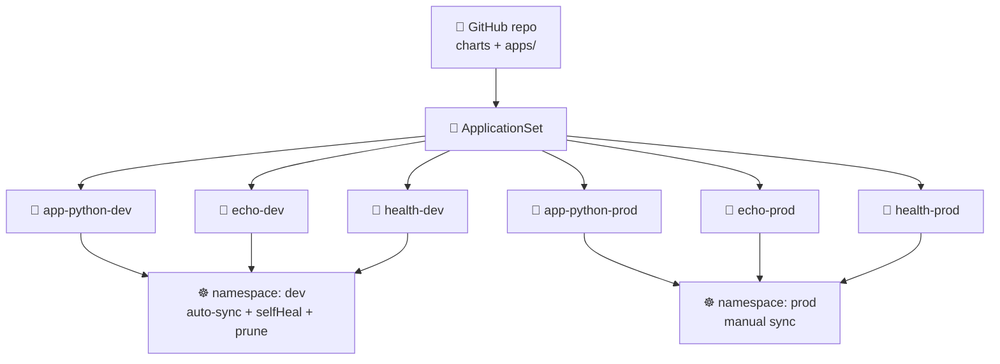

# Lab 13 — GitOps with ArgoCD

Лаба 13 — GitOps с ArgoCD


> **Goal:** Make Git the single source of truth for your cluster. Install **ArgoCD 3.4**, declare `Application` manifests for **three** services across **two** environments by hand, then collapse all six into one **ApplicationSet** that the cluster reconciles continuously.
> **Deliverable:** A PR from `lab13` with `k8s/argocd/` (apps + ApplicationSet + values) and `docs/LAB13.md`. No more `helm upgrade` from your laptop.
>
> **Цель:** сделать Git единственным источником истины для твоего кластера. Установить **ArgoCD 3.4**, вручную описать манифесты `Application` для **трёх** сервисов в **двух** окружениях, а затем свернуть все шесть в один **ApplicationSet**, который кластер непрерывно согласует.
> **Что сдать:** PR из ветки `lab13` с каталогом `k8s/argocd/` (apps + ApplicationSet + values) и файлом `docs/LAB13.md`. Больше никаких `helm upgrade` с ноутбука.

---

## Overview

Обзор

Through Lab 12 you deployed by typing `helm upgrade` from a laptop (or a CI runner). That is the **push** model: a human or pipeline reaches *into* the cluster with cluster-admin credentials. **GitOps** inverts this — an agent *inside* the cluster watches Git, pulls the desired state, and reconciles it continuously. The cluster reaches out to Git; nothing reaches in.

До лабы 12 включительно ты деплоил, набирая `helm upgrade` на ноутбуке (или в CI-раннере). Это **push**-модель: человек или пайплайн заходит *внутрь* кластера с правами cluster-admin. **GitOps** переворачивает схему: агент *внутри* кластера следит за Git, забирает желаемое состояние и непрерывно его согласует. Кластер сам обращается к Git — снаружи никто не заходит.

In this lab you will practice:

В этой лабе ты будешь практиковаться в следующем:

- Picking and **pinning an ArgoCD chart version whose `appVersion` is in the 3.4.x line** (no tutorial copy-paste — read the chart index)
  * Выборе и **фиксации версии чарта ArgoCD, у которой `appVersion` из линейки 3.4.x** (без копипаста из туториалов — читай индекс чарта)
- Writing an `Application` CRD from the bare shape — `source` / `destination` / `syncPolicy` in your own hand
  * Написании CRD `Application` с нуля — `source` / `destination` / `syncPolicy` своими руками
- Two sync disciplines: dev with `automated{prune,selfHeal}`, prod with manual sync — and writing down *why*
  * Двух подходах к синхронизации: dev с `automated{prune,selfHeal}`, prod с ручным синком — и объяснении, *почему* именно так
- Generating **six** Applications from one **ApplicationSet** Matrix(List, List) template — the pattern that only earns its keep at ≥ 3 apps
  * Генерации **шести** приложений из одного шаблона **ApplicationSet** Matrix(List, List) — паттерна, который оправдывает себя начиная с трёх приложений
- Proving the GitOps loop: delete a workload, ArgoCD recreates it; `kubectl edit` a Service, ArgoCD reverts it within 3 minutes
  * Проверке GitOps-цикла на практике: удали рабочую нагрузку — ArgoCD пересоздаст её; измени Service через `kubectl edit` — ArgoCD откатит правку в течение 3 минут

> ⚠️ **Scope:** no Argo Rollouts (that's Lab 14), no multi-cluster, no SSO/OIDC. Stick to one in-cluster ArgoCD managing one cluster. Pick a *different* bonus instead of installing more controllers.
>
> ⚠️ **Границы лабы:** без Argo Rollouts (это лаба 14), без мультикластера, без SSO/OIDC. Ограничься одним ArgoCD внутри кластера, управляющим одним кластером. Вместо установки новых контроллеров выбери *другой* бонус.

> ⚠️ **Version note:** ArgoCD **2.x is EOL** (the 3.2 release in November 2025 ended 2.x support). This lab uses **3.4**. If a tutorial you find online uses 2.x manifests, the `Application`/`ApplicationSet` CRDs are compatible, but cross-check against the 3.x docs linked at the end.
>
> ⚠️ **Про версии:** ArgoCD **2.x больше не поддерживается** (релиз 3.2 в ноябре 2025 года завершил поддержку 2.x). Эта лаба использует **3.4**. Если найденный в интернете туториал применяет манифесты 2.x, CRD `Application`/`ApplicationSet` совместимы, но сверяйся с документацией 3.x по ссылкам в конце.

---

## Project State

Состояние проекта

**You should have from previous labs:**

**У тебя должно быть из прошлых лаб:**

- A k3d cluster on Kubernetes **1.36** (Lab 9)
  * Кластер k3d на Kubernetes **1.36** (лаба 9)
- A Helm chart for `app-python` under `k8s/lab10-app/` with `values-dev.yaml` / `values-prod.yaml` (Lab 10) — Lab 13 will deploy this chart through ArgoCD instead of `helm upgrade`
  * Helm-чарт для `app-python` в каталоге `k8s/lab10-app/` с `values-dev.yaml` / `values-prod.yaml` (лаба 10) — в лабе 13 этот чарт будет деплоиться через ArgoCD вместо `helm upgrade`
- The **`echo`** plumbing service from Lab 9 (`ghcr.io/inno-devops-labs/echo:v1`, port 8081)
  * Сервис-обвязка **`echo`** из лабы 9 (`ghcr.io/inno-devops-labs/echo:v1`, порт 8081)

**This lab adds:**

**Эта лаба добавляет:**

- ArgoCD 3.4 installed via the `argo/argo-cd` Helm chart (in `argocd` namespace)
  * ArgoCD 3.4, установленный через Helm-чарт `argo/argo-cd` (в неймспейсе `argocd`)
- The **`health`** plumbing service — the **third** service in your topology, shipped in `plumbing/health/` (`ghcr.io/inno-devops-labs/health:v1`, port 8082)
  * Сервис-обвязку **`health`** — **третий** сервис в твоей топологии, лежит в `plumbing/health/` (`ghcr.io/inno-devops-labs/health:v1`, порт 8082)
- `k8s/argocd/apps/` — six hand-written `Application` manifests (Tasks 2–3), later replaced by one `ApplicationSet` (Task 4)
  * `k8s/argocd/apps/` — шесть написанных вручную манифестов `Application` (задачи 2–3), позже заменённых одним `ApplicationSet` (задача 4)
- `docs/LAB13.md` — your submission report
  * `docs/LAB13.md` — твой отчёт о сдаче

By Lab 14 the same six Applications get progressive-delivery `Rollout` CRDs in front of them, so the GitOps loop you build here is the substrate everything else runs on.

К лабе 14 перед теми же шестью приложениями появятся CRD `Rollout` для прогрессивной доставки, так что GitOps-цикл, который ты построишь здесь, станет основой, на которой держится всё остальное.

---

## The Three Services

Три сервиса

| Service | Origin | Image | Port | You build it? |
|---|---|---|---|---|
| 🐍 **app-python** | Your Lab 1 → Lab 12 service | from your CI | 8080 | ✅ Yes — your code |
| 🦫 **echo** | Course plumbing (Lab 9+) | `ghcr.io/inno-devops-labs/echo:v1` | 8081 | ❌ No — pre-built |
| 💚 **health** | Course plumbing — **new this lab** | `ghcr.io/inno-devops-labs/health:v1` | 8082 | ❌ No — pre-built |

| Сервис | Происхождение | Образ | Порт | Ты его собираешь? |
|---|---|---|---|---|
| 🐍 **app-python** | Твой сервис из лаб 1 → 12 | из твоего CI | 8080 | ✅ Да — твой код |
| 🦫 **echo** | Обвязка курса (лаба 9+) | `ghcr.io/inno-devops-labs/echo:v1` | 8081 | ❌ Нет — готовый образ |
| 💚 **health** | Обвязка курса — **новый в этой лабе** | `ghcr.io/inno-devops-labs/health:v1` | 8082 | ❌ Нет — готовый образ |

`health` is shipped in `plumbing/health/` (see `plumbing/health/README.md`). Reference the published image directly — **do not** `docker build` it. It exposes `GET /`, `GET /healthz`, and `GET /metrics`. Its only purpose in this lab is to be a third deployment target so `ApplicationSet` stops being a toy pattern.

`health` лежит в `plumbing/health/` (см. `plumbing/health/README.md`). Ссылайся сразу на опубликованный образ — **не** собирай его через `docker build`. Он отдаёт `GET /`, `GET /healthz` и `GET /metrics`. Его единственная задача в этой лабе — быть третьей целью деплоя, чтобы `ApplicationSet` перестал выглядеть игрушечным паттерном.



Схема: репозиторий GitHub (чарты + apps/) → корневой ApplicationSet → шесть приложений (app-python, echo и health в dev и prod); dev-приложения попадают в неймспейс dev с автосинком, selfHeal и prune, а prod-приложения — в неймспейс prod с ручным синком.

---

## Setup

Подготовка

Confirm prereqs from prior labs are alive: `kubectl get nodes` (3 Ready nodes on v1.36.x from Lab 9) and `helm version` (4.1.x from Lab 10). Then add the Argo chart repo — `helm repo add argo https://argoproj.github.io/argo-helm && helm repo update`. You'll search it in Task 1.

Убедись, что всё нужное из прошлых лаб на месте: `kubectl get nodes` (3 узла в состоянии Ready на v1.36.x из лабы 9) и `helm version` (4.1.x из лабы 10). Затем добавь репозиторий чартов Argo — `helm repo add argo https://argoproj.github.io/argo-helm && helm repo update`. В задаче 1 ты будешь в нём искать.

Directory layout you will produce — `k8s/argocd/install/argocd-values.yaml` (Task 1), six Application manifests under `k8s/argocd/apps/` (Tasks 2 & 3 — `{app-python,echo,health}-{dev,prod}.yaml`), and `k8s/argocd/applicationset.yaml` (Task 4, which deletes the six). Your write-up goes in `docs/LAB13.md`. Plumbing files (`plumbing/health/Dockerfile`, `main.go`, …) you do **not** edit — they are given, complete.

Структура каталогов, которую ты создашь: `k8s/argocd/install/argocd-values.yaml` (задача 1), шесть манифестов Application в `k8s/argocd/apps/` (задачи 2 и 3 — `{app-python,echo,health}-{dev,prod}.yaml`) и `k8s/argocd/applicationset.yaml` (задача 4, после которого эти шесть удаляются). Отчёт пишешь в `docs/LAB13.md`. Файлы обвязки (`plumbing/health/Dockerfile`, `main.go`, …) ты **не** редактируешь — они уже готовы и полные.

---

## Task 1 — Install ArgoCD 3.4 (2 pts)

Задача 1 — Установка ArgoCD 3.4 (2 балла)

### 1.1 — Find a chart version with `appVersion` in 3.4.x

1.1 — Найди версию чарта с `appVersion` в 3.4.x

`YOUR TASK`: the `argo/argo-cd` Helm chart and the ArgoCD application itself version independently. Pick a **chart** version whose **`appVersion`** falls inside **3.4.x** (2.x is EOL — you will lose this point if your server reports 2.x or a 3.3.x preview).

`ТВОЯ ЗАДАЧА`: Helm-чарт `argo/argo-cd` и само приложение ArgoCD версионируются независимо. Выбери версию **чарта**, у которой **`appVersion`** входит в **3.4.x** (2.x больше не поддерживается — балл не начислят, если сервер сообщает 2.x или превью 3.3.x).

Hint: `helm search repo argo/argo-cd --versions` lists `CHART VERSION` and `APP VERSION` side by side. Read the table; pick the most recent stable row with `APP VERSION` starting `3.4.`.

Подсказка: команда `helm search repo argo/argo-cd --versions` показывает `CHART VERSION` и `APP VERSION` рядом. Прочитай таблицу и выбери самую свежую стабильную строку, где `APP VERSION` начинается с `3.4.`.

In `docs/LAB13.md`, write the **two** version numbers you chose and a sentence explaining how chart-version and appVersion differ.

В `docs/LAB13.md` запиши **два** выбранных номера версий и одно предложение о том, чем версия чарта отличается от appVersion.

### 1.2 — Install via Helm, with a pinned values file

1.2 — Установка через Helm с зафиксированным values-файлом

`YOUR TASK`: create **`k8s/argocd/install/argocd-values.yaml`** with the *minimum* overrides for a k3d-friendly install. Don't blindly upstream-default. At a minimum, decide and configure:

ТВОЯ ЗАДАЧА: создай **`k8s/argocd/install/argocd-values.yaml`** с *минимальным* набором переопределений для установки, дружественной к k3d. Не бери слепо дефолты из upstream. Как минимум реши и настрой:

- whether `server.service.type` should be `ClusterIP` (you'll `kubectl port-forward`) or `LoadBalancer` (k3d's klipper publishes it) — pick one and justify in the report
  * каким должен быть `server.service.type` — `ClusterIP` (тогда будешь делать `kubectl port-forward`) или `LoadBalancer` (k3d-шный klipper его публикует); выбери одно и обоснуй в отчёте
- `configs.params."server.insecure"` — true is fine for the lab (you'll terminate TLS at port-forward); document the tradeoff
  * `configs.params."server.insecure"` — для лабы `true` подойдёт (TLS ты завершаешь на port-forward); опиши компромисс
- a `resources:` block for at least `controller` and `repoServer` that fits inside k3d's two-agent budget
  * блок `resources:` хотя бы для `controller` и `repoServer`, укладывающийся в ресурсный бюджет k3d с двумя агентами

Then install — fill in the chart version you picked:

Затем установи — подставь выбранную версию чарта:

```bash
# YOUR TASK below:
#   --version: the chart version you picked in 1.1
#   --values:  path to your overrides file (e.g. k8s/argocd/install/argocd-values.yaml)
kubectl create namespace argocd
helm install argocd argo/argo-cd \
  --namespace argocd \
  --version YOUR-TASK \
  --values YOUR-TASK
# wait for the server with `kubectl rollout status deploy/argocd-server -n argocd --timeout=180s`
```

Пояснение: первая команда создаёт неймспейс `argocd`, вторая ставит чарт `argo/argo-cd` с зафиксированными версией и values-файлом; в комментарии ниже — как дождаться готовности сервера.

`k8s/argocd/install/argocd-values.yaml` skeleton — write the inside yourself:

Каркас `k8s/argocd/install/argocd-values.yaml` — внутренности напиши сам:

```yaml
# k8s/argocd/install/argocd-values.yaml
# Overrides for the argo/argo-cd chart on a k3d cluster.
# Leave defaults for anything you don't have a reason to change.

server:
  service:
    type: YOUR-TASK            # ClusterIP or LoadBalancer — your call, document why
  # YOUR-TASK: any other server overrides (e.g. resource requests/limits)

configs:
  params:
    server.insecure: "YOUR-TASK"   # "true" if you want plain HTTP over port-forward

controller:
  resources:
    requests:
      cpu: YOUR-TASK
      memory: YOUR-TASK
    limits:
      cpu: YOUR-TASK
      memory: YOUR-TASK

repoServer:
  resources:
    requests:
      cpu: YOUR-TASK
      memory: YOUR-TASK
```

Пояснение: это каркас values-файла для чарта `argo/argo-cd`; вместо `YOUR-TASK` подставь свои значения, а всё, что менять не нужно, оставь по умолчанию.

### 1.3 — Access UI + install matching CLI

1.3 — Доступ к UI и установка подходящего CLI

`YOUR TASK`: port-forward `svc/argocd-server` to your laptop, retrieve the initial admin password from the `argocd-initial-admin-secret` Secret in the `argocd` namespace (it's base64-encoded in `.data.password`), install the matching **3.4.x** CLI binary, and log in. The CLI's `argocd version` must report **both** `argocd: v3.4.x` (client) **and** `argocd-server: v3.4.x` (server).

ТВОЯ ЗАДАЧА: сделай port-forward `svc/argocd-server` на свой ноутбук, достань начальный пароль администратора из Secret `argocd-initial-admin-secret` в неймспейсе `argocd` (в `.data.password` он закодирован в base64), установи подходящий бинарник CLI **3.4.x** и войди. Команда `argocd version` должна показать **и** `argocd: v3.4.x` (клиент), **и** `argocd-server: v3.4.x` (сервер).

Hint: the password lives in a Secret — `kubectl get secret -n argocd` lists what's there. Don't copy the base64; decode it.

Подсказка: пароль лежит в Secret — `kubectl get secret -n argocd` покажет, что там есть. Не копируй base64 — декодируй его.

### 1.4 — Proof of work

1.4 — Подтверждение работы

**Paste into `docs/LAB13.md`:**

**Вставь в `docs/LAB13.md`:**

- `helm search repo argo/argo-cd --versions | head -5` — your chosen row highlighted
  * `helm search repo argo/argo-cd --versions | head -5` — выбранная строка выделена
- `kubectl get pods -n argocd -o wide` — all core pods Running (expect ≥ 6: `argocd-server`, `argocd-application-controller`, `argocd-applicationset-controller`, `argocd-repo-server`, `argocd-redis`, `argocd-notifications-controller`; `dex-server` only if you enabled it)
  * `kubectl get pods -n argocd -o wide` — все ключевые поды в Running (ожидай ≥ 6: `argocd-server`, `argocd-application-controller`, `argocd-applicationset-controller`, `argocd-repo-server`, `argocd-redis`, `argocd-notifications-controller`; `dex-server` — только если ты его включил)
- `argocd version` — client + server both **3.4.x**
  * `argocd version` — и клиент, и сервер **3.4.x**
- The full contents of `k8s/argocd/install/argocd-values.yaml`
  * Полное содержимое `k8s/argocd/install/argocd-values.yaml`
- One sentence on your `server.service.type` choice + one sentence on `server.insecure`
  * Одно предложение о выборе `server.service.type` + одно о `server.insecure`

---

## Task 2 — Application CRDs for Three Services (3 pts)

Задача 2 — CRD Application для трёх сервисов (3 балла)

### 2.1 — Lay out the GitOps repo path

2.1 — Разложи структуру GitOps-репозитория

`YOUR TASK`: under `k8s/argocd/apps/`, you will produce **six** `Application` manifests in Tasks 2 and 3 (3 services × 2 envs). For now, start with the three **dev** Applications. In `docs/LAB13.md`, include a one-paragraph note explaining: which **chart** each Application references (Lab 10 chart for `app-python`; small charts you write for `echo` and `health` that just deploy the pre-built images + a Service).

ТВОЯ ЗАДАЧА: в `k8s/argocd/apps/` ты сделаешь **шесть** манифестов `Application` в задачах 2 и 3 (3 сервиса × 2 окружения). Пока начни с трёх **dev**-приложений. В `docs/LAB13.md` добавь абзац с пояснением, какой **чарт** использует каждое приложение (чарт из лабы 10 для `app-python`; маленькие чарты, которые ты напишешь для `echo` и `health`, просто разворачивающие готовые образы и Service).

> Tip: the simplest `echo`/`health` chart is a `Chart.yaml` + `templates/deployment.yaml` + `templates/service.yaml` — three files each. The image must be `ghcr.io/inno-devops-labs/echo:v1` and `ghcr.io/inno-devops-labs/health:v1`. Do **not** rebuild them.
>
> Совет: простейший чарт для `echo`/`health` — это `Chart.yaml` + `templates/deployment.yaml` + `templates/service.yaml`, три файла на каждый. Образы должны быть `ghcr.io/inno-devops-labs/echo:v1` и `ghcr.io/inno-devops-labs/health:v1`. **Не** пересобирай их.

### 2.2 — Write three `Application` CRDs by hand (dev environment)

2.2 — Напиши три CRD `Application` вручную (окружение dev)

`YOUR TASK`: write `app-python-dev.yaml`, `echo-dev.yaml`, `health-dev.yaml` in `k8s/argocd/apps/`. The shape is shown; **every** value is yours to choose. For now start with **manual sync** (no `automated:` block) — you will turn it on in Task 3.

ТВОЯ ЗАДАЧА: напиши `app-python-dev.yaml`, `echo-dev.yaml`, `health-dev.yaml` в `k8s/argocd/apps/`. Форма показана, а **каждое** значение выбираешь ты. Пока начни с **ручной синхронизации** (без блока `automated:`) — включишь её в задаче 3.

```yaml
# k8s/argocd/apps/app-python-dev.yaml   (echo-dev.yaml and health-dev.yaml are analogous)
apiVersion: argoproj.io/v1alpha1
kind: Application
metadata:
  name: YOUR-TASK                # e.g. app-python-dev — the controller indexes by this
  namespace: argocd              # ArgoCD watches Applications in its OWN namespace
  finalizers:
    - YOUR-TASK                  # the resources-finalizer that cascade-deletes K8s
                                 # resources on `kubectl delete app`. Look it up.
spec:
  project: default
  source:
    repoURL: YOUR-TASK           # https://github.com/<you>/<your-fork>.git
    targetRevision: YOUR-TASK    # branch (dev) or tag/SHA (prod) — pick one, explain in report
    path: YOUR-TASK              # e.g. k8s/lab10-app for app-python; k8s/charts/echo for echo
    helm:                        # if your chart takes values, declare them here
      valueFiles:
        - YOUR-TASK               # e.g. values-dev.yaml
  destination:
    server: https://kubernetes.default.svc       # in-cluster API server
    namespace: YOUR-TASK         # the K8s namespace the WORKLOAD lands in (e.g. dev)
  syncPolicy:
    # NO `automated:` block YET — Task 3 turns it on for dev only.
    syncOptions:
      - YOUR-TASK                # the option that auto-creates the destination namespace
```

Пояснение: каркас одного `Application` — источник (репозиторий, ревизия, путь к чарту и values) и назначение (кластер и неймспейс для рабочей нагрузки); вместо `YOUR-TASK` подставь свои значения.

Things to figure out as you write these:

Что нужно понять, пока пишешь эти манифесты:

- `metadata.name` lives in `argocd` namespace but `spec.destination.namespace` is where the **workload** goes — these are two different namespaces. Do not conflate them.
  * `metadata.name` живёт в неймспейсе `argocd`, а `spec.destination.namespace` — это место, куда попадает **рабочая нагрузка**; это два разных неймспейса. Не путай их.
- `repoURL` must be the **GitOps repo** (your fork), reachable from the cluster. For HTTPS public repos no credential is needed; for private repos you'd register an `argocd-repo-creds` Secret (out of scope, but worth a sentence in the report).
  * `repoURL` должен указывать на **GitOps-репозиторий** (твой форк), доступный из кластера. Для публичных HTTPS-репозиториев учётные данные не нужны; для приватных пришлось бы регистрировать Secret `argocd-repo-creds` (это вне рамок лабы, но стоит упомянуть одним предложением в отчёте).
- The `finalizers:` block is **load-bearing**. Without it, `kubectl delete app` leaves the Deployment/Service running in the workload namespace. Try it both ways if you want to see the difference.
  * Блок `finalizers:` — **несущая конструкция**. Без него `kubectl delete app` оставит Deployment/Service работать в неймспейсе рабочей нагрузки. Попробуй оба варианта, если хочешь увидеть разницу.

### 2.3 — Deploy and trigger the first sync manually

2.3 — Задеплой и запусти первую синхронизацию вручную

Apply the three Application CRs (`kubectl apply -f k8s/argocd/apps/`) and confirm they appear in `argocd app list` as **OutOfSync** (no `automated:` block yet means the CRs exist but nothing has been reconciled). Then trigger each one with `argocd app sync <name>` — this is the manual sync click-equivalent. Confirm each reaches **`Synced / Healthy`** with `kubectl get app -n argocd -o wide`.

Примени три CR Application (`kubectl apply -f k8s/argocd/apps/`) и убедись, что они видны в `argocd app list` как **OutOfSync** (блока `automated:` пока нет, значит CR существуют, но ничего ещё не согласовано). Затем запусти каждое через `argocd app sync <name>` — это эквивалент нажатия кнопки ручной синхронизации. Убедись через `kubectl get app -n argocd -o wide`, что каждое дошло до **`Synced / Healthy`**.

### 2.4 — Prove the GitOps loop

2.4 — Докажи работу GitOps-цикла

`YOUR TASK`: change something cheap in Git (e.g. `replicaCount: 1` → `2` in your `app-python` chart's `values.yaml`), commit, push. Then **without running any `kubectl apply` or `helm upgrade`**, watch ArgoCD:

ТВОЯ ЗАДАЧА: поменяй что-нибудь несложное в Git (например, `replicaCount: 1` → `2` в `values.yaml` чарта `app-python`), закоммить и запушь. Затем, **не запуская никаких `kubectl apply` и `helm upgrade`**, наблюдай за ArgoCD:

1. Mark the Application **OutOfSync** within ~3 min (default reconcile interval), or sooner if you click **REFRESH** in the UI
   * Приложение помечается **OutOfSync** примерно за 3 минуты (интервал согласования по умолчанию) или быстрее, если нажать **REFRESH** в UI
2. Apply the change (manual sync) and return to **Synced / Healthy**
   * Изменение применяется (ручной синк), и статус возвращается к **Synced / Healthy**

This is the headline of GitOps — Git changed, the cluster followed. No human reached into the cluster.

Это главная идея GitOps: Git изменился — кластер за ним последовал. Ни один человек не заходил в кластер.

### 2.5 — Proof of work

2.5 — Подтверждение работы

**Paste into `docs/LAB13.md`:**

**Вставь в `docs/LAB13.md`:**

- The contents of the three Application manifests
  * Содержимое трёх манифестов Application
- `kubectl get app -n argocd -o wide` — three rows, **Synced / Healthy**
  * `kubectl get app -n argocd -o wide` — три строки, **Synced / Healthy**
- `kubectl get deploy,svc -n dev` — six resources (one Deployment + one Service per service) that you **never** `kubectl apply`'d by hand
  * `kubectl get deploy,svc -n dev` — шесть ресурсов (по одному Deployment и одному Service на сервис), которые ты **никогда** не применял вручную через `kubectl apply`
- The git commit SHA of your "GitOps loop" change + a screenshot or `argocd app history app-python-dev` showing the sync after that commit
  * SHA git-коммита с изменением для «GitOps-цикла» + скриншот или `argocd app history app-python-dev`, показывающий синк после этого коммита

---

## Task 3 — Multi-Environment: dev (auto) vs prod (manual) (3 pts)

Задача 3 — Несколько окружений: dev (авто) и prod (вручную) (3 балла)

### 3.1 — Two namespaces, two value sets

3.1 — Два неймспейса, два набора values

`YOUR TASK`: provide `values-dev.yaml` and `values-prod.yaml` for **each** chart (your `app-python` chart already has them from Lab 10; you need to add equivalents for the `echo` and `health` mini-charts you wrote in Task 2). They must differ **meaningfully** — at minimum two of: replica count, resource requests/limits, image tag pin, service type. Document the table in `docs/LAB13.md`.

ТВОЯ ЗАДАЧА: подготовь `values-dev.yaml` и `values-prod.yaml` для **каждого** чарта (у чарта `app-python` они уже есть с лабы 10; нужно добавить аналоги для мини-чартов `echo` и `health`, написанных в задаче 2). Они должны отличаться **по существу** — как минимум по двум из следующих параметров: количество реплик, requests/limits ресурсов, фиксация тега образа, тип сервиса. Оформи таблицу в `docs/LAB13.md`.

### 3.2 — Convert dev to auto-sync, add three prod Applications

3.2 — Переведи dev на автосинк и добавь три prod-приложения

`YOUR TASK`: edit your three dev Applications to add an `automated:` block, and **write three new** prod Applications (`app-python-prod.yaml`, `echo-prod.yaml`, `health-prod.yaml`) that target the `prod` namespace **without** an `automated:` block.

ТВОЯ ЗАДАЧА: отредактируй три dev-приложения, добавив блок `automated:`, и **напиши три новых** prod-приложения (`app-python-prod.yaml`, `echo-prod.yaml`, `health-prod.yaml`), которые смотрят в неймспейс `prod` **без** блока `automated:`.

**Dev sync policy — `YOUR-TASK` to fill:**

**Политика синхронизации dev — заполни `YOUR-TASK`:**

```yaml
syncPolicy:
  automated:
    prune: YOUR-TASK              # delete cluster resources removed from Git?
    selfHeal: YOUR-TASK           # revert manual cluster edits back to Git state?
    allowEmpty: YOUR-TASK         # apply when render produces zero manifests? (read the docs)
  syncOptions:
    - CreateNamespace=true
    - YOUR-TASK                    # the option that uses K8s server-side apply
                                   # — required for clean HPA/VPA coexistence
```

Пояснение: блок `automated` включает автосинк — `prune` удаляет из кластера ресурсы, убранные из Git, а `selfHeal` откатывает ручные правки кластера к состоянию Git.

**Prod sync policy — `YOUR-TASK` to fill:**

**Политика синхронизации prod — заполни `YOUR-TASK`:**

```yaml
spec:
  source:
    repoURL: YOUR-TASK
    targetRevision: YOUR-TASK     # a TAG or release/* branch — NOT `main`. Why? See 3.3.
    path: YOUR-TASK
    helm:
      valueFiles:
        - YOUR-TASK                # e.g. values-prod.yaml
  destination:
    namespace: YOUR-TASK           # prod
  syncPolicy:
    # NO `automated:` block — prod is manual. A human clicks SYNC or runs `argocd app sync`.
    syncOptions:
      - YOUR-TASK
```

Пояснение: в prod-приложении блока `automated` нет — синхронизацию запускает человек; `targetRevision` указывает на тег или ветку `release/*`, а не на `main`.

### 3.3 — Explain the operational tradeoff

3.3 — Объясни операционный компромисс

In `docs/LAB13.md`, write 4–6 sentences answering:

В `docs/LAB13.md` напиши 4–6 предложений, отвечающих на вопросы:

- Why is `prune: true` + `selfHeal: true` reasonable for **dev** but dangerous for **prod**?
  * Почему `prune: true` + `selfHeal: true` разумны для **dev**, но опасны для **prod**?
- Why does `targetRevision: main` on a prod Application defeat the point of a release process?
  * Почему `targetRevision: main` в prod-приложении обесценивает сам смысл процесса релизов?
- What is the failure mode if you turn `prune: true` on with a wrong `path:` — and what's your mitigation?
  * Каков сценарий отказа, если включить `prune: true` с неверным `path:`, и как это смягчить?

This is the actual learning — the YAML is mechanical; the *policy choice* is the skill.

В этом и состоит суть обучения: YAML — механика, а навык — это *выбор политики*.

### 3.4 — Verify both environments and trigger prod manually

3.4 — Проверь оба окружения и запусти prod вручную

Apply the six Applications. Dev should auto-sync within ~3 min (or immediately if you click REFRESH); prod stays **OutOfSync** until you run `argocd app sync app-python-prod` / `echo-prod` / `health-prod` by hand. Confirm with `kubectl get app -n argocd -o wide`, then compare `kubectl get pods -n dev` vs `kubectl get pods -n prod` — replica counts (and any other deltas you put in your values files) should differ.

Примени шесть приложений. Dev должен синхронизироваться автоматически примерно за 3 минуты (или сразу, если нажать REFRESH); prod останется **OutOfSync**, пока ты вручную не выполнишь `argocd app sync app-python-prod` / `echo-prod` / `health-prod`. Проверь через `kubectl get app -n argocd -o wide`, затем сравни `kubectl get pods -n dev` и `kubectl get pods -n prod` — количество реплик (и любые другие различия из твоих values-файлов) должно отличаться.

### 3.5 — Proof of work

3.5 — Подтверждение работы

**Paste into `docs/LAB13.md`:**

**Вставь в `docs/LAB13.md`:**

- The dev-vs-prod values table (replicas, resources, image tag pin, anything else)
  * Таблицу сравнения values для dev и prod (реплики, ресурсы, фиксация тега образа, что угодно ещё)
- All six Application manifests
  * Все шесть манифестов Application
- `kubectl get app -n argocd -o wide` — six rows, every one **Synced / Healthy**
  * `kubectl get app -n argocd -o wide` — шесть строк, каждая **Synced / Healthy**
- The 4–6 sentence operational-tradeoff write-up
  * Разбор операционного компромисса на 4–6 предложений

---

## Task 4 — ApplicationSet (the headline of the 3rd-service intro) (2 pts)

Задача 4 — ApplicationSet (главная тема, ради которой вводится третий сервис) (2 балла)

### 4.1 — Why one template for six apps

4.1 — Зачем один шаблон на шесть приложений

With **three** services × **two** environments, the six hand-written Applications you just wrote share ~95% of their YAML — only `name`, `path`, and `namespace` vary. Adding a fourth service today means writing two new files and remembering to keep them in lock-step with the existing six. That's the pain `ApplicationSet` solves: one template + a **generator** that enumerates the combinations.

При **трёх** сервисах × **двух** окружениях шесть написанных вручную приложений совпадают по YAML примерно на 95% — различаются только `name`, `path` и `namespace`. Добавить сегодня четвёртый сервис означает написать два новых файла и не забыть держать их в синхроне с шестью существующими. Именно эту боль решает `ApplicationSet`: один шаблон + **генератор**, перебирающий комбинации.

A single List generator over six elements would work but loses the structure (services and envs are conceptually independent). The right shape is a **Matrix(List services, List envs)** — cross-join of two small lists. Add a fourth service? One line in the services list. Add a third env (staging)? One line in the envs list.

Один List-генератор из шести элементов сработал бы, но теряет структуру (сервисы и окружения концептуально независимы). Правильная форма — **Matrix(List services, List envs)**: декартово произведение двух небольших списков. Нужен четвёртый сервис? Одна строка в списке сервисов. Нужно третье окружение (staging)? Одна строка в списке окружений.

> 💡 This is **the** pedagogical reason the lab introduces a third service. With one or two services, ApplicationSet is `kubectl apply` with extra steps. With six generated Applications, the value is obvious. Less than 3 = toy; 3 = real.
>
> 💡 Именно в этом **главная** методическая причина, зачем в лабе появляется третий сервис. С одним-двумя сервисами ApplicationSet — это `kubectl apply` с лишними шагами. С шестью сгенерированными приложениями ценность очевидна. Меньше трёх — игрушка; три — уже всерьёз.

### 4.2 — Write the ApplicationSet

4.2 — Напиши ApplicationSet

`YOUR TASK`: write `k8s/argocd/applicationset.yaml` that generates all six Applications. The kind, the outer `spec.generators` shape, and the destination server are shown; the **matrix body, the list elements, and every `{{...}}` placeholder reference inside the template are yours**.

ТВОЯ ЗАДАЧА: напиши `k8s/argocd/applicationset.yaml`, который генерирует все шесть приложений. Kind, внешняя форма `spec.generators` и сервер назначения уже показаны; **тело matrix, элементы списков и все ссылки на плейсхолдеры `{{...}}` внутри шаблона — за тобой**.

```yaml
# k8s/argocd/applicationset.yaml
apiVersion: argoproj.io/v1alpha1
kind: ApplicationSet
metadata:
  name: all-apps
  namespace: argocd
spec:
  # goTemplate: true enables {{- if eq ... }} / | default — needed if you want
  # per-env sync policy in ONE ApplicationSet. Default is fasttemplate (no logic).
  goTemplate: YOUR-TASK                # true or false — your call, document it
  generators:
    - matrix:
        generators:
          - list:
              elements:
                # YOUR-TASK: three rows, one per service. Each row needs at least:
                #   svc:  short name  (e.g. app-python)
                #   path: chart path in the repo (e.g. k8s/lab10-app)
                - YOUR-TASK
                - YOUR-TASK
                - YOUR-TASK
          - list:
              elements:
                # YOUR-TASK: two rows, one per env. Each row needs at least:
                #   env:      dev or prod
                #   autoSync: "true" / "false"  (you'll branch on this in the template)
                - YOUR-TASK
                - YOUR-TASK
  template:
    metadata:
      name: YOUR-TASK                  # use both generator values, e.g. {{.svc}}-{{.env}}
      finalizers:
        - resources-finalizer.argocd.argoproj.io
    spec:
      project: default
      source:
        repoURL: YOUR-TASK             # your fork URL
        targetRevision: YOUR-TASK      # branch for dev, tag for prod — see hint below
        path: YOUR-TASK                # reference the path from the services list
        helm:
          valueFiles:
            - YOUR-TASK                # e.g. values-{{.env}}.yaml
      destination:
        server: https://kubernetes.default.svc
        namespace: YOUR-TASK           # reference the env value
      syncPolicy:
        # YOUR-TASK: ApplicationSet has no `if` in fasttemplate mode. Pick ONE:
        #   (a) goTemplate: true above, then {{- if eq .autoSync "true" }}automated: {...}{{- end }}
        #   (b) leave fasttemplate, write TWO ApplicationSets (one with `automated:`, one without)
        #       and put the env list in each — three services per ApplicationSet.
        # Whichever you pick, EXPLAIN it in docs/LAB13.md.
        syncOptions:
          - CreateNamespace=true
          - ServerSideApply=true
```

Пояснение: один `ApplicationSet` с Matrix(List, List) перебирает все сочетания сервисов и окружений, а `goTemplate: true` включает Go-шаблоны, чтобы в одном шаблоне ветвиться по окружению.

Pitfalls you must navigate while writing this (these are the actual gotchas — see Common Pitfalls at the bottom):

Подводные камни, которые надо обойти при написании (это и есть настоящие грабли — см. «Частые ошибки» в конце):

- **fasttemplate vs goTemplate.** The default templating engine (fasttemplate) is dumb string-substitution — `{{ values.foo | default "bar" }}` will break. Set `goTemplate: true` if you want pipes / `if` / `default`. The placeholder syntax also flips: `{{svc}}` → `{{.svc}}`.
  * **fasttemplate vs goTemplate.** Шаблонизатор по умолчанию (fasttemplate) — это тупая подстановка строк, и `{{ values.foo | default "bar" }}` сломается. Установи `goTemplate: true`, если нужны пайпы, `if` и `default`. Синтаксис плейсхолдеров тоже меняется: `{{svc}}` → `{{.svc}}`.
- **Per-env sync policy.** ArgoCD does not have an inline `if` in fasttemplate mode. You either flip on `goTemplate: true` (Go template `if`) or write **two** ApplicationSets. The hint above shows both — pick one.
  * **Своя политика синка для каждого окружения.** В режиме fasttemplate у ArgoCD нет inline-`if`. Либо включаешь `goTemplate: true` (и используешь `if` из Go-шаблонов), либо пишешь **два** ApplicationSet. Подсказка выше показывает оба варианта — выбери один.
- **`targetRevision` per env.** If you use a Matrix List for envs, every Application gets the **same** `targetRevision` unless you put it in the env list element itself. Adding `targetRevision: main` for dev and `targetRevision: v1.0.0` for prod into the env-list rows is the cleanest fix.
  * **`targetRevision` для каждого окружения.** Если используешь Matrix List для окружений, каждое приложение получит **одинаковый** `targetRevision`, если не задать его прямо в элементе списка окружений. Чище всего добавить `targetRevision: main` для dev и `targetRevision: v1.0.0` для prod прямо в строки списка окружений.

### 4.3 — Replace the six hand-written manifests

4.3 — Замени шесть рукописных манифестов

Once the ApplicationSet generates Applications whose names match the ones from Task 2/3 (`app-python-dev`, `echo-dev`, `health-dev`, `app-python-prod`, `echo-prod`, `health-prod`), `kubectl apply -f k8s/argocd/applicationset.yaml`, confirm with `kubectl get applications -n argocd` that exactly six show up, then **`git rm`** the six standalone files from `k8s/argocd/apps/` in the same PR.

Когда ApplicationSet сгенерирует приложения с теми же именами, что в задачах 2–3 (`app-python-dev`, `echo-dev`, `health-dev`, `app-python-prod`, `echo-prod`, `health-prod`), выполни `kubectl apply -f k8s/argocd/applicationset.yaml`, убедись через `kubectl get applications -n argocd`, что их ровно шесть, и в том же PR сделай **`git rm`** шести отдельных файлов из `k8s/argocd/apps/`.

If a standalone Application has the same name as a generated one, ArgoCD will refuse to take ownership — `kubectl delete app <name> -n argocd` first, then re-apply the ApplicationSet.

Если отдельное Application совпадает по имени со сгенерированным, ArgoCD откажется брать его под своё управление — сначала выполни `kubectl delete app <name> -n argocd`, затем снова примени ApplicationSet.

### 4.4 — Prove the GitOps reconcile loop (selfHeal)

4.4 — Докажи цикл согласования GitOps (selfHeal)

`YOUR TASK`: trigger ArgoCD self-healing in **dev** and capture the evidence. Two scenarios:

ТВОЯ ЗАДАЧА: запусти самовосстановление ArgoCD в **dev** и зафиксируй доказательства. Два сценария:

1. **Delete a workload** — select by label, not name (the rendered Deployment name is helper-dependent — for `app-python` with release `app-python-dev` and chart `lab10-app`, the canonical helper renders `app-python-dev-lab10-app-web`, not `app-python-dev`):
   * **Удали рабочую нагрузку** — выбирай по лейблу, а не по имени (имя отрендеренного Deployment зависит от хелпера: для `app-python` с релизом `app-python-dev` и чартом `lab10-app` канонический хелпер даёт `app-python-dev-lab10-app-web`, а не `app-python-dev`):

   ```bash
   kubectl delete deploy -l app.kubernetes.io/instance=app-python-dev -n dev
   ```
   With `selfHeal: true`, ArgoCD recreates the Deployment within the next reconcile cycle (default 3 min; click REFRESH in the UI to do it sooner). This is **ArgoCD self-healing** (config drift → revert), distinct from Kubernetes self-healing (a deleted Pod gets recreated by its ReplicaSet).

   При `selfHeal: true` ArgoCD пересоздаст Deployment на следующем цикле согласования (по умолчанию 3 минуты; нажми REFRESH в UI, чтобы быстрее). Это **самовосстановление ArgoCD** (дрейф конфигурации → откат), отличное от самовосстановления Kubernetes (удалённый Pod пересоздаёт его ReplicaSet).

2. **Drift a label** — `kubectl label deploy -l app.kubernetes.io/instance=echo-dev -n dev owner=me --overwrite`. Watch the diff in the UI and the revert.
   * **Вызови дрейф лейбла** — `kubectl label deploy -l app.kubernetes.io/instance=echo-dev -n dev owner=me --overwrite`. Смотри diff в UI и откат.

In `docs/LAB13.md`, explain the difference between Kubernetes self-healing (ReplicaSet → Pod) and ArgoCD self-healing (Git → cluster state). They operate at different layers; selfHeal would not save you from a CrashLoopBackOff.

В `docs/LAB13.md` объясни разницу между самовосстановлением Kubernetes (ReplicaSet → Pod) и самовосстановлением ArgoCD (Git → состояние кластера). Они работают на разных уровнях; selfHeal не спасёт от CrashLoopBackOff.

### 4.5 — Proof of work

4.5 — Подтверждение работы

**Paste into `docs/LAB13.md`:**

**Вставь в `docs/LAB13.md`:**

- The full `applicationset.yaml` contents
  * Полное содержимое `applicationset.yaml`
- A note on which path you took (goTemplate or two ApplicationSets) and why
  * Пояснение, какой путь ты выбрал (goTemplate или два ApplicationSet) и почему
- `kubectl get app -n argocd -o wide` — **six** rows generated by `all-apps`, every one **Synced / Healthy**, all six pulled from Git with no manual `kubectl apply` of the workload
  * `kubectl get app -n argocd -o wide` — **шесть** строк, сгенерированных `all-apps`, каждая **Synced / Healthy**, все шесть взяты из Git без ручного `kubectl apply` для рабочей нагрузки
- The two self-heal captures (delete + label drift) with timestamps showing the revert
  * Два доказательства selfHeal (удаление + дрейф лейбла) с отметками времени, показывающими откат
- One sentence on the K8s-vs-ArgoCD self-healing distinction
  * Одно предложение о различии самовосстановления в K8s и ArgoCD

---

## Bonus Task — Pick ONE Day-2 Capability (2 pts)

Бонусная задача — выбери ОДНУ Day-2-возможность (2 балла)

`YOUR TASK`: pick **one** of the three problem statements below and ship it. Less hand-holding than the main tasks — you choose the design.

ТВОЯ ЗАДАЧА: выбери **одну** из трёх задач ниже и доведи её до конца. Здесь меньше подсказок, чем в основных задачах, — дизайн выбираешь ты сам.

### Option A — ArgoCD Notifications on sync failure

Вариант A — уведомления ArgoCD при ошибке синка

Wire the **argocd-notifications-controller** (it's already in your install from Task 1) to fire a webhook when an Application's sync fails or its health degrades. The minimum bar: configure a trigger + template + a webhook delivery service (request-bin works offline) in `argocd-notifications-cm`, subscribe one Application via annotation, force a failure (push a manifest with a bogus image tag), and capture the alert payload.

Подключи **argocd-notifications-controller** (он уже стоит с задачи 1), чтобы он дёргал webhook, когда синк приложения падает или его состояние ухудшается. Минимальная планка: настроить триггер + шаблон + сервис доставки webhook (request-bin работает офлайн) в `argocd-notifications-cm`, подписать одно приложение через аннотацию, спровоцировать сбой (запушь манифест с заведомо неверным тегом образа) и зафиксировать тело алерта.

### Option B — Sync waves + a PreSync hook

Вариант B — sync waves + хук PreSync

Order resources within a single Application so that a `Namespace` + `ConfigMap` come up at wave `-1`, the `Deployment` at wave `0`, and a `Service` at wave `1`. Add a **PreSync** hook `Job` (e.g. a fake "DB migration" that just `sleep 5; echo done`) with `hook-delete-policy: HookSucceeded` so the Job auto-cleans. Capture `kubectl get jobs -n dev` showing the hook ran and was deleted.

Упорядочи ресурсы внутри одного Application так, чтобы `Namespace` + `ConfigMap` появлялись на волне `-1`, `Deployment` — на волне `0`, а `Service` — на волне `1`. Добавь хук **PreSync** в виде `Job` (например, фейковую «миграцию БД», которая просто делает `sleep 5; echo done`) с `hook-delete-policy: HookSucceeded`, чтобы Job сам удалялся. Зафиксируй `kubectl get jobs -n dev`, показывающий, что хук отработал и был удалён.

### Option C — Multi-cluster: deploy `health` to a second k3d cluster

Вариант C — мультикластер: задеплой `health` во второй кластер k3d

Stand up a second k3d cluster (`k3d cluster create devops-edge`), register it with ArgoCD (`argocd cluster add <context>` — this creates a `Secret` in the `argocd` namespace with the kubeconfig), then write an ApplicationSet using the **Cluster** generator that deploys **only** `health` to clusters matching a label. Two clusters × one service = two new Applications.

Подними второй кластер k3d (`k3d cluster create devops-edge`), зарегистрируй его в ArgoCD (`argocd cluster add <context>` — эта команда создаёт `Secret` в неймспейсе `argocd` с kubeconfig), затем напиши ApplicationSet с генератором **Cluster**, который деплоит **только** `health` в кластеры, подходящие по лейблу. Два кластера × один сервис = два новых приложения.

Whichever you pick, document the design in `docs/LAB13.md` (a paragraph), the change you made, and one piece of CLI evidence proving it worked.

Какой бы вариант ты ни выбрал, опиши в `docs/LAB13.md` дизайн (один абзац), внесённое изменение и одно CLI-доказательство того, что всё работает.

---

## How to Submit

Как сдать

```bash
git switch -c lab13
git add k8s/argocd/ docs/LAB13.md
git commit -m "feat(lab13): gitops with argocd 3.4 — applicationset for 3 services × 2 envs"
git push -u origin lab13
```

Пояснение: команды создают ветку `lab13`, добавляют файлы конфигурации и отчёт, коммитят и публикуют ветку в твой форк.

Open **two** PRs:

Открой **два** PR:

- `your-fork:lab13` → `course-repo:master` *(reviewed)*
  * `your-fork:lab13` → `course-repo:master` *(с ревью)*
- `your-fork:lab13` → `your-fork:master` *(merges into your own main when done)*
  * `your-fork:lab13` → `your-fork:master` *(сливается в твой собственный main по завершении)*

PR checklist:

Чек-лист PR:

```text
- [ ] Task 1 — ArgoCD 3.4 installed; chart version + server/CLI versions documented
- [ ] Task 2 — three dev Applications, manual first sync, GitOps loop proven
- [ ] Task 3 — six Applications across dev (auto) + prod (manual), tradeoff written up
- [ ] Task 4 — ApplicationSet Matrix(List, List) replaces the six manifests; selfHeal proven
- [ ] Bonus — Notifications / sync waves / multi-cluster (one of three)
```

Пояснение: это чек-лист самопроверки — отметь все пункты, прежде чем открывать PR.

---

## Acceptance Criteria

Критерии приёмки

### Task 1 (2 pts)

Задача 1 (2 балла)

- ✅ Chart version chosen has `appVersion` in **3.4.x** (visible in `helm search`)
  * ✅ У выбранной версии чарта `appVersion` в **3.4.x** (видно в `helm search`)
- ✅ `k8s/argocd/install/argocd-values.yaml` written, not vendored from a tutorial
  * ✅ `k8s/argocd/install/argocd-values.yaml` написан тобой, а не скопирован из туториала
- ✅ `argocd version` reports **client + server both 3.4.x**
  * ✅ `argocd version` показывает **и клиент, и сервер 3.4.x**
- ✅ All core pods Running in `argocd` namespace
  * ✅ Все ключевые поды в Running в неймспейсе `argocd`

### Task 2 (3 pts)

Задача 2 (3 балла)

- ✅ Three dev Applications written by hand under `k8s/argocd/apps/`
  * ✅ Три dev-приложения написаны вручную в `k8s/argocd/apps/`
- ✅ Each has `finalizers` and a real `repoURL` (your fork)
  * ✅ У каждого есть `finalizers` и реальный `repoURL` (твой форк)
- ✅ All three reach **Synced / Healthy** after a manual `argocd app sync`
  * ✅ Все три доходят до **Synced / Healthy** после ручного `argocd app sync`
- ✅ GitOps loop proven: a Git commit caused a sync (history shows it)
  * ✅ Доказан GitOps-цикл: коммит в Git вызвал синк (это видно в истории)

### Task 3 (3 pts)

Задача 3 (3 балла)

- ✅ `values-dev.yaml` and `values-prod.yaml` per chart, with **meaningful** deltas
  * ✅ `values-dev.yaml` и `values-prod.yaml` для каждого чарта, с **существенными** различиями
- ✅ Six Applications: dev with `automated:{prune,selfHeal}`, prod with **no** `automated:`
  * ✅ Шесть приложений: dev с `automated:{prune,selfHeal}`, prod **без** `automated:`
- ✅ Prod `targetRevision` is a tag or `release/*` branch (not `main`)
  * ✅ В prod `targetRevision` — тег или ветка `release/*` (не `main`)
- ✅ 4–6 sentence operational tradeoff write-up in `docs/LAB13.md`
  * ✅ Разбор операционного компромисса на 4–6 предложений в `docs/LAB13.md`

### Task 4 (2 pts)

Задача 4 (2 балла)

- ✅ One `ApplicationSet` with a Matrix(List × List) generator under `k8s/argocd/`
  * ✅ Один `ApplicationSet` с генератором Matrix(List × List) в `k8s/argocd/`
- ✅ Generates **six** Applications whose names match the Task-3 ones
  * ✅ Генерирует **шесть** приложений, имена которых совпадают с приложениями из задачи 3
- ✅ Standalone Task-3 manifests removed in the same PR
  * ✅ Отдельные манифесты из задачи 3 удалены в том же PR
- ✅ Per-env sync policy handled (goTemplate `if` OR two ApplicationSets) and explained
  * ✅ Политика синка для каждого окружения реализована (`if` в goTemplate ИЛИ два ApplicationSet) и объяснена
- ✅ selfHeal proven with delete + label-drift captures
  * ✅ selfHeal доказан захватом удаления и дрейфа лейбла

### Bonus (2 pts)

Бонус (2 балла)

- ✅ One option fully wired (Notifications, sync waves, or multi-cluster)
  * ✅ Один вариант полностью реализован (уведомления, sync waves или мультикластер)
- ✅ Real evidence — alert payload, hook Job logs, or second-cluster pod list
  * ✅ Реальные доказательства — тело алерта, логи хука-Job или список подов во втором кластере

---

## Rubric

Критерии оценки

| Task | Points | Criteria |
|------|-------:|----------|
| **Task 1** — Install ArgoCD 3.4 | **2** | Pinned chart with 3.4.x appVersion, hand-written values, UI + CLI verified |
| **Task 2** — Three Application CRDs | **3** | Hand-written app-python/echo/health dev Applications; manual sync; GitOps loop |
| **Task 3** — Multi-env (dev auto / prod manual) | **3** | Six Applications, distinct values, prod pinned, tradeoff written up |
| **Task 4** — ApplicationSet Matrix(List, List) | **2** | One template generates 6 apps; selfHeal proven; standalone manifests removed |
| **Bonus** — Day-2 capability | **2** | Notifications OR sync waves OR multi-cluster — pick one and prove it |
| **Total** | **12** | 10 main + 2 bonus |

| Задача | Баллы | Критерии |
|------|-------:|----------|
| **Задача 1** — установка ArgoCD 3.4 | **2** | Зафиксированный чарт с appVersion 3.4.x, values написаны вручную, UI и CLI проверены |
| **Задача 2** — три CRD Application | **3** | Написанные вручную dev-приложения app-python/echo/health; ручной синк; GitOps-цикл |
| **Задача 3** — несколько окружений (dev авто / prod вручную) | **3** | Шесть приложений, разные values, prod зафиксирован, компромисс описан |
| **Задача 4** — ApplicationSet Matrix(List, List) | **2** | Один шаблон генерирует 6 приложений; selfHeal доказан; отдельные манифесты удалены |
| **Бонус** — Day-2-возможность | **2** | Уведомления ИЛИ sync waves ИЛИ мультикластер — выбери одно и докажи |
| **Итого** | **12** | 10 основных + 2 бонусных |

---

## Resources

Материалы

<details>
<summary>📚 Documentation (ArgoCD 3.x)</summary>

📚 Документация (ArgoCD 3.x)

- [ArgoCD Documentation](https://argo-cd.readthedocs.io/en/stable/) (3.x)
  * [Документация ArgoCD](https://argo-cd.readthedocs.io/en/stable/) (3.x)
- [argo-helm chart — version / appVersion mapping](https://github.com/argoproj/argo-helm/tree/main/charts/argo-cd)
  * [Чарт argo-helm — соответствие version / appVersion](https://github.com/argoproj/argo-helm/tree/main/charts/argo-cd)
- [Declarative Setup (Application CRD)](https://argo-cd.readthedocs.io/en/stable/operator-manual/declarative-setup/)
  * [Декларативная настройка (CRD Application)](https://argo-cd.readthedocs.io/en/stable/operator-manual/declarative-setup/)
- [Automated Sync, selfHeal, prune](https://argo-cd.readthedocs.io/en/stable/user-guide/auto_sync/)
  * [Автоматический синк, selfHeal, prune](https://argo-cd.readthedocs.io/en/stable/user-guide/auto_sync/)
- [ApplicationSet — Generators](https://argo-cd.readthedocs.io/en/stable/operator-manual/applicationset/Generators/)
  * [ApplicationSet — генераторы](https://argo-cd.readthedocs.io/en/stable/operator-manual/applicationset/Generators/)
- [Sync Waves & Resource Hooks](https://argo-cd.readthedocs.io/en/stable/user-guide/sync-waves/)
  * [Sync Waves и хуки ресурсов](https://argo-cd.readthedocs.io/en/stable/user-guide/sync-waves/)
- [Notifications](https://argo-cd.readthedocs.io/en/stable/operator-manual/notifications/)
  * [Уведомления](https://argo-cd.readthedocs.io/en/stable/operator-manual/notifications/)
- [OpenGitOps — the four principles](https://opengitops.dev/)
  * [OpenGitOps — четыре принципа](https://opengitops.dev/)

</details>

<details>
<summary>📦 Course plumbing</summary>

📦 Обвязка курса

- `plumbing/health/README.md` — the **third** service (port 8082, `ghcr.io/inno-devops-labs/health:v1`)
  * `plumbing/health/README.md` — **третий** сервис (порт 8082, `ghcr.io/inno-devops-labs/health:v1`)
- `plumbing/echo/README.md` — the second service (port 8081, `ghcr.io/inno-devops-labs/echo:v1`)
  * `plumbing/echo/README.md` — второй сервис (порт 8081, `ghcr.io/inno-devops-labs/echo:v1`)

</details>

<details>
<summary>⚠️ Common Pitfalls (from real dry-runs)</summary>

⚠️ Частые ошибки (из реальных прогонов)

- **`kubectl apply -f install.yaml` returns non-zero on the first pass.** ArgoCD ships `Application`/`AppProject` CRDs alongside CRs that *use* them; the CRs are applied before their CRDs are Established. Workaround: **apply twice**, or `kubectl apply --server-side`. This isn't an ArgoCD bug — it's how `kubectl apply -f` orders resources alphabetically. The Helm install in Task 1 sidesteps this because Helm orders resources by kind.
  * **`kubectl apply -f install.yaml` возвращает ненулевой код при первом проходе.** ArgoCD поставляет CRD `Application`/`AppProject` вместе с CR, которые их *используют*; CR применяются раньше, чем их CRD переходят в Established. Обходной путь: **применить дважды** или `kubectl apply --server-side`. Это не баг ArgoCD — просто `kubectl apply -f` упорядочивает ресурсы по алфавиту. Установка через Helm в задаче 1 обходит проблему, потому что Helm сортирует ресурсы по kind.
- **`prune: true` deleting a manually-applied Secret.** Classic "where did my Secret go" trap: you `kubectl apply -f my-secret.yaml` in `dev`, ArgoCD reconciles, sees the Secret in the cluster but not in Git, marks it for pruning, and deletes it on the next sync. Either commit the Secret to Git (encrypted — use the Lab 11 OpenBao pattern) or move it to a namespace ArgoCD doesn't manage. Don't disable `prune` to "fix" it — that hides drift.
  * **`prune: true` удаляет Secret, применённый вручную.** Классическая ловушка «куда делся мой Secret»: ты делаешь `kubectl apply -f my-secret.yaml` в `dev`, ArgoCD согласует состояние, видит Secret в кластере, но не в Git, помечает его на prune и удаляет при следующем синке. Либо закоммить Secret в Git (зашифрованным — используй подход с OpenBao из лабы 11), либо перенеси его в неймспейс, которым ArgoCD не управляет. Не отключай `prune`, чтобы «починить» это, — так ты просто спрячешь дрейф.
- **`selfHeal: true` masking real bugs.** A pod with a wrong env var crashes, you `kubectl set env` to fix it during an incident; 3 minutes later selfHeal reverts and you're crashing again. selfHeal is *reverting* drift from Git — the fix has to go *into* Git. Symptom: "every 3 minutes the pod recovers and then breaks again" — that's selfHeal doing its job, not a bug.
  * **`selfHeal: true` маскирует реальные баги.** Под с неверной переменной окружения падает, во время инцидента ты чинишь его через `kubectl set env`; через 3 минуты selfHeal откатывает правку, и он снова падает. selfHeal *откатывает* дрейф к состоянию из Git — фикс должен попасть *в* Git. Симптом: «каждые 3 минуты под восстанавливается и снова ломается» — это selfHeal делает свою работу, а не баг.
- **Repo permissions.** Public HTTPS repo works with no credentials. Private repo needs either: (a) HTTPS + a GitHub PAT registered as an `argocd-repo-creds` Secret, or (b) SSH + a deploy key. Without credentials, the Application shows `Unknown` sync status and `repo-server` logs say `authentication required`. The UI's "Repository Connection Status" panel under Settings → Repositories is the fastest debugger.
  * **Права на репозиторий.** Публичный HTTPS-репозиторий работает без учётных данных. Приватному нужен один из вариантов: (a) HTTPS + PAT GitHub, зарегистрированный как Secret `argocd-repo-creds`, или (b) SSH + deploy key. Без учётных данных приложение показывает статус синка `Unknown`, а в логах `repo-server` будет `authentication required`. Панель «Repository Connection Status» в Settings → Repositories — самый быстрый способ отладить.
- **ApplicationSet `goTemplate: true` vs default fasttemplate.** Fasttemplate is dumb string substitution — `{{ values.foo | default "bar" }}` does **not** parse and you'll get a literal `default` string in your manifest. Set `goTemplate: true` to use Sprig-style pipes, `if`, `default`. The placeholder syntax also changes: fasttemplate uses `{{svc}}`, goTemplate uses `{{.svc}}`. The `controller` logs say `template: ...` when this is the bug.
  * **ApplicationSet `goTemplate: true` против стандартного fasttemplate.** Fasttemplate — тупая подстановка строк: `{{ values.foo | default "bar" }}` **не** распарсится, и в манифесте окажется буквальная строка `default`. Включи `goTemplate: true`, чтобы использовать пайпы в стиле Sprig, `if` и `default`. Синтаксис плейсхолдеров тоже меняется: в fasttemplate `{{svc}}`, в goTemplate `{{.svc}}`. Если дело в этом, в логах `controller` будет `template: ...`.
- **Forgetting the `finalizers:` block.** `kubectl delete app health-dev -n argocd` removes the Application CR but **leaves** the underlying Deployment + Service in the `dev` namespace. Without the finalizer, ArgoCD never gets the chance to cascade-delete the workload. Add it from day 1.
  * **Забытый блок `finalizers:`.** `kubectl delete app health-dev -n argocd` удаляет CR Application, но **оставляет** Deployment и Service в неймспейсе `dev`. Без финализатора у ArgoCD нет шанса каскадно удалить рабочую нагрузку. Добавляй его с первого дня.
- **`targetRevision: main` on prod.** Every merge to main silently deploys to prod. Pin to a tag or a `release/*` branch — that's why prod exists separately.
  * **`targetRevision: main` в prod.** Каждый мёрж в main молча деплоится в prod. Фиксируй тег или ветку `release/*` — для этого prod и существует отдельно.

</details>

<details>
<summary>🛠️ Tools worth knowing</summary>

🛠️ Инструменты, которые стоит знать

- [`argocd` CLI](https://argo-cd.readthedocs.io/en/stable/cli_installation/) — install the same patch as the server
  * [`argocd` CLI](https://argo-cd.readthedocs.io/en/stable/cli_installation/) — ставь ту же патч-версию, что и сервер
- [`argocd app diff`](https://argo-cd.readthedocs.io/en/stable/user-guide/commands/argocd_app_diff/) — inspect drift before a sync
  * [`argocd app diff`](https://argo-cd.readthedocs.io/en/stable/user-guide/commands/argocd_app_diff/) — посмотреть дрейф до синка
- [`argocd app history` / `rollback`](https://argo-cd.readthedocs.io/en/stable/user-guide/commands/argocd_app_history/) — per-app revision history
  * [`argocd app history` / `rollback`](https://argo-cd.readthedocs.io/en/stable/user-guide/commands/argocd_app_history/) — история ревизий по каждому приложению
- [Sealed Secrets](https://github.com/bitnami-labs/sealed-secrets) — encrypt Secrets into Git
  * [Sealed Secrets](https://github.com/bitnami-labs/sealed-secrets) — шифрование Secrets в Git
- [External Secrets Operator](https://external-secrets.io/) — pulls Secret values from OpenBao/Vault/AWS SM (Lab 11 path)
  * [External Secrets Operator](https://external-secrets.io/) — подтягивает значения Secret из OpenBao/Vault/AWS SM (путь лабы 11)

</details>

---

## Looking Ahead

Что дальше

| Lab | What it adds to this service |
|---:|---|
| 14 | Replace the `Deployment` in each chart with an Argo `Rollout` — canary `25→50→75→100` and blue-green |
| 15 | StatefulSets for stateful workloads (stable identity, headless Service, per-pod PVC) |
| 16 | kube-prometheus-stack — scrape `health` and `echo` `/metrics` via `ServiceMonitor` |

| Лаба | Что она добавляет к этому сервису |
|---:|---|
| 14 | Заменяет `Deployment` в каждом чарте на Argo `Rollout` — канареечный `25→50→75→100` и blue-green |
| 15 | StatefulSets для stateful-нагрузок (стабильная идентичность, headless Service, PVC на каждый под) |
| 16 | kube-prometheus-stack — сбор метрик `health` и `echo` с `/metrics` через `ServiceMonitor` |

The cluster now reaches out to Git; nothing reaches in. From here on, every change you ship is a pull request that ArgoCD discovers and reconciles. From "I deployed it" to "Git deployed it" — one merge at a time. 🔄

Теперь кластер сам обращается к Git, а снаружи никто не заходит. С этого момента каждое твоё изменение — это pull request, который ArgoCD находит и согласует. От «я это задеплоил» к «Git это задеплоил» — по одному мёржу за раз. 🔄
