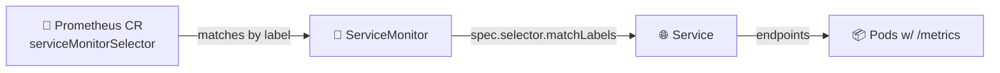

# Lab 16 — Kubernetes Monitoring & Init Containers

Лаба 16 — мониторинг в Kubernetes и init-контейнеры


> **Goal:** Replace Lab 8's hand-edited `prometheus.yml` with the operator-driven **kube-prometheus-stack**, then teach `kubectl` how to start your pods *in the right order* with **init containers** (and learn how `restartPolicy: Always` turns the same primitive into a sidecar).
> **Deliverable:** A PR from `lab16` adding `monitoring-values.yaml`, `k8s/servicemonitor-app-python.yaml` (bonus), `k8s/init-demo.yaml`, and `k8s/MONITORING.md`.
>
> **Цель:** заменить `prometheus.yml`, который в лабе 8 правили руками, на управляемый оператором **kube-prometheus-stack**, а затем научить `kubectl` запускать поды *в правильном порядке* с помощью **init-контейнеров** (и увидеть, как `restartPolicy: Always` превращает тот же примитив в sidecar).
> **Результат:** PR из ветки `lab16`, добавляющий `monitoring-values.yaml`, `k8s/servicemonitor-app-python.yaml` (бонус), `k8s/init-demo.yaml` и `k8s/MONITORING.md`.

---

## Overview

Обзор

In Lab 8 you ran one `prom/prometheus` container in Docker Compose with a hand-written `scrape_configs` block. On Kubernetes, pods come and go, IPs churn, and you cannot re-edit `prometheus.yml` every time the scheduler reschedules. The **Prometheus Operator** solves this by watching **`ServiceMonitor`** / **`PodMonitor`** CRDs and regenerating Prometheus configuration when they change — exactly the GitOps philosophy you applied to apps in Labs 13–14, now applied to **scrape configuration**.

В лабе 8 ты запускал один контейнер `prom/prometheus` в Docker Compose с написанным руками блоком `scrape_configs`. В Kubernetes поды появляются и исчезают, IP постоянно меняются, и переписывать `prometheus.yml` при каждом перепланировании планировщиком невозможно. **Prometheus Operator** решает это так: он следит за CRD **`ServiceMonitor`** / **`PodMonitor`** и перегенерирует конфигурацию Prometheus при их изменении — ровно та философия GitOps, которую ты применял к приложениям в лабах 13–14, только теперь к **конфигурации скрейпинга**.

You will:

Ты сделаешь следующее:

- Install the **kube-prometheus-stack** Helm chart (operator + Prometheus + Alertmanager + Grafana + kube-state-metrics + node-exporter — your choice of how much).
  * Установишь Helm-чарт **kube-prometheus-stack** (оператор + Prometheus + Alertmanager + Grafana + kube-state-metrics + node-exporter — сколько из этого ставить, решаешь сам).
- Write **a ServiceMonitor from scratch** for your `app-python` service. The chart's default selectors require it to carry the `release:` label — that's the whole **two-level selector pattern** the operator is built around.
  * Напишешь **ServiceMonitor с нуля** для своего сервиса `app-python`. Селекторы чарта по умолчанию требуют метку `release:` — в этом и весь **двухуровневый шаблон селекторов**, вокруг которого построен оператор.
- Use **init containers** to do work *before* the main container runs (download a file into a shared `emptyDir`, then prove the main container reads it).
  * Будешь использовать **init-контейнеры**, чтобы выполнять работу *до* запуска основного контейнера (скачать файл в общий `emptyDir`, а затем доказать, что основной контейнер его читает).
- See the same primitive promoted to a **sidecar** by flipping one field — `restartPolicy: Always` on an init container, GA in Kubernetes 1.33.
  * Увидишь, как тот же примитив превращается в **sidecar** сменой одного поля — `restartPolicy: Always` у init-контейнера, GA в Kubernetes 1.33.

> ⚠️ **Scope:** no AlertmanagerConfig CRD writing, no recording-rules-as-code, no full SLO stack. Those land in the SRE-Intro elective. Today's lesson is *operator-driven scrape discovery* and *pod-startup ordering primitives*.
>
> ⚠️ **Границы темы:** мы не пишем CRD AlertmanagerConfig, не описываем recording rules как код и не строим полный SLO-стек. Это будет в элективе SRE-Intro. Сегодняшний урок — *обнаружение целей скрейпинга через оператор* и *примитивы упорядочивания запуска подов*.

**What you'll practice:**

**Что ты отработаешь:**

- The Prometheus Operator CRDs (`Prometheus`, `ServiceMonitor`, `PodMonitor`, `PrometheusRule`) and how the operator reconciles them into scrape config
  * CRD Prometheus Operator (`Prometheus`, `ServiceMonitor`, `PodMonitor`, `PrometheusRule`) и то, как оператор сводит их в конфигурацию скрейпинга
- The **two-level selector pattern** (Prometheus picks ServiceMonitors by label → ServiceMonitor picks Services by label → Service picks Pods)
  * **Двухуровневый шаблон селекторов** (Prometheus выбирает ServiceMonitor по метке → ServiceMonitor выбирает Service по метке → Service выбирает поды)
- Helm 4 values overrides for an opinionated upstream chart (lean vs full install)
  * Переопределение values в Helm 4 для апстрим-чарта со своим мнением (минимальная или полная установка)
- Init containers as a Kubernetes-native solution to "wait for dependency" / "fetch a config" / "run a migration"
  * Init-контейнеры как нативное для Kubernetes решение для «дождаться зависимости», «скачать конфиг» и «выполнить миграцию»
- Sidecar containers — init containers with `restartPolicy: Always`, GA since 1.33
  * Sidecar-контейнеры — init-контейнеры с `restartPolicy: Always`, GA начиная с 1.33

> 📚 Pairs with **Lecture 8 — Metrics & Monitoring with Prometheus** (the scrape model and PromQL) and **Lecture 15 — StatefulSets** (where the sidecar pattern was introduced at the GA boundary). Reread Lec 8 slide on Lab 16 preview and Lec 15 slide on sidecar containers before you start.
>
> 📚 Сочетается с **лекцией 8 — Метрики и мониторинг с Prometheus** (модель скрейпинга и PromQL) и **лекцией 15 — StatefulSets** (там шаблон sidecar вводился на границе GA). Перед началом перечитай слайд лекции 8 о превью лабы 16 и слайд лекции 15 о sidecar-контейнерах.

---

## Project State

Состояние проекта

**You should have from previous labs:**

**Что у тебя должно быть из предыдущих лаб:**

- A k3d cluster on Kubernetes 1.36 (Lab 9).
  * Кластер k3d на Kubernetes 1.36 (лаба 9).
- Your `lab10-app` Helm chart from Labs 10–13 deploying `app-python` (your code, port **8080**, `/metrics` from Lab 8) plus the course plumbing `echo` (`ghcr.io/inno-devops-labs/echo:v1`, port 8081) and `health` (`ghcr.io/inno-devops-labs/health:v1`, port 8082). All three expose `GET /metrics` in Prometheus text format. Throughout this lab, "app-python" refers to the conceptual *service* (the Python app you wrote); the actual K8s Service name from your chart will be `lab10-app-web` (chart fullname `lab10-app` + `-web` component suffix per Lab 10). Your ServiceMonitor will select by the **label** `app.kubernetes.io/name=lab10-app`, which is helper-independent of the Service name.
  * Твой Helm-чарт `lab10-app` из лаб 10–13, разворачивающий `app-python` (твой код, порт **8080**, `/metrics` из лабы 8), плюс курсовую обвязку `echo` (`ghcr.io/inno-devops-labs/echo:v1`, порт 8081) и `health` (`ghcr.io/inno-devops-labs/health:v1`, порт 8082). Все три отдают `GET /metrics` в текстовом формате Prometheus. В этой лабе «app-python» означает концептуальный *сервис* (написанное тобой Python-приложение); фактическое имя Kubernetes Service из твоего чарта будет `lab10-app-web` (fullname чарта `lab10-app` + суффикс компонента `-web`, как в лабе 10). Твой ServiceMonitor будет выбирать по **метке** `app.kubernetes.io/name=lab10-app`, которая не зависит от helper-шаблонов и от имени Service.
- `kubectl`, `helm` v4.1.x, working `port-forward`.
  * `kubectl`, `helm` v4.1.x и работающий `port-forward`.

**This lab adds:**

**Эта лаба добавляет:**

- `monitoring-values.yaml` — Helm values override for the chart (chart version pinned, components you keep, resources/retention)
  * `monitoring-values.yaml` — переопределение Helm values для чарта (закреплённая версия чарта, оставленные компоненты, ресурсы и срок хранения)
- `k8s/servicemonitor-app-python.yaml` — your custom ServiceMonitor (the bonus, but you'll likely write it during Task 2)
  * `k8s/servicemonitor-app-python.yaml` — твой собственный ServiceMonitor (бонус, но скорее всего ты напишешь его уже в задаче 2)
- `k8s/init-demo.yaml` — single Pod showing both the init pattern and the sidecar variant
  * `k8s/init-demo.yaml` — один Pod, показывающий и шаблон init-контейнера, и вариант sidecar
- `k8s/MONITORING.md` — your submission report
  * `k8s/MONITORING.md` — твой отчёт по работе

> 📦 **Course plumbing recap:** `app-python` is **your** app. `echo` and `health` are pre-built, never built by you, and all three expose `/metrics`. The whole point of Task 2 / Bonus is that you *write a ServiceMonitor* — you do not edit any Prometheus config files.
>
> 📦 **Напоминание о курсовой обвязке:** `app-python` — **твоё** приложение. `echo` и `health` собраны заранее, ты их никогда не собираешь, и все три отдают `/metrics`. Смысл задачи 2 и бонуса в том, что ты *пишешь ServiceMonitor* и не правишь ни одного конфигурационного файла Prometheus.

---

## Setup

Подготовка

```bash
helm version              # v4.1.x — same as Lab 10
helm repo add prometheus-community https://prometheus-community.github.io/helm-charts
helm repo update
kubectl get nodes         # your k3d cluster from Lab 9 must be up
kubectl create namespace monitoring
```

Пояснение: команда проверяет версию Helm, подключает репозиторий community-чартов, обновляет индекс, проверяет узлы кластера и создаёт namespace `monitoring`.

Find a current chart version (don't float on `latest` — pin it):

Найди актуальную версию чарта (не плавай на `latest` — закрепи её):

```bash
helm search repo prometheus-community/kube-prometheus-stack --versions | head
# As of May 2026 the chart is in the ~85.x line. Pin whatever is current when you do the lab.
```

Пояснение: `helm search repo --versions` перечисляет доступные версии чарта; в мае 2026 актуальна линейка ~85.x — закрепи ту, что актуальна на момент выполнения лабы.

You'll write `monitoring-values.yaml` next; **do not** install the chart with defaults — defaults run the full stack (alertmanager + node-exporter + kube-state-metrics + push gateway) and may not fit a laptop cluster.

Дальше ты напишешь `monitoring-values.yaml`; **не** устанавливай чарт со значениями по умолчанию — они поднимают полный стек (alertmanager + node-exporter + kube-state-metrics + push gateway), который может не поместиться в ноутбучный кластер.

---

## Task 1 — Deploy the kube-prometheus-stack (2 pts)

Задача 1 — Разверни kube-prometheus-stack (2 балла)

**Objective:** Install the operator-based monitoring stack. The skill being graded is **picking a chart version, picking which components to keep, and writing values to widen ServiceMonitor discovery** — *not* copying our install command.

**Цель:** установить стек мониторинга на основе оператора. Оценивается умение **выбрать версию чарта, выбрать, какие компоненты оставить, и написать values, расширяющие обнаружение ServiceMonitor** — а *не* копирование нашей команды установки.

### 1.1 — Document what each component does

1.1 — Опиши, что делает каждый компонент

`YOUR TASK`: in `MONITORING.md`, fill the role of each component in **your own words** (one sentence each — not copied from the chart README):

`ТВОЯ ЗАДАЧА`: в `MONITORING.md` опиши роль каждого компонента **своими словами** (по одному предложению — не копируя из README чарта):

| Component | What it does in the stack |
|---|---|
| Prometheus Operator | ___ |
| Prometheus (server) | ___ |
| Alertmanager | ___ |
| Grafana | ___ |
| kube-state-metrics | ___ |
| node-exporter | ___ |

| Компонент | Что делает в стеке |
|---|---|
| Prometheus Operator | ___ |
| Prometheus (сервер) | ___ |
| Alertmanager | ___ |
| Grafana | ___ |
| kube-state-metrics | ___ |
| node-exporter | ___ |

You may decide to **disable** some of these (Task 1.2). You still document all six.

Ты можешь решить **отключить** некоторые из них (задача 1.2). Но описать всё равно нужно все шесть.

### 1.2 — Write `monitoring-values.yaml`

1.2 — Напиши `monitoring-values.yaml`

The chart is ~85 different YAML knobs deep. You only need a handful — but those handful are the lesson:

В чарте около 85 разных YAML-ручек. Тебе нужна лишь горстка — но именно она и есть урок:

`YOUR TASK`: write a values file that sets **at least** the four blocks below.

`ТВОЯ ЗАДАЧА`: напиши файл values, который задаёт **как минимум** четыре блока ниже.

```yaml
# monitoring-values.yaml — your overrides for kube-prometheus-stack

prometheus:
  prometheusSpec:
    # YOUR TASK: widen ServiceMonitor discovery so your custom monitor (Task 2 / Bonus)
    # is found regardless of which namespace + which labels it carries.
    # Hint: there are TWO sibling fields here, both starting with
    # serviceMonitorSelector...  and  podMonitorSelector... — read the
    # chart README's "Selector Defaults" section. Why two? Because the operator
    # has DIFFERENT defaults when the field is nil vs {} — that's the trap.
    ___: ___
    ___: ___

    # YOUR TASK: set resource requests + limits AND data retention.
    # Hints: defaults ask for ~1Gi memory which a laptop k3d may not have spare.
    # Retention is a string ('10d' / '24h') under prometheusSpec, NOT under storage.
    resources: { ___ }
    retention: ___

grafana:
  # YOUR TASK: set the admin password ONLY (lab — never hardcode a prod password).
  # Default is 'prom-operator'; pick anything but document it in MONITORING.md.
  adminPassword: ___

# YOUR TASK: pick a profile and disable the components you don't keep.
# Two profiles are acceptable; pick ONE and justify it in MONITORING.md:
#   - LEAN  — operator + Prometheus + Grafana only (laptop k3d, no node metrics)
#   - FULL  — operator + Prometheus + Grafana + KSM + node-exporter + alertmanager
# To disable a component, set its top-level block to { enabled: false }.
# (kube-state-metrics + node-exporter live under their OWN top-level keys at the
#  chart root, not under prometheus.* — look at `helm show values` output.)
```

Пояснение: это заготовка `monitoring-values.yaml` с подсказками в комментариях; заполни пропуски `___`, не меняя структуру блоков.

> 🧠 **Why the two selector fields exist:** the chart bakes a default selector `release: <release-name>` into the operator's `Prometheus` CR. If you leave `serviceMonitorSelector` *nil*, the operator behaves as if you set that label match — meaning your ServiceMonitor needs `labels: { release: monitoring }` to be picked up. Setting `serviceMonitorSelectorNilUsesHelmValues: false` tells the operator *"if I gave you nil, treat it as an empty selector — match everything"*. Same trick for PodMonitors. It's confusingly named but it's the canonical knob.
>
> 🧠 **Зачем нужны два поля селектора:** чарт «зашивает» селектор по умолчанию `release: <release-name>` в CR `Prometheus` оператора. Если оставить `serviceMonitorSelector` *nil*, оператор ведёт себя так, будто эта метка задана, — значит, твой ServiceMonitor должен нести `labels: { release: monitoring }`, иначе его не подхватят. Установка `serviceMonitorSelectorNilUsesHelmValues: false` говорит оператору: *«если я передал nil, считай это пустым селектором — совпадай со всем»*. Тот же приём для PodMonitor. Название сбивает с толку, но это каноническая ручка.

### 1.3 — Install with your pinned version

1.3 — Установи закреплённую версию

`YOUR TASK`: write the `helm install` command using your **pinned** chart version, the `monitoring` namespace, and `monitoring-values.yaml`:

`ТВОЯ ЗАДАЧА`: напиши команду `helm install` с **закреплённой** версией чарта, namespace `monitoring` и файлом `monitoring-values.yaml`:

```bash
helm install ___ prometheus-community/kube-prometheus-stack \
  --namespace ___ --create-namespace \
  --version ___ \
  -f ___
```

Пояснение: подставь имя релиза, namespace, точную версию чарта и свой файл values вместо пропусков `___`.

After install, verify *every* pod in `monitoring` reaches `Running`/`Ready` and the operator's CRDs landed. **YOUR TASK** — write the two `kubectl` commands (one to list pods in the monitoring namespace, one to list only the CRDs in the `monitoring.coreos.com` group):

После установки проверь, что *каждый* под в `monitoring` дошёл до `Running`/`Ready` и CRD оператора установлены. **ТВОЯ ЗАДАЧА** — напиши две команды `kubectl` (одну для списка подов в namespace monitoring, другую — только для CRD группы `monitoring.coreos.com`):

```bash
kubectl ___
kubectl ___
# Expect (at minimum, in the CRD output): servicemonitors, podmonitors,
# prometheuses, alertmanagers, prometheusrules, probes, scrapeconfigs.
```

Пояснение: первая команда должна вывести поды в namespace `monitoring`, вторая — только CRD группы `monitoring.coreos.com`; в списке ожидаются `servicemonitors`, `podmonitors`, `prometheuses` и остальные из комментария.

If a pod is `Pending`, it's almost always resources — re-tune your `resources:` block or disable the heavier components.

Если под висит в `Pending`, почти всегда дело в ресурсах — подкрути блок `resources:` или отключи более тяжёлые компоненты.

### 1.4 — Proof of work

1.4 — Подтверждение работы

Paste into `MONITORING.md`:

Вставь в `MONITORING.md`:

- The pinned chart version (e.g. `85.10.1`) and which profile you picked (lean / full) with one-sentence justification
  * Закреплённую версию чарта (например, `85.10.1`) и выбранный профиль (lean / full) с обоснованием в одном предложении
- Your six-component table from 1.1
  * Таблицу шести компонентов из 1.1
- `kubectl get pods -n monitoring` showing every chosen pod `Running`/`Ready`
  * Вывод `kubectl get pods -n monitoring`, где каждый выбранный под в `Running`/`Ready`
- `kubectl get crd | grep monitoring.coreos.com` showing the operator CRDs
  * Вывод `kubectl get crd | grep monitoring.coreos.com` с CRD оператора
- `kubectl get prometheus -n monitoring -o jsonpath='{.items[0].spec.serviceMonitorSelector}'` — proves the selector is `{}` (i.e. matches everything), not the default `release: <release-name>` match
  * Вывод `kubectl get prometheus -n monitoring -o jsonpath='{.items[0].spec.serviceMonitorSelector}'`, доказывающий, что селектор — `{}` (то есть совпадает со всем), а не стандартное совпадение по `release: <release-name>`

---

## Task 2 — Explore Grafana & Verify Scrape Targets (3 pts)

Задача 2 — Изучи Grafana и проверь цели скрейпинга (3 балла)

**Objective:** Use the bundled dashboards and the Prometheus UI to read the health of *your* cluster, and write the ServiceMonitor that connects your app to the operator-driven scrape config. **This is where the operator pattern earns its keep.**

**Цель:** с помощью встроенных дашбордов и интерфейса Prometheus оценить здоровье *своего* кластера и написать ServiceMonitor, который подключает твоё приложение к конфигурации скрейпинга, управляемой оператором. **Именно здесь шаблон оператора оправдывает себя.**

### 2.1 — Access the UIs

2.1 — Открой интерфейсы

`YOUR TASK`: find your Service names (`kubectl get svc -n monitoring`) and write three `port-forward` commands — Grafana on `3000:80`, Prometheus on `9090:9090`, Alertmanager on `9093:9093` (only if you kept it). The chart prefixes every Service with your release name; if your release was `kps`, the Grafana service is `kps-grafana`, etc.

`ТВОЯ ЗАДАЧА`: найди имена своих Service (`kubectl get svc -n monitoring`) и напиши три команды `port-forward` — Grafana на `3000:80`, Prometheus на `9090:9090`, Alertmanager на `9093:9093` (только если ты его оставил). Чарт добавляет имя релиза в начало каждого Service; если твой релиз назывался `kps`, сервис Grafana будет `kps-grafana` и т.д.

```bash
kubectl port-forward svc/___ -n monitoring 3000:___
kubectl port-forward svc/___ -n monitoring 9090:___
# (Alertmanager only if you kept it enabled in Task 1.2)
kubectl port-forward svc/___ -n monitoring 9093:___
```

Пояснение: подставь реальные имена сервисов своего релиза и нужные порты; Alertmanager пробрасывай только если оставил его включённым.

### 2.2 — Read the cluster with the bundled dashboards

2.2 — Прочитай кластер по встроенным дашбордам

Answer each question below with a screenshot and a **one-line reading**. Values will differ on your cluster; the question is what the graph *means*, not its number.

Ответь на каждый вопрос ниже скриншотом и **однострочной интерпретацией**. Значения на твоём кластере будут другими; важно, что график *означает*, а не его число.

1. **Node resources (USE method):** node CPU utilisation and memory used. *Dashboard: "Node Exporter / Nodes"* — if you went lean and disabled node-exporter, swap in *"Kubernetes / Compute Resources / Cluster"* and explain the swap.
   * **Ресурсы узла (метод USE):** загрузка CPU узла и использованная память. *Дашборд: «Node Exporter / Nodes»* — если ты выбрал lean и отключил node-exporter, используй *«Kubernetes / Compute Resources / Cluster»* и объясни замену.
2. **Namespace compute:** which pods in `<your-app-ns>` use the most/least CPU and memory? *Dashboard: "Kubernetes / Compute Resources / Namespace (Pods)".*
   * **Вычисления в namespace:** какие поды в `<your-app-ns>` потребляют больше/меньше всего CPU и памяти? *Дашборд: «Kubernetes / Compute Resources / Namespace (Pods)».*
3. **Per-pod detail:** CPU throttling and memory working-set for one `app-python` pod. *Dashboard: "Kubernetes / Compute Resources / Pod".*
   * **Детали по поду:** троттлинг CPU и рабочий набор памяти для одного пода `app-python`. *Дашборд: «Kubernetes / Compute Resources / Pod».*
4. **Cluster state (kube-state-metrics):** count of pods per phase — write `sum by (phase) (kube_pod_status_phase)` if you kept KSM; if not, explain why this query has no result on your lean install.
   * **Состояние кластера (kube-state-metrics):** количество подов по фазам — напиши `sum by (phase) (kube_pod_status_phase)`, если оставил KSM; если нет, объясни, почему на lean-установке этот запрос ничего не вернёт.
5. **Alerts:** how many alerts are firing? (A fresh kube-prometheus-stack cluster runs a `Watchdog` always-firing alert — explain in one sentence what `Watchdog` is *for*.)
   * **Алерты:** сколько алертов сейчас активно? (На свежем кластере kube-prometheus-stack всегда горит алерт `Watchdog` — объясни одним предложением, *зачем* он нужен.)

### 2.3 — Write a ServiceMonitor for `app-python` (this is the lesson)

2.3 — Напиши ServiceMonitor для `app-python` (в этом и урок)

The whole point of the operator is that **you never edit a Prometheus config file again**. You write a `ServiceMonitor` and the operator writes the scrape block for you. The two-level selector pattern:

Весь смысл оператора в том, что **ты больше никогда не правишь конфигурационный файл Prometheus**. Ты пишешь `ServiceMonitor`, а оператор пишет блок скрейпинга за тебя. Двухуровневый шаблон селекторов:



Схема: CR `Prometheus` по метке находит ServiceMonitor, тот по `spec.selector.matchLabels` находит Service, а Service указывает на поды с `/metrics`.

Three labels, three matches, in this order. Break any one and the target silently fails to appear.

Три метки, три совпадения, именно в таком порядке. Сломай любое одно — и цель молча не появится.

`YOUR TASK`: write `k8s/servicemonitor-app-python.yaml` from scratch. The shape is given, the **fields that ARE the skill** are blank.

`ТВОЯ ЗАДАЧА`: напиши `k8s/servicemonitor-app-python.yaml` с нуля. Форма дана, а **поля, в которых и есть навык**, оставлены пустыми.

```yaml
apiVersion: monitoring.coreos.com/v1
kind: ServiceMonitor
metadata:
  name: app-python
  # YOUR TASK: which namespace?  Two valid answers:
  #   - your app's namespace (then your monitoring-values.yaml MUST have
  #     serviceMonitorSelectorNilUsesHelmValues: false from Task 1)
  #   - the monitoring namespace (then add a sibling 'namespaceSelector' below
  #     that points at the app's namespace — the Service is across namespaces)
  # Pick one, document the choice in MONITORING.md.
  namespace: ___
  labels:
    # YOUR TASK: at minimum the chart's release-discriminator label so the
    # operator's DEFAULT selector would also pick it up. (Belt-and-braces:
    # works even if Task 1's serviceMonitorSelectorNilUsesHelmValues regresses.)
    # If your release was `monitoring`, the label key/value pair is...
    ___: ___
spec:
  # Level 2: ServiceMonitor → Service. Match the Service by its labels.
  selector:
    matchLabels:
      # YOUR TASK: a label that uniquely identifies your app-python Service.
      # Hint: your Lab 10 helpers emit  app.kubernetes.io/name=<chart-name>
      ___: ___
  # OPTIONAL — only needed if this ServiceMonitor lives in a DIFFERENT namespace
  # from the Service it selects. Default behaviour is "same namespace only".
  # namespaceSelector:
  #   matchNames: [<your-app-ns>]
  endpoints:
    # YOUR TASK: which port of the Service to scrape, which path, how often.
    # CRITICAL: 'port' is the Service port's NAME (a string), not a number.
    # Your app-python Service MUST already have a named port — check Lab 10's
    # service.yaml. If not, add one and `helm upgrade` first.
    - port: ___
      path: ___
      interval: ___
```

Пояснение: заполни пропуски `___` в namespace, метках и секции `endpoints`; комментарии в файле подсказывают допустимые варианты.

After applying, verify from the CLI (port-forward to Prometheus first). The skeleton:

После применения проверь из CLI (сначала пробрось порт к Prometheus). Скелет:

```bash
kubectl apply -f k8s/servicemonitor-app-python.yaml
# Wait ~30s for the operator to reconcile, then:
kubectl get servicemonitor -A          # yours should appear

# YOUR TASK: pipe Prometheus's /api/v1/targets through jq to extract ONLY your
# app-python target, showing its health + last scrape time + URL. The filter is:
#   .data.activeTargets[] | select(.labels.job == "<your-job-name>") | {health, lastScrape, scrapeUrl}
curl -s localhost:9090/api/v1/targets | jq '___'
```

Пояснение: примени манифест, дождись сверки оператором и подставь в `jq`-фильтр имя своего job, чтобы увидеть только цель `app-python`.

> ⚠️ **If your target doesn't appear**, in this order: (1) `kubectl describe prometheus -n monitoring <release>-kube-prometheus-prometheus` and grep for your ServiceMonitor in the Status (operator tells you why it skipped you); (2) `kubectl get svc <app-python> -o yaml | grep -A3 ports:` — is the port **named**? (3) does your ServiceMonitor's `spec.selector.matchLabels` exactly match a label on the Service? (4) does the ServiceMonitor's metadata.labels include `release: <release>` *or* did you disable that selector in Task 1? You only get to skip step 4 if you did Task 1's `nilUsesHelmValues: false`.
>
> ⚠️ **Если цель не появилась**, проверяй по порядку: (1) `kubectl describe prometheus -n monitoring <release>-kube-prometheus-prometheus` и поищи свой ServiceMonitor в Status (оператор скажет, почему пропустил); (2) `kubectl get svc <app-python> -o yaml | grep -A3 ports:` — порт точно **именованный**? (3) `spec.selector.matchLabels` твоего ServiceMonitor точно совпадает с меткой на Service? (4) в metadata.labels ServiceMonitor есть `release: <release>` *или* ты отключил этот селектор в задаче 1? Пропустить шаг 4 можно только если в задаче 1 выставлен `nilUsesHelmValues: false`.

### 2.4 — PromQL on a live cluster

2.4 — PromQL на живом кластере

Once your three services are scraped (`app-python` via your ServiceMonitor, `echo` + `health` via separate monitors you write the same way — *or* via the operator's default service-discovery if they carry the right labels), the same RED/USE queries from Lab 8 work, against more interesting data:

Когда все три сервиса скрейпятся (`app-python` — через твой ServiceMonitor, `echo` и `health` — через отдельные мониторы, написанные так же, *или* через стандартное обнаружение сервисов оператора, если у них есть нужные метки), те же запросы RED/USE из лабы 8 работают, но на более интересных данных:

`YOUR TASK`: write **three** PromQL queries into `MONITORING.md` with one-line readings each. The shape of each is given — fill the body. Don't reuse Lab 8 verbatim; the data shape changed (more labels, k8s-native `job=` labels, namespace/pod selectors).

`ТВОЯ ЗАДАЧА`: напиши **три** запроса PromQL в `MONITORING.md`, каждый с однострочной интерпретацией. Форма каждого дана — заполни тело. Не копируй лабу 8 дословно: форма данных изменилась (больше меток, нативные для k8s метки `job=`, селекторы namespace/pod).

```promql
# 1) "Are all three of my services being scraped right now?"
#    YOUR TASK: one query returning 1 per UP target, filtered to your three jobs.
#    Hint: the metric is `up`; filter with {job=~"<regex>"} to match a|b|c.
___

# 2) RED — per-service request rate over a 5-minute window.
#    YOUR TASK: aggregate the per-pod counter into a per-service rate.
#    Hint: rate() of a Counter, summed by `job` (k8s ServiceMonitor sets job=<SM-name>).
sum by (___) (rate(___[5m]))

# 3) USE — pick ONE: node-level if you kept node-exporter,
#    OR cluster-level CPU saturation if you went lean (use kube-state-metrics).
#    YOUR TASK: write the query you'd graph on a SRE on-call dashboard.
___
```

Пояснение: три заготовки — проверка `up`, скорость запросов через `rate()` и запрос USE; заполни пропуски `___` своими метриками и агрегациями.

### 2.5 — Proof of work

2.5 — Подтверждение работы

Paste into `MONITORING.md`:

Вставь в `MONITORING.md`:

- Your `servicemonitor-app-python.yaml` (full contents)
  * Свой `servicemonitor-app-python.yaml` (полное содержимое)
- A screenshot of Prometheus → Status → Targets with `app-python` `UP`
  * Скриншот Prometheus → Status → Targets, где `app-python` в состоянии `UP`
- Output of `kubectl get servicemonitor -A` (yours appears in the list)
  * Вывод `kubectl get servicemonitor -A` (твой в списке присутствует)
- The three PromQL queries + one-line readings
  * Три запроса PromQL и однострочные интерпретации
- The five dashboard answers from 2.2 with screenshots
  * Пять ответов по дашбордам из 2.2 со скриншотами
- One-line explanation of the `Watchdog` alert
  * Однострочное объяснение алерта `Watchdog`

---

## Task 3 — Init Containers & Sidecars (3 pts)

Задача 3 — Init-контейнеры и sidecar (3 балла)

**Objective:** Use init containers to do setup work *before* the main container starts, then turn the same primitive into a sidecar by flipping one field.

**Цель:** использовать init-контейнеры для подготовительной работы *до* запуска основного контейнера, а затем превратить тот же примитив в sidecar сменой одного поля.

> 📚 **Init containers** run sequentially, each must exit `0` before the next, and **all** init containers must succeed before the app container starts. They're how you wait-for-dependency, fetch-a-config, or run-a-migration *without* baking that logic into your app image. A **sidecar** is `restartPolicy: Always` on an init container — GA since Kubernetes 1.33. Same list, different semantics: an init container *ran-to-completion*; a sidecar *keeps running* alongside the main container and is torn down with it.
>
> 📚 **Init-контейнеры** выполняются последовательно, каждый должен завершиться с кодом `0`, прежде чем начнётся следующий, и **все** они должны успешно завершиться до старта контейнера приложения. Так ты ждёшь зависимость, скачиваешь конфиг или запускаешь миграцию, *не* зашивая эту логику в образ приложения. **Sidecar** — это init-контейнер с `restartPolicy: Always`, GA начиная с Kubernetes 1.33. Тот же список, другая семантика: init-контейнер *отрабатывает до завершения*, а sidecar *продолжает работать* рядом с основным контейнером и завершается вместе с ним.

### 3.1 — Init container: download-then-serve

3.1 — Init-контейнер: скачай, затем отдай

`YOUR TASK`: in `k8s/init-demo.yaml`, write a single `kind: Pod` that proves an init container ran-to-completion *before* the main container started, and the main container *consumes* what the init container wrote.

`ТВОЯ ЗАДАЧА`: в `k8s/init-demo.yaml` напиши один `kind: Pod`, который доказывает, что init-контейнер отработал до завершения *до* старта основного контейнера, а основной контейнер *потребляет* то, что записал init-контейнер.

The data flow is:

Поток данных такой:

```
init container → writes /work/index.html → emptyDir volume → main container reads /usr/share/nginx/html/index.html
```

Пояснение: init-контейнер пишет файл в общий том `emptyDir`, а основной контейнер nginx читает его из своего docroot.

Shape is given; the lines that ARE the skill are blank.

Форма дана, а строки, в которых и есть навык, оставлены пустыми.

```yaml
apiVersion: v1
kind: Pod
metadata:
  name: initdemo
  labels: { app: initdemo }
spec:
  initContainers:
    - name: fetch-content
      # YOUR TASK: pick a tiny image with a shell + an echo or wget.
      # Hints: busybox:1.37, alpine:3.21. The image MUST be able to run `sh -c`.
      image: ___
      # YOUR TASK: a shell one-liner that ends with exit 0.
      # Requirements:
      #   - writes a NON-EMPTY file to /work/index.html
      #   - the file content must contain a string ('ready', a date, anything)
      #     that you can later assert from the main container
      # Hint: `sh -c 'echo "ready @ $(date -u +%FT%TZ)" > /work/index.html'`
      command: ['sh', '-c']
      args: ['___']
      volumeMounts:
        # YOUR TASK: mount the shared emptyDir at /work
        - { name: ___, mountPath: ___ }

  containers:
    - name: app
      # YOUR TASK: a webserver image that serves files from a docroot.
      # Hint: nginx:1.27-alpine reads /usr/share/nginx/html by default.
      image: ___
      ports: [{ containerPort: 80 }]
      volumeMounts:
        # YOUR TASK: mount the SAME emptyDir at the webserver's docroot.
        # The init wrote /work/index.html — what's nginx's docroot path?
        - { name: ___, mountPath: ___ }

  volumes:
    - name: workdir
      emptyDir: {}
```

Пояснение: заполни `___` для образа init-контейнера, команды записи файла и монтирования одного и того же `emptyDir` в оба контейнера.

Verify — `YOUR TASK` is to fill in two `kubectl` commands and one `curl`:

Проверка — `ТВОЯ ЗАДАЧА` заполнить две команды `kubectl` и один `curl`:

```bash
kubectl apply -f k8s/init-demo.yaml
kubectl get pod initdemo -w        # watch: Init:0/1 → PodInitializing → Running

# YOUR TASK: print ONLY the terminated reason of the first init container
# (must be the string 'Completed'). Hint: jsonpath against .status.initContainerStatuses[0].
kubectl get pod initdemo -o jsonpath='___'

# YOUR TASK: prove the main container is serving the file the init wrote.
# Hint: port-forward, then curl localhost:8080/index.html (or whichever filename
# you wrote in 3.1) — the response body must contain the string init wrote.
kubectl port-forward pod/initdemo ___
curl -s localhost:___/___
```

Пояснение: после применения смотри переходы статуса, достань причину завершения init-контейнера через jsonpath и проверь, что ответ `curl` содержит строку, записанную при инициализации.

### 3.2 — Sidecar: same primitive, different restart policy

3.2 — Sidecar: тот же примитив, другая политика перезапуска

`YOUR TASK`: add a **second** entry to `initContainers:` in the same Pod — but make it a *sidecar* (long-running, alongside the main container) by setting `restartPolicy: Always` on that init container only.

`ТВОЯ ЗАДАЧА`: добавь **вторую** запись в `initContainers:` того же Pod, но сделай её *sidecar* (долгоживущей, работающей рядом с основным контейнером), выставив `restartPolicy: Always` только у этого init-контейнера.

```yaml
spec:
  initContainers:
    - name: fetch-content     # from 3.1 — unchanged, run-to-completion
      # ...

    # NEW: a sidecar — long-running, NOT run-to-completion.
    - name: log-tail
      image: busybox:1.37
      # YOUR TASK: pick the field that flips this from init → sidecar.
      # Hint: lives on the container, valid values are 'Always' / 'OnFailure' / 'Never'.
      # GA in K8s 1.33 — your k3d 1.36 supports it natively. NO feature gate flip needed.
      ___: ___
      command: ['sh', '-c']
      # YOUR TASK: a command that runs FOREVER (never exits 0).
      # Suggested: tail -F /work/index.html  — prints any new writes for the lifetime of the pod.
      args: ['___']
      volumeMounts:
        - { name: workdir, mountPath: /work }
```

Пояснение: первый блок остаётся обычным init-контейнером, а во втором достаточно задать политику перезапуска и бесконечную команду.

The sidecar entry **stays in `initContainers:`** — that's not a typo. Kubernetes 1.29 introduced the feature; 1.33 made it GA. A *sidecar* is just an init container with `restartPolicy: Always`; the API didn't move, the *semantic* did. Verify both behaviours coexist — `YOUR TASK` to write the three commands:

Запись sidecar **остаётся в `initContainers:`** — это не опечатка. Kubernetes 1.29 представил эту возможность, а 1.33 довёл её до GA. *Sidecar* — это просто init-контейнер с `restartPolicy: Always`; само API не переехало, изменилась *семантика*. Проверь, что оба поведения сосуществуют, — `ТВОЯ ЗАДАЧА` написать три команды:

```bash
kubectl apply -f k8s/init-demo.yaml

# YOUR TASK: show the pod with its READY count. Once the sidecar is up alongside
# the main container, READY must be 2/2 — that's the headline of the 1.33 GA.
kubectl ___

# YOUR TASK: tail the sidecar's logs (it should stream forever).
kubectl logs initdemo -c ___

# YOUR TASK: prove the OTHER init container (fetch-content) STILL ran-to-completion.
# Hint: a jsonpath over .status.initContainerStatuses[*] showing each entry's name and state.
kubectl get pod initdemo -o jsonpath='___'
```

Пояснение: после применения проверь количество READY, хвост логов sidecar и через jsonpath убедись, что `fetch-content` по-прежнему завершился штатно.

### 3.3 — Pick the right primitive

3.3 — Выбери правильный примитив

In `MONITORING.md`, answer (≤2 sentences each) with **init / sidecar / neither**:

В `MONITORING.md` ответь (не более 2 предложений на каждый), выбрав **init / sidecar / ни то ни другое**:

1. Wait for a Postgres Service to accept connections before the API starts.
   * Дождаться, пока Service Postgres начнёт принимать подключения, до старта API.
2. Stream the app's `/var/log/app.log` to stdout so the kubelet picks it up.
   * Непрерывно отправлять `/var/log/app.log` приложения в stdout, чтобы kubelet его подхватил.
3. Run a one-off DB migration on every chart upgrade.
   * Выполнять разовую миграцию БД при каждом обновлении чарта.
4. Refresh a JWT signing key every 10 minutes for the lifetime of the pod.
   * Обновлять ключ подписи JWT каждые 10 минут в течение жизни пода.

> 💡 The first one is the textbook trap: the wrong answer is "init container with `sleep` until the port opens" — fragile and hides the real fix. One of the four is **not** an init *or* a sidecar at all — it's a primitive you wrote in Lab 10. Explain which and why.
>
> 💡 Первый пункт — классическая ловушка: неправильный ответ — «init-контейнер с `sleep`, пока порт не откроется»; это хрупко и скрывает настоящее решение. Один из четырёх — **не** init и **не** sidecar, а примитив, который ты писал в лабе 10. Объясни, какой и почему.

### 3.4 — Proof of work

3.4 — Подтверждение работы

Paste into `MONITORING.md`:

Вставь в `MONITORING.md`:

- The full `k8s/init-demo.yaml`
  * Полный `k8s/init-demo.yaml`
- `kubectl get pod initdemo -o jsonpath='{.status.initContainerStatuses[0].state.terminated.reason}'` showing `Completed`
  * Вывод `kubectl get pod initdemo -o jsonpath='{.status.initContainerStatuses[0].state.terminated.reason}'` со значением `Completed`
- The `curl` against `localhost:8080/index.html` returning the string your init wrote
  * Вывод `curl` к `localhost:8080/index.html`, возвращающий строку, которую записал init-контейнер
- `kubectl logs initdemo -c log-tail` capture (a few lines is enough)
  * Захват вывода `kubectl logs initdemo -c log-tail` (достаточно нескольких строк)
- Your four-question pick-the-primitive answers
  * Твои ответы на четыре вопроса о выборе примитива

---

## Task 4 — Documentation (2 pts)

Задача 4 — Документация (2 балла)

`YOUR TASK`: write `k8s/MONITORING.md` covering, in this order:

`ТВОЯ ЗАДАЧА`: напиши `k8s/MONITORING.md`, покрыв в таком порядке:

1. **Chart selection** — pinned version, lean vs full profile, six-component table
   * **Выбор чарта** — закреплённая версия, профиль lean или full, таблица шести компонентов
2. **Discovery** — your `monitoring-values.yaml` (selector widening + resources + retention), the `kubectl get prometheus -o jsonpath` proving the selector is wide, and a one-paragraph explanation of the **two-level selector pattern** in your own words
   * **Обнаружение** — твой `monitoring-values.yaml` (расширение селектора + ресурсы + срок хранения), вывод `kubectl get prometheus -o jsonpath`, доказывающий, что селектор широкий, и объяснение **двухуровневого шаблона селекторов** своими словами в одном абзаце
3. **ServiceMonitor** — your `servicemonitor-app-python.yaml`, the Prometheus UI screenshot, the `up{...}` query
   * **ServiceMonitor** — твой `servicemonitor-app-python.yaml`, скриншот интерфейса Prometheus и запрос `up{...}`
4. **Dashboards** — the five Task 2 readings with screenshots, plus the `Watchdog` explanation
   * **Дашборды** — пять ответов из задачи 2 со скриншотами и объяснение `Watchdog`
5. **Init + sidecar** — the manifest, the `Completed` proof, the curl, the sidecar logs, the four pick-the-primitive answers
   * **Init + sidecar** — манифест, доказательство `Completed`, вывод curl, логи sidecar и четыре ответа о выборе примитива
6. **Challenges & learnings** — at least one real one (selector mismatch, missing named port, lean profile sizing, etc.)
   * **Трудности и выводы** — хотя бы одна настоящая (несовпадение селектора, отсутствующий именованный порт, размер lean-профиля и т.п.)

> 📸 Screenshots count. "It works on my machine" with no evidence scores zero for that item.
>
> 📸 Скриншоты идут в зачёт. «У меня всё работает» без доказательств даёт ноль за этот пункт.

---

## Bonus Task — Custom Metric Through a Second ServiceMonitor (2 pts)

Бонусная задача — Своя метрика через второй ServiceMonitor (2 балла)

**Objective:** Ship a *custom business metric* from `app-python` and prove the operator scrapes it without any further config edits — the operator-native replacement for the hand-written `scrape_config` you used in Lab 8.

**Цель:** отдать *свою бизнес-метрику* из `app-python` и доказать, что оператор скрейпит её без каких-либо дальнейших правок конфигурации, — это нативная для оператора замена ручного `scrape_config` из лабы 8.

Less hand-holding here.

Здесь подсказок меньше.

`YOUR TASK`:

`ТВОЯ ЗАДАЧА`:

1. **Add a bounded-cardinality business metric** to `app-python` using `prometheus_client`. Pick the metric **type** and **labels** yourself — but **bounded labels only**. Pass cardinality review: a `Counter` over a small enumeration (one of `/`, `/health`, `/info`), or a `Gauge` for a single global number. Fail it: anything with `user_id`, `request_id`, or unbounded path segments. **YOUR TASK** — write ≤ 10 Python lines and paste the diff into `MONITORING.md`.
   * **Добавь бизнес-метрику с ограниченной кардинальностью** в `app-python` через `prometheus_client`. **Тип** и **метки** выбери сам, но **только ограниченные метки**. Пройди проверку кардинальности: `Counter` по небольшому перечислению (один из `/`, `/health`, `/info`) или `Gauge` для одного глобального числа. Не пройдёт: всё с `user_id`, `request_id` или неограниченными сегментами пути. **ТВОЯ ЗАДАЧА** — написать не более 10 строк Python и вставить diff в `MONITORING.md`.
2. **Confirm your `app-python` Service has a NAMED port** for `/metrics`. If Lab 10 only exposes an un-named `port:`, add a second port — the SM matches by name:
   * **Убедись, что у твоего Service `app-python` есть ИМЕНОВАННЫЙ порт** для `/metrics`. Если в лабе 10 был только безымянный `port:`, добавь второй порт — SM сопоставляет по имени:

   ```yaml
   # Edit your chart's templates/service.yaml ports: block.
   ports:
     - { name: http, port: ___, targetPort: ___ }      # YOUR TASK: existing app port
     - { name: ___, port: ___, targetPort: ___ }       # YOUR TASK: NAMED metrics port for the SM
                                                      # (only needed if you separate /metrics onto a
                                                      # different port; the simpler path is reusing the
                                                      # existing `http` port since the app serves /metrics
                                                      # on the same listener as the app endpoints)
   ```

3. **Write a second ServiceMonitor (or edit the one from Task 2)** so it scrapes the new named port. Add a `relabelings:` block to set the `job` label to something readable. The shape:
   * **Напиши второй ServiceMonitor (или отредактируй из задачи 2)**, чтобы он скрейпил новый именованный порт. Добавь блок `relabelings:`, задающий читаемую метку `job`. Форма:

   ```yaml
   spec:
     endpoints:
       - port: ___                       # YOUR TASK: the name from the Service port above
         path: ___                       # YOUR TASK: where prometheus_client serves metrics
         interval: ___
         relabelings:
           # YOUR TASK: one rewrite that sets the `job` label to a custom value.
           # Hint: action: replace, targetLabel: job, replacement: <your-value>
           - ___
   ```

4. **Verify** in Prometheus UI (Status → Targets) that the new endpoint is `UP` and the metric is queryable. **YOUR TASK** — paste the exact PromQL query you used to graph your custom metric over time (hint: `rate(<your-counter>[5m])` over the appropriate label aggregation).
   * **Проверь** в интерфейсе Prometheus (Status → Targets), что новая цель в `UP` и метрику можно запросить. **ТВОЯ ЗАДАЧА** — вставь точный запрос PromQL, которым ты строил график своей метрики во времени (подсказка: `rate(<your-counter>[5m])` с подходящей агрегацией по меткам).

Paste into `MONITORING.md`:

Вставь в `MONITORING.md`:

- The Python diff adding the metric (≤ 10 lines)
  * Python-diff с добавленной метрикой (≤ 10 строк)
- The named-port block of your Service
  * Блок именованного порта твоего Service
- The new/edited ServiceMonitor
  * Новый или отредактированный ServiceMonitor
- Screenshot of Prometheus → Targets with the new endpoint `UP`
  * Скриншот Prometheus → Targets с новой целью в `UP`
- Screenshot of the Grafana panel graphing your custom metric
  * Скриншот панели Grafana с графиком твоей метрики

> 🧠 **Operator vs Lab 8 (the headline):** in Lab 8 you added a `- job_name: app` to `prometheus.yml`, restarted the container, and prayed. Here you add a `ServiceMonitor` object and the operator regenerates the scrape config for you — declaratively, reconciled, surviving pod churn and operator upgrades. Same outcome, Kubernetes-native plumbing.
>
> 🧠 **Оператор против лабы 8 (главное):** в лабе 8 ты добавлял `- job_name: app` в `prometheus.yml`, перезапускал контейнер и надеялся. Здесь ты добавляешь объект `ServiceMonitor`, и оператор сам перегенерирует конфигурацию скрейпинга — декларативно, с постоянной сверкой, переживая смену подов и обновления оператора. Тот же результат, но нативная для Kubernetes механика.

---

## How to Submit

Как сдать

```bash
git switch -c lab16
git add monitoring-values.yaml k8s/
git commit -m "feat(lab16): kube-prometheus-stack + ServiceMonitor + init/sidecar demo"
git push -u origin lab16
```

Пояснение: создай ветку `lab16`, добавь файлы, закоммить и запушь её — дальше останется открыть два PR.

Open **two** PRs:

Открой **два** PR:

- `your-fork:lab16` → `course-repo:master` *(reviewed)*
  * `your-fork:lab16` → `course-repo:master` *(с ревью)*
- `your-fork:lab16` → `your-fork:master` *(merges into your own main when done)*
  * `your-fork:lab16` → `your-fork:master` *(вливается в твой собственный main по завершении)*

PR checklist:

Чек-лист PR:

```text
- [ ] Task 1 — chart version pinned, profile + components documented, all pods Running, CRDs present
- [ ] Task 2 — ServiceMonitor written from scratch, app-python visible in Targets as UP, three PromQL queries documented, five dashboard answers with screenshots
- [ ] Task 3 — initdemo Pod with both an init container (Completed) and a sidecar (Running), four pick-the-primitive answers
- [ ] Task 4 — MONITORING.md with all six sections + evidence
- [ ] Bonus — custom bounded metric + named port + second ServiceMonitor scraped and graphed
```

Пояснение: это шаблон чек-листа для PR; сверь по нему каждый пункт задания перед отправкой.

---

## Acceptance Criteria

Критерии приёмки

### Task 1 — Deploy the stack (2 pts)

Задача 1 — Разверни стек (2 балла)

- ✅ Chart **version pinned** (not `latest`); installed into the `monitoring` namespace
  * ✅ Версия чарта **закреплена** (не `latest`); установлен в namespace `monitoring`
- ✅ All chosen pods reach `Running`/`Ready`; operator CRDs present (`servicemonitors`, `podmonitors`, `prometheuses`, …)
  * ✅ Все выбранные поды доходят до `Running`/`Ready`; CRD оператора на месте (`servicemonitors`, `podmonitors`, `prometheuses`, …)
- ✅ `serviceMonitorSelectorNilUsesHelmValues: false` (or equivalent) set so monitors are discovered cluster-wide
  * ✅ Выставлен `serviceMonitorSelectorNilUsesHelmValues: false` (или эквивалент), чтобы мониторы обнаруживались по всему кластеру
- ✅ `kubectl get prometheus -o jsonpath='{...serviceMonitorSelector}'` returns `{}`
  * ✅ `kubectl get prometheus -o jsonpath='{...serviceMonitorSelector}'` возвращает `{}`
- ✅ Six-component table filled in your own words
  * ✅ Таблица шести компонентов заполнена своими словами

### Task 2 — Grafana + ServiceMonitor (3 pts)

Задача 2 — Grafana и ServiceMonitor (3 балла)

- ✅ Grafana + Prometheus reachable via port-forward (Alertmanager only if you kept it)
  * ✅ Grafana и Prometheus доступны через port-forward (Alertmanager — только если оставил)
- ✅ Five dashboard answers with screenshots
  * ✅ Пять ответов по дашбордам со скриншотами
- ✅ **Your own** `ServiceMonitor` for `app-python` written from scratch (no copy from chart README)
  * ✅ **Свой собственный** `ServiceMonitor` для `app-python`, написанный с нуля (не скопирован из README чарта)
- ✅ Prometheus → Targets shows `app-python` `UP`
  * ✅ Prometheus → Targets показывает `app-python` в состоянии `UP`
- ✅ Three PromQL queries with one-line readings; `up{job=~"app-python|echo|health"}` = 1 for all
  * ✅ Три запроса PromQL с однострочными интерпретациями; `up{job=~"app-python|echo|health"}` = 1 для всех
- ✅ `Watchdog` alert explained
  * ✅ Алерт `Watchdog` объяснён

### Task 3 — Init + Sidecar (3 pts)

Задача 3 — Init и sidecar (3 балла)

- ✅ Init container writes a non-empty file to a shared `emptyDir`; main container serves it
  * ✅ Init-контейнер пишет непустой файл в общий `emptyDir`; основной контейнер его отдаёт
- ✅ `initContainerStatuses[0].state.terminated.reason` = `Completed`
  * ✅ `initContainerStatuses[0].state.terminated.reason` = `Completed`
- ✅ `curl` against the main container returns the string the init wrote
  * ✅ `curl` к основному контейнеру возвращает строку, записанную init-контейнером
- ✅ Sidecar (`restartPolicy: Always` on a second init entry) is `Running` alongside the main container
  * ✅ Sidecar (`restartPolicy: Always` у второй записи init) работает `Running` рядом с основным контейнером
- ✅ Four pick-the-primitive answers correct
  * ✅ Четыре ответа о выборе примитива верны

### Task 4 — Documentation (2 pts)

Задача 4 — Документация (2 балла)

- ✅ `MONITORING.md` covers all six required sections with evidence
  * ✅ `MONITORING.md` покрывает все шесть обязательных разделов с доказательствами
- ✅ Chart version + `monitoring-values.yaml` recorded
  * ✅ Версия чарта и `monitoring-values.yaml` зафиксированы
- ✅ All screenshots present and legible
  * ✅ Все скриншоты на месте и читаемы

### Bonus — Custom metric (2 pts)

Бонус — Своя метрика (2 балла)

- ✅ New bounded-cardinality business metric in `app-python`
  * ✅ Новая бизнес-метрика с ограниченной кардинальностью в `app-python`
- ✅ Service exposes a **named** port for `/metrics`
  * ✅ Service отдаёт **именованный** порт для `/metrics`
- ✅ New/edited ServiceMonitor scrapes it; appears `UP` in Targets
  * ✅ Новый или отредактированный ServiceMonitor скрейпит её; она видна в Targets как `UP`
- ✅ Metric graphed in Grafana
  * ✅ Метрика построена на графике в Grafana

---

## Rubric

Рубрика

| Task | Points | Criteria |
|------|-------:|----------|
| **Task 1** — Deploy stack | **2** | Chart pinned, components documented, all pods healthy, selector widened |
| **Task 2** — ServiceMonitor + dashboards | **3** | SM written from scratch, target UP, dashboards answered |
| **Task 3** — Init + sidecar | **3** | Both patterns proven in one pod, primitives picked correctly |
| **Task 4** — Documentation | **2** | `MONITORING.md` complete with screenshots |
| **Bonus** — Custom metric | **2** | Custom metric + named port + SM scraped + graphed |
| **Total** | **12** | 10 main + 2 bonus |

| Задание | Баллы | Критерии |
|------|-------:|----------|
| **Задача 1** — Разверни стек | **2** | Чарт закреплён, компоненты описаны, все поды здоровы, селектор расширен |
| **Задача 2** — ServiceMonitor и дашборды | **3** | SM написан с нуля, цель в UP, дашборды отвечены |
| **Задача 3** — Init и sidecar | **3** | Оба шаблона доказаны в одном поде, примитивы выбраны верно |
| **Задача 4** — Документация | **2** | `MONITORING.md` полон и со скриншотами |
| **Бонус** — Своя метрика | **2** | Своя метрика + именованный порт + SM скрейпит + график |
| **Итого** | **12** | 10 основных + 2 бонусных |

**Grading:**

**Оценивание:**

- **10/10:** Stack healthy, ServiceMonitor written cleanly, init + sidecar both proven, thorough docs
  * **10/10:** стек здоров, ServiceMonitor написан чисто, init и sidecar доказаны, документация подробная
- **8–9/10:** Monitoring works end-to-end; minor gaps in dashboard answers or init evidence
  * **8–9/10:** мониторинг работает end-to-end; мелкие пробелы в ответах по дашбордам или доказательствах init
- **6–7/10:** Stack installs but ServiceMonitor relies on chart defaults, or sidecar variant missing
  * **6–7/10:** стек ставится, но ServiceMonitor опирается на настройки чарта по умолчанию или отсутствует вариант sidecar
- **<6/10:** Stack not healthy, scrape unverified, or `init-demo.yaml` not in repo
  * **<6/10:** стек нездоров, скрейпинг не проверен или `init-demo.yaml` нет в репозитории

---

## Resources

Материалы

<details>
<summary>📚 Documentation</summary>

📚 Документация

- [kube-prometheus-stack chart](https://github.com/prometheus-community/helm-charts/tree/main/charts/kube-prometheus-stack)
  * [Чарт kube-prometheus-stack](https://github.com/prometheus-community/helm-charts/tree/main/charts/kube-prometheus-stack)
- [Prometheus Operator — design](https://prometheus-operator.dev/docs/getting-started/design/)
  * [Prometheus Operator — архитектура](https://prometheus-operator.dev/docs/getting-started/design/)
- [ServiceMonitor & PodMonitor](https://prometheus-operator.dev/docs/developer/getting-started/)
  * [ServiceMonitor и PodMonitor](https://prometheus-operator.dev/docs/developer/getting-started/)
- [Selector defaults in the chart](https://github.com/prometheus-community/helm-charts/tree/main/charts/kube-prometheus-stack#prometheusspec)
  * [Селекторы по умолчанию в чарте](https://github.com/prometheus-community/helm-charts/tree/main/charts/kube-prometheus-stack#prometheusspec)
- [Prometheus 3.x docs](https://prometheus.io/docs/)
  * [Документация Prometheus 3.x](https://prometheus.io/docs/)
- [Grafana docs](https://grafana.com/docs/)
  * [Документация Grafana](https://grafana.com/docs/)
- [Init containers](https://kubernetes.io/docs/concepts/workloads/pods/init-containers/)
  * [Init-контейнеры](https://kubernetes.io/docs/concepts/workloads/pods/init-containers/)
- [Sidecar containers (GA 1.33)](https://kubernetes.io/docs/concepts/workloads/pods/sidecar-containers/)
  * [Sidecar-контейнеры (GA 1.33)](https://kubernetes.io/docs/concepts/workloads/pods/sidecar-containers/)
- [USE method (Brendan Gregg)](https://www.brendangregg.com/usemethod.html) · [RED method (Tom Wilkie)](https://grafana.com/blog/the-red-method-how-to-instrument-your-services/)
  * [Метод USE (Брендан Грегг)](https://www.brendangregg.com/usemethod.html) · [Метод RED (Том Уилки)](https://grafana.com/blog/the-red-method-how-to-instrument-your-services/)

</details>

<details>
<summary>⚠️ Common Pitfalls (from real dry-runs)</summary>

⚠️ Частые ошибки (из реальных прогонов)

- **ServiceMonitor in the wrong namespace.** By default a ServiceMonitor only selects Services in its **own** namespace. Put the SM in `monitoring/` while the Service lives in your app namespace and nothing matches. Fix: either put the SM in the app namespace, or add `spec.namespaceSelector.matchNames: [<app-ns>]` to the SM in `monitoring/`.
  * **ServiceMonitor в неправильном namespace.** По умолчанию ServiceMonitor выбирает Service только в **своём** namespace. Положи SM в `monitoring/`, а Service держи в namespace приложения — и совпадений не будет. Исправление: либо положи SM в namespace приложения, либо добавь в SM в `monitoring/` `spec.namespaceSelector.matchNames: [<app-ns>]`.
- **Missing `release:` label on the ServiceMonitor.** The chart's default `serviceMonitorSelector` requires `release: <release-name>` on every monitor. If you didn't set `serviceMonitorSelectorNilUsesHelmValues: false` AND didn't add the `release:` label, the operator silently ignores your SM. `kubectl describe prometheus -n monitoring <release>` shows which monitors were skipped and why.
  * **Нет метки `release:` на ServiceMonitor.** Стандартный `serviceMonitorSelector` чарта требует `release: <release-name>` на каждом мониторе. Если ты не выставил `serviceMonitorSelectorNilUsesHelmValues: false` и не добавил метку `release:`, оператор молча проигнорирует твой SM. Команда `kubectl describe prometheus -n monitoring <release>` покажет, какие мониторы пропущены и почему.
- **Service port not named.** `endpoints.port` in a ServiceMonitor is the Service port **NAME** (a string), not a number. `port: 5000` looks valid and lints fine — but the operator can't resolve it and your target never appears. Always: `ports: [{ name: http, port: 80, targetPort: 5000 }]` and `endpoints: [{ port: http, ... }]`.
  * **У порта Service нет имени.** `endpoints.port` в ServiceMonitor — это **имя** порта Service (строка), а не число. `port: 5000` выглядит валидно и проходит линтеры, но оператор не может его разрешить, и цель не появляется. Всегда указывай: `ports: [{ name: http, port: 80, targetPort: 5000 }]` и `endpoints: [{ port: http, ... }]`.
- **Pre-existing Prometheus CRD conflict.** kube-prometheus-stack ships its own opinionated CRDs. If you already installed the upstream Prometheus Operator separately, or another Helm release of the same chart, the CRDs collide. Helm 4 will refuse the install with a "resource already exists" error. Clean uninstall: `helm uninstall <other-release> -n <ns>` AND `kubectl delete crd $(kubectl get crd -o name | grep monitoring.coreos.com)` before re-installing.
  * **Конфликт с уже установленными CRD Prometheus.** kube-prometheus-stack поставляет собственные CRD со своим мнением. Если ты уже устанавливал upstream Prometheus Operator отдельно или другой релиз того же чарта, CRD конфликтуют. Helm 4 откажется устанавливать с ошибкой «resource already exists». Чистое удаление: `helm uninstall <other-release> -n <ns>` и `kubectl delete crd $(kubectl get crd -o name | grep monitoring.coreos.com)` перед повторной установкой.
- **Init container waiting for a Service with `sleep N` is a smell.** "Wait for the database" by polling is fragile (`sleep 5; nc -z db 5432; if [ $? -ne 0 ]; then sleep 10; fi` — works until it doesn't). The Kubernetes-native fix: use a **readiness gate** + a sidecar that flips the gate, or fix the app to retry its own DB connect on startup. Init containers should run *to completion*, not *until* something is true.
  * **Init-контейнер, ждущий Service через `sleep N`, — плохой запах.** «Подождать базу» опросом хрупко (`sleep 5; nc -z db 5432; if [ $? -ne 0 ]; then sleep 10; fi` — работает, пока не перестанет). Нативное для Kubernetes решение: **readiness gate** плюс sidecar, который переключает gate, либо доработка приложения, чтобы оно само повторяло подключение к БД при старте. Init-контейнеры должны работать *до завершения*, а не *пока* что-то не станет истинным.
- **Sidecar containers need Kubernetes ≥ 1.29 (beta) / 1.33 (GA).** `restartPolicy: Always` on an `initContainers[]` entry is a no-op on older clusters — the container becomes a regular init and exits when its command exits. Your k3d 1.36 has GA support; check `kubectl version` if you target a managed cluster older than 1.33.
  * **Sidecar-контейнерам нужен Kubernetes ≥ 1.29 (beta) / 1.33 (GA).** `restartPolicy: Always` у элемента `initContainers[]` ничего не делает на старых кластерах: контейнер становится обычным init и завершается вместе с командой. Твой k3d 1.36 поддерживает GA; если целевой managed-кластер старше 1.33, проверь `kubectl version`.
- **Lean profile + `node-exporter`-dependent dashboards.** If you disable `nodeExporter` and `kube-state-metrics` to fit a laptop, the "Node Exporter / Nodes" and "Kubernetes / Cluster" dashboards go blank. That's expected, not a bug. Swap in "Kubernetes / Compute Resources / Cluster" (KSM only) or stand up the full profile.
  * **Lean-профиль и дашборды, зависящие от `node-exporter`.** Если отключить `nodeExporter` и `kube-state-metrics`, чтобы влезть в ноутбук, дашборды «Node Exporter / Nodes» и «Kubernetes / Cluster» станут пустыми. Это ожидаемо, а не баг. Используй «Kubernetes / Compute Resources / Cluster» (только KSM) или подними полный профиль.
- **Watchdog isn't an error.** kube-prometheus-stack ships an `Watchdog` `PrometheusRule` that *always fires* — its purpose is to *prove the alerting pipeline is working*. If `Watchdog` ever stops firing, your monitoring is broken. Many graders see "1 alert firing" on day 0 and panic; don't.
  * **Watchdog — не ошибка.** kube-prometheus-stack поставляет `PrometheusRule` с `Watchdog`, который *всегда срабатывает*: его задача — *доказать, что конвейер алертинга работает*. Если `Watchdog` когда-нибудь перестанет срабатывать, значит, мониторинг сломан. Многие проверяющие видят «1 активный алерт» в первый день и паникуют; не надо.

</details>

<details>
<summary>📖 Learning Resources</summary>

📖 Учебные материалы

- [Prometheus Operator docs — design notes on selectors](https://prometheus-operator.dev/docs/getting-started/design/)
  * [Документация Prometheus Operator — заметки об архитектуре селекторов](https://prometheus-operator.dev/docs/getting-started/design/)
- [Kubernetes Sidecar Containers — GA blog (1.33)](https://kubernetes.io/blog/2025/04/01/kubernetes-v1-33-sidecar-containers-ga/)
  * [Sidecar-контейнеры в Kubernetes — блог о GA (1.33)](https://kubernetes.io/blog/2025/04/01/kubernetes-v1-33-sidecar-containers-ga/)
- *Cloud Native Observability with Prometheus* (2023) — Wakeling & Hartmann, Manning — chapter on the operator pattern
  * *Cloud Native Observability with Prometheus* (2023) — Уэйклинг и Хартманн, Manning — глава о шаблоне оператора

</details>

---

## Looking Ahead

Что дальше

You've now built the full DevOps lifecycle on Kubernetes: an app (Labs 1–3), containers (Lab 2), CI/CD (Labs 3–5), config + logs + metrics (Labs 6–8), a cluster (Labs 9–12), GitOps and progressive delivery (Labs 13–14), stateful workloads (Lab 15), and operator-driven cluster monitoring (this lab). The observability stack you ran locally in Compose for Labs 7–8 is now operator-managed and Kubernetes-native — same metrics, same PromQL, discovered automatically through a CRD instead of a hand-edited config file.

Теперь ты построил полный жизненный цикл DevOps на Kubernetes: приложение (лабы 1–3), контейнеры (лаба 2), CI/CD (лабы 3–5), конфигурация, логи и метрики (лабы 6–8), кластер (лабы 9–12), GitOps и прогрессивная доставка (лабы 13–14), stateful-нагрузки (лаба 15) и мониторинг кластера под управлением оператора (эта лаба). Стек наблюдаемости, который ты запускал локально в Compose для лаб 7–8, теперь управляется оператором и нативен для Kubernetes — те же метрики, тот же PromQL, но обнаружение идёт автоматически через CRD, а не через правку конфигурационного файла руками.

**Optional electives (exam alternatives):**

**Дополнительные элективы (альтернативы экзамену):**

- **Lab 17:** Deploy your Lab 1 service to **Cloudflare Workers** (V8 isolates on the edge)
  * **Лаба 17:** разверни свой сервис из лабы 1 в **Cloudflare Workers** (изоляты V8 на периферии)
- **Lab 18:** Package it reproducibly with **Nix** flakes
  * **Лаба 18:** упакуй его воспроизводимо с помощью **Nix** flakes

---

**Good luck!** 📊

**Удачи!** 📊

> **Remember:** with the operator you declare *what* to scrape; the platform handles *how*. If you wrote a ServiceMonitor by hand and never touched `prometheus.yml`, you got the lesson.
>
> **Помни:** с оператором ты объявляешь, *что* скрейпить, а платформа берёт на себя *как*. Если ты написал ServiceMonitor руками и ни разу не открыл `prometheus.yml` — урок усвоен.
