# 📌 Lecture 1 — Introduction to DevOps: From Chaos to Flow

Лекция 1 — Введение в DevOps: от хаоса к потоку

## 📍 Slide 1 – 🚀 Welcome to DevOps

Слайд 1 — Добро пожаловать в DevOps

* 🌍 **Software is eating the world** — but shipping it reliably is hard
  * **Софт поглощает мир** — но надёжно доставлять его сложно
* 😰 Teams struggle with slow releases, broken deploys, and finger-pointing
  * Команды мучаются из-за медленных релизов, сломанных деплоев и поиска виноватых
* 🌉 **DevOps bridges the gap** between **building** and **running** software
  * **DevOps закрывает разрыв** между **созданием** и **эксплуатацией** ПО
* 🎯 This course: practical skills to deliver software the way modern teams actually do
  * Этот курс: практические навыки, чтобы поставлять софт так, как это реально делают современные команды

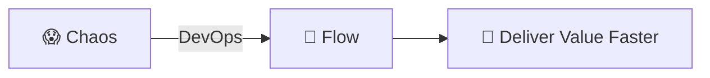

Схема: 😱 Хаос → (DevOps) → 🌊 Поток → 💎 Ценность доставляется быстрее.

> 📚 **Frame for the semester:** every lab in this course traces back to a problem that DevOps solves. Today we name the problems; over the next 16 weeks you build the solutions yourself.
>
> **Установка на семестр:** каждая лаба в этом курсе выводится из проблемы, которую решает DevOps. Сегодня мы называем проблемы; за следующие 16 недель ты сам построишь их решения.

---

## 📍 Slide 2 – 🎯 Learning Outcomes

Слайд 2 — Результаты обучения

* ✅ Define DevOps and its core principles (CAMS, Three Ways)
  * Дать определение DevOps и его ключевых принципов (CAMS, «Три пути»)
* ✅ Recognize pre-DevOps anti-patterns in real teams
  * Узнавать антипаттерны, характерные для команд до DevOps
* ✅ Map DevOps practices (CI/CD, IaC, observability) to the problems they fix
  * Сопоставлять практики DevOps (CI/CD, IaC, наблюдаемость) с проблемами, которые они решают
* ✅ Read DORA metrics and tell elite teams from low performers
  * Читать метрики DORA и отличать элитные команды от отстающих
* ✅ Navigate the DevOps lifecycle and locate this course's labs inside it
  * Ориентироваться в жизненном цикле DevOps и находить в нём лабы этого курса

**🎓 By the end of this lecture:**

**🎓 К концу лекции:**

| # | Outcome |
|---|---------|
| 1 | 🧠 Define DevOps in your own words |
| 2 | 🔍 Recognize the silos, fear, and toil that DevOps formed to fight |
| 3 | 🛠️ Match each DevOps practice to the failure mode it addresses |
| 4 | 🗺️ Place every course lab on the DevOps lifecycle |

| # | Результат |
|---|-----------|
| 1 | 🧠 Сформулировать DevOps своими словами |
| 2 | 🔍 Узнавать разрозненность, страх и рутину, против которых возник DevOps |
| 3 | 🛠️ Соотносить каждую практику DevOps с типом сбоя, который она устраняет |
| 4 | 🗺️ Разместить каждую лабу курса на схеме жизненного цикла DevOps |

---

## 📍 Slide 3 – 📜 A Brief History

Слайд 3 — Краткая история

* 📅 **2009** — Patrick Debois organizes **DevOpsDays** in Ghent, Belgium. The term *"DevOps"* is coined.
  * **2009** — Патрик Дебуа проводит **DevOpsDays** в Генте (Бельгия). Возникает сам термин *«DevOps»*.
* 📅 **2009** — John Allspaw & Paul Hammond present *"10+ Deploys per Day"* at Velocity — the cultural manifesto.
  * **2009** — Джон Оллспо и Пол Хаммонд делают доклад *«10+ деплоев в день»* на Velocity — это культурный манифест движения.
* 📅 **2011** — Werner Vogels (Amazon CTO) reports Amazon deploys to production **every 11.7 seconds** at peak.
  * **2011** — Вернер Фогельс (CTO Amazon) сообщает, что Amazon деплоит в прод **каждые 11,7 секунды** в пике.
* 📅 **2013** — **Docker** open-sourced. Containers become mainstream.
  * **2013** — **Docker** выходит в открытый исходный код. Контейнеры становятся мейнстримом.
* 📅 **2014** — **Kubernetes** announced by Google. Container orchestration takes off.
  * **2014** — Google анонсирует **Kubernetes**. Оркестрация контейнеров набирает обороты.
* 📅 **2016** — **The DevOps Handbook** published (Kim, Humble, Debois, Willis).
  * **2016** — выходит **The DevOps Handbook** (Ким, Хамбл, Дебуа, Уиллис).
* 📅 **2018** — Nicole Forsgren's *Accelerate* publishes the four DORA metrics.
  * **2018** — книга Николь Форсгрен *Accelerate* публикует четыре метрики DORA.
* 📅 **2024** — DORA *State of DevOps* reports **19% elite + 22% high performers** (41% combined; final report with this taxonomy).
  * **2024** — отчёт DORA *State of DevOps*: **19% элитных + 22% высокоэффективных** команд (41% суммарно; последний отчёт с такой классификацией).
* 📅 **2025** — DORA retires the Elite/High/Medium/Low ladder; replaces it with **seven team archetypes** that combine delivery performance with human factors (burnout, friction, perceived value).
  * **2025** — DORA отказывается от лестницы Elite/High/Medium/Low и заменяет её **семью архетипами команд**, где скорость доставки оценивается вместе с человеческими факторами (выгорание, трение, ощущаемая ценность).

> 🤔 **Notice:** DevOps started as a *culture* movement, not a tool announcement.
>
> **Обрати внимание:** DevOps начался как движение за *культуру*, а не как анонс инструмента.

---

## 📍 Slide 4 – ❓ The Big Question

Слайд 4 — Большой вопрос

* 📊 **70%+** of large-scale IT projects experience significant cost or schedule overruns (McKinsey)
  * **Свыше 70%** крупных IT-проектов выходят за бюджет или сроки (McKinsey)
* ⏱️ Pre-DevOps lead time from commit to production: **weeks to months**
  * До DevOps время от коммита до прода: **недели и месяцы**
* 💥 The biggest source of outages is **changes** — deploys, config edits, dependency bumps
  * Главный источник аварий — **изменения**: деплои, правки конфигов, обновления зависимостей

> 💬 *"It worked on my machine."* — Every developer, ever
>
> *«У меня локально всё работало»* — каждый разработчик в истории.

**🤔 Discussion:**

**🤔 Обсуждение:**

* Why is software delivery so hard?
  * Почему доставка ПО такая сложная?
* Why do teams fear deployments?
  * Почему команды боятся деплоев?
* What would "good" look like for your team?
  * Как выглядит «хорошо» для твоей команды?

---

## 📍 Slide 5 – 🔥 Section 1: The Problem Before DevOps

Слайд 5 — Раздел 1: Проблема до DevOps

* 👨‍💻 **Development** and ⚙️ **Operations** were separate teams with opposing goals
  * 👨‍💻 **Разработка** и ⚙️ **эксплуатация** были разными командами с противоположными целями
* 🚀 Dev wanted: **ship features fast** (rewarded for velocity)
  * 🚀 Разработка хотела **быстро выпускать фичи** (её вознаграждали за скорость)
* 🛡️ Ops wanted: **keep systems stable** (rewarded for uptime)
  * 🛡️ Эксплуатация хотела **держать системы стабильными** (её вознаграждали за uptime)
* 💥 Result: **structural conflict, blame, and slow delivery**
  * 💥 Результат: **структурный конфликт, поиск виноватых и медленная доставка**

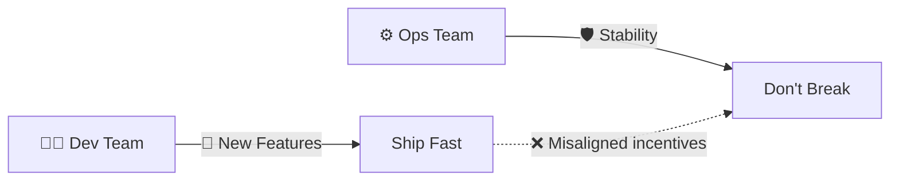

Схема: команда разработки тянет к «выпустить быстро», команда эксплуатации — к «не сломать»; пунктирная стрелка между ними — ❌ рассогласованные стимулы.

> 📖 *The Phoenix Project* (Kim, Behr, Spafford, 2013) dramatizes this exact conflict — required reading for this course.
>
> *The Phoenix Project* (Ким, Бер, Спаффорд, 2013) как раз драматизирует этот конфликт — обязательное чтение в этом курсе.

---

## 📍 Slide 6 – 🧱 The Wall of Confusion

Слайд 6 — Стена непонимания

* 🧱 **The Wall** = invisible barrier between Dev and Ops
  * 🧱 **«Стена»** — невидимый барьер между разработкой и эксплуатацией
* 📦 Dev "throws code over the wall"; Ops catches the blame when it breaks
  * 📦 Разработка «перебрасывает код через стену»; когда он ломается, виноватой оказывается эксплуатация
* 🔄 Ops rejects changes to avoid risk; Dev routes around Ops
  * 🔄 Эксплуатация отклоняет изменения, чтобы избежать риска; разработка обходит её стороной

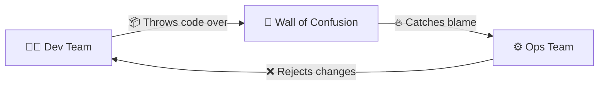

Схема: разработка перебрасывает код через «стену непонимания»; эксплуатация получает обвинения, когда что-то падает, и в ответ отклоняет изменения — круг замыкается.

> 🤔 **Think:** in your last student project, who would have been "Dev" and who "Ops"?
>
> **Подумай:** в твоём последнем учебном проекте кто был бы «разработкой», а кто — «эксплуатацией»?

---

## 📍 Slide 7 – 😱 Manual Release Hell

Слайд 7 — Ад ручных релизов

* 📅 Deployments are rare events (monthly or quarterly)
  * 📅 Деплои — редкие события (раз в месяц или квартал)
* 🎰 Each release = **high-risk, all-hands-on-deck**
  * 🎰 Каждый релиз — **высокий риск и мобилизация всех**
* 📋 Manual checklists, weekend work, no rollback plan
  * 📋 Ручные чек-листы, работа по выходным, плана отката нет
* 💀 One mistake = hours of recovery, frustrated users
  * 💀 Одна ошибка — часы на восстановление и раздражённые пользователи

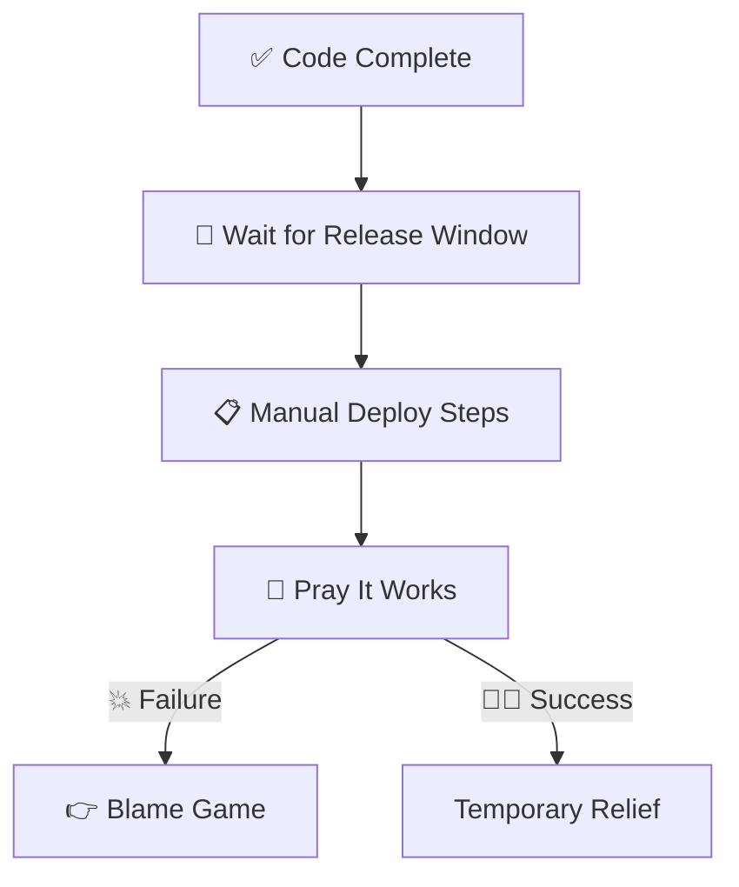

Схема: код готов → ждём окно релиза → ручные шаги → «надеемся, что заведётся»; при сбое — поиск виноватых, при успехе — временное облегчение.

**📊 Pre-DevOps numbers (Accelerate, 2018):**

**📊 Цифры до DevOps (Accelerate, 2018):**

* 🐢 Lead time for changes: **months** (low performers)
  * 🐢 Время от изменения до продакшена: **месяцы** (у отстающих команд)
* 📉 Change failure rate: **40–60%** for low performers
  * 📉 Доля неудачных изменений: **40–60%** у отстающих
* ⏱️ Recovery from incident: **a week or more**
  * ⏱️ Восстановление после инцидента: **неделя и больше**

---

## 📍 Slide 8 – 😨 Fear and Blame Culture

Слайд 8 — Культура страха и обвинений

* 🌙 Incident happens at 2am — first question is *"Who did this?"*
  * 🌙 Инцидент в 2 часа ночи — первый вопрос: *«Кто это сделал?»*
* 🙈 Engineers hide mistakes; nobody deploys on Friday
  * 🙈 Инженеры скрывают ошибки; никто не деплоит в пятницу
* 💀 Innovation freezes; the safest move is to do nothing
  * 💀 Инновации замирают: безопаснее всего ничего не делать

> ⚠️ **Fear kills velocity.**
>
> ⚠️ **Страх убивает скорость.**

**Symptoms of a blame culture:**

**Признаки культуры обвинений:**

* 🔇 People afraid to speak up in postmortems
  * 🔇 Люди боятся говорить на разборах инцидентов
* 📝 Excessive documentation written defensively
  * 📝 Документация пишется «защитно», с оглядкой на возможные обвинения
* 🐌 Slow decision-making, escalations on everything
  * 🐌 Медленные решения, эскалация по любому поводу
* 🚪 High turnover among senior engineers
  * 🚪 Высокая текучка среди опытных инженеров

> 📖 *"Without blameless postmortems, organisations never learn from incidents."* — Google SRE Book (Beyer et al.)
>
> *«Без безвинных post-mortem организация никогда не учится на инцидентах»*. — Google SRE Book (Байер и др.)

---

## 📍 Slide 9 – 💸 The Cost of Chaos

Слайд 9 — Цена хаоса

| 🔥 Problem | 💥 Impact |
|------------|-----------|
| 🐢 Slow releases | Lost market opportunity, competitors ship first |
| 📋 Manual processes | Human error, burnout, on-call fatigue |
| 👉 Blame culture | Senior talent leaves, knowledge bleeds |
| 🙈 No observability | Firefighting mode, MTTR in hours not minutes |

| 🔥 Проблема | 💥 Последствие |
|-------------|----------------|
| 🐢 Медленные релизы | Упущенная рыночная возможность, конкуренты выпускают первыми |
| 📋 Ручные процессы | Человеческие ошибки, выгорание, усталость от дежурств |
| 👉 Культура обвинений | Уходят опытные специалисты, вместе с ними утекают знания |
| 🙈 Нет наблюдаемости | Постоянный режим тушения пожаров, MTTR измеряется часами, а не минутами |

**📈 Concrete examples:**

**📈 Конкретные примеры:**

* 🏢 **Amazon pre-DevOps (early 2000s):** monolithic deploys took **weeks**
  * 🏢 **Amazon до DevOps (начало 2000-х):** монолитные деплои занимали **недели**
* 🚀 **Amazon today:** ~50 million deploys/year across services (Werner Vogels, re:Invent)
  * 🚀 **Amazon сегодня:** около 50 млн деплоев в год по всем сервисам (Вернер Фогельс, re:Invent)
* 💰 **IBM Cost of a Data Breach:** peaked at **$4.88M (2024)**, then **dropped to $4.44M in 2025** as AI-assisted detection cut containment time; **U.S. average hit a record $10.22M** in 2025
  * 💰 **IBM Cost of a Data Breach:** пик — **$4,88 млн (2024)**, затем **снижение до $4,44 млн в 2025** благодаря ИИ-детекции, сократившей время локализации; **средняя стоимость в США достигла рекордных $10,22 млн** в 2025-м

> 🔥 **Hot take:** every hour of downtime is paid for. The question is whether *you* or *your users* pay.
>
> 🔥 **Резко, но честно:** каждый час простоя кто-то оплачивает. Вопрос — *ты* или *твои пользователи*.

---

## 📍 Slide 10 – 💡 Section 2: What DevOps Really Is

Слайд 10 — Раздел 2: Что такое DevOps на самом деле

* 🤝 **DevOps** = development + operations working as **one team**
  * 🤝 **DevOps** = разработка и эксплуатация работают как **одна команда**
* 🌱 A **culture** of collaboration and shared responsibility
  * 🌱 **Культура** сотрудничества и общей ответственности
* 🔧 A set of **practices** for fast, reliable delivery
  * 🔧 Набор **практик** для быстрой и надёжной доставки
* 🚫 NOT just tools, NOT a job title, NOT a separate team
  * 🚫 Это НЕ просто инструменты, НЕ должность и НЕ отдельная команда

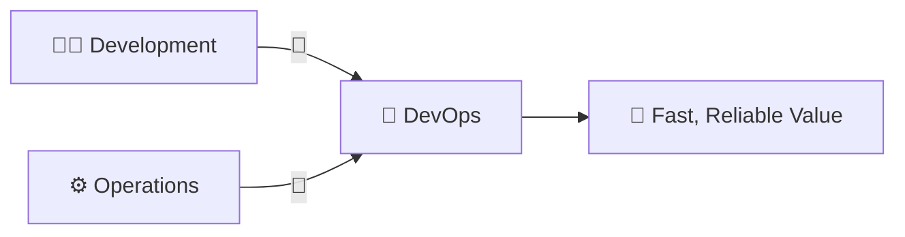

Схема: разработка и эксплуатация вместе образуют DevOps, который доставляет ценность быстро и надёжно.

**📖 Working definition (Humble & Farley, *Continuous Delivery*, 2010):**

**📖 Рабочее определение (Хамбл и Фарли, *Continuous Delivery*, 2010):**

> DevOps is a set of practices that combines software development and IT operations to shorten the development lifecycle while delivering features, fixes, and updates frequently in close alignment with business objectives.
>
> DevOps — это набор практик, объединяющих разработку ПО и IT-эксплуатацию, чтобы сократить жизненный цикл разработки и часто выпускать функции, исправления и обновления в тесной связке с бизнес-целями.

---

## 📍 Slide 11 – 🚫 What DevOps is NOT

Слайд 11 — Чем DevOps НЕ является

| ❌ Myth | ✅ Reality |
|---------|-----------|
| "We hired a DevOps engineer, we're done" | 👥 Everyone participates |
| "DevOps means using Kubernetes" | 🛠️ Tools support culture, not the reverse |
| "DevOps replaces developers or ops" | 🤝 It unites them |
| "DevOps = just automation" | 🧩 Automation + culture + measurement + sharing |
| "DevOps is a team" | 🌍 It's a way of working |

| ❌ Миф | ✅ Реальность |
|--------|---------------|
| «Мы наняли DevOps-инженера — всё, готово» | 👥 Участвуют все |
| «DevOps — это про Kubernetes» | 🛠️ Инструменты поддерживают культуру, а не наоборот |
| «DevOps заменяет разработчиков или эксплуатацию» | 🤝 Он их объединяет |
| «DevOps = просто автоматизация» | 🧩 Автоматизация + культура + измерения + обмен знаниями |
| «DevOps — это команда» | 🌍 Это способ работы |

> 🔥 **Hot take:** You can't buy DevOps. You build it.
>
> 🔥 **Резко, но честно:** DevOps нельзя купить. Его нужно построить.

---

## 📍 Slide 12 – 🔄 The Three Ways

Слайд 12 — Три пути

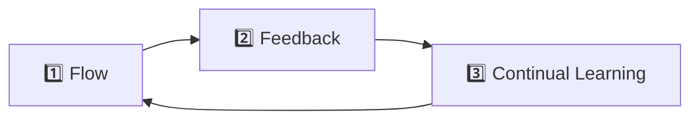

Схема: 1️⃣ Поток → 2️⃣ Обратная связь → 3️⃣ Непрерывное обучение → снова поток.

| 🛤️ Way | 🎯 Focus | 💡 Practical Example |
|--------|---------|-----------|
| 1️⃣ **Flow** | Fast Dev → Prod | 🚀 CI/CD pipelines, trunk-based development |
| 2️⃣ **Feedback** | Fast Prod → Dev | 📊 Monitoring, alerting, error budgets |
| 3️⃣ **Continual Learning** | Experiment safely | 📝 Blameless postmortems, chaos engineering |

| 🛤️ Путь | 🎯 Фокус | 💡 Пример на практике |
|----------|----------|-----------------------|
| 1️⃣ **Поток (Flow)** | Быстро из разработки в прод | 🚀 CI/CD-пайплайны, trunk-based development |
| 2️⃣ **Обратная связь** | Быстро из прода в разработку | 📊 Мониторинг, алерты, error budgets |
| 3️⃣ **Непрерывное обучение** | Безопасно экспериментировать | 📝 Безвинные post-mortem, chaos engineering |

> 📚 **Source:** *The Phoenix Project* and *The DevOps Handbook* (Kim et al.)
>
> 📚 **Источник:** *The Phoenix Project* и *The DevOps Handbook* (Ким и др.)

---

## 📍 Slide 13 – 🧩 The CAMS Model

Слайд 13 — Модель CAMS

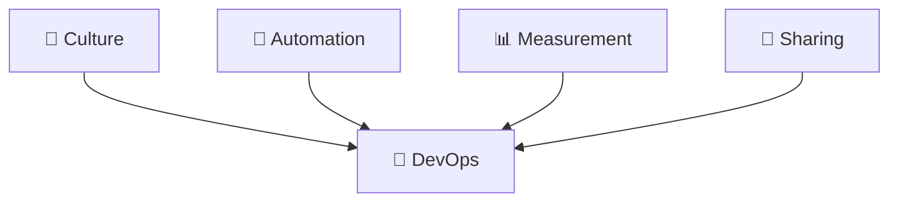

Схема: культура, автоматизация, измерения и обмен знаниями вместе образуют DevOps.

* 🌱 **Culture** — trust, collaboration, shared ownership
  * 🌱 **Культура (Culture)** — доверие, сотрудничество, общая ответственность
* 🤖 **Automation** — eliminate manual, error-prone toil
  * 🤖 **Автоматизация (Automation)** — устранить ручную, подверженную ошибкам рутину
* 📊 **Measurement** — track metrics, decide with data
  * 📊 **Измерения (Measurement)** — отслеживать метрики и решать на основе данных
* 🔗 **Sharing** — knowledge flows freely, postmortems are blameless
  * 🔗 **Обмен (Sharing)** — знания распространяются свободно, post-mortem проводятся без обвинений

> 📖 Coined by Damon Edwards and John Willis (2010). Jez Humble later added **L** for *Lean* → **CALMS**.
>
> 📖 Модель предложили Дэймон Эдвардс и Джон Уиллис (2010). Позже Джез Хамбл добавил **L** — *Lean* (бережливое производство), и получилась **CALMS**.

---

## 📍 Slide 14 – ⚡ Before vs. After DevOps

Слайд 14 — До и после DevOps

| 😰 Before | 🚀 After |
|----------|---------|
| 📅 Releases every few months | 📆 Releases daily or hourly |
| 📋 Manual deployments | 🤖 Automated, version-controlled pipelines |
| 👉 Blame when things break | 📝 Blameless postmortems |
| 🙅 "Not my problem" | 🤝 Shared ownership ("you build it, you run it") |
| 😨 Fear of change | 💪 Small, reversible changes embraced |
| 🐌 Hours of manual deploy | ⚡ Minutes to deploy, seconds to roll back |

| 😰 До | 🚀 После |
|-------|----------|
| 📅 Релизы раз в несколько месяцев | 📆 Релизы ежедневно или ежечасно |
| 📋 Ручные деплои | 🤖 Автоматизированные пайплайны под контролем версий |
| 👉 Поиск виноватых при сбоях | 📝 Post-mortem без обвинений |
| 🙅 «Это не моя проблема» | 🤝 Общая ответственность («ты это построил — ты это и эксплуатируешь») |
| 😨 Страх изменений | 💪 Мелкие обратимые изменения приветствуются |
| 🐌 Часы на ручной деплой | ⚡ Минуты на деплой, секунды на откат |

> 🤔 Which column describes a team you've worked on?
>
> 🤔 Какая колонка описывает команду, в которой ты работал?

---

## 📍 Slide 15 – 🎮 Section 3: DevOps as a Game

Слайд 15 — Раздел 3: DevOps как игра

## 🕹️ Simulation — You're the CTO

🕹️ Симуляция — ты CTO

* 🏢 **FlowStart Inc.** — a growing startup
  * 🏢 **FlowStart Inc.** — растущий стартап
* 👥 5 developers, 2 ops engineers, 10K users
  * 👥 5 разработчиков, 2 инженера эксплуатации, 10 тыс. пользователей
* 📈 Pressure from leadership: ship faster, but stop breaking things
  * 📈 Давление сверху: выпускайте быстрее, но перестаньте всё ломать
* ❓ **What could go wrong?**
  * ❓ **Что может пойти не так?**

> 💀 *Everything.*
>
> 💀 *Всё.*

Let's walk through four real failure modes and the DevOps practice that fixes each. Each scenario maps to a lab you'll do this semester.

Разберём четыре реальных сценария сбоя и практику DevOps, которая каждый из них исправляет. Каждый сценарий соответствует лабе, которую ты сделаешь в этом семестре.

---

## 📍 Slide 16 – 💥 Scenario 1: Release Failure → CI/CD

Слайд 16 — Сценарий 1: провальный релиз → CI/CD

**The failure:**

**Сбой:**

* 📤 Friday 5pm push, no tests, no review, straight to production
  * 📤 Пуш в пятницу в 17:00, без тестов и ревью, сразу в прод
* 💥 Login broken, 10K users locked out, 4 hours of downtime
  * 💥 Логин сломан, 10 тыс. пользователей без доступа, 4 часа простоя
* 🤷 Nobody knows what changed because nobody can replay the deploy
  * 🤷 Никто не знает, что изменилось, потому что деплой невозможно воспроизвести

**The fix — Continuous Integration & Continuous Delivery:**

**Решение — непрерывная интеграция и доставка (CI/CD):**

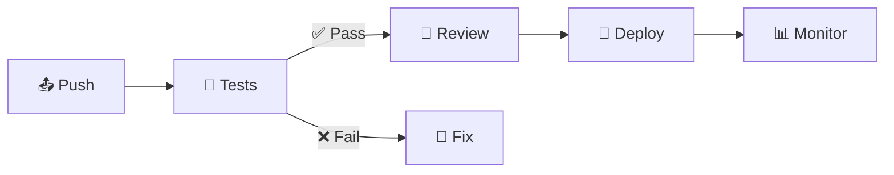

Схема: push → тесты → (при успехе) ревью → деплой → мониторинг; при провале тестов — исправление.

* ✅ Every change runs automated tests before merging
  * ✅ Каждое изменение проходит автотесты до слияния
* ✅ Code review is non-optional
  * ✅ Ревью кода обязательно
* ✅ Deployment is one command (or one git push)
  * ✅ Деплой — одна команда (или один git push)
* ✅ Rollback is one click
  * ✅ Откат — одно нажатие

> 🔗 **Course tie-in:** Lab 3 builds this exact pipeline in GitHub Actions.
>
> 🔗 **Связь с курсом:** в лабе 3 ты построишь ровно такой пайплайн в GitHub Actions.

---

## 📍 Slide 17 – 🐾 Scenario 2: Snowflake Servers → Infrastructure as Code

Слайд 17 — Сценарий 2: уникальные серверы → инфраструктура как код

**The failure:**

**Сбой:**

* 🖥️ Production server hand-configured over 2 years by the ops engineer who just quit
  * 🖥️ Продовый сервер два года настраивали вручную, и только что уволился инженер, который это делал
* 📈 Need to scale to 3 servers — but no one can reproduce the config
  * 📈 Нужно масштабироваться до трёх серверов, но конфигурацию никто не может воспроизвести
* 😱 The "documentation" is in someone's head and Slack DMs
  * 😱 «Документация» — в голове одного человека и в личных сообщениях Slack

> 🐶 **"Pets vs. cattle"** — Bill Baker, Microsoft (2012). Pets are nursed; cattle are replaced.
>
> 🐶 **«Pets vs. cattle»** — Билл Бейкер, Microsoft (2012). Питомцев холят и лечат; скот заменяют.

**The fix — Infrastructure as Code:**

**Решение — инфраструктура как код (IaC):**

```hcl
# 🌍 Terraform (1.10+) — declarative infra
resource "aws_instance" "web" {
  ami           = "ami-0c55b159cbfafe1f0"
  instance_type = "t3.micro"
  count         = 3  # three identical, replaceable servers
}
```

Пояснение к коду: `# 🌍 Terraform (1.10+) — декларативная инфраструктура`; `count = 3` — три одинаковых, заменяемых сервера.

* 📝 Infrastructure lives in version-controlled files
  * 📝 Инфраструктура хранится в файлах под контролем версий
* 🔄 Servers are reproducible, not unique
  * 🔄 Серверы воспроизводимы, а не уникальны
* ⚡ Identical environments spin up in minutes
  * ⚡ Одинаковые окружения поднимаются за минуты

> 🔗 **Course tie-in:** Labs 4 (Terraform + Pulumi) and 5–6 (Ansible) build this skill.
>
> 🔗 **Связь с курсом:** лабы 4 (Terraform + Pulumi) и 5–6 (Ansible) дают этот навык.

---

## 📍 Slide 18 – 🔓 Scenario 3: Secret Leak → Secrets Management

Слайд 18 — Сценарий 3: утечка секрета → управление секретами

**The failure:**

**Сбой:**

* 👨‍💻 Developer commits `database.password = "hunter2"` to a public repo
  * 👨‍💻 Разработчик коммитит `database.password = "hunter2"` в публичный репозиторий
* 🤖 Scanner bots find it in **under 5 minutes** (verified by GitGuardian reports)
  * 🤖 Боты-сканеры находят это **меньше чем за 5 минут** (по данным GitGuardian)
* 💥 Attackers exfiltrate the database
  * 💥 Атакующие выгружают базу данных

**The fix — Secrets Management:**

**Решение — управление секретами:**

```yaml
# ❌ Bad — secret in source
DATABASE_PASSWORD: "super_secret_123"

# ✅ Good — reference, not value
DATABASE_PASSWORD: ${vault:secret/db/password}
```

Пояснение к коду: `# ❌ Плохо — секрет в исходниках`; `# ✅ Хорошо — ссылка, а не значение`.

* 🚫 Never store secrets in code or unencrypted config
  * 🚫 Никогда не хранить секреты в коде или незашифрованных конфигах
* 🔐 Use a secret manager: HashiCorp Vault, OpenBao, AWS Secrets Manager, GCP Secret Manager
  * 🔐 Использовать хранилище секретов: HashiCorp Vault, OpenBao, AWS Secrets Manager, GCP Secret Manager
* 🔍 Pre-commit hooks scan for secrets (gitleaks, trufflehog)
  * 🔍 Pre-commit-хуки ищут секреты (gitleaks, trufflehog)
* 🔄 Rotate credentials automatically
  * 🔄 Автоматически ротировать учётные данные

> 🔗 **Course tie-in:** Lab 11 integrates Kubernetes Secrets with **OpenBao** (the BSL-licensed Vault's open-source fork).
>
> 🔗 **Связь с курсом:** в лабе 11 Kubernetes Secrets интегрируются с **OpenBao** (open-source-форк Vault под лицензией BSL).

---

## 📍 Slide 19 – 🙈 Scenario 4: Blind Operations → Observability

Слайд 19 — Сценарий 4: слепая эксплуатация → наблюдаемость

**The failure:**

**Сбой:**

* 👥 Users on Twitter: *"App is slow."*
  * 👥 Пользователи пишут в Twitter: *«Приложение тормозит»*
* 🤷 Team has no metrics, no logs, no traces
  * 🤷 У команды нет ни метрик, ни логов, ни трейсов
* ⏱️ Hours wasted guessing; finally restart the server out of desperation
  * ⏱️ Часы уходят на догадки; в отчаянии сервер наконец перезапускают

**The fix — Observability (the three pillars):**

**Решение — наблюдаемость (три столпа):**

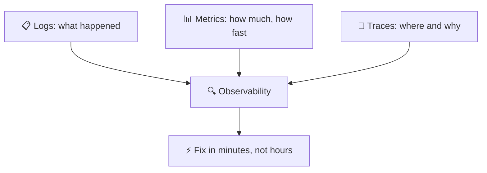

Схема: логи (что произошло), метрики (сколько и как быстро), трейсы (где и почему) складываются в наблюдаемость, которая позволяет чинить за минуты, а не часы.

| 📊 Pillar | 🛠️ Tools you'll use this course |
|-----------|---------------------------------|
| 📋 Logs | Loki + Promtail (Lab 7) |
| 📊 Metrics | Prometheus + Grafana (Lab 8, Lab 16) |
| 🔗 Traces | Out of scope for Core — covered in SRE-Intro |

| 📊 Столп | 🛠️ Инструменты в этом курсе |
|----------|------------------------------|
| 📋 Логи | Loki + Promtail (лаба 7) |
| 📊 Метрики | Prometheus + Grafana (лабы 8, 16) |
| 🔗 Трейсы | Вне рамок Core — разбираются в SRE-Intro |

> 🔗 **Course tie-in:** Labs 7, 8, and 16 build a complete observability stack from scratch.
>
> 🔗 **Связь с курсом:** лабы 7, 8 и 16 собирают полный стек наблюдаемости с нуля.

---

## 📍 Slide 20 – ♾️ Section 4: The DevOps Lifecycle

Слайд 20 — Раздел 4: жизненный цикл DevOps

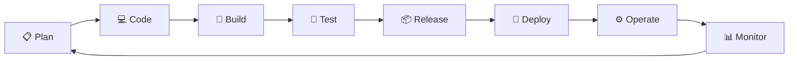

Схема: Plan (планирование) → Code (код) → Build (сборка) → Test (тестирование) → Release (релиз) → Deploy (деплой) → Operate (эксплуатация) → Monitor (мониторинг) → снова Plan.

* ♾️ DevOps is **continuous** — there is no "done"
  * ♾️ DevOps **непрерывен** — состояния «готово» не существует
* 🔄 Each stage feeds the next; monitoring informs the next plan
  * 🔄 Каждый этап питает следующий; мониторинг задаёт следующий план
* 🔁 Forever improving — the loop is the point
  * 🔁 Постоянное улучшение — и есть суть цикла

---

## 📍 Slide 21 – 🔁 Lifecycle Phases → Tools (May 2026 baseline)

Слайд 21 — Фазы жизненного цикла → инструменты (по состоянию на май 2026)

| 📍 Phase | 🎯 Activity | 🛠️ Representative Tools |
|----------|------------|-------------------------|
| 📋 Plan | Requirements, design | Jira, Linear, GitHub Issues |
| 💻 Code | Write & review | Git, GitHub, VS Code, JetBrains |
| 🔨 Build | Compile, package | Docker **29.x**, Buildah, Maven, npm |
| 🧪 Test | Automated testing | pytest 8.3, Jest 30, Playwright, k6 |
| 📦 Release | Version, approve | GitHub Releases, Conventional Commits |
| 🚀 Deploy | Push to environment | **ArgoCD 3.4**, **Argo Rollouts 1.8**, **Helm 4.1** |
| ⚙️ Operate | Run, scale | **Kubernetes 1.36** "Haru", **Terraform 1.15**, **ansible-core 2.21** |
| 📊 Monitor | Observe, alert | **Prometheus 3.11+**, Grafana 11, Loki 3.7, **Alloy 1.16** (Promtail EOL Mar 2026) |

| 📍 Фаза | 🎯 Действие | 🛠️ Типичные инструменты |
|---------|-------------|--------------------------|
| 📋 Планирование | Требования, проектирование | Jira, Linear, GitHub Issues |
| 💻 Код | Писать и ревьюить | Git, GitHub, VS Code, JetBrains |
| 🔨 Сборка | Компиляция, упаковка | Docker **29.x**, Buildah, Maven, npm |
| 🧪 Тестирование | Автотесты | pytest 8.3, Jest 30, Playwright, k6 |
| 📦 Релиз | Версионирование, утверждение | GitHub Releases, Conventional Commits |
| 🚀 Деплой | Доставка в окружение | **ArgoCD 3.4**, **Argo Rollouts 1.8**, **Helm 4.1** |
| ⚙️ Эксплуатация | Запуск, масштабирование | **Kubernetes 1.36** «Haru», **Terraform 1.15**, **ansible-core 2.21** |
| 📊 Мониторинг | Наблюдать, оповещать | **Prometheus 3.11+**, Grafana 11, Loki 3.7, **Alloy 1.16** (Promtail EOL в марте 2026) |

> 🔧 **Note on versions:** every tool above is pinned to a current May-2026 stable. The labs match. *Helm 4 is a major release — most online tutorials still show Helm 3 syntax; we deliberately use 4.*
>
> 🔧 **О версиях:** все инструменты зафиксированы на стабильных версиях по состоянию на май 2026. Лабы им соответствуют. *Helm 4 — мажорный релиз; большинство онлайн-уроков всё ещё показывают синтаксис Helm 3, а мы намеренно используем 4.*

---

## 📍 Slide 22 – 🗺️ Course Map

Слайд 22 — Карта курса

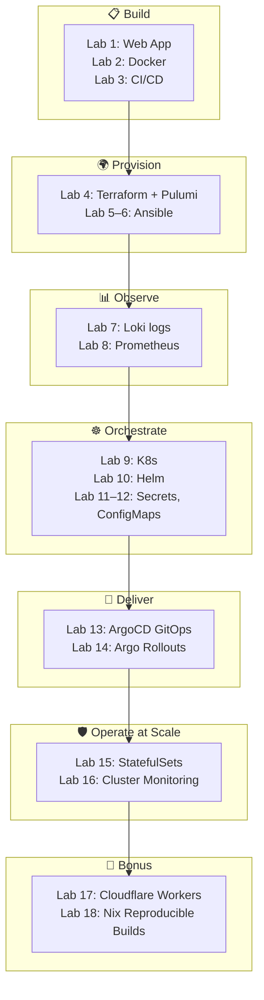

Схема: 📋 Создание (лабы 1–3: веб-приложение, Docker, CI/CD) → 🌍 Подготовка инфраструктуры (лабы 4–6: Terraform + Pulumi, Ansible) → 📊 Наблюдаемость (лабы 7–8: логи Loki, Prometheus) → ☸️ Оркестрация (лабы 9–12: Kubernetes, Helm, секреты и ConfigMaps) → 🚢 Доставка (лабы 13–14: ArgoCD GitOps, Argo Rollouts) → 🛡️ Эксплуатация в масштабе (лабы 15–16: StatefulSets, мониторинг кластера) → 🎁 Бонус (лабы 17–18: Cloudflare Workers, воспроизводимые сборки на Nix).

✅ **16 main labs + 2 bonus labs. Every one maps to a real DevOps skill.**

✅ **16 основных лаб + 2 бонусные. Каждая соответствует реальному навыку DevOps.**

---

## 📍 Slide 23 – 📊 DORA Metrics — How We Measure DevOps

Слайд 23 — метрики DORA — как измеряют DevOps

The DORA team (Nicole Forsgren et al.) identified four metrics that predict software delivery performance. The DORA *State of DevOps* report has tracked them yearly since 2014.

Команда DORA (Николь Форсгрен и др.) выделила четыре метрики, предсказывающие эффективность доставки ПО. Отчёт DORA *State of DevOps* отслеживает их ежегодно с 2014 года.

| 📊 Metric | 📏 What it measures | 🏆 Elite (2024) | 🐢 Low (2024) |
|-----------|--------------------|--------------|--------------|
| ⏱️ **Lead Time for Changes** | Commit → production | < 1 hour | > 1 month |
| 📦 **Deployment Frequency** | How often you deploy | On-demand (multi/day) | < 1/month |
| ❌ **Change Failure Rate** | % deploys that cause incidents | 0–5% | 46–60% |
| 🔧 **Failed Deployment Recovery Time** | MTTR after a bad deploy | < 1 hour | > 1 month |

| 📊 Метрика | 📏 Что измеряет | 🏆 Элитные (2024) | 🐢 Отстающие (2024) |
|------------|-----------------|-------------------|---------------------|
| ⏱️ **Время до изменения (Lead Time for Changes)** | От коммита до прода | < 1 часа | > 1 месяца |
| 📦 **Частота деплоев (Deployment Frequency)** | Как часто вы деплоите | По требованию (несколько в день) | < 1 в месяц |
| ❌ **Доля неудачных изменений (Change Failure Rate)** | % деплоев, вызывающих инциденты | 0–5% | 46–60% |
| 🔧 **Время восстановления после неудачного деплоя (MTTR)** | Сколько чинится плохой деплой | < 1 часа | > 1 месяца |

> 📚 **Source:** DORA *State of DevOps Report 2024* — the last report to use this four-tier ladder. The fifth metric (reliability) was added in 2021. The 2025 report retired the ladder in favour of seven team archetypes blending delivery + human factors — but the four metrics themselves remain the industry standard for measurement.
>
> 📚 **Источник:** DORA *State of DevOps Report 2024* — последний отчёт с этой четырёхуровневой шкалой. Пятая метрика (надёжность) добавлена в 2021-м. Отчёт 2025 года отказался от шкалы в пользу семи архетипов команд, сочетающих скорость доставки и человеческие факторы, — но сами четыре метрики остаются отраслевым стандартом измерения.

**🤔 Question:** which metric is hardest to improve, and why?

**🤔 Вопрос:** какую метрику труднее всего улучшить и почему?

---

## 📍 Slide 24 – 🌊 From Chaos to Flow

Слайд 24 — От хаоса к потоку

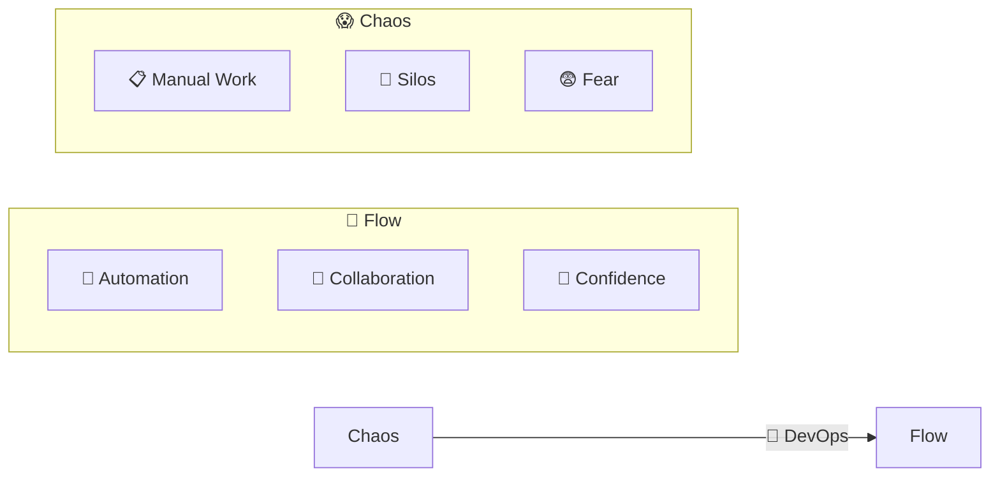

Схема: 😱 Хаос (ручная работа, разрозненность, страх) через 🚀 DevOps превращается в 🌊 Поток (автоматизация, сотрудничество, уверенность).

**🎯 Flow State (Gene Kim's definition):**

**🎯 Состояние потока (определение Джина Кима):**

* ⚡ Changes flow smoothly from idea to production
  * ⚡ Изменения плавно проходят от идеи до продакшена
* 🔄 Feedback loops are fast and trustworthy
  * 🔄 Петли обратной связи быстрые и вызывают доверие
* 📈 Teams continuously experiment and improve
  * 📈 Команды постоянно экспериментируют и улучшаются

---

## 📍 Slide 25 – 🏢 Section 5: DevOps in Real Life

Слайд 25 — Раздел 5: DevOps в реальной жизни

**🎬 Netflix** — the canonical DevOps case study

**🎬 Netflix** — классический кейс DevOps

* 🚀 1000+ production deploys/day across services
  * 🚀 Более 1000 деплоев в прод в день по всем сервисам
* 🐒 *Chaos Monkey* (open-sourced 2012) — kills production instances on purpose to verify resilience
  * 🐒 *Chaos Monkey* (открыт в 2012-м) — намеренно убивает продовые инстансы, чтобы проверить устойчивость
* 🔄 Self-healing infrastructure; on-call engineers rarely paged
  * 🔄 Самовосстанавливающаяся инфраструктура; дежурных инженеров будят редко

**📦 Amazon**

**📦 Amazon**

* ⚡ Every 11.7 seconds on average (Werner Vogels, 2011) — still cited as a benchmark
  * ⚡ В среднем каждые 11,7 секунды (Вернер Фогельс, 2011) — до сих пор цитируется как эталон
* 🔧 *"You build it, you run it"* — Werner's two-pizza team rule
  * 🔧 *«Ты это построил — ты это и эксплуатируешь»* — правило «команд из двух пицц» Фогельса
* 🛠️ AWS itself was built to dogfood Amazon's internal platform
  * 🛠️ Сам AWS строился на внутренней платформе Amazon

**🔍 Google**

**🔍 Google**

* 🛡️ Invented **Site Reliability Engineering (SRE)** in 2003 — Ben Treynor Sloss
  * 🛡️ В 2003 году придумал **Site Reliability Engineering (SRE)** — Бен Трейнър Слосс
* 📊 *Error budgets* balance velocity against reliability
  * 📊 *Error budgets* балансируют скорость и надёжность
* 📝 Blameless postmortems are a hiring criterion
  * 📝 Post-mortem без обвинений — критерий при найме

> 🔗 **Want more of this?** SRE-Intro (elective) goes deep on Google's playbook.
>
> 🔗 **Хочешь глубже?** Электив SRE-Intro подробно разбирает подход Google.

---

## 📍 Slide 26 – 👥 DevOps Roles (2025/26)

Слайд 26 — Роли в DevOps (2025/26)

| 👤 Role | 🎯 Focus |
|---------|---------|
| 🔧 **DevOps Engineer** | Pipelines, automation, infra-as-code |
| 🛡️ **SRE** | Reliability, SLOs, incident response |
| 🏗️ **Platform Engineer** | Internal developer platform, golden paths |
| ☁️ **Cloud Engineer** | Cloud infra, cost optimization, FinOps |

| 👤 Роль | 🎯 Фокус |
|---------|----------|
| 🔧 **DevOps-инженер** | Пайплайны, автоматизация, инфраструктура как код |
| 🛡️ **SRE** | Надёжность, SLO, реагирование на инциденты |
| 🏗️ **Platform-инженер** | Внутренняя платформа для разработчиков, готовые пути |
| ☁️ **Cloud-инженер** | Облачная инфраструктура, оптимизация затрат, FinOps |

**🔗 Common thread:** collaboration, automation, ownership of production.

**🔗 Общее:** сотрудничество, автоматизация, ответственность за прод.

> 💼 Platform Engineering is the fastest-growing of the four (Gartner 2024). Many companies now treat the *internal developer platform* as a product.
>
> 💼 Platform Engineering — самая быстрорастущая из четырёх ролей (Gartner, 2024). Многие компании теперь относятся к *внутренней платформе разработчиков* как к продукту.

---

## 📍 Slide 27 – 🤝 Team Collaboration in Practice

Слайд 27 — Командная работа на практике

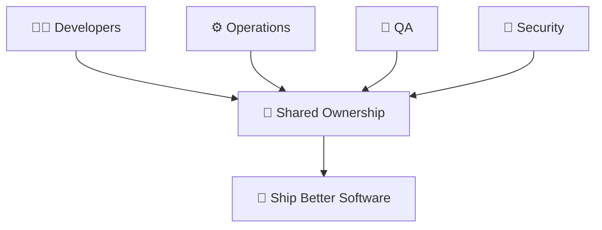

Схема: разработчики, эксплуатация, QA и безопасность вместе несут ответственность и в итоге выпускают более качественное ПО.

**🤝 Practices you'll see in healthy teams:**

**🤝 Практики здоровых команд:**

* 📟 Shared on-call rotations across Dev and Ops
  * 📟 Общие дежурства разработки и эксплуатации
* 📝 Blameless incident reviews with action items
  * 📝 Разборы инцидентов без обвинений, с конкретными задачами
* 👥 Cross-functional squads — feature teams own from idea to operations
  * 👥 Кросс-функциональные команды: одна команда отвечает за фичу от идеи до эксплуатации
* 🔓 Self-service deploy — every engineer can ship, with guardrails
  * 🔓 Самостоятельный деплой — любой инженер может выкатить, но в заданных рамках

---

## 📍 Slide 28 – 🎯 Key Takeaways

Слайд 28 — Главное из лекции

1. 🧩 **DevOps = culture + practices + tools** — in that order
   * 🧩 **DevOps = культура + практики + инструменты** — именно в таком порядке
2. 🧱 **Break down silos** between Dev and Ops
   * 🧱 **Разрушай барьеры** между разработкой и эксплуатацией
3. 🤖 **Automate everything** repeatable
   * 🤖 **Автоматизируй всё**, что повторяется
4. 📊 **Measure with DORA** — lead time, deploy frequency, change failure rate, MTTR
   * 📊 **Измеряй по DORA** — время до изменения, частота деплоев, доля неудачных изменений, MTTR
5. 📝 **Learn from failures**, don't assign blame
   * 📝 **Учись на сбоях**, а не ищи виноватых
6. 🔄 **Small changes, fast feedback** — the safest path to production
   * 🔄 **Мелкие изменения и быстрая обратная связь** — самый безопасный путь в прод

> 💡 DevOps isn't a destination. It's a direction.
>
> 💡 DevOps — не пункт назначения, а направление.

---

## 📍 Slide 29 – 🧠 The Mindset Shift

Слайд 29 — Смена мышления

| 😰 Old Mindset | 🚀 DevOps Mindset |
|---------------|------------------|
| 🙅 "Not my job" | 🤝 "Our responsibility" |
| 🚫 "Don't touch prod" | 💪 "Deploy with confidence, roll back fast" |
| 👉 "Who broke it?" | 🔍 "How do we prevent this class of failure?" |
| 😨 "Change is risky" | ✅ "Small frequent changes are safer than rare big ones" |
| 💻 "Works on my machine" | 🌍 "Works in every environment — proved by pipeline" |

| 😰 Старое мышление | 🚀 Мышление DevOps |
|--------------------|--------------------|
| 🙅 «Это не моя работа» | 🤝 «Это наша ответственность» |
| 🚫 «Не трогай прод» | 💪 «Деплой уверенно, откатывай быстро» |
| 👉 «Кто это сломал?» | 🔍 «Как не допустить этот класс сбоев?» |
| 😨 «Изменения рискованны» | ✅ «Мелкие частые изменения безопаснее редких крупных» |
| 💻 «У меня локально работает» | 🌍 «Работает в любом окружении — это доказано пайплайном» |

> ❓ Which mindset describes the team you want to work on?
>
> ❓ Какое мышление описывает команду, в которой ты хочешь работать?

---

## 📍 Slide 30 – 🚀 What Comes Next

Слайд 30 — Что дальше

**📚 Next lecture: *Containerization with Docker*** — packaging your app so "works on my machine" finally means "works everywhere."

**📚 Следующая лекция: *Контейнеризация с Docker*** — как упаковать приложение, чтобы «работает у меня» наконец означало «работает везде».

* 🐳 Why containers won (and where they don't)
  * 🐳 Почему контейнеры победили (и где они не нужны)
* 🔧 Writing production-ready Dockerfiles
  * 🔧 Как писать Dockerfile, готовый к продакшену
* 🛡️ Rootless, distroless, multi-stage builds
  * 🛡️ Rootless, distroless, многоступенчатые сборки
* 🌐 Docker Hub workflow
  * 🌐 Работа с Docker Hub

**🔬 Your Lab 1 work:** build a Python web service exposing `/` and `/health`. That service will be your project for the rest of the semester — by Lab 16, it'll be running on Kubernetes with GitOps, monitoring, secrets, and StatefulSet-backed storage.

**🔬 Что делает твоя лаба 1:** ты собираешь Python-веб-сервис с эндпоинтами `/` и `/health`. Этот сервис станет твоим проектом до конца семестра — к лабе 16 он будет работать в Kubernetes с GitOps, мониторингом, секретами и хранилищем на StatefulSet.

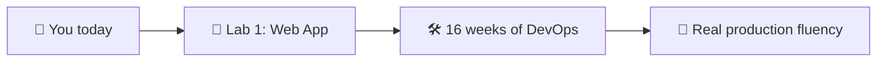

Схема: ты сегодня → лаба 1 (веб-приложение) → 16 недель DevOps → реальная продовая практика.

**👋 See you in Lecture 2.**

**👋 До встречи на лекции 2.**

> 🌊 From chaos to flow — one commit at a time.
>
> 🌊 От хаоса к потоку — по одному коммиту за раз.

---

## 📚 Resources & Further Reading

📚 Материалы и дополнительное чтение

**📕 Books — read at least one this semester:**

**📕 Книги — прочитай хотя бы одну за семестр:**

* *The Phoenix Project* — Gene Kim, Kevin Behr, George Spafford (2013). The novel that introduced DevOps to mainstream IT.
  * *The Phoenix Project* — Джин Ким, Кевин Бер, Джордж Спаффорд (2013). Роман, который принёс DevOps в мейнстрим IT.
* *The DevOps Handbook* (2nd ed.) — Kim, Humble, Debois, Willis (2021). The reference manual.
  * *The DevOps Handbook* (2-е изд.) — Ким, Хамбл, Дебуа, Уиллис (2021). Справочник по теме.
* *Accelerate* — Forsgren, Humble, Kim (2018). The science behind DORA metrics.
  * *Accelerate* — Форсгрен, Хамбл, Ким (2018). Наука, стоящая за метриками DORA.
* *Site Reliability Engineering* — Beyer, Jones, Petoff, Murphy (2016). Free at sre.google/books.
  * *Site Reliability Engineering* — Байер, Джонс, Петофф, Мёрфи (2016). Бесплатно на sre.google/books.

**🔗 Links:**

**🔗 Ссылки:**

* 🌐 [DORA State of DevOps reports](https://dora.dev/research/) — yearly research, free
  * 🌐 [Отчёты DORA State of DevOps](https://dora.dev/research/) — ежегодные исследования, бесплатно
* 🌐 [12 Factor App](https://12factor.net) — Heroku's foundational principles
  * 🌐 [12 Factor App](https://12factor.net) — базовые принципы от Heroku
* 🌐 [CNCF Cloud Native Landscape](https://landscape.cncf.io) — the tool universe
  * 🌐 [CNCF Cloud Native Landscape](https://landscape.cncf.io) — карта инструментов

**🎓 Quiz:** post-lecture quiz feeds the weeks 1–3 leaderboard (see `README.md` → Grading).

**🎓 Квиз:** квиз после лекции идёт в зачёт лидерборда недель 1–3 (см. `README.md` → Grading).
