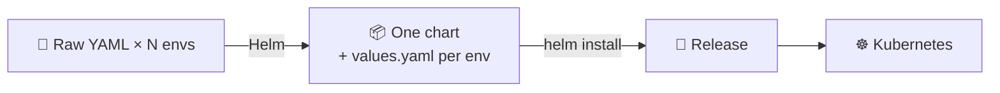
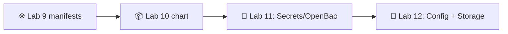

# 📌 Lecture 10 — Helm Package Management: Templating Kubernetes

Лекция 10 — Управление пакетами в Helm: шаблонизация Kubernetes

## 📍 Slide 1 – 📦 Welcome to Helm

Слайд 1 — Добро пожаловать в Helm

* 🌍 **Lecture 9 left you with raw YAML** — a Deployment + Service per environment, copied and edited by hand. That scales to maybe two environments before it bites.
  * **После лекции 9 у тебя остался «сырой» YAML** — Deployment и Service под каждое окружение, скопированные и правленные вручную. Этого хватит максимум на два окружения, а дальше всё начнёт ломаться.
* 📦 **Helm** = the package manager for Kubernetes. It bundles your manifests into a **chart**, parameterizes them with **values**, and tracks installs as **releases**.
  * **Helm** — это менеджер пакетов для Kubernetes. Он собирает твои манифесты в **chart**, параметризует их через **values** и отслеживает установки как **релизы**.
* 🎯 This lecture: write a chart, template it cleanly, and ship the same chart through dev/stage/prod with one value file change per environment.
  * На этой лекции: напишем chart, аккуратно его шаблонизируем и прогоним один и тот же chart через dev/stage/prod, меняя для каждого окружения лишь один файл значений.
* 🔗 **Tie-in to Lab 10:** convert your Lab 9 manifests into a Helm chart, support 3 environments via values, add pre/post-install hooks, push the chart to GHCR as an OCI artifact.
  * **Связь с лабой 10:** превратить манифесты из лабы 9 в Helm chart, поддержать 3 окружения через values, добавить pre/post-install хуки и запушить chart в GHCR как OCI-артефакт.



Схема: 📄 «сырой» YAML под N окружений → (Helm) → 📦 один chart + values.yaml под каждое окружение → (helm install) → 🚀 релиз → ☸️ Kubernetes.

---

## 📍 Slide 2 – 🎯 Learning Outcomes

Слайд 2 — Результаты обучения

| # | Outcome |
|---|---------|
| 1 | 🧱 Read & write Helm 4 chart structure: `Chart.yaml`, `values.yaml`, `templates/`, `_helpers.tpl`, `charts/` |
| 2 | 🎨 Use Go templates + Sprig functions, named templates, `tpl`, `include` |
| 3 | 🚦 Drive releases with `install / upgrade / rollback / uninstall / template / lint / test` |
| 4 | 🌳 Compose charts with dependencies and library charts |
| 5 | 🪝 Use hooks for pre-install / post-upgrade / pre-delete logic |
| 6 | 🌐 Push and pull charts via OCI registry (GHCR) |

| # | Результат |
|---|-----------|
| 1 | 🧱 Читать и писать структуру chart'а Helm 4: `Chart.yaml`, `values.yaml`, `templates/`, `_helpers.tpl`, `charts/` |
| 2 | 🎨 Использовать Go-шаблоны и функции Sprig, именованные шаблоны, `tpl`, `include` |
| 3 | 🚦 Управлять релизами через `install / upgrade / rollback / uninstall / template / lint / test` |
| 4 | 🌳 Собирать chart'ы из зависимостей и library chart'ов |
| 5 | 🪝 Использовать хуки для логики pre-install / post-upgrade / pre-delete |
| 6 | 🌐 Пушить и пулить chart'ы через OCI-реестр (GHCR) |

**Tech stack pinned for May 2026:** **Helm 4.1.4** (released April 8 2026). Helm 3 is in support mode through July 8 2026 (bug fixes) / November 11 2026 (security only). New work uses Helm 4.

**Стек зафиксирован по состоянию на май 2026:** **Helm 4.1.4** (выпущен 8 апреля 2026). Helm 3 находится в режиме поддержки до 8 июля 2026 (исправления багов) и до 11 ноября 2026 (только безопасность). Новые проекты используют Helm 4.

---

## 📍 Slide 3 – ❓ Why Helm Exists

Слайд 3 — Зачем нужен Helm

You wrote three manifests in Lab 9 (Deployment, Service, ConfigMap). Now imagine:

В лабе 9 ты написал три манифеста (Deployment, Service, ConfigMap). А теперь представь:

* 🌳 Three environments — dev, staging, prod — each needs different replica counts, image tags, resource limits
  * 🌳 Три окружения — dev, staging, prod — и у каждого своё количество реплик, свои теги образов и свои лимиты ресурсов
* 🔁 Twelve services — same shape, different names
  * 🔁 Двенадцать сервисов — одинаковых по форме, но с разными именами

**Without Helm:** copy-and-edit YAML, eyeball diffs, hope no env drifts. Fails by service 4.

**Без Helm:** копируешь и правишь YAML, сравниваешь диффы глазами и надеешься, что окружения не разъедутся. Всё ломается уже на четвёртом сервисе.

**With Helm:** *one* set of templates, *one* `values.yaml` per environment, one command per install. Templates render to YAML; Helm pushes through `kubectl apply`.

**С Helm:** *один* набор шаблонов, *один* `values.yaml` на окружение и одна команда на установку. Шаблоны рендерятся в YAML, а Helm применяет результат через `kubectl apply`.

> 🔥 **Hot take:** Helm is not the only K8s templating tool (Kustomize, Jsonnet, cdk8s, Carvel ytt). It's the most popular by ~5x because charts are *shareable artifacts* — `helm pull oci://…` and you have someone else's working stack.
>
> 🔥 **Резко, но честно:** Helm — не единственный инструмент шаблонизации для K8s (Kustomize, Jsonnet, cdk8s, Carvel ytt). Он популярнее остальных примерно в 5 раз, потому что chart'ы — это *артефакты, которыми можно делиться*: сделал `helm pull oci://…` — и у тебя есть чужой рабочий стек.

---

## 📍 Slide 4 – 📜 Helm Evolution: 1 → 2 → 3 → 4

Слайд 4 — Эволюция Helm: 1 → 2 → 3 → 4

* 📅 **2015** — Helm 1 created by Deis (acquired by Microsoft 2017). Client-side templating only.
  * **2015** — Deis (в 2017-м куплена Microsoft) создаёт Helm 1. Только клиентская шаблонизация.
* 📅 **2016** — Helm 2 introduces **Tiller** — an in-cluster server-side component. Loved for power, hated for cluster-wide RBAC.
  * **2016** — в Helm 2 появляется **Tiller** — серверный компонент внутри кластера. Его любили за возможности и ненавидели за RBAC на весь кластер.
* 📅 **2019** — Helm 3 **drops Tiller**, stores release state in K8s Secrets/ConfigMaps. The default everyone uses today.
  * **2019** — Helm 3 **отказывается от Tiller** и хранит состояние релизов в K8s Secrets/ConfigMaps. Это вариант по умолчанию для всех и сегодня.
* 📅 **2022** — OCI registries become first-class for chart distribution (charts pushed/pulled like Docker images).
  * **2022** — OCI-реестры становятся полноценным способом распространения chart'ов (chart'ы пушатся и пулятся как образы Docker).
* 📅 **2026 (Apr 8)** — Helm **4.1.4** released. Backwards-compatible chart format for `apiVersion: v2`; engine rewrites + better dependency resolution + WASM plugin support.
  * **2026 (8 апреля)** — выпущен **Helm 4.1.4**. Формат chart'ов для `apiVersion: v2` обратно совместим; переписанный движок, улучшенное разрешение зависимостей и поддержка WASM-плагинов.

> 📝 **Migration story:** most Helm 3 charts work unmodified on Helm 4. Helm 3's CLI is still available; expect both in shops through mid-2026. The labs in this course use Helm 4.
>
> **История миграции:** большинство chart'ов для Helm 3 работают на Helm 4 без изменений. CLI Helm 3 по-прежнему доступен, так что до середины 2026 года в компаниях будут встречаться оба варианта. В лабах этого курса используется Helm 4.

---

## 📍 Slide 5 – 🧱 Chart Anatomy

Слайд 5 — Анатомия chart'а

A chart is a directory with this shape:

Chart — это каталог такой структуры:

```
mychart/
├── Chart.yaml          # 📇 Metadata: name, version, appVersion, dependencies
├── values.yaml         # 🎚️ Default values (overridable per install)
├── values.schema.json  # 📐 (Optional) JSON schema for values validation
├── templates/
│   ├── deployment.yaml
│   ├── service.yaml
│   ├── ingress.yaml
│   ├── configmap.yaml
│   ├── _helpers.tpl    # 🛠️ Named template definitions (no underscore = file is rendered)
│   ├── NOTES.txt       # 📋 Printed after install/upgrade
│   └── tests/
│       └── test-connection.yaml
├── charts/             # 📦 Subcharts (dependencies)
└── README.md
```

Пояснение: в корне лежат метаданные (`Chart.yaml`), значения по умолчанию (`values.yaml`) и каталог `templates/` с шаблонами манифестов; файлы, начинающиеся с `_`, — вспомогательные партиалы, а `charts/` хранит вендорные вложенные chart'ы.

Key rules:

Ключевые правила:

* 📁 Files starting with `_` are **partials** — included via `{{ include ... }}`, never rendered as standalone YAML
  * 📁 Файлы, начинающиеся с `_`, — это **партиалы**: их подключают через `{{ include ... }}`, и они никогда не рендерятся как самостоятельный YAML
* 🧪 Files in `templates/tests/` run only on `helm test <release>`
  * 🧪 Файлы из `templates/tests/` выполняются только при `helm test <release>`
* 🔒 Anything under `charts/` is a vendored subchart (managed by `helm dependency update`)
  * 🔒 Всё, что лежит в `charts/`, — вендорный подchart (управляется через `helm dependency update`)

---

## 📍 Slide 6 – 📇 Chart.yaml

Слайд 6 — Chart.yaml

```yaml
apiVersion: v2                # ⚠️ Helm 3+; Helm 4 reads v2; v1 is Helm 2 (deprecated)
name: lab10-app
description: DevOps Core lab 10 — Python service + Go echo
type: application             # 'application' (default) or 'library'
version: 1.3.0                # 📌 Chart version (SemVer) — bumped on chart changes
appVersion: "1.0.0"           # 📌 App version (string) — bumped on image changes
kubeVersion: ">=1.33.0"       # 🚦 Refuse install on older clusters

dependencies:
  - name: postgresql
    version: 16.x
    repository: oci://registry-1.docker.io/bitnamicharts
    condition: postgresql.enabled
```

Пояснение: `version` — версия самого chart'а, `appVersion` — версия приложения в образе; `kubeVersion` не даст поставить chart на слишком старый кластер, а блок `dependencies` подключает PostgreSQL из Bitnami, если включён `postgresql.enabled`.

* 🎯 **Two versions** matter: `version` (the chart YOU publish) and `appVersion` (the image it deploys). They evolve independently.
  * 🎯 Важны **две версии**: `version` (chart, который публикуешь ты) и `appVersion` (образ, который он разворачивает). Они развиваются независимо.
* 🔧 `type: library` charts contribute only `_helpers.tpl` templates — they don't install anything themselves.
  * 🔧 Chart'ы с `type: library` дают только шаблоны `_helpers.tpl` — сами по себе они ничего не устанавливают.

---

## 📍 Slide 7 – 🎨 Go Templates + Sprig

Слайд 7 — Go-шаблоны + Sprig

Helm uses Go's `text/template` package + the **Sprig** function library (~200 extra helpers).

Helm использует пакет Go `text/template` и библиотеку функций **Sprig** (около 200 дополнительных хелперов).

```yaml
apiVersion: apps/v1
kind: Deployment
metadata:
  name: {{ include "lab10-app.fullname" . }}
  labels:
    {{- include "lab10-app.labels" . | nindent 4 }}
spec:
  replicas: {{ .Values.replicaCount | default 2 }}
  template:
    spec:
      containers:
        - name: web
          image: "{{ .Values.image.repository }}:{{ .Values.image.tag | default .Chart.AppVersion }}"
          env:
            - name: ECHO_URL
              value: "http://{{ include "lab10-app.fullname" . }}-echo:80"
          {{- with .Values.resources }}
          resources:
            {{- toYaml . | nindent 12 }}
          {{- end }}
```

Common idioms:

Частые идиомы:

* `{{ include "name" . }}` — invoke a named template (better than `template` because it returns a string you can pipe)
  * `{{ include "name" . }}` — вызвать именованный шаблон (лучше, чем `template`, потому что возвращает строку, которую можно передать в пайп)
* `| nindent N` — indent a block by N spaces *after* a newline (the most common formatting bug fix)
  * `| nindent N` — сдвинуть блок на N пробелов *после* перевода строки (самое частое исправление ошибок форматирования)
* `| default X` — fallback when the value is absent
  * `| default X` — запасное значение, если значение отсутствует
* `{{- ... -}}` — strip whitespace on the left/right of the action
  * `{{- ... -}}` — убрать пробелы слева и справа от действия
* `{{ toYaml . | nindent N }}` — render a structure as YAML
  * `{{ toYaml . | nindent N }}` — отрендерить структуру в YAML

> 🔥 **The #1 Helm bug:** indentation. `nindent` (newline + indent) is what you want 90% of the time. `indent` produces invalid YAML if the action is on its own line.
>
> 🔥 **Баг Helm №1:** отступы. `nindent` (перевод строки + отступ) нужен в 90% случаев. А `indent` даёт невалидный YAML, если действие стоит на отдельной строке.

---

## 📍 Slide 8 – 🛠️ `_helpers.tpl` — Named Templates Done Right

Слайд 8 — `_helpers.tpl` — именованные шаблоны, сделанные правильно

Avoid copy-pasting label blocks. Define once, include everywhere.

Не копируй блоки меток. Определи один раз и подключай везде.

```handlebars
{{/*
Standard labels — matches the K8s recommended labels namespace.
*/}}
{{- define "lab10-app.labels" -}}
helm.sh/chart: {{ printf "%s-%s" .Chart.Name .Chart.Version | replace "+" "_" | trunc 63 | trimSuffix "-" }}
app.kubernetes.io/name: {{ .Chart.Name }}
app.kubernetes.io/instance: {{ .Release.Name }}
app.kubernetes.io/version: {{ .Chart.AppVersion | quote }}
app.kubernetes.io/managed-by: {{ .Release.Service }}
{{- end }}

{{/*
Selector labels — subset that should never change after install.
*/}}
{{- define "lab10-app.selectorLabels" -}}
app.kubernetes.io/name: {{ .Chart.Name }}
app.kubernetes.io/instance: {{ .Release.Name }}
{{- end }}
```

Selector labels are a strict subset of `.labels` because **Service/Deployment selectors are immutable after creation**. Don't put `version` in selector labels or you'll break rolling updates.

Selector labels — строгое подмножество `.labels`, потому что **селекторы Service/Deployment нельзя изменить после создания**. Не добавляй `version` в selector labels, иначе сломаешь rolling update.

---

## 📍 Slide 9 – 🚦 The Release Lifecycle

Слайд 9 — Жизненный цикл релиза

```bash
helm install web ./mychart -n dev \
  -f values-dev.yaml \
  --create-namespace

helm upgrade web ./mychart -n dev \
  -f values-dev.yaml \
  --set image.tag=v1.0.5

helm rollback web 3 -n dev          # ⏪ to revision 3
helm history web -n dev             # 📜 every revision is in K8s Secrets
helm uninstall web -n dev           # 🗑️ removes everything Helm tracked

helm template ./mychart -f values-prod.yaml  # 🔍 render to stdout (CI / GitOps friendly)
helm lint ./mychart                          # 🔍 syntax + schema check
helm test web -n dev                         # 🧪 run templates/tests/ pods
```

Пояснение: `helm install` ставит chart, `upgrade` обновляет его с новыми значениями, `rollback` возвращает указанную ревизию, `history` показывает все ревизии, а `template`, `lint` и `test` позволяют проверить chart до и после установки.

* 📜 Every `install` and `upgrade` creates a **revision** stored as a `helm.sh/release.v1` Secret in the release's namespace. `helm rollback` is just "apply the manifests from revision N".
  * 📜 Каждый `install` и `upgrade` создаёт **ревизию**, которая хранится как Secret `helm.sh/release.v1` в namespace релиза. `helm rollback` — это просто «применить манифесты из ревизии N».
* 🔍 `helm template` is the gateway to GitOps: render once, commit the YAML, let ArgoCD apply.
  * 🔍 `helm template` — это вход в GitOps: отрендерил один раз, закоммитил YAML, а применить даёшь ArgoCD.

---

## 📍 Slide 10 – 🌳 Multi-Environment via Values Hierarchy

Слайд 10 — Много окружений через иерархию values

The flexible pattern is a base `values.yaml` + an override per environment.

Гибкий подход — базовый `values.yaml` плюс переопределения под каждое окружение.

```yaml
# values.yaml (defaults)
replicaCount: 2
image:
  repository: ghcr.io/innodevops/lab2-app
  tag: ""                            # falls back to .Chart.AppVersion
resources:
  requests: {cpu: 100m, memory: 64Mi}
  limits:   {cpu: 500m, memory: 256Mi}
ingress:
  enabled: false
```

```yaml
# values-prod.yaml (overrides)
replicaCount: 5
image:
  tag: v1.2.0
resources:
  requests: {cpu: 500m, memory: 256Mi}
  limits:   {cpu: 2000m, memory: 1Gi}
ingress:
  enabled: true
  host: app.prod.example.com
```

```bash
helm upgrade --install web ./mychart -n prod -f values.yaml -f values-prod.yaml
```

Пояснение: базовый `values.yaml` задаёт значения по умолчанию, а `values-prod.yaml` переопределяет только то, что отличается в проде; `helm upgrade --install` применяет оба файла по порядку.

Order of precedence (lowest → highest):

Порядок приоритета (от низшего к высшему):

1. `values.yaml` (chart default)
   * `values.yaml` (значения по умолчанию из chart'а)
2. `-f file.yaml` (later files override earlier)
   * `-f file.yaml` (более поздние файлы переопределяют более ранние)
3. `--set key=value` (explicit on CLI)
   * `--set key=value` (явно задано в командной строке)

---

## 📍 Slide 11 – 🪝 Hooks: pre-install, post-upgrade, …

Слайд 11 — Хуки: pre-install, post-upgrade, …

Hooks let you run a Job, Pod, or any resource at a specific point in the release lifecycle.

Хуки позволяют запустить Job, Pod или любой другой ресурс в определённой точке жизненного цикла релиза.

```yaml
apiVersion: batch/v1
kind: Job
metadata:
  name: {{ include "lab10-app.fullname" . }}-db-migrate
  annotations:
    "helm.sh/hook": pre-upgrade,pre-install
    "helm.sh/hook-weight": "-5"
    "helm.sh/hook-delete-policy": before-hook-creation,hook-succeeded
spec:
  template:
    spec:
      restartPolicy: Never
      containers:
        - name: migrate
          image: "{{ .Values.image.repository }}:{{ .Values.image.tag }}"
          command: ["python", "manage.py", "migrate"]
```

Common hook points: `pre-install`, `post-install`, `pre-upgrade`, `post-upgrade`, `pre-delete`, `post-delete`, `test`.

Частые точки хуков: `pre-install`, `post-install`, `pre-upgrade`, `post-upgrade`, `pre-delete`, `post-delete`, `test`.

`hook-weight` orders multiple hooks (lower runs first; ties broken alphabetically).

`hook-weight` задаёт порядок нескольких хуков (меньшее значение выполняется раньше; при равенстве — по алфавиту).

`hook-delete-policy` controls cleanup: `before-hook-creation` (default), `hook-succeeded`, `hook-failed`.

`hook-delete-policy` управляет очисткой: `before-hook-creation` (по умолчанию), `hook-succeeded`, `hook-failed`.

> ⚠️ **Hook gotcha:** hook resources are *not* tracked in the release — `helm uninstall` won't delete a hook Job. Use `hook-delete-policy: hook-succeeded` for cleanup.
>
> ⚠️ **Ловушка с хуками:** ресурсы хуков *не* отслеживаются в релизе — `helm uninstall` не удалит Job хука. Для очистки используй `hook-delete-policy: hook-succeeded`.

---

## 📍 Slide 12 – 📦 Dependencies & Subcharts

Слайд 12 — Зависимости и вложенные chart'ы

Charts can depend on other charts. Run `helm dependency update` to fetch them into `charts/`.

Chart'ы могут зависеть от других chart'ов. Выполни `helm dependency update`, чтобы скачать их в `charts/`.

```yaml
# Chart.yaml
dependencies:
  - name: postgresql
    version: 16.x
    repository: oci://registry-1.docker.io/bitnamicharts
    condition: postgresql.enabled
    alias: db                        # 🏷️ rename in values
```

```yaml
# values.yaml
postgresql:                          # 🎚️ subchart values nest under its alias
  enabled: true
  auth:
    username: app
    database: lab10
```

Helm 4 added improved dependency resolution — multiple charts can pull the same transitive dep without conflicts.

В Helm 4 улучшили разрешение зависимостей: несколько chart'ов могут тянуть одну и ту же транзитивную зависимость без конфликтов.

---

## 📍 Slide 13 – 📚 Library Charts

Слайд 13 — Library chart'ы

A chart with `type: library` contributes only `_helpers.tpl` templates. Use it when 10 application charts share boilerplate (labels, security context, image-pull secrets).

Chart с `type: library` содержит только шаблоны `_helpers.tpl`. Используй его, когда у десяти приложений одинаковый бойлерплейт (метки, security context, секреты для скачивания образов).

```yaml
# common-lib/Chart.yaml
apiVersion: v2
name: common-lib
type: library                        # 🚫 no templates rendered, only helpers contributed
version: 1.0.0
```

```yaml
# mychart/Chart.yaml
dependencies:
  - name: common-lib
    version: 1.x
    repository: oci://ghcr.io/innodevops/charts
```

```handlebars
# mychart/templates/deployment.yaml
{{ include "common-lib.labels" . | nindent 4 }}    # 🔁 reused from the library
```

> 🔗 **Lab 10 bonus** asks you to extract `_helpers.tpl` into a library chart and consume it from your app chart.
>
> 🔗 **Бонус в лабе 10** просит вынести `_helpers.tpl` в library chart и подключить его в своём chart'е.

---

## 📍 Slide 14 – 🌐 OCI Registries — Charts as OCI Artifacts

Слайд 14 — OCI-реестры — chart'ы как OCI-артефакты

Since 2022, Helm pushes charts to OCI registries (same protocol as Docker images). GHCR / Docker Hub / Harbor / ECR all support OCI artifacts.

С 2022 года Helm пушит chart'ы в OCI-реестры (тот же протокол, что у образов Docker). GHCR, Docker Hub, Harbor и ECR поддерживают OCI-артефакты.

```bash
# 📦 Package
helm package ./mychart                       # produces mychart-1.3.0.tgz

# 🔑 Auth (GHCR uses GitHub PAT or GITHUB_TOKEN in CI)
echo $GITHUB_TOKEN | helm registry login ghcr.io -u $GITHUB_ACTOR --password-stdin

# 📤 Push
helm push mychart-1.3.0.tgz oci://ghcr.io/innodevops/charts

# 📥 Pull (in another repo / cluster)
helm install web oci://ghcr.io/innodevops/charts/mychart --version 1.3.0
```

Пояснение: chart сначала упаковывается в `.tgz`, затем выполняется вход в реестр, push, а установка идёт прямо из OCI-реестра по имени chart'а.

> 🔥 **Why OCI:** one auth model, one registry, one set of access controls for images *and* charts. Drops the legacy `helm repo add` HTTP indexing model.
>
> 🔥 **Почему OCI:** одна модель аутентификации, один реестр и одни правила доступа для образов *и* chart'ов. Устаревшая модель индексации по HTTP через `helm repo add` больше не нужна.

---

## 📍 Slide 15 – 🧪 Testing Charts

Слайд 15 — Тестирование chart'ов

* 🔍 `helm lint ./mychart` — schema + YAML parse check
  * 🔍 `helm lint ./mychart` — проверка схемы и разбора YAML
* 📐 `values.schema.json` — JSON Schema validates `values.yaml`. Helm errors out before install if values are wrong.
  * 📐 `values.schema.json` — JSON Schema проверяет `values.yaml`. Если значения некорректны, Helm выдаст ошибку ещё до установки.
* 🧪 `helm template ./mychart | kubectl apply --dry-run=server -f -` — server-side validation
  * 🧪 `helm template ./mychart | kubectl apply --dry-run=server -f -` — серверная валидация
* ✅ `helm test <release>` — runs Pods in `templates/tests/` against the live release
  * ✅ `helm test <release>` — запускает Pod'ы из `templates/tests/` против живого релиза

A typical `templates/tests/test-connection.yaml`:

Типичный `templates/tests/test-connection.yaml`:

```yaml
apiVersion: v1
kind: Pod
metadata:
  name: "{{ include "lab10-app.fullname" . }}-test"
  annotations:
    "helm.sh/hook": test
spec:
  restartPolicy: Never
  containers:
    - name: curl
      image: curlimages/curl:8.10.1
      args: ["-fsS", "http://{{ include "lab10-app.fullname" . }}:80/healthz"]
```

Пояснение: тестовый Pod помечен аннотацией `helm.sh/hook: test`; `helm test` запускает его и проверяет, что сервис отвечает на `/healthz`.

---

## 📍 Slide 16 – 🚫 Anti-Patterns and Common Bugs

Слайд 16 — Антипаттерны и частые баги

1. ❌ **Hard-coding image tags in templates** — put them in `values.yaml` so upgrades flow through `--set image.tag=...`
   * ❌ **Хардкод тегов образов в шаблонах** — вынеси их в `values.yaml`, чтобы обновления шли через `--set image.tag=...`
2. ❌ **`indent` instead of `nindent`** — produces invalid YAML when the action is on its own line
   * ❌ **`indent` вместо `nindent`** — даёт невалидный YAML, когда действие стоит на отдельной строке
3. ❌ **Mutable selector labels** — once a Deployment exists, K8s rejects selector changes; use a stable subset
   * ❌ **Изменяемые selector labels** — после создания Deployment K8s не даст поменять селектор; используй стабильное подмножество
4. ❌ **Skipping `helm lint` in CI** — every chart change should fail CI on lint error
   * ❌ **Пропуск `helm lint` в CI** — любое изменение chart'а должно валить CI при ошибке линтера
5. ❌ **Hooks that don't clean up** — set `hook-delete-policy: hook-succeeded` or you accumulate failed Jobs
   * ❌ **Хуки без очистки** — задай `hook-delete-policy: hook-succeeded`, иначе будешь копить упавшие Job'ы
6. ❌ **Putting secrets in `values.yaml`** — git-tracked. Use **OpenBao + the secrets injector** (Lab 11) or `helm secrets` plugin
   * ❌ **Секреты в `values.yaml`** — файл под контролем git. Используй **OpenBao + secrets injector** (лаба 11) или плагин `helm secrets`
7. ❌ **One huge umbrella chart for 12 services** — each service should have its own chart; share via library chart
   * ❌ **Один огромный umbrella chart на 12 сервисов** — у каждого сервиса должен быть свой chart; общее выноси в library chart
8. ❌ **Using `latest` in `appVersion`** — kills reproducibility. Pin a SemVer or git SHA.
   * ❌ **`latest` в `appVersion`** — убивает воспроизводимость. Фиксируй SemVer или git SHA.

---

## 📍 Slide 17 – 🌍 Helm in the Wild

Слайд 17 — Helm в реальном мире

* 📦 **Artifact Hub** indexes **15,000+ Helm charts** across hundreds of publishers
  * 📦 **Artifact Hub** индексирует **более 15 000 Helm chart'ов** от сотен издателей
* 🏢 **Bitnami** ships production-grade charts for ~150 popular open-source apps (Postgres, MongoDB, Redis, RabbitMQ, Kafka …) — though IPO/license changes in 2024 led many to move to community forks
  * 🏢 **Bitnami** поставляет продовые chart'ы примерно для 150 популярных open-source-приложений (Postgres, MongoDB, Redis, RabbitMQ, Kafka …), хотя из-за IPO и смены лицензии в 2024 году многие перешли на community-форки
* 🎬 **Netflix, Shopify, Spotify** all publish internal Helm charts as the standard packaging unit
  * 🎬 **Netflix, Shopify и Spotify** публикуют внутренние Helm chart'ы как стандартную единицу упаковки
* 🪐 **Crossplane, ArgoCD, kube-prometheus-stack** are all distributed as Helm charts — the K8s ecosystem assumes you have Helm
  * 🪐 **Crossplane, ArgoCD и kube-prometheus-stack** распространяются как Helm chart'ы — экосистема K8s исходит из того, что Helm у тебя есть

> 📊 **CNCF survey 2024:** Helm is the #1 K8s package manager by margin. The "K8s deployment story" is still mostly Helm + ArgoCD + Kustomize in 2026.
>
> 📊 **Опрос CNCF 2024:** Helm — менеджер пакетов №1 для K8s с большим отрывом. История про деплой в K8s в 2026 году всё ещё в основном Helm + ArgoCD + Kustomize.

---

## 📍 Slide 18 – 🎯 Key Takeaways

Слайд 18 — Главное из лекции

1. 📦 **Helm = templating + packaging + release lifecycle** — three jobs in one tool
   * 📦 **Helm = шаблонизация + упаковка + жизненный цикл релиза** — три задачи в одном инструменте
2. 🧱 **Chart structure is rigid** — `Chart.yaml`, `values.yaml`, `templates/`, `_helpers.tpl`. Memorize.
   * 🧱 **Структура chart'а строгая** — `Chart.yaml`, `values.yaml`, `templates/`, `_helpers.tpl`. Запомни.
3. 🎨 **Go templates + Sprig + named templates** — `nindent`, `include`, `default` cover 80% of use cases
   * 🎨 **Go-шаблоны + Sprig + именованные шаблоны** — `nindent`, `include` и `default` закрывают 80% задач
4. 🌳 **One chart, N value files** — the multi-environment story; never copy-edit YAML
   * 🌳 **Один chart, N файлов values** — вся история с окружениями; никогда не копируй YAML руками
5. 🪝 **Hooks** run Jobs/Pods at lifecycle moments — set `hook-delete-policy` to clean up
   * 🪝 **Хуки** запускают Job'ы и Pod'ы в нужные моменты жизненного цикла — настрой `hook-delete-policy` для очистки
6. 📚 **Library charts** share helpers across application charts
   * 📚 **Library chart'ы** делят хелперы между прикладными chart'ами
7. 🌐 **OCI artifacts** are the modern distribution path — same registry as your images
   * 🌐 **OCI-артефакты** — современный способ распространения: тот же реестр, что и для образов
8. ✅ **`helm lint` + `values.schema.json` + `helm template` in CI** — catch errors before the cluster does
   * ✅ **`helm lint` + `values.schema.json` + `helm template` в CI** — лови ошибки раньше кластера

> 💡 **The Helm 4 reality:** the syntax you write today will install fine on Helm 3.x clusters too. Adopt Helm 4 now; you're already future-proof.
>
> 💡 **Реальность Helm 4:** синтаксис, который ты пишешь сегодня, нормально установится и на кластерах с Helm 3.x. Переходи на Helm 4 сейчас — и ты уже защищён на будущее.

---

## 📍 Slide 19 – 🚀 What Comes Next

Слайд 19 — Что дальше

**📚 Next lecture: *Secret Management with Kubernetes + OpenBao*** — because `values.yaml` is git-tracked and your DB password isn't.

**📚 Следующая лекция: *Управление секретами в Kubernetes + OpenBao*** — потому что `values.yaml` лежит в git, а пароль от БД — нет.

* 🔐 K8s `Secret` — what it actually does (and doesn't)
  * 🔐 K8s `Secret` — что он на самом деле делает (и чего не делает)
* 🪦 HashiCorp Vault → OpenBao migration (BSL fallout, August 2023)
  * 🪦 Миграция с HashiCorp Vault на OpenBao (последствия перехода на BSL, август 2023)
* 🤖 External Secrets Operator (ESO)
  * 🤖 External Secrets Operator (ESO)
* 🎯 Vault Agent Injector for templated config
  * 🎯 Vault Agent Injector для шаблонного конфига

**🔬 Lab 10 deliverables:**

**🔬 Что сдать по лабе 10:**

* Package your Lab 9 manifests into a `lab10-app` chart
  * Упаковать манифесты из лабы 9 в chart `lab10-app`
* Support `values-dev.yaml` / `values-staging.yaml` / `values-prod.yaml`
  * Поддержать `values-dev.yaml` / `values-staging.yaml` / `values-prod.yaml`
* Add a pre-install hook for DB migration (even if fake)
  * Добавить pre-install хук для миграции БД (пусть даже фиктивный)
* Push the chart to GHCR via `helm push oci://`
  * Запушить chart в GHCR через `helm push oci://`
* Bonus 2 pts: extract `_helpers.tpl` into a library chart consumed by your app chart
  * Бонус 2 балла: вынести `_helpers.tpl` в library chart и подключить его в своём chart'е



Схема: ☸️ манифесты из лабы 9 → 📦 chart лабы 10 → 🔐 лаба 11: секреты и OpenBao → 💾 лаба 12: конфигурация и хранилище.

> 🌊 From YAML to packages — one template at a time.
>
> 🌊 От YAML к пакетам — по одному шаблону за раз.

---

## 📚 Resources

📚 Материалы

* 📕 *Learning Helm* (2e, 2024) — Butcher, Farina, Dolitsky (O'Reilly). The canonical reference.
  * 📕 *Learning Helm* (2-е изд., 2024) — Батчер, Фарина, Долицки (O'Reilly). Канонический справочник.
* 📕 *Mastering Helm* — Sumesh Kumar (2023) — chart patterns
  * 📕 *Mastering Helm* — Сумеш Кумар (2023) — паттерны построения chart'ов
* 🌐 [helm.sh/docs](https://helm.sh/docs/) — official docs (Helm 4)
  * 🌐 [helm.sh/docs](https://helm.sh/docs/) — официальная документация (Helm 4)
* 🌐 [helm.sh/docs/chart_best_practices](https://helm.sh/docs/chart_best_practices/) — chart authoring conventions
  * 🌐 [helm.sh/docs/chart_best_practices](https://helm.sh/docs/chart_best_practices/) — соглашения по написанию chart'ов
* 🌐 [Artifact Hub](https://artifacthub.io/) — search public charts
  * 🌐 [Artifact Hub](https://artifacthub.io/) — поиск публичных chart'ов
* 🌐 [Sprig functions](https://masterminds.github.io/sprig/) — the function reference you'll consult weekly
  * 🌐 [Sprig functions](https://masterminds.github.io/sprig/) — справочник функций, к которому будешь обращаться каждую неделю
* 🌐 [Helm 4 release notes](https://helm.sh/blog/) — what changed from 3
  * 🌐 [Helm 4 release notes](https://helm.sh/blog/) — что изменилось по сравнению с версией 3

**🎓 Quiz:** post-lecture quiz feeds the weeks 10-12 leaderboard window.

**🎓 Квиз:** квиз после лекции идёт в зачёт лидерборда недель 10–12.
