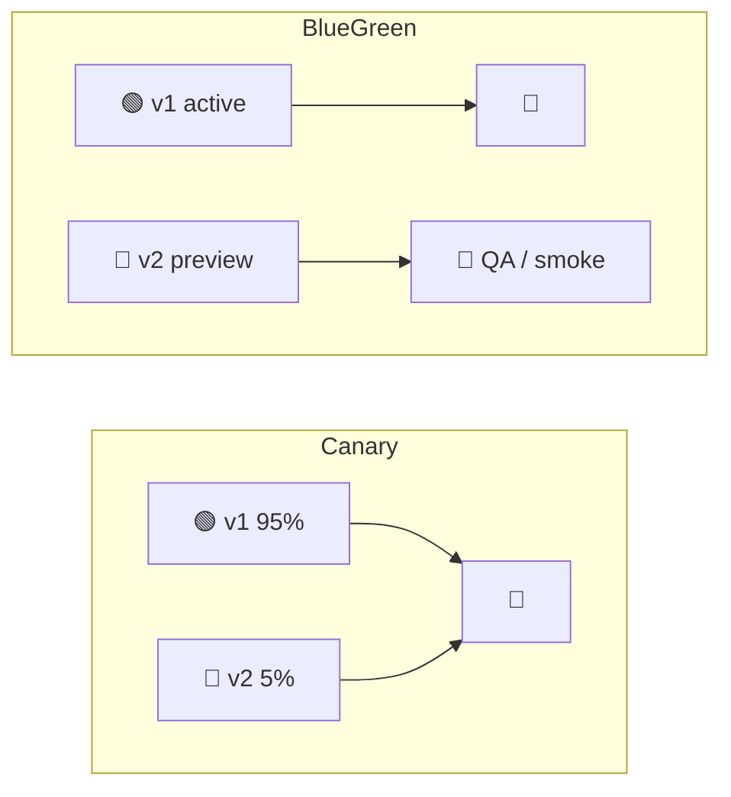
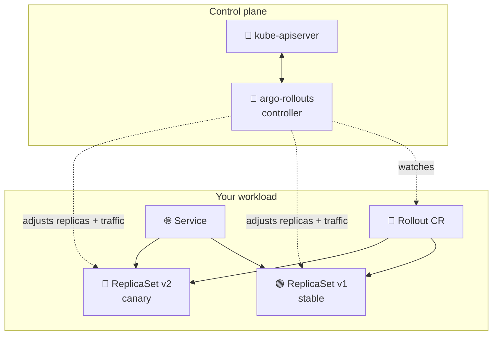
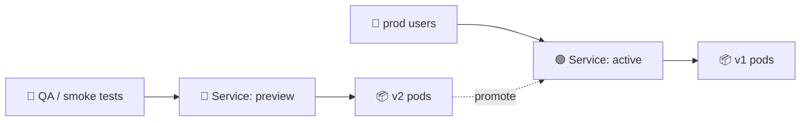
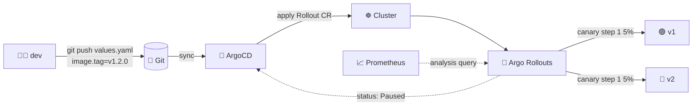
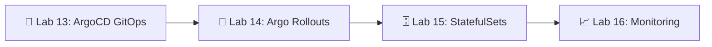

# 📌 Lecture 14 — Progressive Delivery with Argo Rollouts

Лекция 14 — Прогрессивная доставка с Argo Rollouts

## 📍 Slide 1 – 🚦 Welcome to Progressive Delivery

Слайд 1 — Добро пожаловать в прогрессивную доставку

* 🌍 **Lecture 13 gave you GitOps.** ArgoCD now reconciles your Helm chart from Git → cluster within seconds. Source of truth: solved.
  * 🌍 **Лекция 13 дала тебе GitOps.** ArgoCD теперь за секунды приводит твой Helm-чарт из Git в кластер. Единый источник истины: решено.
* 🐤 **But "deployed" ≠ "released".** A Deployment rollout swaps pods 25% at a time and stops measuring once they pass a liveness probe. The bug in your new image — the one that only fires on 5% of requests — ships to 100% of users.
  * 🐤 **Но «задеплоено» ≠ «выпущено».** Выкатка Deployment меняет поды по 25% за раз и перестаёт что-либо измерять, как только они проходят liveness-пробу. Баг в новом образе — тот, что срабатывает лишь на 5% запросов, — уезжает ко всем 100% пользователей.
* 🎯 This lecture: replace `kind: Deployment` with `kind: Rollout`, shape traffic in steps (5% → 25% → 50% → 100%), let metrics decide whether to promote or roll back — **without a human watching Grafana at 5pm on a Friday**.
  * 🎯 Эта лекция: заменить `kind: Deployment` на `kind: Rollout`, управлять трафиком ступенями (5% → 25% → 50% → 100%) и позволить метрикам решать, продвигать релиз или откатывать его, — **без человека, смотрящего в Grafana в пять вечера в пятницу**.
* 🔗 **Tie-in to Lab 14:** convert your Lab 13 chart from `Deployment` → `Rollout`, ship a canary strategy with 5-step traffic shifting, then add a parallel blue-green strategy with a `previewService`, plus a Prometheus `AnalysisTemplate` for the bonus.
  * 🔗 **Связь с лабой 14:** перевести свой чарт из лабы 13 с `Deployment` на `Rollout`, сделать канареечную стратегию с пошаговым переключением трафика из 5 шагов, затем добавить параллельную blue-green-стратегию с `previewService` и, для бонуса, `AnalysisTemplate` для Prometheus.

```mermaid
flowchart LR
  Deploy[📦 kind: Deployment] -->|25% pods at a time, no metrics| Done[✅ "Deployed"]
  Rollout[🐤 kind: Rollout] -->|5% → 25% → 50% → 100%<br/>+ metric gates| Released[🎯 "Released"]
```

Схема: `kind: Deployment` меняет по 25% подов за раз и не смотрит на метрики — получается лишь «задеплоено» (✅); `kind: Rollout` ведёт трафик шагами 5% → 25% → 50% → 100% и добавляет проверки по метрикам — получается «выпущено» (🎯).

---

## 📍 Slide 2 – 🎯 Learning Outcomes

Слайд 2 — Результаты обучения

| # | Outcome |
|---|---------|
| 1 | 🧠 Distinguish **deployment** (pods running new code) from **release** (users seeing new code) |
| 2 | 🐤 Configure **canary** strategy with step-based weights and pauses |
| 3 | 🔵 Configure **blue-green** strategy with an `activeService` + `previewService` |
| 4 | 📊 Write an **`AnalysisTemplate`** that queries Prometheus and auto-promotes / auto-aborts |
| 5 | 🚦 Wire **traffic shaping** through NGINX, ALB, Istio, or the Gateway API plugin |
| 6 | 🛠️ Drive a rollout with `kubectl argo rollouts`: `get`, `promote`, `abort`, `retry`, `undo` |

| # | Результат |
|---|-----------|
| 1 | 🧠 Различать **деплой** (поды уже на новом коде) и **релиз** (пользователи уже видят новый код) |
| 2 | 🐤 Настроить **канареечную** стратегию с весами по шагам и паузами |
| 3 | 🔵 Настроить **blue-green** стратегию с `activeService` + `previewService` |
| 4 | 📊 Написать **`AnalysisTemplate`**, который ходит в Prometheus и сам продвигает / сам прерывает релиз |
| 5 | 🚦 Подключить **управление трафиком** через NGINX, ALB, Istio или плагин Gateway API |
| 6 | 🛠️ Управлять роллаутом через `kubectl argo rollouts`: `get`, `promote`, `abort`, `retry`, `undo` |

**Tech stack pinned for May 2026:** **Argo Rollouts 1.8.4** (released Feb 13 2026), Kubernetes **1.36 "Haru"**, ArgoCD **3.4.x** for sync, **Prometheus 3.11.3** (or the 3.5 LTS line) for analysis metrics — the same Prometheus you stood up in Lab 8.

**Технологический стек, зафиксированный на май 2026:** **Argo Rollouts 1.8.4** (выпущен 13 февраля 2026), Kubernetes **1.36 «Haru»**, ArgoCD **3.4.x** для синхронизации, **Prometheus 3.11.3** (или LTS-ветка 3.5) для метрик анализа — тот же Prometheus, который ты поднял в лабе 8.

---

## 📍 Slide 3 – ❓ Deployment ≠ Release

Слайд 3 — Деплой ≠ Релиз

You've done rolling updates with vanilla `kind: Deployment` since Lab 9. So why isn't that enough?

Ты уже делал rolling update на обычном `kind: Deployment` начиная с лабы 9. Так почему этого недостаточно?

* 🩺 **A Deployment's only health signal is the pod-level probe.** Once readiness flips green, K8s shifts traffic. Memory leaks, slow tail-latency, and 5xx spikes are invisible to the rollout.
  * 🩺 **Единственный сигнал здоровья у Deployment — проба на уровне пода.** Как только readiness становится зелёной, K8s переключает трафик. Утечки памяти, выросшая хвостовая задержка и всплески 5xx для роллаута невидимы.
* ⏱️ **`maxSurge` and `maxUnavailable` are blunt knobs.** 25% maxSurge means by minute 2 you have 25% of traffic on a broken build with no automatic abort.
  * ⏱️ **`maxSurge` и `maxUnavailable` — грубые ручки.** При maxSurge 25% уже к второй минуте 25% трафика идёт на сломанную сборку, и автоматического прерывания нет.
* 🌐 **No traffic-percentage primitive.** Deployments can't say "send 5% of HTTP requests to v2 and 95% to v1." They can only say "swap N pods."
  * 🌐 **Нет примитива для доли трафика.** Deployment не умеет сказать «отправь 5% HTTP-запросов на v2, а 95% — на v1». Он умеет только «замени N подов».
* 🚫 **No metric integration.** You can't tell a Deployment "rollback if 5xx > 1%." You can tell *Argo Rollouts* exactly that.
  * 🚫 **Нет интеграции с метриками.** Deployment нельзя сказать «откатись, если 5xx > 1%». А *Argo Rollouts* — можно, ровно так.

> 🔥 **Hot take:** "Move fast and break things" is dead; "move fast with feedback loops" is what elite teams actually do. Progressive delivery is what closes the loop between *deploying code* and *knowing it works*.
>
> 🔥 **Резко, но честно:** «Двигайся быстро и ломай всё» — это в прошлом; «двигайся быстро с петлями обратной связи» — вот что на деле делают элитные команды. Прогрессивная доставка и есть то, что замыкает петлю между *деплоем кода* и *знанием, что он работает*.

---

## 📍 Slide 4 – 📜 A Brief History of Progressive Delivery

Слайд 4 — Краткая история прогрессивной доставки

* 📅 **2010** — Humble & Farley publish *Continuous Delivery*. The book introduces the canary metaphor as "deploy to one server, watch, then promote."
  * 📅 **2010** — Хамбл и Фарли публикуют *Continuous Delivery*. В книге появляется метафора канарейки: «задеплой на один сервер, посмотри, потом продвигай».
* 📅 **2014** — Netflix open-sources **Spinnaker** with built-in canary stages backed by their internal "ACA" (Automated Canary Analysis).
  * 📅 **2014** — Netflix открывает исходники **Spinnaker** со встроенными канареечными стадиями на основе их внутреннего «ACA» (Automated Canary Analysis).
* 📅 **2018** — Netflix + Google open-source **Kayenta**, the statistical canary judge (Mann-Whitney U test). Spinnaker users get free metric-driven promotion.
  * 📅 **2018** — Netflix и Google открывают исходники **Kayenta** — статистического судьи канареек (U-критерий Манна — Уитни). Пользователи Spinnaker получают бесплатное продвижение по метрикам.
* 📅 **2019** — Weaveworks coin the term **"progressive delivery"** in a blog post; they ship **Flagger** alongside Flux. Argo team ships **Argo Rollouts** alongside ArgoCD the same year.
  * 📅 **2019** — Weaveworks вводят термин **«progressive delivery»** в блог-посте и выпускают **Flagger** вместе с Flux. Команда Argo в том же году выпускает **Argo Rollouts** вместе с ArgoCD.
* 📅 **2021** — Argo Rollouts **v1.0 GA**. Joins ArgoCD/Workflows/Events as CNCF incubating, graduates to Graduated in **December 2022**.
  * 📅 **2021** — Argo Rollouts **v1.0 GA**. Проект входит в CNCF на стадии incubating вместе с ArgoCD/Workflows/Events и переходит в Graduated в **декабре 2022**.
* 📅 **2024** — CNCF archives the **SMI** (Service Mesh Interface) spec. **Gateway API** + the Argo Rollouts Gateway API plugin become the recommended path for traffic shaping across meshes.
  * 📅 **2024** — CNCF архивирует спецификацию **SMI** (Service Mesh Interface). **Gateway API** и плагин Argo Rollouts для Gateway API становятся рекомендуемым способом управления трафиком в любых mesh.
* 📅 **2026 (Feb 13)** — **Argo Rollouts 1.8.4** — bug fix release for blue-green analysis (the "premature success when ReplicaSet becomes unsaturated" issue), plus dependency bumps.
  * 📅 **2026 (13 февраля)** — **Argo Rollouts 1.8.4** — релиз с исправлением blue-green-анализа (проблема «преждевременного успеха, когда ReplicaSet становится ненасыщенным») плюс обновления зависимостей.

> 📚 *The Phoenix Project* and *Accelerate* both call progressive delivery the single largest predictor of low change-failure-rate. DORA 2024: elite teams have **< 5% change failure rate**; low performers sit at 15-30%.
>
> 📚 И *The Phoenix Project*, и *Accelerate* называют прогрессивную доставку главным предиктором низкой доли неудачных изменений. DORA 2024: у элитных команд **< 5% change failure rate**; у отстающих — 15–30%.

---

## 📍 Slide 5 – 🐤 Canary, Blue-Green, and Friends

Слайд 5 — Канарейка, blue-green и компания

Four strategies you'll see in the wild. Argo Rollouts implements the first two natively; the others are application-level patterns.

Четыре стратегии, которые встречаются на практике. Argo Rollouts реализует первые две нативно, остальные — паттерны уровня приложения.

| Strategy | How it shifts traffic | Resource cost | Best for |
|----------|----------------------|----------------|----------|
| 🟰 **Rolling** (built into Deployment) | Pod count, not request % | 1x + maxSurge | Stateless, low-risk changes |
| 🐤 **Canary** | Request % via traffic router (5 → 25 → 50 → 100) | 1x + canary replicas | Most production deploys |
| 🔵 **Blue-Green** | All-or-nothing service swap | 2x during cutover | DB migrations, breaking API changes |
| 🚩 **Feature flag** | Per-request, in-app | 1x (it's just code) | Internal-only or A/B experiments |

| Стратегия | Как переключает трафик | Стоимость ресурсов | Для чего лучше |
|----------|----------------------|----------------|----------|
| 🟰 **Rolling** (встроено в Deployment) | Количество подов, а не % запросов | 1x + maxSurge | Stateless-сервисы, изменения с низким риском |
| 🐤 **Canary** | % запросов через маршрутизатор трафика (5 → 25 → 50 → 100) | 1x + канареечные реплики | Большинство продовых деплоев |
| 🔵 **Blue-Green** | Переключение сервиса целиком, всё или ничего | 2x на время переключения | Миграции БД, ломающие изменения API |
| 🚩 **Feature flag** | На уровне запроса, внутри приложения | 1x (это просто код) | Внутренние функции или A/B-эксперименты |



Схема: в канареечной схеме 95% пользователей идут на 🟢 v1, а 5% — на 🐤 v2; в blue-green v1 остаётся активной, а v2 крутится в preview, куда ходят QA и smoke-тесты.

> 🤔 **Think:** which strategy would you pick for a database schema change that v1 can't read? *(Hint: not canary — 5% of users hitting a broken schema is still 5% of users.)*
>
> 🤔 **Подумай:** какую стратегию выбрать для изменения схемы БД, которое v1 не умеет читать? *(Подсказка: не канарейку — 5% пользователей, упёршихся в сломанную схему, это всё равно 5% пользователей.)*

---

## 📍 Slide 6 – 🤖 Argo Rollouts: the Drop-in Replacement

Слайд 6 — Argo Rollouts: замена без переписывания

Argo Rollouts is a Kubernetes controller that owns a CRD called `Rollout`. The shape is 95% identical to `Deployment` — same `replicas`, `selector`, `template` — plus a `strategy` block where you declare *how* to roll out.

Argo Rollouts — это контроллер Kubernetes, которому принадлежит CRD `Rollout`. Структура на 95% совпадает с `Deployment` — те же `replicas`, `selector`, `template` — плюс блок `strategy`, где ты описываешь, *как* выкатывать.



Схема: контроллер argo-rollouts в control plane следит за CR `Rollout` и управляет двумя ReplicaSet — стабильным (🟢 v1) и канареечным (🐤 v2), — распределяя между ними поды и трафик через Service.

* 📜 **One CRD replaces Deployment.** The controller manages two ReplicaSets — stable and canary — and shifts pods and/or HTTP weights between them.
  * 📜 **Один CRD заменяет Deployment.** Контроллер управляет двумя ReplicaSet — стабильным и канареечным — и перераспределяет между ними поды и/или HTTP-веса.
* 🔧 **kubectl plugin** (`kubectl argo rollouts`) gives you `get`, `promote`, `abort`, `retry`, `undo`, plus the `dashboard` subcommand for a local UI.
  * 🔧 **Плагин kubectl** (`kubectl argo rollouts`) даёт команды `get`, `promote`, `abort`, `retry`, `undo`, а также подкоманду `dashboard` для локального интерфейса.
* 🤝 **ArgoCD already speaks Rollouts.** Once you swap your chart's `Deployment` for a `Rollout`, ArgoCD's UI renders rollout progress as a first-class object — no extra config.
  * 🤝 **ArgoCD уже понимает Rollouts.** Как только ты меняешь в чарте `Deployment` на `Rollout`, интерфейс ArgoCD показывает прогресс роллаута как полноценный объект — без дополнительной настройки.

> 🔥 **Migration is mechanical:** `sed -i 's/kind: Deployment/kind: Rollout/' templates/*.yaml`, then add a `strategy:` block. The pod template is unchanged.
>
> 🔥 **Миграция механическая:** `sed -i 's/kind: Deployment/kind: Rollout/' templates/*.yaml`, затем добавь блок `strategy:`. Шаблон пода не меняется.

---

## 📍 Slide 7 – 📜 A Minimal Rollout

Слайд 7 — Минимальный Rollout

```yaml
apiVersion: argoproj.io/v1alpha1
kind: Rollout
metadata:
  name: lab14-app
spec:
  replicas: 10
  selector:
    matchLabels:
      app: lab14-app
  template:
    metadata:
      labels:
        app: lab14-app
    spec:
      containers:
        - name: web
          image: ghcr.io/innodevops/lab2-app:v1.2.0
          ports: [{containerPort: 8080}]
          readinessProbe:
            httpGet: {path: /ready, port: 8080}
  strategy:
    canary:
      steps:
        - setWeight: 5
        - pause: {duration: 2m}
        - setWeight: 25
        - pause: {duration: 5m}
        - setWeight: 50
        - pause: {duration: 5m}
        - setWeight: 100
```

Пояснение к коду: создаётся `Rollout` на 10 реплик; в блоке `strategy.canary.steps` описана лестница весов — 5%, 25%, 50%, 100% — с паузами 2, 5 и 5 минут между шагами.

* 🐤 **Step list runs top-to-bottom.** Each `setWeight` is a percentage of *replicas* (with no traffic router) or a percentage of *requests* (with a traffic router — see slide 12).
  * 🐤 **Список шагов выполняется сверху вниз.** Каждый `setWeight` — это доля *реплик* (если нет маршрутизатора трафика) или доля *запросов* (если маршрутизатор есть — см. слайд 12).
* ⏸️ **`pause: {duration: ...}`** is a timed pause; **`pause: {}`** is a hard manual gate — the rollout sits there until you run `kubectl argo rollouts promote`.
  * ⏸️ **`pause: {duration: ...}`** — пауза по таймеру; **`pause: {}`** — жёсткий ручной шлюз: роллаут стоит на месте, пока ты не выполнишь `kubectl argo rollouts promote`.
* 🎯 **No `setWeight: 100` needed at the end** — the controller assumes 100% is the final state once all steps complete.
  * 🎯 **`setWeight: 100` в конце не обязателен** — контроллер считает, что 100% — это финальное состояние после завершения всех шагов.

---

## 📍 Slide 8 – ⏱️ What Happens at Each Step

Слайд 8 — Что происходит на каждом шаге

| Time | Stable replicas | Canary replicas | Traffic to v2 | State |
|------|----------------|----------------|----------------|-------|
| T+0   | 10 | 0 | 0%   | `Progressing` (deploying canary) |
| T+0.5 | 10 | 1 | 5%   | `Paused` (2 min timer) |
| T+2.5 | 8  | 3 | 25%  | `Paused` (5 min timer) |
| T+7.5 | 5  | 5 | 50%  | `Paused` (5 min timer) |
| T+12.5 | 0 | 10 | 100% | `Healthy` ✅ |

| Время | Стабильных реплик | Канареечных реплик | Трафик на v2 | Состояние |
|------|----------------|----------------|----------------|-------|
| T+0   | 10 | 0 | 0%   | `Progressing` (разворачивается канарейка) |
| T+0.5 | 10 | 1 | 5%   | `Paused` (таймер 2 мин) |
| T+2.5 | 8  | 3 | 25%  | `Paused` (таймер 5 мин) |
| T+7.5 | 5  | 5 | 50%  | `Paused` (таймер 5 мин) |
| T+12.5 | 0 | 10 | 100% | `Healthy` ✅ |

* 🔄 **Without a traffic router,** Argo Rollouts approximates the weight by adjusting the *replica count ratio* and relying on the `Service`'s round-robin to do the rest. At 10 replicas total, 5% rounds to 1 canary pod.
  * 🔄 **Без маршрутизатора трафика** Argo Rollouts приближает вес, меняя *соотношение числа реплик* и полагаясь на round-robin `Service`. При 10 репликах всего 5% округляются до одного канареечного пода.
* 🚦 **With a traffic router** (NGINX, ALB, Istio, Gateway API), the weight is exact at the HTTP layer regardless of replica count. You can run 5% traffic on 10% of pods.
  * 🚦 **С маршрутизатором трафика** (NGINX, ALB, Istio, Gateway API) вес задаётся точно на уровне HTTP независимо от числа реплик. Можно пустить 5% трафика на 10% подов.
* 💥 **`Degraded`** appears if the canary ReplicaSet fails progress deadlines or an `analysis` step fails.
  * 💥 **`Degraded`** появляется, если канареечный ReplicaSet превысил сроки прогресса или провалился шаг `analysis`.

---

## 📍 Slide 9 – 🔵 Blue-Green Strategy

Слайд 9 — Стратегия Blue-Green

When you can't afford to mix versions — say, a backwards-incompatible schema migration — switch all traffic at once.

Когда смешивать версии нельзя — например, при обратно несовместимой миграции схемы, — переключай весь трафик разом.

```yaml
strategy:
  blueGreen:
    activeService: lab14-app
    previewService: lab14-app-preview
    autoPromotionEnabled: false      # require manual `promote`
    scaleDownDelaySeconds: 300       # keep old pods 5 min for fast rollback
    prePromotionAnalysis:
      templates: [{templateName: smoke-tests}]
```

Пояснение к коду: `activeService` принимает продовый трафик, `previewService` — новый ReplicaSet; `autoPromotionEnabled: false` требует ручного `promote`, `scaleDownDelaySeconds: 300` держит старые поды 5 минут для быстрого отката, а `prePromotionAnalysis` запускает smoke-тесты до продвижения.



Схема: продовые пользователи ходят через сервис active на поды 📦 v1; QA и smoke-тесты — через сервис preview на поды 📦 v2; после `promote` сервис active переключается на v2.

* 🟢 **`activeService`** is what production traffic uses. The selector is rewritten by the controller to point at the current "live" ReplicaSet.
  * 🟢 **`activeService`** — сервис, через который идёт продовый трафик. Контроллер переписывает его селектор, чтобы он указывал на текущий «живой» ReplicaSet.
* 🔵 **`previewService`** points at the new ReplicaSet — your QA team / smoke tests / synthetic monitors hit this URL.
  * 🔵 **`previewService`** указывает на новый ReplicaSet — по этому URL ходят QA, smoke-тесты и синтетические мониторы.
* ⏪ **`scaleDownDelaySeconds`** keeps the old pods alive for N seconds post-promotion. Roll back instantly by running `kubectl argo rollouts undo` before the timer expires.
  * ⏪ **`scaleDownDelaySeconds`** держит старые поды живыми N секунд после продвижения. Мгновенный откат — выполнить `kubectl argo rollouts undo`, пока таймер не истёк.

> ⚠️ **Cost reality:** during cutover you're running 2x the pods (active + preview), 2x the cluster cost for that window. Budget it.
>
> ⚠️ **Реальность затрат:** на время переключения работают 2x подов (active + preview), то есть 2x стоимость кластера в этом окне. Заложи это в бюджет.

---

## 📍 Slide 10 – 📊 AnalysisTemplate — Metric-Driven Decisions

Слайд 10 — AnalysisTemplate — решения на основе метрик

The most powerful Argo Rollouts feature: define a query, a success condition, and a failure threshold. Reference it from a rollout step and the controller will *automatically* abort on regression.

Самая мощная возможность Argo Rollouts: задать запрос, условие успеха и порог неудачи. Сошлись на него в шаге роллаута — и контроллер *автоматически* прервёт выкатку при регрессии.

```yaml
apiVersion: argoproj.io/v1alpha1
kind: AnalysisTemplate
metadata:
  name: success-rate
spec:
  args:
    - name: service-name
  metrics:
    - name: success-rate
      interval: 1m              # query every minute
      count: 5                  # take 5 samples
      successCondition: result[0] >= 0.99
      failureLimit: 2           # 2 failures → abort
      provider:
        prometheus:
          address: http://prometheus.monitoring:9090
          query: |
            sum(rate(http_requests_total{
              service="{{args.service-name}}",
              status!~"5.."
            }[2m]))
            /
            sum(rate(http_requests_total{
              service="{{args.service-name}}"
            }[2m]))
```

Пояснение к коду: с интервалом `interval` (1 минута) контроллер выполняет PromQL-запрос; `successCondition: result[0] >= 0.99` требует доли успешных запросов не ниже 99%; `failureLimit: 2` допускает две неудачные проверки, а третья прерывает роллаут.

* 🎯 **`successCondition`** is a Go expression over `result` — Prometheus returns a `[]float64`, take index 0 for instant queries.
  * 🎯 **`successCondition`** — выражение на Go над `result`: Prometheus возвращает `[]float64`, для мгновенных запросов берётся индекс 0.
* ❌ **`failureLimit: 2`** means up to 2 failed measurements are tolerated; the third aborts the rollout.
  * ❌ **`failureLimit: 2`** значит, что допускаются до двух неудачных измерений; третье прерывает роллаут.
* ⚠️ **`inconclusiveLimit`** (not shown) pauses (rather than aborts) when data is missing — useful if Prometheus is slow to scrape new pods.
  * ⚠️ **`inconclusiveLimit`** (в примере не показан) ставит на паузу, а не прерывает, когда данных нет, — полезно, если Prometheus медленно собирает метрики с новых подов.

---

## 📍 Slide 11 – 🔗 Hooking Analysis into a Canary

Слайд 11 — Подключаем анализ к канарейке

Drop an `analysis` step between weight changes. The rollout will not proceed until the analysis returns `Successful`.

Вставь шаг `analysis` между изменениями веса. Роллаут не пойдёт дальше, пока анализ не вернёт `Successful`.

```yaml
strategy:
  canary:
    steps:
      - setWeight: 5
      - pause: {duration: 2m}
      - analysis:
          templates: [{templateName: success-rate}]
          args:
            - name: service-name
              value: lab14-app-canary
      - setWeight: 25
      - analysis:
          templates: [{templateName: success-rate}]
          args:
            - name: service-name
              value: lab14-app-canary
      - setWeight: 100
```

Пояснение к коду: шаг `analysis` с шаблоном `success-rate` стоит после весов 5% и 25%; пока анализ не вернёт успех, следующий `setWeight` не выполнится.

Analysis outcomes:

Исходы анализа:

| Result | Rollout action |
|--------|----------------|
| ✅ `Successful` | Move to next step |
| ❌ `Failed` | Auto-abort, scale canary down, reset traffic to stable |
| ⚠️ `Inconclusive` | Pause; resume manually with `promote` |
| 🐢 `Running` | Keep sampling until count or failureLimit reached |

| Результат | Действие роллаута |
|--------|----------------|
| ✅ `Successful` | Перейти к следующему шагу |
| ❌ `Failed` | Автопрерывание, канарейка уменьшается, трафик возвращается на стабильную версию |
| ⚠️ `Inconclusive` | Пауза; возобновить вручную через `promote` |
| 🐢 `Running` | Продолжать снимать выборки до достижения `count` или `failureLimit` |

> 🔥 **Pro tip:** also configure `analysis` as `backgroundAnalysis` at the spec level — it runs in parallel with every step from the moment it's started, so a regression mid-step aborts immediately rather than waiting for the next gate.
>
> 🔥 **Совет профи:** настрой `analysis` и как `backgroundAnalysis` на уровне spec — он работает параллельно с каждым шагом с момента запуска, поэтому регрессия посреди шага прерывает роллаут сразу, а не ждёт следующего шлюза.

---

## 📍 Slide 12 – 🚦 Traffic Routing: Replica Ratio vs Real HTTP Weights

Слайд 12 — Маршрутизация трафика: доля реплик против реальных HTTP-весов

Without a traffic router, "5% traffic" is approximated by the replica count ratio. That's coarse and inaccurate at small N. A **traffic router** integration lets the controller program real HTTP weights into your ingress or mesh.

Без маршрутизатора трафика «5% трафика» приближаются соотношением числа реплик. При малом N это грубо и неточно. Интеграция с **маршрутизатором трафика** позволяет контроллеру прописывать реальные HTTP-веса в ingress или mesh.

| Router | Resource Argo Rollouts edits | When |
|--------|------------------------------|------|
| 🌐 **NGINX Ingress** | A second `Ingress` with `nginx.ingress.kubernetes.io/canary: true` + `canary-weight` | Most common K8s ingress |
| 🚢 **AWS ALB** | `TargetGroupBinding` weight in the `ListenerRule` | EKS shops on managed ALB |
| 🕸️ **Istio** | `VirtualService` HTTP route weights | Existing Istio mesh |
| 🔗 **Linkerd** | Via the **SMI** TrafficSplit (legacy) or **Gateway API** (recommended) | Linkerd users |
| 🌉 **Gateway API plugin** | Native `HTTPRoute` weighted backends — works on any GW API impl | New deployments (mesh-agnostic) |

| Маршрутизатор | Что редактирует Argo Rollouts | Когда использовать |
|--------|------------------------------|------|
| 🌐 **NGINX Ingress** | Второй `Ingress` с `nginx.ingress.kubernetes.io/canary: true` + `canary-weight` | Самый распространённый ingress в K8s |
| 🚢 **AWS ALB** | Вес `TargetGroupBinding` в `ListenerRule` | EKS-проекты на управляемом ALB |
| 🕸️ **Istio** | Веса HTTP-маршрута в `VirtualService` | Уже есть Istio mesh |
| 🔗 **Linkerd** | Через **SMI** TrafficSplit (устаревший) или **Gateway API** (рекомендуется) | Пользователи Linkerd |
| 🌉 **Плагин Gateway API** | Взвешенные бэкенды нативного `HTTPRoute` — работает на любой реализации GW API | Новые деплои (независимо от mesh) |

Example with NGINX:

Пример с NGINX:

```yaml
strategy:
  canary:
    canaryService: lab14-app-canary
    stableService: lab14-app-stable
    trafficRouting:
      nginx:
        stableIngress: lab14-app-ingress
    steps:
      - setWeight: 5
      - pause: {duration: 2m}
      - setWeight: 100
```

Пояснение к коду: `trafficRouting.nginx` связывает канареечный и стабильный сервисы с ingress, а шаги задают вес 5%, паузу на 2 минуты и финальные 100%.

> 📚 **CNCF archived the SMI spec in 2024.** New work should target the **Kubernetes Gateway API** via the `argoproj-labs/rollouts-plugin-trafficrouter-gatewayapi` plugin — one plugin, any conformant mesh.
>
> 📚 **CNCF заархивировал спецификацию SMI в 2024 году.** Новые проекты должны ориентироваться на **Kubernetes Gateway API** через плагин `argoproj-labs/rollouts-plugin-trafficrouter-gatewayapi` — один плагин для любого совместимого mesh.

---

## 📍 Slide 13 – 🛠️ kubectl argo rollouts — The Survival Toolkit

Слайд 13 — kubectl argo rollouts — необходимый набор команд

```bash
# 📊 Live status — refreshes in place, shows weight, pods, analysis
kubectl argo rollouts get rollout lab14-app --watch

# ⏯️ Move past a manual `pause: {}`
kubectl argo rollouts promote lab14-app

# ⏩ Skip ALL remaining steps and go to 100% (use sparingly)
kubectl argo rollouts promote lab14-app --full

# 💥 Abort the in-progress rollout — traffic flips back to stable
kubectl argo rollouts abort lab14-app

# 🔁 Restart a Degraded rollout from step 0 (after you've fixed the image)
kubectl argo rollouts retry rollout lab14-app

# ⏪ Roll back to the previous stable ReplicaSet (after promotion)
kubectl argo rollouts undo lab14-app

# 🖥️ Local dashboard at http://localhost:3100
kubectl argo rollouts dashboard
```

Пояснение к коду: `get --watch` показывает живой статус, `promote` проходит ручную паузу, `--full` пропускает все шаги до 100%, `abort` возвращает трафик на стабильную версию, `retry` перезапускает Degraded-роллаут с нуля, `undo` откатывает на предыдущий ReplicaSet, а `dashboard` поднимает локальный UI.

> 🔧 **Tip:** alias the long command — `alias kr='kubectl argo rollouts'`. You'll thank yourself by mid-Lab-14.
>
> 🔧 **Совет:** сделай алиас для длинной команды — `alias kr='kubectl argo rollouts'`. К середине лабы 14 ты сам себя за это поблагодаришь.

---

## 📍 Slide 14 – 🔁 ArgoCD + Argo Rollouts — Full GitOps Loop

Слайд 14 — ArgoCD + Argo Rollouts — полный цикл GitOps

Lab 13 wired ArgoCD; Lab 14 swaps the workload type. ArgoCD treats the `Rollout` as a first-class resource, watching its `.status.phase` for `Healthy` / `Paused` / `Degraded`.

Лаба 13 подключила ArgoCD; лаба 14 меняет тип workload. ArgoCD считает `Rollout` полноценным ресурсом и следит за его `.status.phase`: `Healthy` / `Paused` / `Degraded`.



Схема: разработчик коммитит `values.yaml` с новым `image.tag`, ArgoCD синхронизирует репозиторий и применяет CR `Rollout` в кластер; Argo Rollouts ведёт 5% трафика на канарейку 🐤 v2 при 95% на стабильную 🟢 v1, статус `Paused` возвращается в ArgoCD, а Prometheus поставляет данные для запросов анализа.

* ✅ ArgoCD reports the app `Healthy` *only* when the Rollout is `Healthy` — a paused canary shows as `Progressing`, an aborted one as `Degraded`. No more "synced but actually broken" footguns.
  * ✅ ArgoCD считает приложение `Healthy` *только* когда `Rollout` в состоянии `Healthy`: приостановленная канарейка отображается как `Progressing`, прерванная — как `Degraded`. Больше никаких «синхронизировано, но на самом деле сломано».
* 🚫 **Don't enable ArgoCD auto-sync `selfHeal: true` on the Rollout CR's `status` fields.** ArgoCD diffs spec only by default — but if you've widened that, you can fight the rollout controller.
  * 🚫 **Не включай автосинхронизацию ArgoCD с `selfHeal: true` для полей `status` CR `Rollout`.** По умолчанию ArgoCD сравнивает только spec, но если ты расширил сравнение, начнёшь воевать с контроллером роллаутов.

---

## 📍 Slide 15 – 🐦 Flagger — The Other Option

Слайд 15 — Flagger — альтернатива

Argo Rollouts isn't alone. **Flagger** (Weaveworks, now Flux subproject) is the other major progressive-delivery controller.

Argo Rollouts не одинок. **Flagger** (Weaveworks, теперь субпроект Flux) — второй крупный контроллер прогрессивной доставки.

| | 🐤 **Argo Rollouts** | 🐦 **Flagger** |
|---|------------------------|----------------|
| Resource model | Replaces Deployment with `Rollout` CRD | Keeps your existing Deployment, adds `Canary` CR |
| Rollout shape | Explicit `steps:` list (you write each weight) | Declarative `stepWeight`/`maxWeight` — controller increments automatically |
| GitOps pairing | ArgoCD (same project family) | Flux CD (same project family) |
| Mesh support | Native: NGINX, ALB, Istio, Traefik, AppMesh, plugins (Gateway API, Contour, Consul…) | Native: Istio, Linkerd, AppMesh, Contour, NGINX, Gloo, Gateway API |
| Metric providers | Prometheus, Datadog, NewRelic, Wavefront, CloudWatch, Graphite, InfluxDB, Kayenta, Web | Prometheus, Datadog, CloudWatch, NewRelic, Graphite, custom webhooks |
| Manual gates | First-class (`pause: {}`) | Possible via webhook, less ergonomic |

| | 🐤 **Argo Rollouts** | 🐦 **Flagger** |
|---|------------------------|----------------|
| Модель ресурсов | Заменяет Deployment на CRD `Rollout` | Оставляет существующий Deployment, добавляет CR `Canary` |
| Форма роллаута | Явный список `steps:` (ты пишешь каждый вес) | Декларативные `stepWeight`/`maxWeight` — контроллер увеличивает вес сам |
| Пара с GitOps | ArgoCD (то же семейство проектов) | Flux CD (то же семейство проектов) |
| Поддержка mesh | Нативно: NGINX, ALB, Istio, Traefik, AppMesh, плагины (Gateway API, Contour, Consul…) | Нативно: Istio, Linkerd, AppMesh, Contour, NGINX, Gloo, Gateway API |
| Провайдеры метрик | Prometheus, Datadog, NewRelic, Wavefront, CloudWatch, Graphite, InfluxDB, Kayenta, Web | Prometheus, Datadog, CloudWatch, NewRelic, Graphite, кастомные webhook-и |
| Ручные шлюзы | Из коробки (`pause: {}`) | Возможны через webhook, но менее удобно |

> 🔥 **Rule of thumb:** if you're on ArgoCD, use Argo Rollouts. If you're on Flux, use Flagger. The two are spiritual siblings — same goals, slightly different ergonomics. This course uses Argo Rollouts because Lab 13 already stood up ArgoCD.
>
> 🔥 **Правило большого пальца:** если ты на ArgoCD — используй Argo Rollouts. Если на Flux — Flagger. Это идейные братья: те же цели, чуть разная эргономика. В этом курсе выбран Argo Rollouts, потому что в лабе 13 уже поднят ArgoCD.

---

## 📍 Slide 16 – 🔥 Common Anti-Patterns

Слайд 16 — Частые антипаттерны

1. ❌ **Canary with no analysis.** A time-based pause "5 minutes at 5%" is just slow Russian roulette. Always wire an `AnalysisTemplate`.
   * ❌ **Канарейка без анализа.** Пауза «5 минут на 5%» — это просто медленная русская рулетка. Всегда подключай `AnalysisTemplate`.
2. ❌ **`successCondition: result[0] >= 0.95`.** Too lax — that allows a 5% error rate. Real SLOs are 99.9%+.
   * ❌ **`successCondition: result[0] >= 0.95`.** Слишком мягко — это допускает 5% ошибок. Реальные SLO — 99,9% и выше.
3. ❌ **No `failureLimit`.** Without it, a single Prometheus blip aborts every rollout. Default to `failureLimit: 2` or `3`.
   * ❌ **Нет `failureLimit`.** Без него один сбойный замер Prometheus прерывает любой роллаут. Ставь `failureLimit: 2` или `3` по умолчанию.
4. ❌ **Selecting on `version: v1` labels.** Service selector + rollout label conflict — Argo Rollouts injects its own `rollouts-pod-template-hash` label and you'll break the service.
   * ❌ **Селектор по метке `version: v1`.** Конфликт селектора Service и меток роллаута: Argo Rollouts добавляет свою метку `rollouts-pod-template-hash`, и сервис сломается.
5. ❌ **`scaleDownDelaySeconds: 0` on blue-green.** Old pods are gone the instant you promote; if you find a bug 10 seconds later, there's nothing to roll back *to*.
   * ❌ **`scaleDownDelaySeconds: 0` при blue-green.** Старые поды исчезают сразу после продвижения; найди ты баг через 10 секунд — откатываться будет *не на что*.
6. ❌ **Mixing canary + database migration.** 5% of users hit v2 → v2 writes a column v1 can't read → 95% of users get 500s. Use blue-green for schema changes, with the migration as a pre-promotion analysis.
   * ❌ **Смешивать канарейку и миграцию БД.** 5% пользователей попадают на v2 → v2 пишет колонку, которую v1 не читает → 95% пользователей получают 500. Для изменений схемы используй blue-green, а миграцию — как анализ перед продвижением.
7. ❌ **Skipping the kubectl plugin in CI.** Your CI job runs `kubectl rollout status` (Deployment command), gets confused, and reports "success" while the canary is still at 5%. Use `kubectl argo rollouts status` instead.
   * ❌ **CI без плагина kubectl.** CI-задача выполняет `kubectl rollout status` (команда для Deployment), путается и рапортует «success», пока канарейка ещё на 5%. Используй `kubectl argo rollouts status`.

---

## 📍 Slide 17 – 🏭 Progressive Delivery in the Wild

Слайд 17 — Прогрессивная доставка в реальном мире

* 🎬 **Netflix** — pioneered automated canary analysis with Kayenta (2018, joint with Google). Every Spinnaker pipeline at Netflix gates production behind a statistical comparison of canary-vs-baseline metrics. Their canary "judge" uses a Mann-Whitney U test for time-series significance.
  * 🎬 **Netflix** — пионер автоматического канареечного анализа с Kayenta (2018, совместно с Google). Каждый пайплайн Spinnaker в Netflix пропускает прод через статистическое сравнение метрик канарейки и базовой версии. Их канареечный «судья» использует U-критерий Манна — Уитни для оценки значимости временных рядов.
* 🏢 **Google** — uses canary + blue-green internally; one Borg job per region, with traffic-shifted releases across regions over hours, not minutes. SRE book chapter 8.
  * 🏢 **Google** — использует канарейку и blue-green внутри компании: одна задача Borg на регион, а релизы раскатываются между регионами за часы, а не минуты. Глава 8 книги SRE.
* 🐙 **GitHub** — ships a "preview" environment for every internal change before merge; production rollout is region-by-region with metric gates.
  * 🐙 **GitHub** — для каждого внутреннего изменения до мержа выкатывает «preview»-окружение; в прод раскатка идёт регион за регионом с проверками по метрикам.
* 🐦 **Twitter (now X)** — public engineering blog (2023) on rolling out the timeline algorithm changes via 0.1% → 1% → 10% canaries with 24-hour observation windows.
  * 🐦 **Twitter (теперь X)** — в инженерном блоге (2023) рассказали, как раскатывали изменения алгоритма ленты через канарейки 0,1% → 1% → 10% с окнами наблюдения по 24 часа.
* 💸 **Capital One** — case study (2022): moved from blue-green-only to canary + analysis after a $20M outage caused by an instant 100% promotion of a broken auth service.
  * 💸 **Capital One** — кейс (2022): перешли от одного blue-green к канарейке с анализом после аварии на $20 млн, вызванной мгновенным продвижением сломанного сервиса аутентификации сразу на 100%.

> 📊 **DORA 2024:** organizations using progressive delivery report **41% lower change-failure rate** than those still on rolling Deployments.
>
> 📊 **DORA 2024:** организации, использующие прогрессивную доставку, сообщают о **на 41% меньшей доле неудачных изменений**, чем те, кто всё ещё на rolling Deployments.

---

## 📍 Slide 18 – 🎚️ Choosing Your Step Sizes

Слайд 18 — Как выбрать размер шагов

There's no universal "right" canary step list. Calibrate by **expected error budget** and **traffic volume**.

Универсального «правильного» списка канареечных шагов нет. Подбирай по **ожидаемому error budget** и **объёму трафика**.

| Service type | Traffic | Recommended steps |
|--------------|---------|--------------------|
| 🌐 Internal admin tool | < 100 rpm | `25 → 50 → 100`, 2 min pauses |
| 🏬 Mid-traffic API | 1k-10k rpm | `5 → 25 → 50 → 100`, 5 min pauses + analysis |
| 🌍 High-traffic public service | > 100k rpm | `1 → 5 → 10 → 25 → 50 → 100`, 30 min pauses + background analysis |
| 💳 Payment / auth (high blast radius) | any | `1 → 5 → 25 → 50 → 100`, manual gates between EACH step + multi-window analysis |

| Тип сервиса | Трафик | Рекомендуемые шаги |
|--------------|---------|--------------------|
| 🌐 Внутренний админ-инструмент | < 100 rpm | `25 → 50 → 100`, паузы по 2 мин |
| 🏬 API со средним трафиком | 1k-10k rpm | `5 → 25 → 50 → 100`, паузы по 5 мин + анализ |
| 🌍 Публичный сервис с высоким трафиком | > 100k rpm | `1 → 5 → 10 → 25 → 50 → 100`, паузы по 30 мин + фоновый анализ |
| 💳 Платежи / аутентификация (большой радиус поражения) | любой | `1 → 5 → 25 → 50 → 100`, ручные шлюзы между КАЖДЫМ шагом + многовиндовый анализ |

* 📏 **Rule:** smaller first step + longer pause when the cost of a bad deploy is high. A 5% canary on a service handling 1M req/min still exposes 50,000 req/min to bugs.
  * 📏 **Правило:** чем дороже плохой деплой, тем меньше первый шаг и длиннее пауза. Канарейка на 5% для сервиса с 1 млн запросов в минуту всё равно отдаёт багам 50 000 запросов в минуту.
* ⏱️ **Pause length** should be ≥ the analysis sample window (e.g., 5 min query rate → 5 min pause minimum) so the first analysis sees only canary traffic.
  * ⏱️ **Длительность паузы** должна быть не меньше окна выборки анализа (например, запрос с окном 5 минут → минимум 5 минут паузы), чтобы первый анализ видел только канареечный трафик.

---

## 📍 Slide 19 – 🧪 Lab 14 in Detail

Слайд 19 — Лаба 14 в деталях

You'll build on the Helm chart from Lab 13 (ArgoCD-managed).

Ты будешь развивать Helm-чарт из лабы 13 (управляемый ArgoCD).

**Task 1 — Fundamentals (2 pts):** install Argo Rollouts controller + `kubectl argo rollouts` plugin + dashboard. Verify with `kubectl argo rollouts version`.

**Задание 1 — Основы (2 балла):** установи контроллер Argo Rollouts, плагин `kubectl argo rollouts` и dashboard. Проверь через `kubectl argo rollouts version`.

**Task 2 — Canary (3 pts):** convert `templates/deployment.yaml` → `templates/rollout.yaml`. Configure 5-step canary `20 → 40 → 60 → 80 → 100` with a manual gate after step 1. Trigger a rollout via image tag bump, promote through the dashboard, then abort mid-rollout and confirm traffic returns to stable.

**Задание 2 — Канарейка (3 балла):** преобразуй `templates/deployment.yaml` → `templates/rollout.yaml`. Настрой пятишаговую канарейку `20 → 40 → 60 → 80 → 100` с ручным шлюзом после первого шага. Запусти роллаут, подняв тег образа, продвигай его через dashboard, затем прерви посреди выкатки и убедись, что трафик вернулся на стабильную версию.

**Task 3 — Blue-Green (3 pts):** add a second values file `values-bluegreen.yaml`. Configure `activeService` / `previewService`. Deploy v1, then v2, hit the preview service, promote, then immediately `undo` and watch the active service flip back.

**Задание 3 — Blue-Green (3 балла):** добавь второй файл значений `values-bluegreen.yaml`. Настрой `activeService` / `previewService`. Задеплой v1, затем v2, обратись к preview-сервису, продвинь релиз, а затем сразу выполни `undo` и посмотри, как active-сервис переключается обратно.

**Task 4 — Documentation (2 pts):** write `k8s/ROLLOUTS.md` documenting both strategies, screenshots from the Argo Rollouts dashboard, CLI command reference, and your recommendation on which strategy to use for what.

**Задание 4 — Документация (2 балла):** напиши `k8s/ROLLOUTS.md`, описав обе стратегии, со скриншотами из dashboard Argo Rollouts, справочником CLI-команд и твоей рекомендацией, какую стратегию для чего использовать.

**Bonus (+2.5 pts):** wire an `AnalysisTemplate` against the Prometheus you stood up in Lab 8. Use a `web` provider against `/health` as a low-bar option, or a real `prometheus` provider with `rate(http_requests_total{status=~"5.."}[2m])` for the full experience. Demonstrate **auto-rollback** by intentionally deploying an image that returns 500s.

**Бонус (+2,5 балла):** подключи `AnalysisTemplate` к Prometheus, который ты поднял в лабе 8. Используй провайдер `web` против `/health` как простой вариант или настоящий провайдер `prometheus` с `rate(http_requests_total{status=~"5.."}[2m])` — для полного опыта. Продемонстрируй **автооткат**, намеренно задеплоив образ, возвращающий 500.

> 🔗 **Carry-over to Lab 16:** the AnalysisTemplate you write here is exactly what Lab 16's "monitoring + alerting" picks up — Prometheus rules + rollout gates close the loop between *observe* and *react*.
>
> 🔗 **Переход к лабе 16:** `AnalysisTemplate`, который ты напишешь здесь, — ровно то, что подхватит «мониторинг + алертинг» лабы 16: правила Prometheus и шлюзы роллаута замыкают контур между *наблюдением* и *реакцией*.

---

## 📍 Slide 20 – 📊 Dashboard + Notifications

Слайд 20 — Dashboard и уведомления

```bash
kubectl argo rollouts dashboard           # http://localhost:3100
```

The dashboard shows every Rollout in the cluster, its current step, the canary/stable replica counts, traffic weight, and the live status of any in-flight analysis. Three buttons matter: `Promote`, `Abort`, `Restart`.

Dashboard показывает все Rollout в кластере, текущий шаг, число канареечных и стабильных реплик, вес трафика и живой статус выполняющегося анализа. Важны три кнопки: `Promote`, `Abort`, `Restart`.

For **notifications** (Slack, MS Teams, email), install `argo-rollouts-notifications` and define `NotificationConfiguration` triggers:

Для **уведомлений** (Slack, MS Teams, почта) установи `argo-rollouts-notifications` и опиши триггеры в `NotificationConfiguration`:

```yaml
apiVersion: notifications.argoproj.io/v1alpha1
kind: NotificationConfiguration
spec:
  triggers:
    - name: on-rollout-aborted
      condition: rollout.status.phase == 'Degraded'
      template: rollout-aborted
  templates:
    - name: rollout-aborted
      slack:
        attachments: |
          [{"title": "Rollout {{.rollout.metadata.name}} aborted",
            "color": "#E96D76"}]
```

Пояснение к коду: конфигурация добавляет триггер `on-rollout-aborted`, который срабатывает при фазе `Degraded` и отправляет в Slack сообщение по шаблону `rollout-aborted`.

> 🚨 **Production rule:** every team should get a Slack ping on `Degraded` rollouts. Silent failures are how you find out a week later that production has been on v1.1 because every promotion since auto-aborts.
>
> 🚨 **Продовое правило:** каждая команда должна получать пинг в Slack о роллаутах в `Degraded`. Тихие сбои — это как узнать через неделю, что прод всё это время на v1.1, потому что каждое продвижение с тех пор автоматически прерывалось.

---

## 📍 Slide 21 – ✨ What's New in Argo Rollouts 1.8.x

Слайд 21 — Что нового в Argo Rollouts 1.8.x

Argo Rollouts is a stable project — 1.8 is incremental refinement, not revolution.

Argo Rollouts — зрелый проект: 1.8 — это постепенные улучшения, а не революция.

* 🩹 **1.8.4 (Feb 13 2026)** — fix for "bluegreen analysis prematurely succeeds if new ReplicaSet becomes unsaturated" (PR #4604). Bumps `hashicorp/go-plugin` to 1.6.3. **This is the version to pin in Lab 14.**
  * 🩹 **1.8.4 (13 февраля 2026)** — исправление ошибки «blue-green-анализ преждевременно завершается успехом, если новый ReplicaSet становится ненасыщенным» (PR #4604). Обновляет `hashicorp/go-plugin` до 1.6.3. **Эту версию и закрепляй в лабе 14.**
* 🔌 **Plugin maturation** — the traffic-router and metric-provider plugin systems are now the recommended path for non-core integrations. Gateway API, Contour, kgateway, Consul plugins all live under `argoproj-labs/`.
  * 🔌 **Созревание плагинов** — системы плагинов для маршрутизации трафика и провайдеров метрик теперь рекомендуемый путь для неосновных интеграций. Плагины Gateway API, Contour, kgateway и Consul живут в `argoproj-labs/`.
* 📜 **`apisix` traffic router** GA earlier in the 1.8 line.
  * 📜 **Маршрутизатор `apisix`** стал GA раньше в ветке 1.8.
* 🏃 **Performance** — controller now uses informer caches more aggressively for large clusters (10k+ rollouts).
  * 🏃 **Производительность** — контроллер теперь активнее использует informer-кэши на больших кластерах (10k+ роллаутов).
* 🚫 **Deprecation reminder:** the in-tree `smi` traffic router still works but is on borrowed time after CNCF archived the SMI spec. Move to Gateway API plugin for new work.
  * 🚫 **Напоминание об устаревании:** встроенный маршрутизатор `smi` ещё работает, но его дни сочтены после архивации спецификации SMI в CNCF. Для новых задач переходи на плагин Gateway API.

> 📚 **Source:** [Argo Rollouts releases](https://github.com/argoproj/argo-rollouts/releases). Pin to `v1.8.4` for stability; `v1.9` ships in mid-2026.
>
> 📚 **Источник:** [релизы Argo Rollouts](https://github.com/argoproj/argo-rollouts/releases). Для стабильности закрепляй `v1.8.4`; `v1.9` выйдет в середине 2026 года.

---

## 📍 Slide 22 – 🎯 Key Takeaways

Слайд 22 — Главное из лекции

1. 🐤 **A Rollout is a Deployment + a strategy.** Same pod template, different controller, vastly safer release.
   * 🐤 **Rollout — это Deployment + стратегия.** Тот же шаблон пода, другой контроллер, гораздо более безопасный релиз.
2. 🎚️ **Canary shifts traffic in steps;** blue-green flips it all at once. Both are first-class in Argo Rollouts.
   * 🎚️ **Канарейка переключает трафик шагами;** blue-green — сразу целиком. Оба варианта в Argo Rollouts из коробки.
3. 📊 **`AnalysisTemplate` is the unlock.** Without metric gates, you've just slowed down a bad deploy; with them, you've automated rollback.
   * 📊 **`AnalysisTemplate` — это ключ ко всему.** Без шлюзов по метрикам ты лишь замедляешь плохой деплой; с ними ты автоматизируешь откат.
4. 🚦 **Traffic router > replica ratio** for accurate small percentages. NGINX for most, Gateway API plugin for mesh-agnostic.
   * 🚦 **Маршрутизатор трафика лучше доли реплик** для точных малых процентов. NGINX — для большинства, плагин Gateway API — если не хочешь зависеть от mesh.
5. 🧰 **`kubectl argo rollouts` is your daily driver** — `get --watch`, `promote`, `abort`, `undo`. Alias it.
   * 🧰 **`kubectl argo rollouts` — твой повседневный инструмент** — `get --watch`, `promote`, `abort`, `undo`. Сделай алиас.
6. 🔁 **ArgoCD + Argo Rollouts is the canonical GitOps + progressive delivery combo.** Lab 13 + Lab 14 sit together by design.
   * 🔁 **ArgoCD + Argo Rollouts — каноничная связка GitOps и прогрессивной доставки.** Лабы 13 и 14 стоят рядом не случайно.
7. 🚫 **Avoid mixing canary with breaking changes.** 5% of users on an incompatible schema is still a bad day. Reach for blue-green.
   * 🚫 **Не смешивай канарейку с ломающими изменениями.** 5% пользователей на несовместимой схеме — всё равно испорченный день. Здесь нужен blue-green.

> 💡 **The pattern:** Git push → ArgoCD sync → Rollout starts → analysis queries Prometheus → step or rollback. The whole loop runs without a human.
>
> 💡 **Паттерн:** git push → синхронизация ArgoCD → запуск Rollout → анализ запрашивает Prometheus → шаг вперёд или откат. Весь цикл работает без человека.

---

## 📍 Slide 23 – 🧠 The Mindset Shift

Слайд 23 — Смена мышления

| 😰 Vanilla Deployment | 🐤 Progressive Delivery |
|---|---|
| "It rolled out, ship it" | "It rolled out *and the metrics held* — ship it" |
| `kubectl rollout undo` (manual) | `kubectl argo rollouts abort` (auto on regression) |
| 100% blast radius from minute 1 | 5% blast radius gated behind analysis |
| Friday deploys = scary | Friday deploys = same as Tuesday deploys |
| Rollback is a postmortem | Rollback is a controller decision |
| "Did it deploy?" | "Did it deploy *and release*?" |

| 😰 Обычный Deployment | 🐤 Прогрессивная доставка |
|---|---|
| «Выкатилось — поехали» | «Выкатилось *и метрики выдержали* — поехали» |
| `kubectl rollout undo` (вручную) | `kubectl argo rollouts abort` (автоматически при регрессии) |
| Радиус поражения 100% с первой минуты | Радиус поражения 5%, прикрытый анализом |
| Деплой в пятницу = страшно | Деплой в пятницу = как во вторник |
| Откат — это разбор инцидента | Откат — это решение контроллера |
| «Оно задеплоилось?» | «Оно задеплоилось *и выпустилось*?» |

---

## 📍 Slide 24 – 🚀 What Comes Next

Слайд 24 — Что дальше

**📚 Next lecture: *StatefulSets & Persistent Storage*** — because stateless rollouts are easy. Databases, Kafka, Elastic, Redis: those are different.

**📚 Следующая лекция: *StatefulSets и постоянное хранилище*** — ведь stateless-роллауты просты. Базы данных, Kafka, Elastic, Redis — совсем другое дело.

* 🗄️ **StatefulSets:** ordered, stable network identity, per-pod PVCs
  * 🗄️ **StatefulSets:** упорядоченность, стабильная сетевая идентичность, отдельные PVC на каждый под
* 💾 **PersistentVolumes & PersistentVolumeClaims:** the storage abstraction
  * 💾 **PersistentVolumes и PersistentVolumeClaims:** абстракция хранилища
* 🪣 **StorageClasses:** dynamic provisioning (gp3, ssd, nfs)
  * 🪣 **StorageClasses:** динамическое выделение (gp3, ssd, nfs)
* 📦 **Volume snapshots & restore:** for backups inside K8s
  * 📦 **Снимки томов и восстановление:** для бэкапов внутри K8s
* 🔄 **OnDelete vs RollingUpdate strategies:** why StatefulSet updates aren't progressive in the Rollout sense
  * 🔄 **Стратегии OnDelete и RollingUpdate:** почему обновления StatefulSet не прогрессивны в смысле Rollout

**🔬 Lab 14 deliverables (recap):**

**🔬 Что сдаёшь по лабе 14 (кратко):**

* Argo Rollouts 1.8.4 controller + dashboard
  * Контроллер Argo Rollouts 1.8.4 + dashboard
* Helm chart with `Rollout` resource, both canary and blue-green strategies
  * Helm-чарт с ресурсом `Rollout` и обеими стратегиями — канареечной и blue-green
* `kubectl argo rollouts` walkthrough: promote, abort, retry, undo
  * Практика с `kubectl argo rollouts`: promote, abort, retry, undo
* Bonus: `AnalysisTemplate` + intentional-failure rollback demo
  * Бонус: `AnalysisTemplate` + демонстрация отката на намеренно сломанном образе



Схема: лаба 13 (ArgoCD GitOps) → лаба 14 (Argo Rollouts) → лаба 15 (StatefulSets) → лаба 16 (мониторинг).

> 🌊 From "deployed" to "released" — one weighted step at a time.
>
> 🌊 От «задеплоено» к «выпущено» — по одному взвешенному шагу за раз.

---

## 📚 Resources

Материалы

* 📕 *Continuous Delivery* (2010) — Humble & Farley. Where the canary metaphor enters the mainstream.
  * 📕 *Continuous Delivery* (2010) — Хамбл и Фарли. Здесь метафора канарейки выходит в мейнстрим.
* 📕 *Accelerate* (2018) — Forsgren, Humble, Kim. DORA data on change failure rate.
  * 📕 *Accelerate* (2018) — Форсгрен, Хамбл, Ким. Данные DORA о доле неудачных изменений.
* 🌐 [Argo Rollouts docs](https://argoproj.github.io/argo-rollouts/) — official; the *Features* section is excellent
  * 🌐 [Документация Argo Rollouts](https://argoproj.github.io/argo-rollouts/) — официальная; раздел *Features* отличный
* 🌐 [Argo Rollouts releases](https://github.com/argoproj/argo-rollouts/releases) — pin v1.8.4
  * 🌐 [Релизы Argo Rollouts](https://github.com/argoproj/argo-rollouts/releases) — закрепляй v1.8.4
* 🌐 [Gateway API plugin](https://github.com/argoproj-labs/rollouts-plugin-trafficrouter-gatewayapi) — mesh-agnostic traffic routing
  * 🌐 [Плагин Gateway API](https://github.com/argoproj-labs/rollouts-plugin-trafficrouter-gatewayapi) — маршрутизация трафика без привязки к mesh
* 🌐 [Flagger docs](https://flagger.app/) — the Flux-side alternative
  * 🌐 [Документация Flagger](https://flagger.app/) — альтернатива со стороны Flux
* 🌐 [Kayenta on Netflix Tech Blog](https://netflixtechblog.com/automated-canary-analysis-at-netflix-with-kayenta-3260bc7acc69) — statistical canary analysis from the team that pioneered it
  * 🌐 [Kayenta в блоге Netflix Tech](https://netflixtechblog.com/automated-canary-analysis-at-netflix-with-kayenta-3260bc7acc69) — статистический канареечный анализ от команды-первопроходца
* 🌐 [CNCF: Progressive Delivery primer](https://www.cncf.io/blog/2024/02/27/flagger-vs-argo-rollouts-vs-service-meshes-a-guide-to-progressive-delivery-in-kubernetes/)
  * 🌐 [CNCF: введение в Progressive Delivery](https://www.cncf.io/blog/2024/02/27/flagger-vs-argo-rollouts-vs-service-meshes-a-guide-to-progressive-delivery-in-kubernetes/)
* 🎥 [Argo vs Flagger (KubeCon panel)](https://www.cncf.io/online-programs/) — direct controller-vs-controller comparison
  * 🎥 [Argo против Flagger (панель на KubeCon)](https://www.cncf.io/online-programs/) — прямое сравнение контроллеров

**🎓 Quiz:** post-lecture quiz feeds the weeks 13-16 leaderboard window.

**🎓 Квиз:** квиз после лекции идёт в зачёт лидерборда недель 13–16.
