# 📌 Lecture 15 — StatefulSets & Persistent Storage: Running the Stuff That Remembers

Лекция 15 — StatefulSets и постоянное хранилище: как запускать то, что помнит

> 🎯 **From stateless cattle to stateful identity — when "any pod will do" stops being true**
>
> 🎯 **От stateless-скота к stateful-идентичности — когда «подойдёт любой под» перестаёт быть правдой**

---

## 📍 Slide 1 – 🗄️ The Workloads That Won't Forget

Слайд 1 — Рабочие нагрузки, которые не забывают

Up through Lab 14 every pod we ran was disposable. Kill it, get a new one with a random name and a fresh empty disk; the user never noticed. That worked because nothing on those pods *remembered* anything between requests — state lived in the request itself or in someone else's database.

К лабе 14 каждый под, который мы запускали, был одноразовым. Убей его — получишь новый со случайным именем и чистым диском; пользователь ничего не заметит. Это работало, потому что ничто на этих подах *не хранило* никакого состояния между запросами: состояние жило в самом запросе или в чужой базе данных.

* 📦 Most workloads are stateless: web apps, APIs, workers, edge proxies
  * 📦 Большинство рабочих нагрузок не хранят состояние: веб-приложения, API, воркеры, edge-прокси
* 🗄️ A few aren't: databases, message queues, search clusters, caches with warm working sets
  * 🗄️ Некоторые всё же хранят: базы данных, очереди сообщений, поисковые кластеры, кэши с «тёплым» рабочим набором
* 💥 Treating the second group like the first is how production data disappears
  * 💥 Если обращаться со второй группой как с первой, продовые данные просто исчезнут

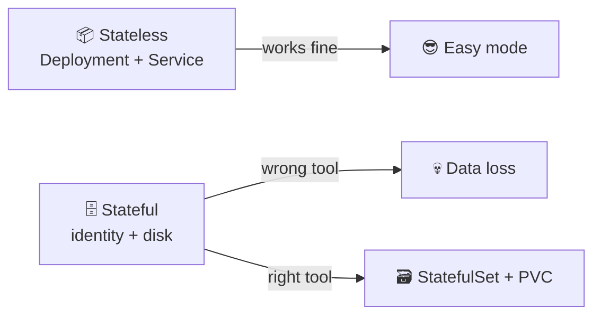

Схема: не хранящие состояние поды (Deployment + Service) работают без проблем; для stateful-нагрузок нужен правильный инструмент — без него 💀 потеря данных, с ним 🗃️ StatefulSet + PVC.

> 🔗 **Lab 15 tie-in:** you convert your Lab 12 Helm chart from a `Deployment` to a `StatefulSet` with `volumeClaimTemplates` and a headless `Service`, then prove that each pod owns its own visit counter that survives a pod kill.
>
> 🔗 **Связь с лабой 15:** ты переводишь Helm-чарт из лабы 12 с `Deployment` на `StatefulSet` с `volumeClaimTemplates` и headless-`Service`, а затем доказываешь, что каждый под владеет своим счётчиком визитов, который переживает убийство пода.

---

## 📍 Slide 2 – 🎯 Learning Outcomes

Слайд 2 — Результаты обучения

| # | Outcome |
|---|---------|
| 1 | 🧠 Tell stateless from stateful workloads and pick the right controller |
| 2 | 🏗️ Read and write `StatefulSet` manifests with `volumeClaimTemplates` |
| 3 | 🌐 Configure a headless `Service` (`clusterIP: None`) and resolve per-pod DNS |
| 4 | 🔢 Reason about ordered vs `Parallel` pod management for stateful clusters |
| 5 | 🔄 Pick between `RollingUpdate` (with partitions) and `OnDelete` update strategies |
| 6 | 🤖 Know when to drop StatefulSets entirely and reach for an operator (CloudNativePG, Strimzi, Rook) |

| # | Результат |
|---|-----------|
| 1 | 🧠 Отличать stateless-нагрузки от stateful и выбирать правильный контроллер |
| 2 | 🏗️ Читать и писать манифесты `StatefulSet` с `volumeClaimTemplates` |
| 3 | 🌐 Настраивать headless-`Service` (`clusterIP: None`) и разрешать DNS-имена отдельных подов |
| 4 | 🔢 Рассуждать об упорядоченном и `Parallel` управлении подами для stateful-кластеров |
| 5 | 🔄 Выбирать между стратегиями обновления `RollingUpdate` (с партициями) и `OnDelete` |
| 6 | 🤖 Понимать, когда отказаться от StatefulSet и взять оператор (CloudNativePG, Strimzi, Rook) |

**Tech stack pinned for May 2026:** Kubernetes **1.36** "Haru", **CloudNativePG 1.29** (PostgreSQL operator), **Rook v1.18+ (Ceph 19 Squid)**, **Longhorn 1.9** as the lightweight CNCF storage option. Apps-API `apps/v1` `StatefulSet` has been GA since **Kubernetes 1.9 (Dec 2017)** — the API surface is rock-solid; the failure modes aren't.

**Технологический стек зафиксирован на май 2026:** Kubernetes **1.36** «Haru», **CloudNativePG 1.29** (оператор PostgreSQL), **Rook v1.18+ (Ceph 19 Squid)**, **Longhorn 1.9** как лёгкий вариант хранилища из CNCF. `StatefulSet` из Apps-API `apps/v1` стал GA с **Kubernetes 1.9 (декабрь 2017)** — сам API предельно стабилен, а вот режимы отказа — нет.

---

## 📍 Slide 3 – ⚠️ Why a Deployment Is Wrong for Postgres

Слайд 3 — Почему Deployment не подходит для Postgres

Everything that makes a `Deployment` great for a stateless web app is *exactly* what hurts a stateful one.

Всё, что делает `Deployment` удобным для stateless-веб-приложения, *ровно так же* вредит stateful-нагрузке.

| Deployment behaviour | Why it's great for web | Why it's terrible for Postgres |
|---|---|---|
| 🎲 Random pod names (`web-7b9c4-x4f2k`) | Pods are interchangeable | Replica needs to know *which* pod is the primary |
| 📦 Shared `PersistentVolumeClaim` (or none) | Stateless = no disk | Two Postgres processes writing the same WAL = corruption |
| ⚡ Parallel pod startup | Faster scale-up | Bootstrap election races; split-brain |
| 🔁 Pod IPs change on restart | `Service` smooths it over | Replica connection strings break mid-stream |
| 📉 Scale to zero is safe | Just a restart | "Scale to zero" = data still on a PVC, *but is it?* |

| Поведение Deployment | Почему это хорошо для веба | Почему это ужасно для Postgres |
|---|---|---|
| 🎲 Случайные имена подов (`web-7b9c4-x4f2k`) | Поды взаимозаменяемы | Реплике нужно знать, *какой* под является primary |
| 📦 Общий `PersistentVolumeClaim` (или его отсутствие) | Stateless — значит, диск не нужен | Два процесса Postgres пишут один WAL = повреждение данных |
| ⚡ Параллельный запуск подов | Быстрее масштабирование | Гонки на выборах лидера при бутстрапе; split-brain |
| 🔁 IP подов меняются при перезапуске | `Service` сглаживает это | Строки подключения реплик рвутся на полуслове |
| 📉 Масштабирование до нуля безопасно | Всего лишь перезапуск | «Масштабирование до нуля» = данные всё ещё на PVC, *но так ли это?* |

> 🔥 **Hot take:** the day someone files an incident titled *"the database pod restarted and the data is gone"* is the day they learn that `Deployment` + `emptyDir` is not a database. That's why we have `StatefulSet`.
>
> 🔥 **Резко, но честно:** в тот день, когда кто-то заводит инцидент с заголовком *«под базы перезапустился, и данные пропали»*, он узнаёт, что `Deployment` + `emptyDir` — не база данных. Именно поэтому существует `StatefulSet`.

---

## 📍 Slide 4 – 🐾 Pets vs Cattle, Revisited

Слайд 4 — Питомцы и скот, снова

Lecture 1 introduced **pets vs cattle** (Bill Baker, 2012). Stateless workloads are cattle: replaceable, numbered by chance. Stateful workloads are pets — but **managed pets**, not snowflakes.

В лекции 1 мы ввели понятие **pets vs cattle** (Билл Бейкер, 2012). Stateless-нагрузки — это скот: взаимозаменяемый, нумеруется случайно. Stateful-нагрузки — питомцы, но **управляемые питомцы**, а не «снежинки».

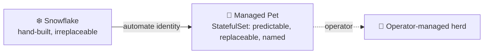

Схема: вручную собранная «снежинка» через автоматизацию идентичности превращается в управляемого питомца (`StatefulSet`: предсказуемый, заменяемый, именованный), а оператор превращает питомцев в управляемое стадо.

* 🐶 **Pet** = stable identity, stable storage, you know exactly who pod-0 is
  * 🐶 **Питомец** = стабильная идентичность, стабильное хранилище, ты точно знаешь, кто такой pod-0
* 🐮 **Cattle** = pick any one, it doesn't matter — Deployments
  * 🐮 **Скот** = бери любого, разницы нет — это Deployment
* 🏥 **Managed herd** = an operator (CloudNativePG, Strimzi) treats every pet for you so a human doesn't have to
  * 🏥 **Управляемое стадо** = оператор (CloudNativePG, Strimzi) «лечит» каждого питомца за тебя, чтобы человеку этого не делать

> 💡 StatefulSet is the K8s primitive for *managed pets*. Operators are the primitive for *managed herds*.
>
> 💡 StatefulSet — примитив K8s для *управляемых питомцев*. Операторы — примитив для *управляемых стад*.

---

## 📍 Slide 5 – 🏗️ StatefulSet Guarantees

Слайд 5 — Гарантии StatefulSet

Three guarantees you don't get from a Deployment. Memorize them.

Три гарантии, которых нет у Deployment. Запомни их.

* 🔢 **Stable, unique network identity** — pod names are `<sts-name>-<ordinal>`: `postgres-0`, `postgres-1`, `postgres-2`. The name *survives reschedule, restart, node failure*.
  * 🔢 **Стабильная, уникальная сетевая идентичность** — имена подов имеют вид `<sts-name>-<ordinal>`: `postgres-0`, `postgres-1`, `postgres-2`. Имя *переживает перепланирование, перезапуск и отказ узла*.
* 💾 **Stable, persistent storage** — each ordinal owns its own `PersistentVolumeClaim` provisioned from a `volumeClaimTemplates` block. Reschedule pod-1, the same PVC follows it.
  * 💾 **Стабильное постоянное хранилище** — каждый ординал владеет своим `PersistentVolumeClaim`, созданным из блока `volumeClaimTemplates`. Перепланируй pod-1 — за ним последует тот же PVC.
* 📊 **Ordered, graceful deployment, scaling, and termination** — pod-0 must be Ready before pod-1 starts. On scale-down, the highest ordinal goes first.
  * 📊 **Упорядоченное, аккуратное развёртывание, масштабирование и завершение** — pod-0 должен стать Ready до запуска pod-1. При уменьшении количества первым завершается ординал с наибольшим номером.

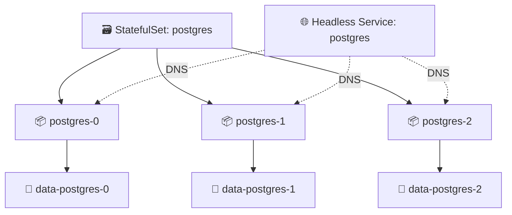

Схема: StatefulSet `postgres` управляет тремя подами `postgres-0…2`, у каждого свой том `data-postgres-N`; headless-сервис `postgres` резолвит DNS-имена всех трёх подов.

> 📚 **Source:** [Kubernetes docs — StatefulSet](https://kubernetes.io/docs/concepts/workloads/controllers/statefulset/) (apps/v1, GA since 1.9).
>
> 📚 **Источник:** [документация Kubernetes — StatefulSet](https://kubernetes.io/docs/concepts/workloads/controllers/statefulset/) (apps/v1, GA с 1.9).

---

## 📍 Slide 6 – 🌐 Headless Services — DNS Without an LB

Слайд 6 — Headless-сервисы: DNS без балансировщика

A regular `Service` gets a virtual `clusterIP`; `kube-proxy` load-balances across endpoints. A **headless** Service has `clusterIP: None` and behaves differently: the cluster DNS returns the **A records of every pod**, not one virtual IP.

Обычный `Service` получает виртуальный `clusterIP`, а `kube-proxy` балансирует нагрузку между эндпоинтами. У **headless**-сервиса `clusterIP: None`, и ведёт он себя иначе: кластерный DNS возвращает **A-записи каждого пода**, а не один виртуальный IP.

```yaml
# 🌐 Regular Service — one virtual IP, round-robin to pods
apiVersion: v1
kind: Service
metadata:
  name: postgres
spec:
  selector: { app: postgres }
  ports: [{ port: 5432 }]
---
# 🌐 Headless Service — no IP, returns every pod's IP
apiVersion: v1
kind: Service
metadata:
  name: postgres-headless
spec:
  clusterIP: None              # 🔑 the magic
  selector: { app: postgres }
  ports: [{ port: 5432 }]
```

Пояснение к коду: обычный `Service` даёт один виртуальный IP и распределяет трафик по подам; в headless-сервисе `clusterIP: None` убирает виртуальный IP, и DNS возвращает адреса всех подов.

| DNS query | Regular Service | Headless Service |
|-----------|-----------------|------------------|
| `postgres.default.svc` | `10.96.0.42` (one virtual IP) | `10.244.1.7, 10.244.2.3, 10.244.3.9` (every pod) |
| `postgres-0.postgres-headless.default.svc` | ❌ doesn't exist | `10.244.1.7` (pod-0 only) |

| DNS-запрос | Обычный Service | Headless Service |
|-----------|-----------------|------------------|
| `postgres.default.svc` | `10.96.0.42` (один виртуальный IP) | `10.244.1.7, 10.244.2.3, 10.244.3.9` (каждый под) |
| `postgres-0.postgres-headless.default.svc` | ❌ не существует | `10.244.1.7` (только pod-0) |

> 🔑 **Why we need it:** the StatefulSet ↔ DNS bond *requires* a headless governing Service. Without it, you can't address `pod-0` directly, which means you can't write a Postgres connection string for the primary.
>
> 🔑 **Зачем это нужно:** связка StatefulSet ↔ DNS *требует* управляющего headless-сервиса. Без него нельзя обратиться к `pod-0` напрямую, а значит, не получится написать строку подключения Postgres к primary.

---

## 📍 Slide 7 – 🔗 Per-Pod DNS Names

Слайд 7 — DNS-имена отдельных подов

Every pod in a `StatefulSet` gets a stable DNS record under the governing headless Service:

Каждый под в `StatefulSet` получает стабильную DNS-запись под управляющим headless-сервисом:

```
<pod-name>.<headless-service>.<namespace>.svc.cluster.local
```

Пояснение: формат DNS-имени — имя пода, имя headless-сервиса, namespace и `cluster.local`.

For a StatefulSet `postgres` with `serviceName: postgres-headless` in namespace `prod`:

Для StatefulSet `postgres` с `serviceName: postgres-headless` в namespace `prod`:

```
postgres-0.postgres-headless.prod.svc.cluster.local
postgres-1.postgres-headless.prod.svc.cluster.local
postgres-2.postgres-headless.prod.svc.cluster.local
```

Пояснение: три стабильные DNS-записи для ординалов 0, 1 и 2 в namespace `prod`.

* ✅ Names **never change** for a given ordinal — `postgres-0` is `postgres-0` forever
  * ✅ Имена **никогда не меняются** для заданного ординала — `postgres-0` остаётся `postgres-0` навсегда
* ✅ Resolution works **from any pod in the cluster** — that's how the replicas find the primary
  * ✅ Резолвинг работает **из любого пода кластера** — именно так реплики находят primary
* ✅ If `postgres-0` is rescheduled to a different node, the name still resolves to the new pod IP
  * ✅ Если `postgres-0` перепланирован на другой узел, имя по-прежнему резолвится в IP нового пода

> 🔧 **Test it in Lab 15:** `kubectl exec postgres-0 -- nslookup postgres-1.postgres-headless` — you should see one A record matching pod-1's current IP.
>
> 🔧 **Проверь в лабе 15:** `kubectl exec postgres-0 -- nslookup postgres-1.postgres-headless` — ты должен увидеть одну A-запись с текущим IP этого пода.

---

## 📍 Slide 8 – 💾 volumeClaimTemplates: One PVC Per Pod, For Free

Слайд 8 — volumeClaimTemplates: по PVC на под, бесплатно

The killer feature. A `volumeClaimTemplates` block tells the StatefulSet controller: *for every pod ordinal, provision a PVC from this template*. No human writes the PVCs.

Главная фича. Блок `volumeClaimTemplates` говорит контроллеру StatefulSet: *для каждого ординала пода создай PVC по этому шаблону*. PVC никто вручную не пишет.

```yaml
apiVersion: apps/v1
kind: StatefulSet
metadata: { name: postgres }
spec:
  serviceName: postgres-headless
  replicas: 3
  selector: { matchLabels: { app: postgres } }
  template:
    metadata: { labels: { app: postgres } }
    spec:
      containers:
        - name: postgres
          image: postgres:17.5
          volumeMounts:
            - { name: data, mountPath: /var/lib/postgresql/data }
  volumeClaimTemplates:                  # 🔑 per-pod PVC provisioning
    - metadata: { name: data }
      spec:
        accessModes: [ReadWriteOnce]
        storageClassName: standard
        resources: { requests: { storage: 20Gi } }
```

Пояснение к коду: `serviceName` привязывает StatefulSet к headless-сервису; `volumeClaimTemplates` создаёт отдельный PVC `data-postgres-N` для каждого пода; контейнер монтирует его в `/var/lib/postgresql/data`.

**Result after `kubectl apply`:**

**Результат после `kubectl apply`:**

```
PVC data-postgres-0   →   PV   →   bound to postgres-0
PVC data-postgres-1   →   PV   →   bound to postgres-1
PVC data-postgres-2   →   PV   →   bound to postgres-2
```

Пояснение: каждый PVC привязан к своему PV и обслуживает конкретный под — `data-postgres-0` для `postgres-0` и так далее.

> ⚠️ **Critical:** PVCs created by `volumeClaimTemplates` are **NOT deleted** when you scale the StatefulSet down or delete the StatefulSet itself. This is a feature — your data outlives mistakes. The trade-off is you have to clean them up manually with `kubectl delete pvc`.
>
> ⚠️ **Важно:** PVC, созданные через `volumeClaimTemplates`, **НЕ удаляются** при уменьшении StatefulSet или удалении самого StatefulSet. Это фича — данные переживают ошибки. Плата за это — PVC нужно чистить вручную командой `kubectl delete pvc`.

---

## 📍 Slide 9 – 🔄 Ordered Deployment and Scaling

Слайд 9 — Упорядоченное развёртывание и масштабирование

Default behaviour: pod-N waits for pod-(N-1) to be Ready before it starts. Scale-down is reverse.

Поведение по умолчанию: pod-N ждёт, пока pod-(N-1) станет Ready, и только потом запускается. При уменьшении — в обратном порядке.

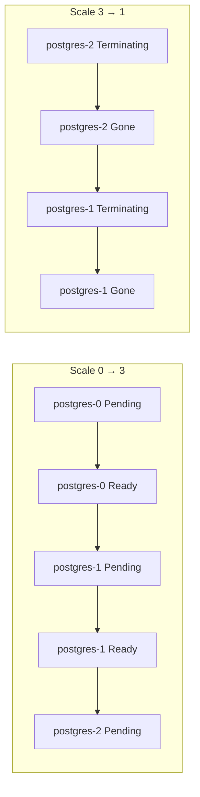

Схема: при масштабировании с 0 до 3 поды запускаются по очереди — `postgres-0` Pending → Ready, затем `postgres-1` и так далее; при масштабировании с 3 до 1 первыми завершаются `postgres-2`, затем `postgres-1`.

* 🔢 Sequential start: pod-0 becomes primary → pod-1 joins as replica → pod-2 joins
  * 🔢 Последовательный запуск: pod-0 становится primary → pod-1 подключается репликой → pod-2 подключается
* 📉 Reverse termination: pod-2 drains → pod-1 drains → pod-0 (the primary) stays until last
  * 📉 Обратное завершение: сначала выводится pod-2 → затем pod-1 → pod-0 (primary) остаётся до последнего
* ⏱️ A wedged pod-1 **blocks** pod-2 from ever starting — slow but safe
  * ⏱️ Застрявший pod-1 **блокирует** запуск pod-2 — медленно, но безопасно

**Override with `podManagementPolicy: Parallel`** when you don't need the ordering — e.g., a stateless cluster of shards that all discover each other lazily. Default is `OrderedReady`.

**Переопредели через `podManagementPolicy: Parallel`**, если порядок не нужен — например, для кластера шардов без состояния, которые лениво находят друг друга. По умолчанию используется `OrderedReady`.

```yaml
spec:
  podManagementPolicy: Parallel   # start all pods at once; PVCs still per-ordinal
```

Пояснение к коду: `podManagementPolicy: Parallel` запускает все поды сразу, но PVC по-прежнему выделяется каждому ординалу отдельно.

> 🔥 **When `Parallel` makes sense:** a Cassandra-style cluster where every node is equal and discovery is via gossip, not via "find pod-0". Most databases want `OrderedReady`.
>
> 🔥 **Когда `Parallel` оправдан:** кластер в стиле Cassandra, где все узлы равны, а обнаружение идёт через gossip, а не через «найди pod-0». Большинству баз данных нужен `OrderedReady`.

---

## 📍 Slide 10 – 🔄 Update Strategies: RollingUpdate vs OnDelete

Слайд 10 — Стратегии обновления: RollingUpdate и OnDelete

A StatefulSet upgrade matters more than a Deployment one — you're upgrading the *primary database*, not a web frontend.

Обновление StatefulSet важнее, чем обновление Deployment: ты обновляешь *основную базу данных*, а не веб-фронтенд.

**RollingUpdate (default)** — replaces pods one at a time, *highest ordinal first*:

**RollingUpdate (по умолчанию)** — заменяет поды по одному, *начиная с наибольшего ординала*:

```yaml
spec:
  updateStrategy:
    type: RollingUpdate
    rollingUpdate:
      partition: 0           # update everything from ordinal 0 upward (i.e., all pods)
```

Пояснение к коду: `partition: 0` обновляет всё от ординала 0 и выше, то есть все поды.

**OnDelete** — controller does *nothing* on a spec change; you delete pods yourself when ready:

**OnDelete** — контроллер *ничего не делает* при изменении спецификации; поды удаляешь ты сам, когда будешь готов:

```yaml
spec:
  updateStrategy:
    type: OnDelete
```

Пояснение к коду: при `OnDelete` контроллер не трогает поды после изменения спецификации — удаление остаётся за человеком.

| Strategy | Triggered by | When to use |
|---|---|---|
| `RollingUpdate` | `kubectl apply` of new pod template | Most cases — let K8s drive |
| `RollingUpdate` + `partition` | apply + manual partition decrement | Canary one replica before the rest |
| `OnDelete` | manual `kubectl delete pod` | Strict change windows; coordinated DB upgrades |

| Стратегия | Чем запускается | Когда использовать |
|---|---|---|
| `RollingUpdate` | `kubectl apply` нового шаблона пода | В большинстве случаев — пусть K8s рулит |
| `RollingUpdate` + `partition` | apply + ручное уменьшение partition | Канареечно обновить одну реплику до остальных |
| `OnDelete` | ручной `kubectl delete pod` | Жёсткие окна изменений; согласованные обновления БД |

> 🔧 **Lab 15 bonus:** try both. The `OnDelete` workflow is what most production database upgrades actually look like — a human is in the loop because the cost of an automated mistake is "restore from backup".
>
> 🔧 **Бонус в лабе 15:** попробуй оба варианта. Процесс `OnDelete` — это то, как на самом деле выглядит большинство обновлений продакшен-баз: человек остаётся в контуре, потому что цена автоматической ошибки — «восстановление из бэкапа».

---

## 📍 Slide 11 – 🎯 Partitioned Rollout (Canary for Stateful Apps)

Слайд 11 — Партиционированное развёртывание (канарейка для stateful-приложений)

The `partition` field is the StatefulSet equivalent of a canary. Pods with ordinal `>= partition` get the new template; the rest stay on the old one.

Поле `partition` — аналог канарейки для StatefulSet. Поды с ординалом `>= partition` получают новый шаблон, остальные остаются на старом.

```yaml
spec:
  replicas: 5
  updateStrategy:
    type: RollingUpdate
    rollingUpdate:
      partition: 4           # 🐤 only postgres-4 updates
```

Пояснение к коду: при `replicas: 5` и `partition: 4` новый шаблон получает только `postgres-4`.

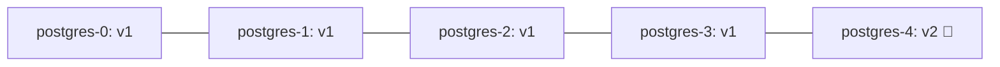

Схема: `postgres-0`…`postgres-3` работают на версии v1, а `postgres-4` один работает на v2 🐤 — это и есть канарейка.

* 🐤 Update lands only on pod-4 — your canary
  * 🐤 Обновление попадает только на pod-4 — твою канарейку
* ✅ Validate metrics, replication lag, application errors
  * ✅ Проверь метрики, отставание репликации и ошибки приложения
* 🔽 Drop `partition: 4 → 3 → 2 → 1 → 0` to roll the upgrade forward
  * 🔽 Уменьшай `partition: 4 → 3 → 2 → 1 → 0`, чтобы катить обновление дальше
* ⏪ Set `partition` back to a high number and re-apply old image to roll back
  * ⏪ Верни `partition` на большое число и примени старый образ, чтобы откатиться

> 📊 **Compare to Lab 14 (Rollouts):** Argo Rollouts gives you weighted traffic shifting for *stateless* apps. StatefulSet partitions give you "this ordinal runs the new version" for *stateful* apps. Different problems, different tools.
>
> 📊 **Сравни с лабой 14 (Rollouts):** Argo Rollouts даёт взвешенное перераспределение трафика для *stateless*-приложений. Партиции StatefulSet дают «этот ординал работает на новой версии» для *stateful*-приложений. Разные задачи — разные инструменты.

---

## 📍 Slide 12 – ⏱️ Common Failure Modes

Слайд 12 — Частые режимы отказа

| Symptom | Likely cause | Fix |
|---|---|---|
| 🟡 `postgres-1` stuck `Pending` forever | PVC can't bind: storage class missing, quota exceeded, RWO PVC on a node that already has it mounted | `kubectl describe pvc data-postgres-1`; check `StorageClass`; check node where pod-0 sits |
| 🔁 Pod restarts every minute | Liveness probe failing; readiness on the wrong port | `kubectl logs --previous`; tighten probe paths |
| ❌ Pod-2 never starts | Pod-1 isn't Ready (controller waits) | Fix pod-1 first; or switch to `podManagementPolicy: Parallel` if your app supports it |
| 💾 Scale-down "deleted" my data | It didn't — PVCs were retained on purpose; you scaled the StatefulSet but the PVC is still there | `kubectl get pvc` — your data is still there; bump `replicas` back up |
| 🌐 `postgres-0.postgres-headless` doesn't resolve | Headless Service missing or has the wrong selector | Confirm `serviceName` in STS matches a `clusterIP: None` Service whose selector matches pod labels |
| 🐢 Scale 0→10 takes 20 minutes | Default `OrderedReady` waits for each pod | Use `podManagementPolicy: Parallel` if you don't need ordering |

| Симптом | Вероятная причина | Исправление |
|---|---|---|
| 🟡 `postgres-1` навсегда застрял в `Pending` | PVC не может привязаться: нет StorageClass, превышена квота, RWO-PVC на узле, где он уже смонтирован | `kubectl describe pvc data-postgres-1`; проверь `StorageClass`; проверь узел, где находится pod-0 |
| 🔁 Под перезапускается каждую минуту | Падает liveness-проба; readiness-проба смотрит не на тот порт | `kubectl logs --previous`; уточни пути проб |
| ❌ Pod-2 вообще не запускается | Pod-1 не в состоянии Ready (контроллер ждёт) | Сначала почини pod-1; либо переключись на `podManagementPolicy: Parallel`, если приложение это поддерживает |
| 💾 «Масштабирование вниз удалило мои данные» | Нет — PVC сохранены намеренно; ты уменьшил StatefulSet, но PVC остался | `kubectl get pvc` — данные на месте; верни `replicas` обратно |
| 🌐 `postgres-0.postgres-headless` не резолвится | Headless-сервис отсутствует или у него неверный селектор | Убедись, что `serviceName` в STS совпадает с сервисом `clusterIP: None`, чей селектор соответствует меткам пода |
| 🐢 Масштабирование 0→10 занимает 20 минут | Стандартный `OrderedReady` ждёт каждый под | Используй `podManagementPolicy: Parallel`, если порядок не нужен |

> 🔍 **Debugging order:** `kubectl get sts,pod,pvc,svc` — these four together tell the whole story.
>
> 🔍 **Порядок отладки:** `kubectl get sts,pod,pvc,svc` — эти четыре ресурса вместе рассказывают всю историю.

---

## 📍 Slide 13 – 💽 Persistent Volumes: The Two-Layer Model

Слайд 13 — Постоянные тома: двухуровневая модель

A `PersistentVolumeClaim` is a *request*; a `PersistentVolume` is the actual disk. The cluster's `StorageClass` provisions PVs dynamically — without one, your PVCs hang forever.

`PersistentVolumeClaim` — это *запрос*; `PersistentVolume` — собственно диск. `StorageClass` кластера динамически создаёт PV: без него твои PVC будут висеть вечно.

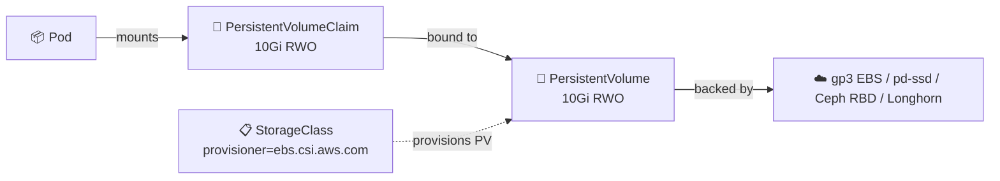

Схема: под монтирует PVC (запрос 10Gi RWO), PVC привязан к PV (реальный диск 10Gi RWO), а PV опирается на бэкенд вроде gp3 EBS, pd-ssd, Ceph RBD или Longhorn; `StorageClass` динамически создаёт PV.

| Access mode | Meaning | Typical backend |
|---|---|---|
| `ReadWriteOnce` (RWO) | One node R/W at a time | Block storage (EBS, GCE PD, Ceph RBD) — the default for StatefulSets |
| `ReadOnlyMany` (ROX) | Many nodes, read only | Object storage layered on top |
| `ReadWriteMany` (RWX) | Many nodes R/W simultaneously | NFS, CephFS, EFS — needed for shared-filesystem apps, rare for databases |
| `ReadWriteOncePod` (RWOP, GA 1.29) | Exactly one pod R/W cluster-wide | Stricter than RWO; prevents multi-attach on the same node |

| Режим доступа | Значение | Типичный бэкенд |
|---|---|---|
| `ReadWriteOnce` (RWO) | Чтение и запись с одного узла одновременно | Блочное хранилище (EBS, GCE PD, Ceph RBD) — стандарт для StatefulSet |
| `ReadOnlyMany` (ROX) | Много узлов, только чтение | Объектное хранилище, поданное через слой совместимости |
| `ReadWriteMany` (RWX) | Много узлов читают и пишут одновременно | NFS, CephFS, EFS — нужно для приложений с общим файловым хранилищем, редко для баз данных |
| `ReadWriteOncePod` (RWOP, GA 1.29) | Ровно один под на весь кластер | Строже RWO; предотвращает многократное подключение на одном узле |

> ⚠️ **Reclaim policy:** PVs come with a `persistentVolumeReclaimPolicy`. `Retain` keeps the data after the PVC is deleted (safer); `Delete` wipes it. Most cloud `StorageClass` defaults are `Delete`. **Set `Retain` for anything that matters.**
>
> ⚠️ **Политика возврата (reclaim policy):** у PV есть `persistentVolumeReclaimPolicy`. `Retain` сохраняет данные после удаления PVC (безопаснее); `Delete` их стирает. В большинстве облачных `StorageClass` по умолчанию стоит `Delete`. **Ставь `Retain` для всего, что важно.**

---

## 📍 Slide 14 – 🌩️ Cloud-Native Storage Options (May 2026)

Слайд 14 — Варианты облачного хранилища (май 2026)

Not every cluster runs on EBS or GCE PDs. For on-prem or multi-cloud, you bring storage with you.

Не каждый кластер работает на EBS или GCE PD. Для on-prem и мультиоблака хранилище приносишь с собой.

| Project | Style | Strengths | Trade-offs |
|---|---|---|---|
| **Rook v1.18 + Ceph 19 Squid** | Distributed (block + file + object) | Battle-tested at scale; unified block/file/object; CNCF graduated | Heavy — needs ≥3 nodes, careful capacity planning |
| **Longhorn 1.9** (SUSE → CNCF) | Distributed block, native to K8s | Simple UI, easy snapshots, S3 backups, small clusters | Block only; per-volume replica overhead |
| **OpenEBS Mayastor** | NVMe-over-TCP, hyperconverged | Highest performance for NVMe; default engine in new installs | Newer; requires kernel features |
| **CSI cloud drivers** (EBS, GCE PD, Azure Disk) | Single-cloud block | Managed, fast, cheap | Vendor lock-in; RWO only |

| Проект | Стиль | Сильные стороны | Компромиссы |
|---|---|---|---|
| **Rook v1.18 + Ceph 19 Squid** | Распределённое (блочное + файловое + объектное) | Проверено в масштабе; единый блок/файл/объект; graduated в CNCF | Тяжёлое — нужно ≥3 узлов и аккуратное планирование ёмкости |
| **Longhorn 1.9** (SUSE → CNCF) | Распределённое блочное, родное для K8s | Простой UI, лёгкие снапшоты, бэкапы в S3, небольшие кластеры | Только блочное; накладные расходы на реплики по каждому тому |
| **OpenEBS Mayastor** | NVMe-over-TCP, гиперконвергентное | Наибольшая производительность для NVMe; движок по умолчанию в новых установках | Новее; требует возможностей ядра |
| **CSI-драйверы облаков** (EBS, GCE PD, Azure Disk) | Блочное в пределах одного облака | Управляемое, быстрое, дешёвое | Привязка к вендору; только RWO |

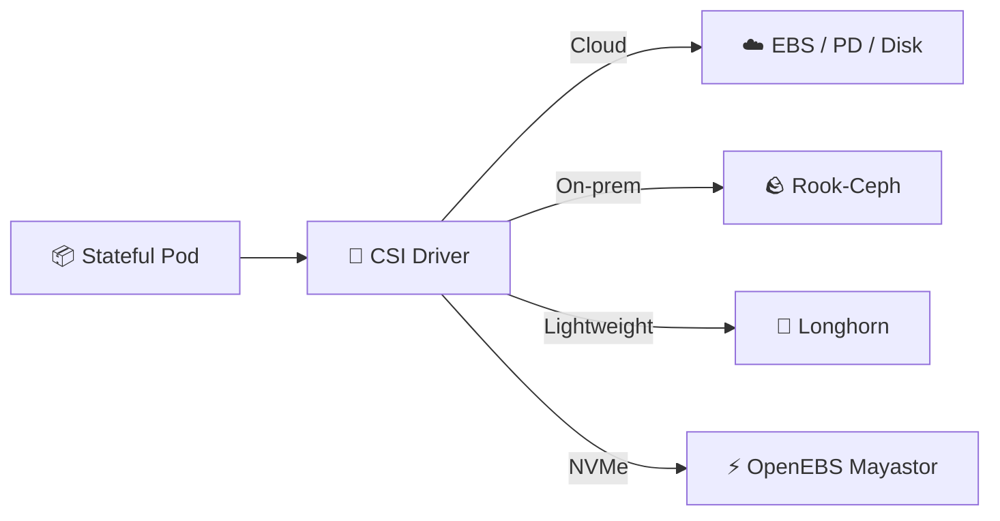

Схема: stateful-под обращается к CSI-драйверу, который подключает облачное хранилище (EBS/PD/Disk), on-prem-хранилище Rook-Ceph, лёгкое Longhorn или NVMe-хранилище OpenEBS Mayastor.

> 🔧 **Course tie-in:** Lab 15 uses k3d's default `StorageClass` (the local-path-provisioner). The principles transfer; production swaps in EBS or Rook.
>
> 🔧 **Связь с курсом:** лаба 15 использует стандартный `StorageClass` из k3d (local-path-provisioner). Принципы переносятся, а в продакшене его заменяют на EBS или Rook.

---

## 📍 Slide 15 – 🏥 Past StatefulSets: When You Need an Operator

Слайд 15 — За пределами StatefulSet: когда нужен оператор

A StatefulSet gets you *identity + storage*. It doesn't give you:

StatefulSet даёт тебе *идентичность + хранилище*. Но он не даёт:

* 🩺 Failover orchestration (promote replica when primary dies)
  * 🩺 Оркестрацию failover (повышение реплики, когда primary умирает)
* 💾 Coordinated backups (`pg_basebackup`, WAL archiving)
  * 💾 Согласованные бэкапы (`pg_basebackup`, архивирование WAL)
* 🔄 Point-in-time restore from S3
  * 🔄 Восстановление на момент времени из S3
* 📊 Replication lag monitoring
  * 📊 Мониторинг отставания репликации
* 🔐 Per-tenant credential rotation
  * 🔐 Ротацию учётных данных для каждого тенанта

That's an **operator** — a controller that understands your specific database. Operators ship as CRDs (Custom Resource Definitions) plus a controller pod that watches them.

Вот тут и нужен **оператор** — контроллер, который понимает конкретную базу данных. Операторы поставляются как CRD (Custom Resource Definitions) плюс под-контроллер, который за ними следит.

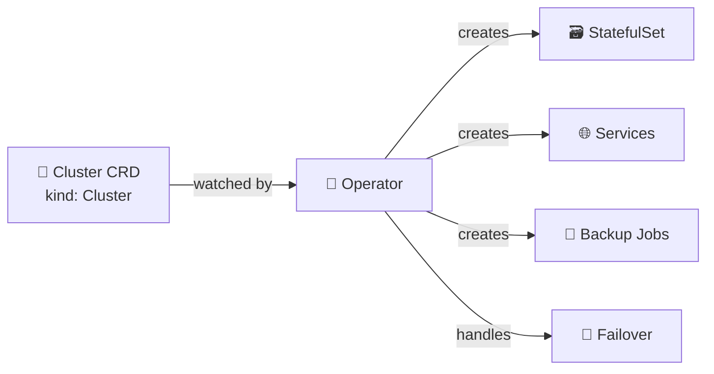

Схема: CRD `kind: Cluster` отслеживается оператором, который создаёт StatefulSet, сервисы и задания бэкапа, а также берёт на себя failover.

**Production-grade operators in 2026:**

**Продакшен-операторы в 2026 году:**

| Workload | Operator | Notes |
|---|---|---|
| 🐘 PostgreSQL | **CloudNativePG 1.29** (CNCF Sandbox) | Default for many platform teams; PG 18.3 supported; quorum failover stable |
| 🐬 MySQL | **MySQL Operator for K8s** (Oracle) or **Percona XtraDB Operator** | Two viable choices; Percona for high availability |
| 🟢 MongoDB | **MongoDB Community Operator** | Stays under the SSPL license boundary |
| 🍂 Redis | **Redis Operator** (OT/Spotahome) or **Dragonfly Operator** | Dragonfly is a Redis-compatible drop-in |
| 📨 Kafka | **Strimzi** (CNCF) | The de-facto K8s Kafka operator |
| 🐘 ClickHouse | **Altinity ClickHouse Operator** | |

| Нагрузка | Оператор | Примечания |
|---|---|---|
| 🐘 PostgreSQL | **CloudNativePG 1.29** (CNCF Sandbox) | Выбор по умолчанию у многих платформенных команд; поддерживает PG 18.3; кворумный failover стабилен |
| 🐬 MySQL | **MySQL Operator for K8s** (Oracle) или **Percona XtraDB Operator** | Два рабочих варианта; Percona — для высокой доступности |
| 🟢 MongoDB | **MongoDB Community Operator** | Остаётся в границах лицензии SSPL |
| 🍂 Redis | **Redis Operator** (OT/Spotahome) или **Dragonfly Operator** | Dragonfly — совместимая замена Redis |
| 📨 Kafka | **Strimzi** (CNCF) | Де-факто оператор Kafka для K8s |
| 🐘 ClickHouse | **Altinity ClickHouse Operator** | |

> 💡 **Rule of thumb:** if you'd page yourself at 3 AM for that database's failure, run it with an operator, not a raw StatefulSet.
>
> 💡 **Правило простое:** если из-за отказа этой базы ты готов поднять себя по тревоге в 3 часа ночи, запускай её через оператор, а не на голом StatefulSet.

---

## 📍 Slide 16 – 🐘 CloudNativePG in 90 Seconds

Слайд 16 — CloudNativePG за 90 секунд

A taste of what an operator buys you. Compare this to writing a 3-pod Postgres StatefulSet by hand.

Почувствуй, что даёт оператор. Сравни с ручным написанием Postgres-StatefulSet из трёх подов.

```yaml
apiVersion: postgresql.cnpg.io/v1
kind: Cluster
metadata:
  name: app-db
spec:
  instances: 3                        # 🔢 1 primary + 2 replicas
  imageName: ghcr.io/cloudnative-pg/postgresql:18.3
  storage:
    size: 50Gi
    storageClass: standard
  backup:
    barmanObjectStore:
      destinationPath: s3://my-backups/app-db
      s3Credentials:
        accessKeyId:     { name: backup-creds, key: ACCESS_KEY_ID }
        secretAccessKey: { name: backup-creds, key: SECRET_ACCESS_KEY }
    retentionPolicy: "30d"
  monitoring:
    enablePodMonitor: true            # 📊 Prometheus scraping out of the box
```

Пояснение к коду: `kind: Cluster` описывает три инстанса Postgres, хранилище на 50Gi, бэкапы в S3 через `barmanObjectStore` с хранением 30 дней и мониторинг через `PodMonitor`.

* 🔄 Automatic primary election (quorum-based failover, stable since 1.28)
  * 🔄 Автоматические выборы primary (кворумный failover, стабилен с 1.28)
* 💾 Continuous WAL archiving to S3
  * 💾 Непрерывное архивирование WAL в S3
* ♻️ Rolling minor version upgrades coordinated across the cluster
  * ♻️ Rollout минорных версий, согласованный по всему кластеру
* 📊 `PodMonitor` + dashboards bundled
  * 📊 `PodMonitor` и дашборды из коробки

> 📚 **Source:** [cloudnative-pg.io](https://cloudnative-pg.io/) — 1.29 GA released 2026; PostgreSQL 18.3 the default image.
>
> 📚 **Источник:** [cloudnative-pg.io](https://cloudnative-pg.io/) — GA-версия 1.29 вышла в 2026 году; по умолчанию используется образ PostgreSQL 18.3.

---

## 📍 Slide 17 – 💾 Backup & Restore (Briefly)

Слайд 17 — Бэкапы и восстановление (кратко)

> 📘 **Deeper coverage:** SRE-Intro (elective) has a full lecture on backup strategies, RPO/RTO, and chaos-testing your restore. We just plant the flag here.
>
> 📘 **Глубже:** в элективе SRE-Intro есть полная лекция о стратегиях бэкапа, RPO/RTO и хаос-тестировании восстановления. Здесь мы лишь ставим флажок.

**Three rules for stateful K8s in 2026:**

**Три правила для stateful в K8s в 2026 году:**

1. 💾 **A snapshot is not a backup.** EBS snapshots are application-unaware; restoring a half-written WAL is corruption. Use the database's native tool (`pg_basebackup`, `mongodump`, `xtrabackup`).
   * 💾 **Снапшот — не бэкап.** Снапшоты EBS не знают о приложении; восстановление наполовину записанного WAL — это повреждение. Используй родной инструмент базы (`pg_basebackup`, `mongodump`, `xtrabackup`).
2. 🔁 **An untested backup is a wish.** Restore drills, on a schedule, to a fresh cluster. The 2017 GitLab.com incident lost data because 5 of 5 backup mechanisms were broken — nobody had checked.
   * 🔁 **Непроверенный бэкап — это мечта.** Регулярно проводи учебные восстановления в свежий кластер. В инциденте GitLab.com в 2017 году данные потеряли, потому что 5 из 5 механизмов бэкапа были сломаны — никто их не проверял.
3. 📦 **Store backups outside the cluster.** S3, GCS, or an external Ceph object store. If the cluster goes, your backups can't go with it.
   * 📦 **Храни бэкапы вне кластера.** S3, GCS или внешнее объектное хранилище Ceph. Если кластер исчезнет, бэкапы не должны исчезнуть вместе с ним.

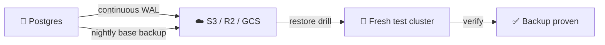

Схема: Postgres непрерывно отправляет WAL в S3/R2/GCS и раз в ночь делает базовый бэкап; восстановление проверяется на свежем тестовом кластере, после чего бэкап считается доказанным.

> 🔥 **Operator advantage again:** CloudNativePG, Strimzi, and friends ship backup *and* restore as CRDs. You declare `kind: Backup` and `kind: ScheduledBackup`; you declare `kind: Cluster.spec.bootstrap.recovery` to restore. No bash scripts.
>
> 🔥 **Снова преимущество оператора:** CloudNativePG, Strimzi и их аналоги поставляют бэкап *и* восстановление как CRD. Ты объявляешь `kind: Backup` и `kind: ScheduledBackup`, а для восстановления — `kind: Cluster.spec.bootstrap.recovery`. Никаких bash-скриптов.

---

## 📍 Slide 18 – 📋 Complete StatefulSet Example (Lab 15 Template)

Слайд 18 — Полный пример StatefulSet (шаблон лабы 15)

The minimum viable StatefulSet — what your Lab 15 chart converges on:

Минимально жизнеспособный StatefulSet — к нему сходится твой чарт из лабы 15:

```yaml
apiVersion: v1
kind: Service
metadata: { name: visits-headless }
spec:
  clusterIP: None
  selector: { app: visits }
  ports: [{ port: 8000, name: http }]
---
apiVersion: apps/v1
kind: StatefulSet
metadata: { name: visits }
spec:
  serviceName: visits-headless        # 🔑 must match the headless Service
  replicas: 3
  selector: { matchLabels: { app: visits } }
  template:
    metadata: { labels: { app: visits } }
    spec:
      containers:
        - name: app
          image: ghcr.io/innodevops/lab12-app:v1.2.0
          ports: [{ containerPort: 8000, name: http }]
          volumeMounts:
            - { name: data, mountPath: /data }
          readinessProbe:
            httpGet: { path: /health, port: http }
            initialDelaySeconds: 3
            periodSeconds: 5
  volumeClaimTemplates:
    - metadata: { name: data }
      spec:
        accessModes: [ReadWriteOnce]
        resources: { requests: { storage: 1Gi } }
```

Пояснение к коду: headless-сервис `visits-headless` и `serviceName` связывают поды с DNS; три реплики получают PVC `data` по 1Gi из `volumeClaimTemplates`; readiness-проба проверяет `/health`, чтобы ординалы поднимались по очереди только после готовности.

**Verify in Lab 15:**

**Проверка в лабе 15:**

```bash
kubectl get sts,pod,pvc,svc                                  # all four resources present
kubectl exec visits-0 -- nslookup visits-1.visits-headless   # 🔗 per-pod DNS works
for i in 0 1 2; do                                           # 💾 per-pod state
  kubectl exec visits-$i -- cat /data/visits
done
kubectl delete pod visits-0                                  # pod-0 restarts, same PVC, same data
```

Пояснение к командам: проверяем наличие всех четырёх типов ресурсов, резолвинг DNS между подами, независимое состояние каждого пода в `/data/visits` и то, что после удаления `visits-0` под перезапускается с тем же PVC и теми же данными.

---

## 📍 Slide 19 – ⚠️ Gotchas in Production

Слайд 19 — Подводные камни в продакшене

| Gotcha | Symptom | Mitigation |
|---|---|---|
| 🗑️ Forgotten PVCs | Cluster fills up with orphan PVCs | `kubectl delete pvc data-postgres-{0..N}` when retiring a StatefulSet |
| 🔄 Reclaim policy `Delete` | Wiped data on PVC deletion | Patch `StorageClass` to `Retain` for prod; verify on the PV |
| 🌐 Missing headless Service | DNS resolution silently broken | Apply Service *before* the StatefulSet; CI lint for it |
| 📊 Liveness probe too aggressive | Pods restart mid-WAL flush | Use readiness for traffic; liveness only on deep deadlocks |
| 🐢 Two-replica clusters | Worst of both worlds | Stateful clusters want **odd** numbers ≥3 for quorum; or single-instance with backups |
| 🔁 `volumeClaimTemplates` change | Field is **immutable** after creation | To resize: edit the PVC directly (if `allowVolumeExpansion: true` in the StorageClass) |
| 📦 Pod-0 fails first; rest never start | Default `OrderedReady` blocks | Fix pod-0 root cause; switch to `Parallel` only if app supports it |

| Подводный камень | Симптом | Как избежать |
|---|---|---|
| 🗑️ Забытые PVC | Кластер зарастает «сиротскими» PVC | Удаляй PVC командой `kubectl delete pvc data-postgres-{0..N}` при выводе StatefulSet из эксплуатации |
| 🔄 Политика возврата `Delete` | Данные стираются при удалении PVC | Пропатчь `StorageClass` на `Retain` для прода; проверь политику на самом PV |
| 🌐 Отсутствует headless Service | DNS-резолвинг молча ломается | Применяй Service *до* StatefulSet; добавь проверку в CI-линтер |
| 📊 Слишком агрессивная liveness-проба | Поды перезапускаются посреди записи WAL | Для трафика используй readiness; liveness — только при серьёзных дедлоках |
| 🐢 Кластеры из двух реплик | Худшее из обоих вариантов | Для кворума stateful-кластеру нужно **нечётное** число ≥3; либо один инстанс с бэкапами |
| 🔁 Изменение `volumeClaimTemplates` | Поле **неизменяемо** после создания | Чтобы увеличить размер, правь PVC напрямую (если в StorageClass стоит `allowVolumeExpansion: true`) |
| 📦 Pod-0 падает первым; остальные не запускаются | Стандартный `OrderedReady` блокирует | Устрани причину отказа pod-0; переключайся на `Parallel`, только если приложение это поддерживает |

> 🔥 **Resizing trap:** you cannot edit `volumeClaimTemplates.spec.resources` and have it propagate. The StatefulSet controller silently ignores it. Resize the PVCs *manually*; recreate the StatefulSet with `--cascade=orphan` if the template diff matters.
>
> 🔥 **Ловушка с resize:** отредактировать `volumeClaimTemplates.spec.resources` и ждать, что изменение применится, нельзя. Контроллер StatefulSet молча его игнорирует. Увеличивай PVC *вручную*; если важен diff шаблона, пересоздай StatefulSet с `--cascade=orphan`.

---

## 📍 Slide 20 – 🆚 Deployment vs StatefulSet vs DaemonSet vs Job

Слайд 20 — Deployment vs StatefulSet vs DaemonSet vs Job

So far this course has touched all four. A quick consolidation:

Пока в курсе встречались все четыре. Быстрое обобщение:

| Controller | Pods named | Storage | Ordering | Use case |
|---|---|---|---|---|
| **Deployment** | random suffix | shared / none | parallel | Stateless apps (web, API, workers) |
| **StatefulSet** | ordinal (`-0`, `-1`) | per-pod via templates | sequential by default | Databases, queues, anything with identity |
| **DaemonSet** | one per node | hostPath / per-node | one-per-node | Node agents (log shipper, CSI driver, network plugin) |
| **Job / CronJob** | random; runs to completion | task-scoped | parallel or sequential | Batch work, migrations, scheduled tasks |

| Контроллер | Имена подов | Хранилище | Порядок | Вариант использования |
|---|---|---|---|---|
| **Deployment** | случайный суффикс | общее / нет | параллельный | Stateless-приложения (веб, API, воркеры) |
| **StatefulSet** | ординал (`-0`, `-1`) | у каждого пода свой, через шаблоны | последовательный по умолчанию | Базы данных, очереди, всё, что имеет идентичность |
| **DaemonSet** | один на узел | hostPath / на узел | один на узел | Агенты узла (сборщик логов, CSI-драйвер, сетевой плагин) |
| **Job / CronJob** | случайные; до завершения | в рамках задачи | параллельный или последовательный | Пакетные задачи, миграции, задачи по расписанию |

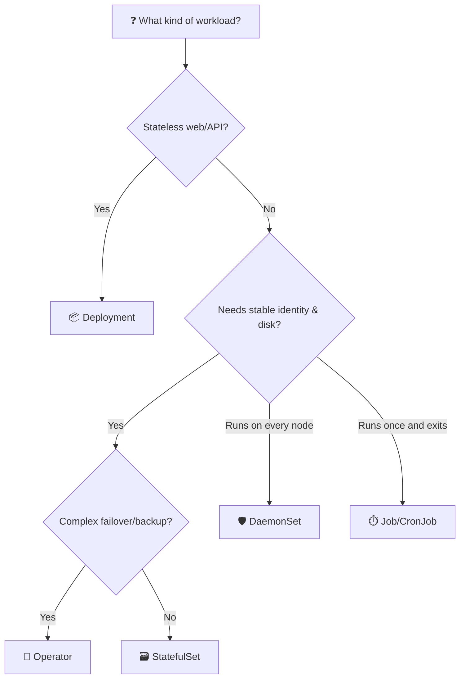

Схема: если нагрузка — stateless веб/API, бери Deployment; если нужна стабильная идентичность и диск — StatefulSet, а при сложном failover и бэкапах — оператор; если под должен работать на каждом узле — DaemonSet; если выполниться один раз и завершиться — Job/CronJob.

> 💡 **Most pods you'll ever write are Deployments.** Reach for StatefulSet only when you need identity *or* per-pod storage. Reach for an operator the moment failover, backups, or upgrade choreography enters the picture.
>
> 💡 **Большинство подов, которые ты напишешь, — это Deployment.** Берись за StatefulSet, только когда нужна идентичность *или* отдельное хранилище на под. За оператором иди в тот момент, когда появляются failover, бэкапы или хореография обновлений.

---

## 📍 Slide 21 – 🎯 Key Takeaways

Слайд 21 — Главное из лекции

1. 🗃️ **StatefulSet = identity + per-pod storage + ordered lifecycle.** Three guarantees Deployments don't offer.
   * 🗃️ **StatefulSet = идентичность + хранилище на под + упорядоченный жизненный цикл.** Три гарантии, которых нет у Deployment.
2. 🌐 **Headless Services (`clusterIP: None`) are required** — they give you the per-pod DNS that makes identity useful.
   * 🌐 **Headless-сервисы (`clusterIP: None`) обязательны** — они дают DNS-имена отдельных подов, благодаря которым идентичность становится полезной.
3. 💾 **`volumeClaimTemplates` provisions one PVC per ordinal**, and the PVCs are deliberately retained on scale-down.
   * 💾 **`volumeClaimTemplates` создаёт по PVC на каждый ординал**, и эти PVC намеренно сохраняются при уменьшении StatefulSet.
4. 🔢 **Default ordering is `OrderedReady`**; `Parallel` is opt-in for clusters that don't need pod-0 to bootstrap first.
   * 🔢 **По умолчанию порядок — `OrderedReady`**; `Parallel` — опция для кластеров, которым не нужно, чтобы pod-0 поднимался первым.
5. 🔄 **`RollingUpdate` + `partition`** is your canary mechanism for stateful upgrades; **`OnDelete`** is for change-window-driven manual upgrades.
   * 🔄 **`RollingUpdate` + `partition`** — механизм канареечного обновления для stateful; **`OnDelete`** — для ручных обновлений в рамках окна изменений.
6. 🤖 **For real databases, use an operator** (CloudNativePG, Strimzi, Percona). StatefulSet alone is the *primitive*, not the *answer*.
   * 🤖 **Для настоящих баз данных используй оператор** (CloudNativePG, Strimzi, Percona). StatefulSet сам по себе — *примитив*, а не *решение*.
7. 💾 **A snapshot is not a backup.** Application-aware tools + tested restore drills, or you don't have backups.
   * 💾 **Снапшот — не бэкап.** Инструменты, понимающие приложение, + проверенные учебные восстановления, иначе бэкапов у тебя нет.
8. 🐾 **StatefulSets are managed pets.** Operators are managed herds. Both beat snowflakes.
   * 🐾 **StatefulSets — управляемые питомцы.** Операторы — управляемые стада. И то и другое лучше «снежинок».

> 💡 **Mantra:** *If you'd page yourself for its failure, don't run it as a Deployment.*
>
> 💡 **Мантра:** *Если из-за его отказа ты готов поднять себя по тревоге, не запускай это как Deployment.*

---

## 📍 Slide 22 – 🧠 The Mindset Shift

Слайд 22 — Смена мышления

| 😰 Old | 🚀 StatefulSet-aware |
|---|---|
| "Just spin up another pod, they're all the same" | "pod-0 is the primary — name matters" |
| "We'll mount a shared PVC across all replicas" | "Each replica owns its own PVC via the template" |
| "It's a database, deploy it like the app" | "Operator handles failover, we just declare `kind: Cluster`" |
| "Backup is whatever the cloud snapshot does" | "Backups are app-aware, off-cluster, and restore-tested" |
| "Why is the deploy stuck on pod-1?" | "Because pod-0 isn't Ready — investigate the root cause, don't bypass with Parallel" |
| "Scale to zero, scale back up" | "PVCs stay; data stays; you can scale freely" |

| 😰 Старое | 🚀 С пониманием StatefulSet |
|---|---|
| «Просто подними ещё один под, они все одинаковые» | «pod-0 — это primary, имя имеет значение» |
| «Смонтируем один общий PVC на все реплики» | «У каждой реплики свой PVC из шаблона» |
| «Это база данных, деплой её как приложение» | «Failover делает оператор, мы просто объявляем `kind: Cluster`» |
| «Бэкап — это то, что делает облачный снапшот» | «Бэкапы понимают приложение, лежат вне кластера и проверены восстановлением» |
| «Почему деплой застрял на pod-1?» | «Потому что pod-0 не Ready — ищи корневую причину, не обходи её через Parallel» |
| «Масштабируй до нуля и обратно» | «PVC остаются; данные остаются; масштабируйся свободно» |

> 🤔 Which row describes a team you've worked on?
>
> 🤔 Какая строка описывает команду, в которой ты работал?

---

## 📍 Slide 23 – 🚀 What Comes Next

Слайд 23 — Что дальше

**📚 Next lecture: *Lecture 16 — Beyond Kubernetes*** — when the cluster is overkill *and* when the cluster is the wrong shape.

**📚 Следующая лекция: *Лекция 16 — За пределами Kubernetes*** — когда кластер избыточен *и* когда кластер не той формы.

* 🌐 **Cloudflare Workers** — V8 isolates on the edge; 0ms cold starts; tiny bundles
  * 🌐 **Cloudflare Workers** — V8-изоляты на edge; холодный старт 0 мс; крошечные бандлы
* ❄️ **Nix** — reproducible builds and dev shells without a container in sight
  * ❄️ **Nix** — воспроизводимые сборки и dev-окружения без единого контейнера
* 🤔 **Trade-offs** — when to skip K8s entirely; when to pair it with something else
  * 🤔 **Компромиссы** — когда вообще обойтись без K8s; когда сочетать его с чем-то ещё
* 🎁 **Bonus labs 17 & 18** — deploy your Lab 1 service to Cloudflare Workers; package it with Nix flakes
  * 🎁 **Бонусные лабы 17 и 18** — задеплой сервис из лабы 1 в Cloudflare Workers; упакуй его через Nix flakes

**🔬 Lab 15 deliverables:**

**🔬 Что сдать по лабе 15:**

* Convert your Lab 12 Helm chart from `Deployment` → `StatefulSet`
  * Перевести Helm-чарт из лабы 12 с `Deployment` → `StatefulSet`
* Add a headless `Service` (`clusterIP: None`) governed by `serviceName`
  * Добавить headless-`Service` (`clusterIP: None`), управляемый через `serviceName`
* Configure `volumeClaimTemplates` so each pod gets its own PVC
  * Настроить `volumeClaimTemplates`, чтобы каждый под получил свой PVC
* Prove per-pod state: hit pods through `kubectl port-forward`, watch independent visit counters
  * Доказать состояние на уровне пода: обращаться к подам через `kubectl port-forward` и убедиться, что счётчики визитов независимы
* Kill `app-0`, watch the same data come back on reschedule
  * Убить `app-0` и убедиться, что те же данные вернулись после перепланирования
* **Bonus (2.5 pts):** demonstrate `RollingUpdate` with `partition` *and* an `OnDelete` rollout
  * **Бонус (2,5 балла):** продемонстрировать `RollingUpdate` с `partition` *и* откат через `OnDelete`

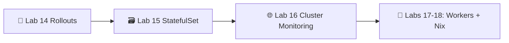

Схема: лаба 14 (Rollouts) → лаба 15 (StatefulSet) → лаба 16 (мониторинг кластера) → бонусные лабы 17–18 (Workers + Nix).

> 🌊 From cattle to managed pets — one ordinal at a time.
>
> 🌊 От скота к управляемым питомцам — ординал за ординалом.

Post-lecture quiz feeds the weeks 13-16 leaderboard window.

Квиз после лекции идёт в зачёт лидерборда недель 13–16.

---

## 📚 Resources

Материалы

**📕 Books:**

**📕 Книги:**

* *Kubernetes Up & Running* (3e, 2022) — Burns, Beda, Hightower. Chapter on StatefulSets is the canonical text.
  * *Kubernetes Up & Running* (3-е изд., 2022) — Бёрнс, Беда, Хайтауэр. Глава о StatefulSets — канонический текст.
* *Kubernetes Patterns* (2e, 2024) — Ibryam & Huß. "Stateful Service" and "Service Discovery" patterns.
  * *Kubernetes Patterns* (2-е изд., 2024) — Ибрэм и Хусс. Паттерны «Stateful Service» и «Service Discovery».
* *Database Reliability Engineering* (2017) — Campbell & Majors. Why operators exist, in book form.
  * *Database Reliability Engineering* (2017) — Кэмпбелл и Мейджорс. Почему существуют операторы — в книжном виде.

**🔗 Links:**

**🔗 Ссылки:**

* 🌐 [StatefulSet concepts](https://kubernetes.io/docs/concepts/workloads/controllers/statefulset/) — official
  * 🌐 [Концепции StatefulSet](https://kubernetes.io/docs/concepts/workloads/controllers/statefulset/) — официальная документация
* 🌐 [Headless Services](https://kubernetes.io/docs/concepts/services-networking/service/#headless-services)
  * 🌐 [Headless-сервисы](https://kubernetes.io/docs/concepts/services-networking/service/#headless-services)
* 🌐 [Volume claim templates](https://kubernetes.io/docs/concepts/workloads/controllers/statefulset/#volume-claim-templates)
  * 🌐 [Шаблоны volume claim](https://kubernetes.io/docs/concepts/workloads/controllers/statefulset/#volume-claim-templates)
* 🌐 [Update strategies & partition rollout](https://kubernetes.io/docs/concepts/workloads/controllers/statefulset/#update-strategies)
  * 🌐 [Стратегии обновления и партиционированный rollout](https://kubernetes.io/docs/concepts/workloads/controllers/statefulset/#update-strategies)
* 🌐 [Operator pattern](https://kubernetes.io/docs/concepts/extend-kubernetes/operator/)
  * 🌐 [Паттерн Operator](https://kubernetes.io/docs/concepts/extend-kubernetes/operator/)
* 🌐 [OperatorHub.io](https://operatorhub.io/) — curated operator catalogue
  * 🌐 [OperatorHub.io](https://operatorhub.io/) — курируемый каталог операторов
* 🌐 [CloudNativePG](https://cloudnative-pg.io/) — the PostgreSQL operator we cite throughout
  * 🌐 [CloudNativePG](https://cloudnative-pg.io/) — оператор PostgreSQL, который мы упоминаем по всему тексту
* 🌐 [Rook](https://rook.io/) — production storage on Ceph
  * 🌐 [Rook](https://rook.io/) — продакшен-хранилище на Ceph
* 🌐 [Longhorn](https://longhorn.io/) — lightweight CNCF block storage
  * 🌐 [Longhorn](https://longhorn.io/) — лёгкое блочное хранилище из CNCF
