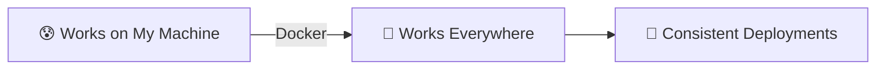
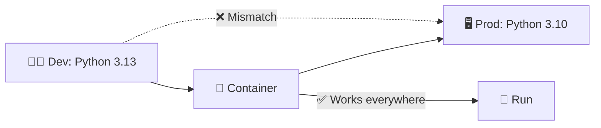
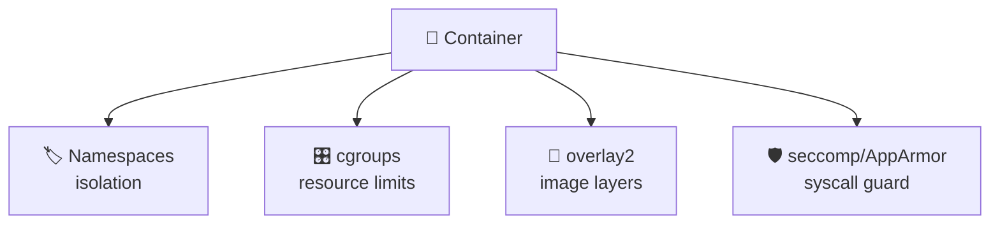
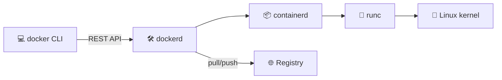
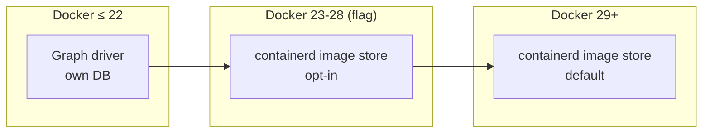
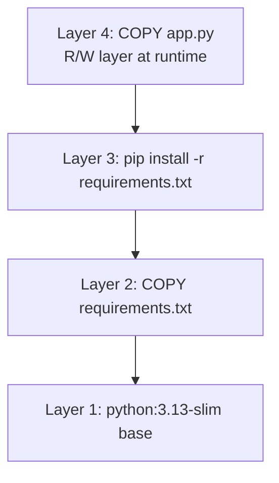
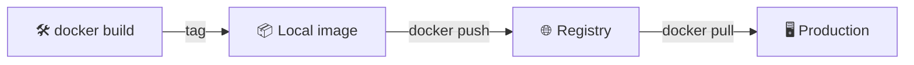
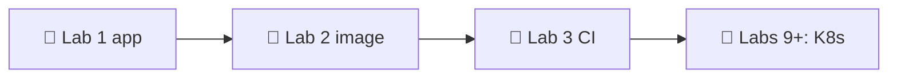

# 📌 Lecture 2 — Containerization with Docker: From "Works on My Machine" to Works Everywhere

Лекция 2 — Контейнеризация с Docker: от «работает у меня» к «работает везде»

## 📍 Slide 1 – 🐳 Welcome to Containerization

Слайд 1 — Добро пожаловать в контейнеризацию

* 🌍 **"Works on my machine"** — the most expensive phrase in software (Lecture 1's running joke, now we fix it)
  * 🌍 **«У меня локально работает»** — самая дорогая фраза в разработке ПО (шутка из лекции 1, и сейчас мы её исправляем)
* 📦 **Containers** = package your app + dependencies + runtime into a single shippable unit
  * 📦 **Контейнеры** — упаковка приложения + зависимостей + runtime в один поставляемый артефакт
* 🚀 **Docker** = the tool that made containers mainstream in 2013
  * 🚀 **Docker** — инструмент, который в 2013 году сделал контейнеры мейнстримом
* 🎯 This lecture: build production-grade containers — small, secure, reproducible
  * 🎯 Эта лекция: сборка production-контейнеров — маленьких, безопасных и воспроизводимых



Схема: проблема «работает у меня» через Docker превращается в «работает везде» и даёт 💎 согласованные деплои.

> 🔗 **Tie-in to Lab 2:** you'll containerize the Python service from Lab 1. By the end you'll have a multi-stage Dockerfile under 100MB final image.
>
> 🔗 **Связь с лабой 2:** ты упакуешь Python-сервис из лабы 1 в контейнер. К концу у тебя будет multi-stage Dockerfile, а финальный образ окажется меньше 100 МБ.

---

## 📍 Slide 2 – 🎯 Learning Outcomes

Слайд 2 — Результаты обучения

| # | Outcome |
|---|---------|
| 1 | 🧠 Explain how Linux namespaces and cgroups make containers possible |
| 2 | 📝 Write production-ready Dockerfiles |
| 3 | 🔐 Apply rootless and distroless patterns |
| 4 | 📦 Cut image size with multi-stage builds |
| 5 | 🚀 Push and pull from Docker Hub or GHCR |

| # | Результат |
|---|-----------|
| 1 | 🧠 Объяснить, как Linux namespaces и cgroups делают контейнеры возможными |
| 2 | 📝 Писать production-ready Dockerfile |
| 3 | 🔐 Применять подходы rootless и distroless |
| 4 | 📦 Сокращать размер образа с помощью multi-stage сборок |
| 5 | 🚀 Пушить и пулить образы из Docker Hub или GHCR |

**Tech stack pinned for May 2026:** Docker Engine **29.5+** (released May 2026; containerd image store is now default), BuildKit on by default, Compose v2 in Go (Python compose v1 reached EOL July 2023).

**Технологический стек, зафиксированный на май 2026:** Docker Engine **29.5+** (выпущен в мае 2026; containerd image store теперь по умолчанию), BuildKit включён по умолчанию, Compose v2 на Go (Python-версия compose v1 достигла EOL в июле 2023).

---

## 📍 Slide 3 – ❓ The Big Question

Слайд 3 — Большой вопрос

* 📊 **~65%** of organizations run containers in production (CNCF Annual Survey 2024)
  * 📊 **~65%** организаций запускают контейнеры в продакшене (ежегодный опрос CNCF 2024)
* 🐳 Docker Hub holds **15M+** public images, serves **~17B** pulls per month
  * 🐳 В Docker Hub **15M+** публичных образов, он обслуживает **~17 млрд** загрузок в месяц
* 💥 Yet a 2024 Snyk scan found **~80%** of public images contain at least one HIGH-severity CVE
  * 💥 Но скан Snyk 2024 года показал, что **~80%** публичных образов содержат хотя бы одну уязвимость уровня HIGH

> 💬 *"Containers are the new deployment unit."* — Kelsey Hightower
>
> 💬 *«Контейнеры — это новая единица развёртывания»*. — Келси Хайтауэр

**🤔 Discussion:** if every image is potentially vulnerable, what makes a "good" Dockerfile?

**🤔 Обсуждение:** если каждый образ потенциально уязвим, что делает Dockerfile «хорошим»?

---

## 📍 Slide 4 – 🔥 The Dependency Problem

Слайд 4 — Проблема зависимостей

* 👨‍💻 **Dev box:** Python 3.13, glibc 2.40, OpenSSL 3.3
  * 👨‍💻 **Дев-машина:** Python 3.13, glibc 2.40, OpenSSL 3.3
* 🖥️ **Prod box:** Python 3.10, glibc 2.31, OpenSSL 1.1
  * 🖥️ **Прод-машина:** Python 3.10, glibc 2.31, OpenSSL 1.1
* 💥 App crashes in prod with `GLIBC_2.34 not found` — and nobody can reproduce locally
  * 💥 Приложение падает в проде с `GLIBC_2.34 not found` — и никто не может воспроизвести это локально



Схема: окружения разработки и прода не совпадают (❌), но приложение в контейнере одинаково работает везде (✅) и успешно запускается.

The container freezes the *entire userspace* — interpreter, libraries, system tools — into one immutable artifact. Only the kernel is shared.

Контейнер замораживает *весь userspace* — интерпретатор, библиотеки, системные утилиты — в один неизменяемый артефакт. Общим остаётся только ядро.

---

## 📍 Slide 5 – 😱 The VM Solution (and Why Containers Won)

Слайд 5 — Решение на виртуалках (и почему победили контейнеры)

VMs solved isolation in the 2000s by virtualizing **hardware**: a full OS per app.

Виртуалки решили задачу изоляции в 2000-х, виртуализируя **железо**: для каждого приложения — своя полная ОС.

| 📊 | 🖥️ VM | 🐳 Container |
|----|------|-------------|
| Boot time | minutes | seconds |
| Overhead | full OS per app (~GB) | shared kernel (~MB) |
| Density per host | tens | hundreds to thousands |
| Image size | 1–10 GB | 5 MB – 1 GB |
| Isolation | hardware-level | process-level + namespaces |

| 📊 | 🖥️ Виртуалка | 🐳 Контейнер |
|----|------|-------------|
| Время загрузки | минуты | секунды |
| Накладные расходы | полная ОС на приложение (~ГБ) | общее ядро (~МБ) |
| Плотность на один хост | десятки | сотни–тысячи |
| Размер образа | 1–10 ГБ | 5 МБ – 1 ГБ |
| Изоляция | на уровне железа | на уровне процессов + namespaces |

> 🔥 **The trade-off:** containers are weaker isolation. A kernel CVE escapes containers but not VMs. That's why production K8s clusters often run on VMs.
>
> 🔥 **Компромисс:** изоляция контейнеров слабее. Уязвимость ядра ломает контейнер, но не виртуалку. Поэтому production-кластеры K8s часто работают на виртуалках.

---

## 📍 Slide 6 – 📜 A Brief History of Containers

Слайд 6 — Краткая история контейнеров

* 📅 **1979** — `chroot()` added to Unix V7. The ancestor of all containers.
  * 📅 **1979** — в Unix V7 добавлен `chroot()`. Прародитель всех контейнеров.
* 📅 **2000** — FreeBSD Jails: chroot + process isolation.
  * 📅 **2000** — FreeBSD Jails: chroot + изоляция процессов.
* 📅 **2008** — **LXC** (Linux Containers): namespaces + cgroups together.
  * 📅 **2008** — **LXC** (Linux Containers): namespaces и cgroups вместе.
* 📅 **2013** — **Docker** open-sourced by dotCloud (renamed). Solomon Hykes's PyCon demo goes viral.
  * 📅 **2013** — **Docker** открыт компанией dotCloud (позже переименованной). Демо Соломона Хайкса на PyCon становится вирусным.
* 📅 **2015** — Docker donates the container runtime spec (OCI). Containerd separates from Docker.
  * 📅 **2015** — Docker передаёт сообществу спецификацию container runtime (OCI). Containerd отделяется от Docker.
* 📅 **2016** — Kubernetes hits 1.0; container orchestration becomes the production story.
  * 📅 **2016** — Kubernetes достигает версии 1.0; оркестрация контейнеров становится производственной нормой.
* 📅 **2020** — Kubernetes deprecates Docker as a runtime (uses containerd directly). Docker images still work — they're OCI.
  * 📅 **2020** — Kubernetes объявляет Docker устаревшим как runtime (использует containerd напрямую). Образы Docker по-прежнему работают — они соответствуют OCI.
* 📅 **2023** — Docker Compose v1 (Python) reaches EOL July 2023. **Compose v2 (Go)** is the standard.
  * 📅 **2023** — Docker Compose v1 (Python) достигает EOL в июле 2023. Стандартом становится **Compose v2 (Go)**.
* 📅 **2026** — Docker Engine **29** released (May 2026). Containerd image store becomes the default for new installs — finishes the "Docker is becoming containerd + tooling" trajectory that started in 2015.
  * 📅 **2026** — выпущен Docker Engine **29** (май 2026). containerd image store становится выбором по умолчанию для новых установок — траектория «Docker превращается в containerd + инструменты», начатая в 2015 году, завершена.

---

## 📍 Slide 7 – 🐧 The Kernel Primitives That Make It Work

Слайд 7 — Примитивы ядра, на которых всё держится

Containers are not a feature — they're a *composition* of Linux features:

Контейнеры — это не отдельная функция, а *композиция* возможностей Linux:

| Primitive | What it isolates |
|-----------|------------------|
| 🏷️ **Namespaces** (PID, NET, MNT, UTS, IPC, USER, CGROUP) | Process trees, networks, mounts, hostname, IPC, UIDs, cgroup view |
| 🎛️ **cgroups (v2)** | CPU, memory, block I/O, PIDs — *quotas*, not isolation |
| 📂 **Union filesystems** (overlay2) | Stacked read-only layers + one R/W layer = the image model |
| 🛡️ **Capabilities + seccomp + AppArmor** | What syscalls a container is allowed to make |

| Примитив | Что изолирует |
|-----------|------------------|
| 🏷️ **Namespaces** (PID, NET, MNT, UTS, IPC, USER, CGROUP) | Деревья процессов, сети, точки монтирования, имя хоста, IPC, UID, представление cgroup |
| 🎛️ **cgroups (v2)** | CPU, память, блочный ввод-вывод, PID — *квоты*, а не изоляция |
| 📂 **Union-файловые системы** (overlay2) | Слоистые read-only слои + один слой R/W = модель образа |
| 🛡️ **Capabilities + seccomp + AppArmor** | Какие системные вызовы разрешены контейнеру |



Схема: контейнер опирается на namespaces (изоляция), cgroups (лимиты ресурсов), overlay2 (слои образа) и seccomp/AppArmor (фильтрация системных вызовов).

> 📖 *Containers from Scratch* (Liz Rice talk, 2017) — builds a container in 100 lines of Go using these primitives.
>
> 📖 Доклад *Containers from Scratch* (Лиз Райс, 2017) — контейнер собирается на 100 строках Go с помощью этих примитивов.

---

## 📍 Slide 8 – 🏗️ Docker Architecture

Слайд 8 — Архитектура Docker



Схема: CLI общается с демоном `dockerd` по REST API; демон управляет containerd, тот — runc, который запускает процессы через ядро Linux; образы тянутся и пушатся в registry.

* **`docker` CLI** — what you type
  * **`docker` CLI** — то, что ты вводишь в терминале
* **`dockerd`** — the daemon; talks to containerd via gRPC
  * **`dockerd`** — демон; общается с containerd по gRPC
* **`containerd`** — the OCI runtime manager (also used directly by K8s)
  * **`containerd`** — менеджер OCI-runtime (его напрямую использует и K8s)
* **`runc`** — the actual process spawner that calls the kernel
  * **`runc`** — то, что реально запускает процесс и вызывает ядро
* **Registry** — Docker Hub, GHCR, ECR, GAR, Harbor — stores images
  * **Registry** — Docker Hub, GHCR, ECR, GAR, Harbor — хранит образы

> 📝 **Rootless Docker** (default since Docker 23): `dockerd` runs as your user, not root. Adopt it.
>
> 📝 **Rootless Docker** (по умолчанию с Docker 23): `dockerd` работает под твоим пользователем, а не под root. Переходи на него.

---

## 📍 Slide 9 – 🔁 Docker 29 and the containerd Image Store

Слайд 9 — Docker 29 и containerd image store

For a decade, Docker had its own image store (the *graph driver* — `overlay2`, `aufs`, etc.). containerd had a *different* image store. Same OCI images on disk, but two databases describing them. Docker 23 introduced the containerd image store as a feature flag in 2023; **Docker 29 (May 2026) makes it the default for new installs**.

Целую декаду у Docker было собственное хранилище образов (*graph driver* — `overlay2`, `aufs` и т. д.). У containerd было *другое* хранилище. На диске лежали одни и те же OCI-образы, но их описывали две разные базы данных. В 2023 году Docker 23 добавил containerd image store как экспериментальный флаг; **Docker 29 (май 2026) делает его выбором по умолчанию для новых установок**.

Why students should care:

Почему это важно студентам:

* 🪞 **Lazy pulls** — pull only the layers you actually need (eStargz / SOCI)
  * 🪞 **Ленивые pull'ы** — скачиваются только реально нужные слои (eStargz / SOCI)
* 🖥️ **Multi-platform images locally** — `docker buildx build --platform linux/amd64,linux/arm64` finally works without registry round-trips
  * 🖥️ **Мультиплатформенные образы локально** — `docker buildx build --platform linux/amd64,linux/arm64` наконец работает без походов в registry
* 📦 **Better disk reclamation** — image GC matches what `nerdctl` and Kubernetes already do
  * 📦 **Лучшее освобождение диска** — сборка мусора для образов работает так же, как в `nerdctl` и Kubernetes
* 🧹 **One image database** on the host instead of two
  * 🧹 **Одна база образов** на хосте вместо двух



Схема: эволюция от собственного graph driver в Docker ≤ 22 к opt-in containerd image store в Docker 23–28 и к использованию по умолчанию в Docker 29+.

> 🔥 **Hot take:** Docker the engine is now mostly a polished UX on top of containerd + BuildKit. That's a *good* thing for the ecosystem; it means Kubernetes, nerdctl, podman and Docker agree on the runtime.
>
> 🔥 **Горячее мнение:** движок Docker теперь во многом — удобный UX поверх containerd + BuildKit. Для экосистемы это *хорошо*: Kubernetes, nerdctl, podman и Docker договариваются об одном runtime.

---

## 📍 Slide 10 – 📚 Image Layers — The Mental Model

Слайд 10 — Слои образа: ментальная модель

Every Dockerfile instruction creates a **read-only layer**. Layers are stacked via overlayfs; the running container adds one R/W layer on top.

Каждая инструкция Dockerfile создаёт **read-only слой**. Слои складываются через overlayfs; запущенный контейнер добавляет сверху один R/W слой.



Схема: слои ложатся снизу вверх — базовый `python:3.13-slim`, затем `COPY requirements.txt`, затем `pip install`, а сверху — R/W слой с `COPY app.py` во время работы.

**Why this matters:**

**Почему это важно:**

* 🚀 Layers are **cached** — unchanged steps don't rebuild
  * 🚀 Слои **кэшируются** — неизменённые шаги не пересобираются
* 📦 Layers are **shared** — three images using the same base each store the base once
  * 📦 Слои **разделяются** — три образа с одной базой хранят базу один раз
* 💀 Layers are **additive** — deleting a file in a later layer hides it but the layer above still has it
  * 💀 Слои **только добавляются** — если удалить файл в более позднем слое, он скроется, но в слое выше всё равно останется

> 🔥 **Anti-pattern:** `COPY secrets.env / && rm secrets.env` does NOT remove the secret. It's still in the earlier layer. Treat every layer as forever.
>
> 🔥 **Антипаттерн:** `COPY secrets.env / && rm secrets.env` НЕ удаляет секрет. Он остаётся в более раннем слое. Считай, что каждый слой — навсегда.

---

## 📍 Slide 11 – 📝 Dockerfile Basics — Read This Twice

Слайд 11 — Основы Dockerfile: перечитай дважды

```dockerfile
# 🏗️ Base image — alpine, debian-slim, distroless, scratch
FROM python:3.13-slim

# 👤 Don't run as root (we'll harden this later)
RUN useradd --create-home --shell /bin/bash app
USER app
WORKDIR /home/app

# 📦 Dependencies FIRST (changes rarely → cached)
COPY --chown=app:app requirements.txt .
RUN pip install --user --no-cache-dir -r requirements.txt

# 💻 App code LAST (changes often → only this layer rebuilds)
COPY --chown=app:app . .

# 🚪 Document the port
EXPOSE 8080

# 🚀 Use exec form (PID 1 = your app → signals work)
CMD ["python", "app.py"]
```

Пояснение к коду: сначала задаём базовый образ, создаём непривилегированного пользователя и рабочую директорию; зависимости копируем и устанавливаем раньше кода, чтобы слой с зависимостями кэшировался; в конце документируем порт и запускаем приложение в exec-форме.

> ⚠️ **PID 1 trap:** shell form (`CMD python app.py`) makes `/bin/sh` PID 1 and your app PID 2 — signals (SIGTERM) never reach it. Always use exec form `CMD ["python", "app.py"]`.
>
> ⚠️ **Ловушка PID 1:** shell-форма (`CMD python app.py`) делает PID 1 `/bin/sh`, а приложение — PID 2; сигналы (SIGTERM) до него не доходят. Всегда используй exec-форму `CMD ["python", "app.py"]`.

---

## 📍 Slide 12 – ⚡ Before vs After Docker

Слайд 12 — До и после Docker

| 😰 Without Docker | 🚀 With Docker |
|---|---|
| README has 14 steps of `apt-get install` | `docker run myapp` |
| "Works on Linux, not Windows" | Works the same on Linux/macOS/Windows (with Linux containers) |
| Production drift accumulates | Image is immutable; rebuilds are reproducible |
| Onboarding a new dev takes hours | `docker compose up` and code |
| One bad dependency = whole-server reinstall | `docker stop && docker rm && docker run` — done |

| 😰 Без Docker | 🚀 С Docker |
|---|---|
| В README 14 шагов с `apt-get install` | `docker run myapp` |
| «Работает на Linux, но не на Windows» | Одинаково работает на Linux/macOS/Windows (с Linux-контейнерами) |
| Дрейф продакшена накапливается | Образ неизменяем; пересборки воспроизводимы |
| Онбординг нового разработчика занимает часы | `docker compose up` — и за работу |
| Одна плохая зависимость = переустановка всего сервера | `docker stop && docker rm && docker run` — готово |

---

## 📍 Slide 13 – 🎮 Scenario 1: Running as Root

Слайд 13 — Сценарий 1: запуск под root

**The failure:**

**В чём проблема:**

```dockerfile
FROM python:3.13-slim
COPY . /app
CMD ["python", "/app/server.py"]
```

Пояснение к коду: образ собирается из `python:3.13-slim`, копирует весь код в `/app` и запускает сервер — без отдельного пользователя, то есть от имени root.

This runs as **root inside the container**. A kernel CVE (e.g., CVE-2022-0185, the FILESYSTEM\_MOUNT escape) lets the process become root on the host. That's container escape.

Этот контейнер работает **под root внутри контейнера**. Уязвимость ядра (например, CVE-2022-0185, побег через FILESYSTEM\_MOUNT) позволяет процессу стать root на хосте. Это и есть container escape.

**The fix — drop privileges:**

**Исправление — сбрасываем привилегии:**

```dockerfile
FROM python:3.13-slim
RUN useradd --uid 10001 --create-home --shell /bin/bash app
WORKDIR /home/app
COPY --chown=app:app . .
USER 10001     # 👤 numeric UID survives renames
CMD ["python", "server.py"]
```

Пояснение к коду: создаём пользователя с фиксированным UID 10001, отдаём ему файлы через `--chown` и переключаемся на него инструкцией `USER 10001`; числовой UID не зависит от переименования пользователя.

> 🔒 **Bonus:** add `--read-only` and `--cap-drop=ALL` at `docker run` time. Lab 2 walks through this.
>
> 🔒 **Бонус:** добавь `--read-only` и `--cap-drop=ALL` при `docker run`. В лабе 2 это разбирается подробно.

---

## 📍 Slide 14 – 🐌 Scenario 2: Slow Builds (Bad Layer Order)

Слайд 14 — Сценарий 2: медленные сборки (неверный порядок слоёв)

**Wrong order — every code change re-installs all dependencies (5 minute build):**

**Неверный порядок — каждое изменение кода переустанавливает все зависимости (сборка на 5 минут):**

```dockerfile
COPY . /app                 # 🚫 Every change invalidates everything below
RUN pip install -r /app/requirements.txt
```

Пояснение к коду: `COPY . /app` кладёт весь код в один слой, поэтому любая правка кода ломает кэш и следующая команда `pip install` выполняется заново.

**Correct order — dependency layer cached until `requirements.txt` changes:**

**Правильный порядок — слой зависимостей кэшируется, пока не изменится `requirements.txt`:**

```dockerfile
COPY requirements.txt .     # ✅ Rarely changes
RUN pip install -r requirements.txt
COPY . .                    # ✅ Code changes don't bust the deps layer
```

Пояснение к коду: сначала копируется только `requirements.txt` и устанавливаются зависимости, затем — остальной код. Правки кода не затрагивают слой зависимостей.

**Rule of thumb:** order layers from **least-frequently-changing** to **most**. Base → system packages → language deps → app code.

**Правило:** упорядочивай слои от **самых редко меняющихся** к **самым частым**. База → системные пакеты → зависимости языка → код приложения.

---

## 📍 Slide 15 – 📦 Scenario 3: Bloated Images

Слайд 15 — Сценарий 3: раздутые образы

A naive Python image is **~1.2 GB**. That's a problem:

Наивный образ Python весит **~1.2 ГБ**. И это проблема:

* 🐢 Slow `docker pull` → slow deploys, slow autoscale
  * 🐢 Медленный `docker pull` → медленные деплои и медленное автомасштабирование
* 💸 Storage and egress costs scale with image size
  * 💸 Затраты на хранение и трафик растут вместе с размером образа
* 🛡️ Bigger image = more packages = more CVEs
  * 🛡️ Больше образ — больше пакетов — больше CVE

**Slim it:**

**Как уменьшить:**

| Base image | Size | Trade-off |
|------------|-----:|-----------|
| `python:3.13` (debian) | ~1.2 GB | comprehensive |
| `python:3.13-slim` | ~150 MB | no man pages, fewer system libs |
| `python:3.13-alpine` | ~60 MB | musl libc — some wheels break |
| `gcr.io/distroless/python3` | ~50 MB | no shell, no package manager |
| `scratch` (for Go/Rust) | ~10 MB | nothing but your binary |

| Базовый образ | Размер | Компромисс |
|------------|-----:|-----------|
| `python:3.13` (debian) | ~1.2 ГБ | всё включено |
| `python:3.13-slim` | ~150 МБ | нет man-страниц, меньше системных библиотек |
| `python:3.13-alpine` | ~60 МБ | musl libc — часть wheel'ов не работает |
| `gcr.io/distroless/python3` | ~50 МБ | нет shell, нет пакетного менеджера |
| `scratch` (для Go/Rust) | ~10 МБ | только твой бинарник |

---

## 📍 Slide 16 – 📁 Scenario 4: No `.dockerignore`

Слайд 16 — Сценарий 4: без `.dockerignore`

Without `.dockerignore`, `COPY . .` ships your local `node_modules/`, `.git`, `.venv`, IDE configs, and **secrets** into the image. The build context can be hundreds of MB.

Без `.dockerignore` команда `COPY . .` отправляет в образ локальные `node_modules/`, `.git`, `.venv`, настройки IDE и **секреты**. Контекст сборки может достигать сотен мегабайт.

```gitignore
# .dockerignore — same syntax as .gitignore
.git
.venv
venv/
__pycache__/
node_modules/
.env
*.pyc
docs/
tests/
README.md
.idea/
.vscode/
```

Пояснение к коду: файл `.dockerignore` использует тот же синтаксис, что и `.gitignore`, и исключает из контекста сборки всё перечисленное.

> 🔍 **Real story:** in 2022, Toyota leaked customer data because a `.git` folder was included in a deployed container. Always have a `.dockerignore`.
>
> 🔍 **Реальная история:** в 2022 году Toyota допустила утечку данных клиентов, потому что в развёрнутый контейнер попала папка `.git`. Всегда имей `.dockerignore`.

---

## 📍 Slide 17 – 🚀 Multi-Stage Builds: The Big Trick

Слайд 17 — Multi-stage сборки: главный трюк

Compile in a heavy image, **copy only the artifact** into a tiny final image.

Собирай в тяжёлом образе, а в крошечный финальный образ **копируй только артефакт**.

```dockerfile
# 🏗️ Build stage: full toolchain
FROM golang:1.23 AS build
WORKDIR /src
COPY . .
RUN CGO_ENABLED=0 go build -o /app ./cmd/server

# 🚀 Final stage: just the binary
FROM gcr.io/distroless/static-debian12
COPY --from=build /app /app
USER nonroot:nonroot
ENTRYPOINT ["/app"]
```

Пояснение к коду: на этапе `build` используется полный toolchain Go и компилируется статически слинкованный бинарник; во второй, финальный, этап из distroless-образа копируется только он — без исходников и компилятора.

Result for a typical Go service:

Результат для типичного Go-сервиса:

* Single-stage `golang:1.23` image: **~900 MB**
  * Одноэтапный образ `golang:1.23`: **~900 МБ**
* Multi-stage distroless image: **~15 MB**
  * Multi-stage distroless-образ: **~15 МБ**
* Same binary, **60× smaller**, **zero shell**, **zero package manager**
  * Тот же бинарник, **в 60 раз меньше**, **без shell**, **без пакетного менеджера**

> 🔗 **Lab 2 bonus:** rewrite your Lab 1 Go app as a multi-stage distroless build.
>
> 🔗 **Бонус к лабе 2:** перепиши своё Go-приложение из лабы 1 как multi-stage distroless-сборку.

---

## 📍 Slide 18 – 🔐 Distroless and `scratch`

Слайд 18 — Distroless и `scratch`

**Distroless** (Google, 2018): images with your runtime + your app, but **no shell, no apt, no busybox**. Drastically reduces attack surface.

**Distroless** (Google, 2018): образы с твоим runtime и приложением, но **без shell, без apt, без busybox**. Резко сокращает поверхность атаки.

```dockerfile
# ❌ Standard slim — debug-friendly, larger, more CVEs
FROM python:3.13-slim
COPY . /app
CMD ["python", "/app/server.py"]

# ✅ Distroless — production
FROM gcr.io/distroless/python3-debian12
COPY --from=build /app /app
CMD ["/app/server.py"]
```

Пояснение к коду: первый вариант — обычный slim-образ, удобный для отладки, но больше и с большим числом CVE; второй — distroless, где нет ничего лишнего, только приложение и его runtime.

**`scratch`** — the empty image. Use only for statically-linked binaries (Go with `CGO_ENABLED=0`, Rust with musl). 0 CVEs because there's literally nothing else.

**`scratch`** — пустой образ. Используй его только для статически слинкованных бинарников (Go с `CGO_ENABLED=0`, Rust с musl). 0 CVE, потому что внутри буквально ничего нет.

> 📖 **Liz Rice's *Container Security* (O'Reilly, 2020)** — the reference on hardening images.
>
> 📖 **Книга Лиз Райс *Container Security* (O'Reilly, 2020)** — эталон по защите образов.

---

## 📍 Slide 19 – 🌐 Docker Hub & Registries

Слайд 19 — Docker Hub и registry



Схема: `docker build` с тегом создаёт локальный образ; `docker push` отправляет его в registry; `docker pull` доставляет его в продакшен.

| Registry | Notes |
|----------|-------|
| 🐳 **Docker Hub** | Default; 1 free private repo; rate limits hurt CI |
| 🐙 **GHCR** (ghcr.io) | Free for public, integrated with GitHub Actions |
| ☁️ **ECR / GAR / ACR** | Cloud-native; IAM-gated; recommended for AWS/GCP/Azure prod |
| 🏠 **Harbor** | Self-hosted; CNCF graduated; image signing + vuln scan built in |

| Registry | Заметки |
|----------|---------|
| 🐳 **Docker Hub** | По умолчанию; 1 бесплатный приватный репозиторий; лимиты запросов мешают CI |
| 🐙 **GHCR** (ghcr.io) | Бесплатно для публичных репозиториев, интегрирован с GitHub Actions |
| ☁️ **ECR / GAR / ACR** | Облачные; доступ через IAM; рекомендуются для прода в AWS/GCP/Azure |
| 🏠 **Harbor** | Self-hosted; graduated в CNCF; подпись образов и скан уязвимостей из коробки |

**Image references:** `[registry/]namespace/repo[:tag][@digest]`

**Ссылки на образы:** `[registry/]namespace/repo[:tag][@digest]`

- `nginx` → `docker.io/library/nginx:latest`
  * `nginx` → `docker.io/library/nginx:latest`
- `ghcr.io/innodevops/lab2-app:v1.2.3@sha256:abc…` — pin by digest for production
  * `ghcr.io/innodevops/lab2-app:v1.2.3@sha256:abc…` — для прода фиксируй образ по digest

---

## 📍 Slide 20 – 🏷️ Tagging Strategies

Слайд 20 — Стратегии тегирования

> 🚫 **Never deploy `:latest` to production.** It's mutable; you can't reproduce yesterday's deploy.
>
> 🚫 **Никогда не деплой `:latest` в продакшен.** Тег изменяемый — вчерашний деплой не воспроизвести.

| Strategy | Example | When |
|----------|---------|------|
| 📌 **SemVer** | `v1.4.2` | Library or product release |
| 🔢 **Git SHA** | `git-3a7f29c` | CI builds; always unique |
| 📅 **CalVer** | `2026.04.0` | Time-driven release cadence |
| 🌿 **Branch** | `main`, `develop` | Dev-time only |
| 🔒 **Digest pin** | `@sha256:…` | Production — immutable |

| Стратегия | Пример | Когда использовать |
|----------|---------|------|
| 📌 **SemVer** | `v1.4.2` | Релиз библиотеки или продукта |
| 🔢 **Git SHA** | `git-3a7f29c` | Сборки в CI; всегда уникальны |
| 📅 **CalVer** | `2026.04.0` | Релизы, привязанные ко времени |
| 🌿 **Ветка** | `main`, `develop` | Только для разработки |
| 🔒 **Фиксация по digest** | `@sha256:…` | Продакшен — неизменяемо |

**Recommended:** push two tags per build — a SemVer-or-SHA tag for reproducibility, plus a moving `main` tag for convenience. Production references the immutable one.

**Рекомендация:** пушь два тега на каждую сборку — тег SemVer или SHA для воспроизводимости и плавающий тег `main` для удобства. В продакшене ссылайся на неизменяемый тег.

---

## 📍 Slide 21 – 🛡️ Container Security Best Practices

Слайд 21 — Лучшие практики безопасности контейнеров

A checklist you can apply to any Dockerfile:

Чек-лист, который можно применить к любому Dockerfile:

1. ✅ **Pin base image versions** — `python:3.13-slim`, not `python:slim` or `python:latest`
   * ✅ **Фиксируй версии базового образа** — `python:3.13-slim`, а не `python:slim` или `python:latest`
2. ✅ **Drop to a non-root UID** — `USER 10001`
   * ✅ **Переходи на non-root UID** — `USER 10001`
3. ✅ **Add a `HEALTHCHECK`** so the orchestrator knows when your app is alive
   * ✅ **Добавляй `HEALTHCHECK`**, чтобы оркестратор знал, что приложение живо
4. ✅ **Don't bake secrets in** — `--build-arg` is visible in `docker history`; use BuildKit secrets or runtime env
   * ✅ **Не запекай секреты в образ** — `--build-arg` виден в `docker history`; используй BuildKit secrets или переменные окружения во время запуска
5. ✅ **Set `WORKDIR`** explicitly — `/app`, not `/` or `~`
   * ✅ **Явно задавай `WORKDIR`** — `/app`, а не `/` или `~`
6. ✅ **Use `COPY` not `ADD`** unless you specifically need URL fetching or tar auto-extract
   * ✅ **Используй `COPY`, а не `ADD`**, если только тебе не нужно скачивание по URL или авто-распаковка tar
7. ✅ **Scan images** — Trivy, Grype, or Snyk in CI; gate the build on HIGH/CRITICAL CVEs
   * ✅ **Сканируй образы** — Trivy, Grype или Snyk в CI; блокируй сборку при HIGH/CRITICAL CVE
8. ✅ **Sign images** — cosign + Sigstore; verify in admission controller (covered in DevSecOps elective)
   * ✅ **Подписывай образы** — cosign + Sigstore; проверяй подпись в admission controller (разбирается в факультативе по DevSecOps)

```bash
# 🔍 Lab 2 will use this
trivy image --severity HIGH,CRITICAL --exit-code 1 myapp:v1.0.0
```

Пояснение к коду: команда сканирует образ `myapp:v1.0.0` и завершается с кодом 1, если найдены уязвимости уровня HIGH или CRITICAL, — это удобно для блокировки CI.

---

## 📍 Slide 22 – 🐙 Compose: Multi-Container Locally

Слайд 22 — Compose: несколько контейнеров локально

`docker-compose.yml` describes a multi-container stack declaratively — perfect for local dev and CI smoke tests.

`docker-compose.yml` декларативно описывает стек из нескольких контейнеров — идеально для локальной разработки и smoke-тестов в CI.

```yaml
services:
  app:
    build: ./app_python
    ports: ["8080:8080"]
    environment:
      DATABASE_URL: postgres://db:5432/app
    depends_on:
      db:
        condition: service_healthy
  db:
    image: postgres:17
    healthcheck:
      test: ["CMD-SHELL", "pg_isready -U postgres"]
      interval: 5s
    environment:
      POSTGRES_PASSWORD: dev
```

Пояснение к коду: сервис `app` собирается из `./app_python`, публикует порт 8080 и ждёт, пока `db` станет healthy; сервис `db` использует образ `postgres:17` с проверкой `pg_isready`.

> 🔗 **You'll use Compose in Labs 6, 7, 8.** For production multi-container workloads, Kubernetes (Lab 9+) takes over.
>
> 🔗 **Compose пригодится в лабах 6, 7 и 8.** Для production-нагрузок из нескольких контейнеров используется Kubernetes (начиная с лабы 9).

---

## 📍 Slide 23 – 🌍 Container Patterns at Real Companies

Слайд 23 — Паттерны контейнеров в реальных компаниях

* 🎬 **Netflix** — every microservice ships as a container image; thousands of builds/day pushed to S3-backed internal registry.
  * 🎬 **Netflix** — каждый микросервис поставляется образом; тысячи сборок в день пушатся во внутренний registry на базе S3.
* 📦 **Amazon (Bottlerocket)** — container-optimized OS, the host runs almost nothing else.
  * 📦 **Amazon (Bottlerocket)** — ОС, оптимизированная для контейнеров: на хосте почти ничего больше не работает.
* 🔍 **Google** — invented containers in production (Borg, 2003); pushes ~2 billion containers/week internally.
  * 🔍 **Google** — придумал контейнеры в продакшене (Borg, 2003); внутри запускает ~2 млрд контейнеров в неделю.
* 💬 **GitHub** — *every* PR runs in a container via Actions; ~100 million containers/month.
  * 💬 **GitHub** — *каждый* PR выполняется в контейнере через Actions; ~100 млн контейнеров в месяц.
* 🏦 **Capital One** — moved core banking from VMs to containers on EKS; cut compute costs ~40%.
  * 🏦 **Capital One** — перевёл core banking с виртуалок на контейнеры в EKS; сократил расходы на вычисления примерно на 40%.

> 🔥 **Common thread:** containers are how modern engineering organisations ship at scale.
>
> 🔥 **Общая мысль:** контейнеры — это то, как современные инженерные организации поставляют ПО в масштабе.

---

## 📍 Slide 24 – 🎯 Key Takeaways

Слайд 24 — Ключевые выводы

1. 📦 **Containers are not magic** — namespaces + cgroups + overlayfs + a registry
   * 📦 **Контейнеры — не магия** — namespaces + cgroups + overlayfs + registry
2. 🏗️ **Order layers from stable to volatile** — keep caches warm
   * 🏗️ **Упорядочивай слои от стабильных к изменчивым** — так кэш остаётся горячим
3. 👤 **Never run as root** — drop to a non-zero UID, ideally numeric
   * 👤 **Никогда не работай под root** — переходи на ненулевой UID, лучше числовой
4. 🛡️ **Multi-stage + distroless** — smaller image, fewer CVEs, faster pulls
   * 🛡️ **Multi-stage + distroless** — меньше образ, меньше CVE, быстрее pull
5. 🏷️ **Tag by SemVer or SHA; never deploy `:latest`**
   * 🏷️ **Тегируй по SemVer или SHA; никогда не деплой `:latest`**
6. 🔍 **Scan every image in CI** — Trivy or Grype, gate on HIGH/CRITICAL
   * 🔍 **Сканируй каждый образ в CI** — Trivy или Grype, блокируй на HIGH/CRITICAL
7. 📄 **`.dockerignore` is not optional** — keeps secrets and `.git` out
   * 📄 **`.dockerignore` обязателен** — он держит секреты и `.git` снаружи

> 💡 **A good Dockerfile is small, secure, and reproducible. Two out of three is a bug.**
>
> 💡 **Хороший Dockerfile — маленький, безопасный и воспроизводимый. Два из трёх — это баг.**

---

## 📍 Slide 25 – 🧠 The Mindset Shift

Слайд 25 — Смена мышления

| 😰 Old | 🚀 Container-native |
|-------|---------------------|
| "Set up the server" | Define the environment in a `Dockerfile` |
| "Update the production box" | Build a new image, redeploy |
| "Works on my machine" | Works in the image, image works everywhere |
| "Big monolith on a VM" | Many small services, each a container |
| Image is a black box | Image is a versioned artifact, scanned and signed |

| 😰 Старый подход | 🚀 Container-native |
|-------|---------------------|
| «Настроить сервер» | Описать окружение в `Dockerfile` |
| «Обновить прод-машину» | Собрать новый образ и задеплоить заново |
| «У меня локально работает» | Работает в образе, а образ работает везде |
| «Большой монолит на виртуалке» | Много маленьких сервисов, каждый — контейнер |
| Образ — чёрный ящик | Образ — версионируемый артефакт, просканированный и подписанный |

---

## 📍 Slide 26 – 🚀 What Comes Next

Слайд 26 — Что дальше

**📚 Next lecture: *Continuous Integration*** — every push runs tests, builds an image, and scans it before merging.

**📚 Следующая лекция: *Continuous Integration*** — каждый push запускает тесты, собирает образ и сканирует его до слияния.

* 🔄 Why CI prevents the failures you saw in Lecture 1
  * 🔄 Почему CI предотвращает сбои, которые ты видел в лекции 1
* 🛠️ GitHub Actions workflow syntax
  * 🛠️ Синтаксис workflow в GitHub Actions
* 🧪 Testing pyramid: unit → integration → end-to-end
  * 🧪 Пирамида тестирования: unit → integration → end-to-end
* 🐳 Building and pushing your Lab 2 image automatically
  * 🐳 Автоматическая сборка и пуш образа из лабы 2

**🔬 Lab 2:** containerize your Lab 1 service with a multi-stage Dockerfile, scan it with Trivy, push to GHCR. The image you build this week will follow your service through every remaining lab — K8s deploys it (Lab 9), Helm packages it (Lab 10), ArgoCD ships it (Lab 13).

**🔬 Лаба 2:** упакуй сервис из лабы 1 в контейнер с multi-stage Dockerfile, просканируй его Trivy и запушь в GHCR. Образ, который ты соберёшь на этой неделе, пройдёт с твоим сервисом через все оставшиеся лабы — K8s задеплоит его (лаба 9), Helm упакует (лаба 10), ArgoCD доставит (лаба 13).



Схема: приложение из лабы 1 становится образом в лабе 2, который CI из лабы 3 собирает автоматически; дальше — лабы 9+ с Kubernetes.

**👋 See you in Lecture 3.**

**👋 Увидимся на лекции 3.**

---

## 📚 Resources

📚 Ресурсы

* 📕 *Docker Deep Dive* — Nigel Poulton (latest ed. covers BuildKit + Compose v2)
  * 📕 *Docker Deep Dive* — Найджел Поултон (последнее издание покрывает BuildKit + Compose v2)
* 📕 *Container Security* — Liz Rice, O'Reilly 2020 (free PDF at aquasec.com)
  * 📕 *Container Security* — Лиз Райс, O'Reilly 2020 (бесплатный PDF на aquasec.com)
* 🎥 *Containers from Scratch* — Liz Rice GopherCon talk (YouTube, 2017)
  * 🎥 *Containers from Scratch* — доклад Лиз Райс на GopherCon (YouTube, 2017)
* 🌐 [docs.docker.com](https://docs.docker.com) — official Docker docs (Engine 27.x)
  * 🌐 [docs.docker.com](https://docs.docker.com) — официальная документация Docker (Engine 27.x)
* 🌐 [distroless](https://github.com/GoogleContainerTools/distroless) — Google's distroless images
  * 🌐 [distroless](https://github.com/GoogleContainerTools/distroless) — distroless-образы Google
* 🌐 [opencontainers.org](https://opencontainers.org) — OCI spec (image + runtime + distribution)
  * 🌐 [opencontainers.org](https://opencontainers.org) — спецификация OCI (образ + runtime + распространение)
* 🌐 [CIS Docker Benchmark](https://www.cisecurity.org/benchmark/docker) — hardening checklist
  * 🌐 [CIS Docker Benchmark](https://www.cisecurity.org/benchmark/docker) — чек-лист по защите

**🎓 Quiz:** post-lecture quiz feeds the weeks 1–3 leaderboard window.

**🎓 Квиз:** квиз после лекции идёт в зачёт лидерборда недель 1–3.
