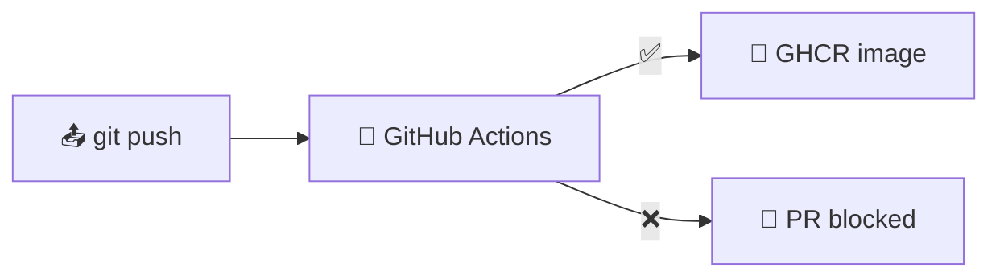
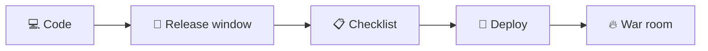
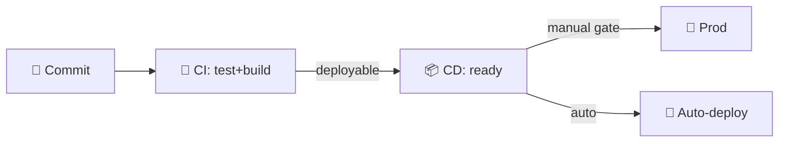
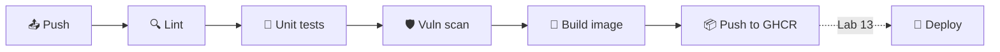
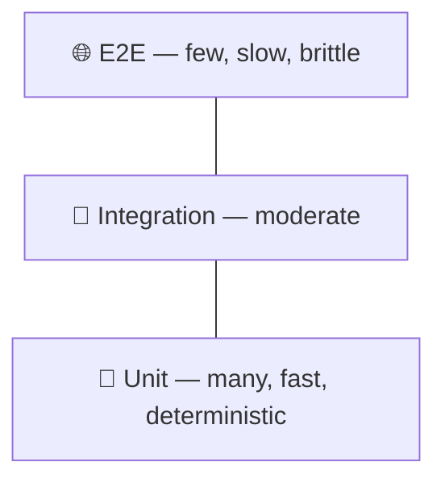
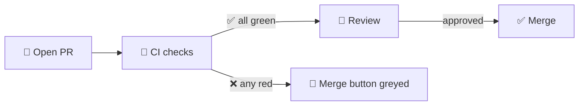
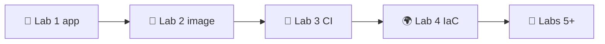

# 📌 Lecture 3 — Continuous Integration: From "Merge Week" to Green on Every Push

Лекция 3 — Непрерывная интеграция: от «недели слияний» к зелёной сборке на каждый пуш

## 📍 Slide 1 – 🤖 Welcome to CI/CD

Слайд 1 — Добро пожаловать в CI/CD

* 🐳 Lecture 2 ended with an image that "works everywhere" — but only if you remember to rebuild, scan, and push it
  * 🐳 Лекция 2 закончилась образом, который «работает везде», — но только если не забыть пересобрать, просканировать и запушить его
* 🤖 **Continuous Integration** makes that "if" a "when": every commit runs the same pipeline, on the same runner, with the same scanner
  * 🤖 **Непрерывная интеграция** превращает это «если» в «когда»: каждый коммит проходит один и тот же пайплайн, на одном и том же раннере, с одним и тем же сканером
* 🎯 This lecture: build the GitHub Actions workflow Lab 3 asks for — test → lint → scan → build → publish, gated on every PR
  * 🎯 Эта лекция: собрать workflow GitHub Actions, который просит лаба 3 — test → lint → scan → build → publish, с гейтом на каждом PR
* 🔗 **Lab 3 builds this exact workflow** for the Python service from Lab 1 and the image from Lab 2
  * 🔗 **Лаба 3 собирает ровно этот workflow** для Python-сервиса из лабы 1 и образа из лабы 2



Схема: git push → GitHub Actions; при успехе собирается образ в GHCR, при неудаче PR блокируется.

> 📚 **Frame:** CI is the bridge between "I changed code on my laptop" (Lec 1) and "this exact image runs in K8s" (Lec 9). Skip CI and the bridge is a leap of faith.
>
> 📚 **Установка:** CI — это мост между «я поменял код на ноутбуке» (лекция 1) и «этот самый образ работает в K8s» (лекция 9). Пропусти CI — и мост превращается в прыжок веры.

---

## 📍 Slide 2 – 🎯 Learning Outcomes

Слайд 2 — Результаты обучения

| # | Outcome |
|---|---------|
| 1 | 🧠 Define CI, CD, and CDeploy in Humble & Farley's terms |
| 2 | 🔺 Apply the test pyramid — unit-heavy, integration-thin, E2E-rare |
| 3 | 📝 Read and write a GitHub Actions workflow from scratch |
| 4 | 🛡️ Gate merges on Trivy vulnerability scans and required checks |
| 5 | 🏷️ Choose SemVer vs CalVer and tag images accordingly |
| 6 | ⚡ Diagnose slow CI — caching, matrices, path filters, concurrency |

| # | Результат |
|---|-----------|
| 1 | 🧠 Дать определение CI, CD и CDeploy в терминах Хамбла и Фарли |
| 2 | 🔺 Применять пирамиду тестирования — много юнит-тестов, немного интеграционных, мало E2E |
| 3 | 📝 Читать и писать workflow GitHub Actions с нуля |
| 4 | 🛡️ Гейтить мержи на сканировании уязвимостей Trivy и обязательных проверках |
| 5 | 🏷️ Выбирать SemVer или CalVer и тегировать образы соответственно |
| 6 | ⚡ Диагностировать медленный CI — кэширование, матрицы, фильтры путей, конкурентность |

---

## 📍 Slide 3 – 🛠️ Tech Stack (Pinned for May 2026)

Слайд 3 — Технологический стек (зафиксирован на май 2026)

| Component | Version | Why pinned |
|-----------|--------:|------------|
| Runner | `ubuntu-24.04` | LTS; `ubuntu-latest` rotates and breaks reproducibility |
| `actions/checkout` | `@v4` | Node 20 runtime; v3 was deprecated Feb 2024 |
| `actions/setup-python` | `@v5` | Built-in `cache: pip` keyed off `requirements.txt` |
| `docker/build-push-action` | `@v6` | BuildKit + multi-platform; v5 EOL April 2025 |
| `docker/metadata-action` | `@v5` | SemVer/CalVer/SHA tags in one step |
| Trivy | `v0.69.3+` | ⚠️ Mar 2026 supply-chain attack (v0.69.4 malicious — see Slide 15); CVE DB updated daily; alternatives: Grype, Snyk (paid) |
| Cosign | `2.4` | Sigstore client; image signing covered in DevSecOps elective |
| pytest | `8.3+` | Python 3.13 compatible |

| Компонент | Версия | Почему зафиксировано |
|-----------|--------:|----------------------|
| Раннер | `ubuntu-24.04` | LTS; `ubuntu-latest` меняется и ломает воспроизводимость |
| `actions/checkout` | `@v4` | Среда выполнения Node 20; v3 устарел в феврале 2024 |
| `actions/setup-python` | `@v5` | Встроенный `cache: pip`, привязанный к `requirements.txt` |
| `docker/build-push-action` | `@v6` | BuildKit + мультиплатформенность; поддержка v5 завершилась в апреле 2025 |
| `docker/metadata-action` | `@v5` | Теги SemVer/CalVer/SHA за один шаг |
| Trivy | `v0.69.3+` | ⚠️ атака на цепочку поставок в марте 2026 (v0.69.4 вредоносна — см. слайд 15); база CVE обновляется ежедневно; альтернативы: Grype, Snyk (платный) |
| Cosign | `2.4` | Клиент Sigstore; подпись образов — в элективе DevSecOps |
| pytest | `8.3+` | Совместим с Python 3.13 |

> 📌 **Pin actions to a major tag** (`@v4`), pin tools to a minor version, pin base images by digest in production. Lab 3 enforces the first two.
>
> 📌 **Фиксируй actions на мажорном теге** (`@v4`), инструменты — на минорной версии, а базовые образы в проде — по дайджесту. Лаба 3 проверяет первые два правила.

---

## 📍 Slide 4 – ❓ The Big Question

Слайд 4 — Большой вопрос

* 📊 **DORA 2024:** elite teams deploy on-demand, multiple times per day; low performers deploy less than once a month
  * 📊 **DORA 2024:** элитные команды деплоят по требованию, несколько раз в день; отстающие — реже раза в месяц
* 🐛 **Capers Jones (2012):** fixing a prod bug costs **30–100×** the cost of catching it in dev
  * 🐛 **Кейперс Джонс (2012):** исправление бага в проде стоит **в 30–100 раз** дороже, чем найти его в разработке
* 🔍 **Sonatype 2024:** 1 in 8 open-source downloads carries a known vulnerability — deps are the attack surface
  * 🔍 **Sonatype 2024:** каждая восьмая загрузка open-source-пакета несёт известную уязвимость — зависимости и есть поверхность атаки

> 💬 *"If it hurts, do it more often."* — Martin Fowler, *Continuous Integration* (2006)
>
> 💬 *«Если это больно — делай это чаще»*. — Мартин Фаулер, *Continuous Integration* (2006)

---

## 📍 Slide 5 – 🔥 The Problem: Manual Testing Hell

Слайд 5 — Проблема: ад ручного тестирования

A team without CI looks like this:

Команда без CI выглядит так:

* 📋 50-step manual checklist before each release
  * 📋 Ручной чек-лист из 50 шагов перед каждым релизом
* 🗓️ Releases monthly because each one takes a full day
  * 🗓️ Релизы раз в месяц, потому что каждый занимает целый день
* 😴 The QA engineer forgot to test `/health` again
  * 😴 QA-инженер снова забыл проверить `/health`
* 💥 Production breaks; nobody can replay what was deployed
  * 💥 Прод падает; никто не может воспроизвести, что было задеплоено



Схема: код → окно релиза → чек-лист → деплой → «боевая комната» (разбор аварии).

> 📖 Lecture 1 named this *Manual Release Hell*. CI is the practice that retires it.
>
> 📖 В лекции 1 это называлось *Manual Release Hell*. CI — та практика, которая её упраздняет.

---

## 📍 Slide 6 – 💥 The Integration Problem ("Merge Week")

Слайд 6 — Проблема интеграции («неделя слияний»)

Before CI, integrating long-lived branches was a scheduled event:

До CI интеграция долгоживущих веток была событием в календаре:

* 🌿 Five devs on feature branches for **3 weeks**
  * 🌿 Пять разработчиков сидят на фичевых ветках по **3 недели**
* 📅 "Integration Friday" — everyone merges into `main` at once
  * 📅 «Пятница интеграции» — все вливают в `main` одновременно
* 🔀 Hours of conflict resolution; nobody understands the diffs
  * 🔀 Часы разрешения конфликтов; никто не понимает диффы
* 💀 `main` broken for a week; nobody can ship
  * 💀 `main` сломан неделю; никто не может выкатить

> 📖 Kent Beck (*Extreme Programming*, 1999) prescribed the cure: **integrate at least daily**. Humble & Farley codified it in *Continuous Delivery* (2010).
>
> 📖 Кент Бек (*Extreme Programming*, 1999) прописал лекарство: **интегрироваться как минимум ежедневно**. Хамбл и Фарли оформили это в *Continuous Delivery* (2010).

**The fix:** small commits, trunk-based development, every push validated by CI.

**Решение:** мелкие коммиты, trunk-based development, каждый пуш проверяется в CI.

---

## 📍 Slide 7 – 🔓 The Security Gap

Слайд 7 — Проблема безопасности

Lecture 2 ended with `trivy image`. Run it once, by hand, and you'll forget — and a CVE published next Tuesday won't ring any bells.

Лекция 2 закончилась командой `trivy image`. Запусти её один раз вручную — и забудешь, а CVE, опубликованная в следующий вторник, ни о чём не напомнит.

* 🔍 **Sonatype 2024:** average enterprise app pulls **180+ open-source dependencies**
  * 🔍 **Sonatype 2024:** среднее корпоративное приложение тянет **180+ open-source-зависимостей**
* ⏱️ Median time-to-detect a vulnerable dep without scanning: **218 days** (Snyk *State of Open Source 2024*)
  * ⏱️ Медианное время обнаружения уязвимой зависимости без сканирования: **218 дней** (Snyk *State of Open Source 2024*)
* 🤖 **GitGuardian 2024:** leaked credentials in public repos are found by scanner bots in **under 5 minutes**
  * 🤖 **GitGuardian 2024:** утёкшие учётные данные в публичных репозиториях находят боты-сканеры **меньше чем за 5 минут**

> 🔥 **CI is where security shifts left** — the scan runs on every PR, not "when we have time".
>
> 🔥 **CI — это место, где безопасность сдвигается влево**: скан запускается на каждом PR, а не «когда будет время».

---

## 📍 Slide 8 – 💡 What CI/CD Actually Is

Слайд 8 — Что такое CI/CD на самом деле

Three terms, often conflated. Humble & Farley's *Continuous Delivery* (2010) draws the lines:

Три термина, которые часто путают. *Continuous Delivery* Хамбла и Фарли (2010) проводит границы:

| Term | Definition | Trigger |
|------|------------|---------|
| 🤖 **Continuous Integration** | Every commit is built and tested in a shared trunk | Push / PR |
| 📦 **Continuous Delivery** | Every passing commit is **deployable** at any time | Merge to `main` |
| 🚀 **Continuous Deployment** | Every passing commit is **automatically deployed** to prod | Merge to `main` |

| Термин | Определение | Триггер |
|------|------------|---------|
| 🤖 **Continuous Integration** | Каждый коммит собирается и тестируется в общей ветке | Push / PR |
| 📦 **Continuous Delivery** | Каждый прошедший коммит **готов к деплою** в любой момент | Мерж в `main` |
| 🚀 **Continuous Deployment** | Каждый прошедший коммит **автоматически выкатывается** в прод | Мерж в `main` |



Схема: коммит → CI (тест и сборка) → CD (готов к деплою), дальше либо ручной гейт в прод, либо автоматический деплой.

> 📖 Jez Humble: *"Continuous Delivery is not Continuous Deployment. The difference is who pushes the button."*
>
> 📖 Джез Хамбл: *«Continuous Delivery — это не Continuous Deployment. Разница в том, кто нажимает кнопку»*.

---

## 📍 Slide 9 – 🔄 Pipeline Anatomy

Слайд 9 — Анатомия пайплайна

Every modern CI pipeline has the same skeleton — Lab 3 builds the boxed steps:

У любого современного CI-пайплайна один и тот же скелет — лаба 3 собирает именно эти шаги:



Схема: push → lint → юнит-тесты → сканирование уязвимостей → сборка образа → публикация в GHCR; пунктирный шаг деплоя относится к лабе 13.

* 🔍 **Lint** — `ruff` / `flake8` / `pylint`. Seconds.
  * 🔍 **Lint** — `ruff` / `flake8` / `pylint`. Секунды.
* 🧪 **Test** — `pytest` against Lab 1's endpoints. Tens of seconds.
  * 🧪 **Test** — `pytest` по эндпоинтам из лабы 1. Десятки секунд.
* 🛡️ **Scan** — Trivy or Grype on deps and image. ~1 min.
  * 🛡️ **Scan** — Trivy или Grype по зависимостям и образу. ~1 минута.
* 🐳 **Build** — Lab 2's multi-stage Dockerfile, BuildKit cached.
  * 🐳 **Build** — многоступенчатый Dockerfile из лабы 2, с кэшем BuildKit.
* 📦 **Publish** — GHCR (free for public, GitHub-native, `GITHUB_TOKEN`).
  * 📦 **Publish** — GHCR (бесплатно для публичных, нативно в GitHub, `GITHUB_TOKEN`).

> 🔗 Deploy (dashed) is Lecture 13 / Lab 13 — ArgoCD watches the registry.
>
> 🔗 Деплой (пунктир) — это лекция 13 / лаба 13: ArgoCD следит за реестром.

---

## 📍 Slide 10 – 🔺 The Testing Pyramid

Слайд 10 — Пирамида тестирования

Mike Cohn's pyramid (*Succeeding with Agile*, 2009) is still the model:

Пирамида Майка Кона (*Succeeding with Agile*, 2009) до сих пор остаётся моделью:



Схема: много быстрых юнит-тестов в основании, умеренный слой интеграционных и немного хрупких E2E на вершине.

| Layer | Share | Speed | Catches |
|-------|------:|------:|---------|
| 🧪 Unit | ~70% | ms | Logic bugs in pure functions |
| 🔗 Integration | ~20% | seconds | Wrong HTTP status, DB query shape |
| 🌐 E2E | ~10% | minutes | Cross-service flows, UI |

| Слой | Доля | Скорость | Что ловит |
|-------|------:|------:|---------|
| 🧪 Юнит | ~70% | мс | Логические ошибки в чистых функциях |
| 🔗 Интеграционные | ~20% | секунды | Неверный HTTP-статус, форма запроса к БД |
| 🌐 E2E | ~10% | минуты | Сквозные сценарии между сервисами, UI |

> ⚠️ **Inverted pyramid (E2E-heavy) = slow, flaky CI.** Google's *Testing Blog* calls it the *ice-cream cone* anti-pattern. Lab 3 stays at the unit layer; integration tests appear in Lab 7+.
>
> ⚠️ **Перевёрнутая пирамида (перекос в E2E) = медленный и нестабильный CI.** *Testing Blog* от Google называет это антипаттерном *рожка мороженого* (ice-cream cone). Лаба 3 остаётся на уровне юнит-тестов; интеграционные тесты появятся в лабе 7 и позже.

---

## 📍 Slide 11 – 📝 GitHub Actions Workflow Anatomy

Слайд 11 — Анатомия workflow GitHub Actions

A workflow is a YAML file under `.github/workflows/`. Read these keys top-to-bottom:

Workflow — это YAML-файл в `.github/workflows/`. Читай эти ключи сверху вниз:

```yaml
name: Python CI                    # 👁️ shown in the Actions tab
on:                                # ⚡ triggers
  push: { branches: [main] }
  pull_request:
permissions:                       # 🔒 minimum required
  contents: read
  packages: write                  # for GHCR push
concurrency:                       # ♻️ cancel superseded runs on the same PR
  group: ci-${{ github.ref }}
  cancel-in-progress: true

jobs:
  test:
    runs-on: ubuntu-24.04          # 📌 pinned, not :latest
    steps:
      - uses: actions/checkout@v4
      - uses: actions/setup-python@v5
        with: { python-version: "3.13", cache: pip }
      - run: pip install -r requirements.txt -r requirements-dev.txt
      - run: ruff check .
      - run: pytest -q
```

Пояснение к коду: `name` — имя, видимое во вкладке Actions; `on` — триггеры; `permissions` — минимальные права, `packages: write` нужен для пуша в GHCR; `concurrency` отменяет устаревшие запуски того же PR; в `jobs.test` раннер зафиксирован на `ubuntu-24.04`, ставятся зависимости, затем запускаются `ruff` и `pytest`.

> 📌 **Pin actions to a major tag** (`@v4`). Pinning to `@main` lets an upstream compromise silently land in your CI (cf. **tj-actions/changed-files** supply-chain attack, **March 14-15, 2025**, **CVE-2025-30066** — 23,000+ repos leaked secrets in CI logs; fixed in v46.0.1).
>
> 📌 **Фиксируй actions на мажорном теге** (`@v4`). Фиксация на `@main` позволяет компрометации на стороне разработчика незаметно попасть в твой CI (ср. атаку на цепочку поставок **tj-actions/changed-files**, **14–15 марта 2025**, **CVE-2025-30066** — более 23 000 репозиториев утекли секреты в логи CI; исправлено в v46.0.1).

---

## 📍 Slide 12 – 🧩 Jobs, Steps, Needs, Matrices

Слайд 12 — Jobs, steps, needs, матрицы

* 🧱 **Workflow** → many **jobs** → many **steps**
  * 🧱 **Workflow** → много **jobs** → много **steps**
* 🧱 **Jobs run in parallel** by default; sequence them with `needs:`
  * 🧱 **Jobs по умолчанию выполняются параллельно**; выстраивать их в порядок нужно через `needs:`
* 🧱 **Each job is a fresh VM** — files don't carry between jobs unless you `upload-artifact`/`download-artifact`
  * 🧱 **Каждый job — это новая VM**: файлы не переходят между job'ами, если не использовать `upload-artifact`/`download-artifact`
* 🧱 **Matrices** fan out one job over many parameters
  * 🧱 **Матрицы** размножают один job по множеству параметров

```yaml
jobs:
  test:
    strategy:
      fail-fast: false             # don't kill 3.12 when 3.13 fails
      matrix:
        python-version: ["3.11", "3.12", "3.13"]
    runs-on: ubuntu-24.04
    steps:
      - uses: actions/setup-python@v5
        with: { python-version: "${{ matrix.python-version }}" }
      - run: pytest

  docker:
    needs: test                    # 🔗 only runs if every matrix cell passed
    runs-on: ubuntu-24.04
    steps: ...
```

Пояснение к коду: `fail-fast: false` не останавливает остальные ячейки матрицы, если одна версия Python падает; job `docker` объявлен с `needs: test`, поэтому запустится только после успеха всех ячеек матрицы.

> 💡 **Concurrency × matrix:** 3 jobs × N PRs can drain free-tier minutes fast. Always set `cancel-in-progress` (Slide 11).
>
> 💡 **Конкурентность × матрица:** 3 job'а × N PR могут быстро съесть бесплатные минуты. Всегда ставь `cancel-in-progress` (слайд 11).

---

## 📍 Slide 13 – 🎮 Scenario 1: No Tests → pytest in CI

Слайд 13 — Сценарий 1: нет тестов → pytest в CI

**The failure:**

**Сбой:**

```python
# app.py from Lab 1
@app.route("/")
def home():
    return {"message": "Hello", "hostname": os.environ["HOSTNAME"]}
```

Пояснение к коду: `# app.py from Lab 1` — приложение из лабы 1.

A typo in `os.environ` raises `KeyError`. It works on the dev's laptop because their `HOSTNAME` is set; it crashes in the container where it isn't.

Опечатка в `os.environ` вызывает `KeyError`. На ноутбуке разработчика всё работает, потому что у него задан `HOSTNAME`; в контейнере, где он не задан, приложение падает.

**The fix — pytest under CI:**

**Решение — pytest под CI:**

```python
# tests/test_app.py
def test_home_returns_hostname_field(client, monkeypatch):
    monkeypatch.delenv("HOSTNAME", raising=False)
    r = client.get("/")
    assert r.status_code == 200
    assert "hostname" in r.get_json()

def test_health_endpoint(client):
    r = client.get("/health")
    assert r.status_code == 200
    assert r.get_json()["status"] == "healthy"
```

Пояснение к коду: `# tests/test_app.py` — файл тестов; первый тест удаляет переменную окружения `HOSTNAME` и проверяет, что `/` отвечает 200 и содержит поле `hostname`; второй проверяет, что `/health` возвращает `healthy`.

> 🔗 **Lab 3 Task 1** asks you to write exactly these tests for `/` and `/health` — and to justify pytest vs unittest. Pytest's fixtures + plain `assert` win for most projects.
>
> 🔗 **Задача 1 в лабе 3** просит написать ровно такие тесты для `/` и `/health` — и обосновать выбор pytest вместо unittest. Фикстуры pytest и обычный `assert` выигрывают в большинстве проектов.

---

## 📍 Slide 14 – 🎮 Scenario 2: Manual Docker Builds → build-push-action

Слайд 14 — Сценарий 2: ручные сборки Docker → build-push-action

**The failure (Lab 2's manual flow):**

**Сбой (ручной процесс из лабы 2):**

```bash
docker build -t myapp:latest .
docker tag myapp:latest ghcr.io/me/myapp:v1.2.3
docker login ghcr.io                       # ← typed by hand
docker push ghcr.io/me/myapp:v1.2.3
docker push ghcr.io/me/myapp:latest
# 😱 forgot to push :v1.2.3 → prod runs yesterday's bug
```

Пояснение к коду: `# ← typed by hand` — логин в GHCR вводится вручную; `# 😱 forgot to push :v1.2.3 → prod runs yesterday's bug` — забыли запушить тег `:v1.2.3`, и в проде крутится вчерашний баг.

**The fix:**

**Решение:**

```yaml
docker:
  needs: test
  runs-on: ubuntu-24.04
  permissions: { contents: read, packages: write }
  steps:
    - uses: actions/checkout@v4
    - uses: docker/login-action@v3
      with:
        registry: ghcr.io
        username: ${{ github.actor }}
        password: ${{ secrets.GITHUB_TOKEN }}    # 🔒 ephemeral, no secret to rotate
    - uses: docker/metadata-action@v5
      id: meta
      with:
        images: ghcr.io/${{ github.repository }}
        tags: |
          type=semver,pattern={{version}}
          type=sha,prefix=git-
          type=raw,value=latest,enable={{is_default_branch}}
    - uses: docker/build-push-action@v6
      with:
        context: ./app_python
        push: true
        tags: ${{ steps.meta.outputs.tags }}
        cache-from: type=gha
        cache-to: type=gha,mode=max
```

Пояснение к коду: `# 🔒 ephemeral, no secret to rotate` — токен эфемерный, ротировать нечего; теги собираются из семантической версии, SHA и `latest`.

> 🔗 **Lab 3 Task 2** builds this exact job. `GITHUB_TOKEN` is auto-provisioned per run — no Docker Hub credentials to manage.
>
> 🔗 **Задача 2 в лабе 3** собирает ровно этот job. `GITHUB_TOKEN` выдаётся автоматически на каждый запуск — учётные данные Docker Hub не нужны.

---

## 📍 Slide 15 – 🎮 Scenario 3: Vulnerable Dependencies → Trivy + Dependabot

Слайд 15 — Сценарий 3: уязвимые зависимости → Trivy + Dependabot

**The failure:**

**Сбой:**

```
# requirements.txt
flask==2.0.1            # CVE-2023-30861 (high) — session cookie disclosure
requests==2.25.0        # CVE-2023-32681 (medium) — proxy auth leak
```

Пояснение к коду: `# requirements.txt` — файл зависимостей; `# CVE-2023-30861 (high) — session cookie disclosure` — раскрытие сессионной cookie; `# CVE-2023-32681 (medium) — proxy auth leak` — утечка данных прокси-аутентификации.

Lecture 2 introduced `trivy image`. CI runs it on every PR.

В лекции 2 мы познакомились с `trivy image`. CI запускает её на каждом PR.

```yaml
- uses: aquasecurity/trivy-action@0.35.0   # 📌 v0.35.0+ post-incident-safe (see callout)
  with:
    scan-type: fs                      # scan requirements.txt + lockfiles
    severity: HIGH,CRITICAL
    exit-code: "1"                     # 🚫 fail the job
    ignore-unfixed: true               # skip CVEs with no patch yet
```

Пояснение к коду: `# 📌 v0.35.0+ post-incident-safe (see callout)` — версия, безопасная после инцидента (см. врезку); `scan-type: fs` сканирует `requirements.txt` и lock-файлы; `severity: HIGH,CRITICAL` ограничивает проверки; `exit-code: "1"` роняет job; `ignore-unfixed: true` пропускает CVE, для которых ещё нет патча.

> ⚠️ **The Trivy supply-chain attack (March 19, 2026 — CVE-2026-33634).** A malicious **Trivy v0.69.4** binary was published to the official GitHub release page after the maintainer's signing keys were compromised. Any CI job that pinned `trivy-action` to floating `master`/`latest`, or that called `curl -sfL .../install.sh | sh` on Mar 19-20, executed attacker code on the runner — with full access to the CI secret store. The fix shipped within 24h (Trivy **v0.69.3** rolled back to the last-known-good build; `trivy-action **v0.35.0+`**, `setup-trivy **v0.2.6+`** are post-incident-safe). **Lesson for this lecture:** the *scanner itself* is in your supply chain. Pin it. Verify its signature. The exact same pattern (compromised maintainer → malicious release) sank tj-actions/changed-files a year earlier — twice in 12 months for two of the most-used security tools in CI/CD.
>
> ⚠️ **Атака на цепочку поставок Trivy (19 марта 2026 — CVE-2026-33634).** Вредоносный бинарник **Trivy v0.69.4** был опубликован на официальной странице релизов GitHub после компрометации ключей подписи мейнтейнера. Любой CI-job, который фиксировал `trivy-action` на плавающих `master`/`latest` или 19–20 марта вызывал `curl -sfL .../install.sh | sh`, исполнял код атакующего на раннере — с полным доступом к хранилищу секретов CI. Исправление вышло в течение 24 часов (Trivy **v0.69.3** откатили к последней заведомо рабочей сборке; `trivy-action **v0.35.0+`**, `setup-trivy **v0.2.6+`** безопасны после инцидента). **Урок этой лекции:** *сам сканер* — часть твоей цепочки поставок. Фиксируй его версию. Проверяй его подпись. Тот же самый сценарий (компрометация мейнтейнера → вредоносный релиз) годом ранее утопил tj-actions/changed-files — дважды за 12 месяцев для двух самых используемых инструментов безопасности в CI/CD.


**Pair with Dependabot** (`.github/dependabot.yml` — native, no token, no third party):

**В паре с Dependabot** (`.github/dependabot.yml` — нативно, без токена и без сторонних сервисов):

```yaml
version: 2
updates:
  - package-ecosystem: pip
    directory: /app_python
    schedule: { interval: weekly }
  - package-ecosystem: github-actions  # 🔒 keep actions/checkout@v4 fresh
    directory: /
    schedule: { interval: weekly }
```

Пояснение к коду: `# 🔒 keep actions/checkout@v4 fresh` — еженедельное обновление actions, чтобы `actions/checkout@v4` не устаревал.

> 🛡️ **Tool choice:** Trivy (Aqua, Apache-2.0) and Grype (Anchore, Apache-2.0) are first-class FOSS. Snyk is feature-rich but paid past the free tier. Lab 3 accepts any of the three.
>
> 🛡️ **Выбор инструмента:** Trivy (Aqua, Apache-2.0) и Grype (Anchore, Apache-2.0) — полноценные FOSS-решения. Snyk богат функциями, но платный после бесплатного тарифа. Лаба 3 принимает любой из трёх.

---

## 📍 Slide 16 – 🎮 Scenario 4: Slow CI → Caching

Слайд 16 — Сценарий 4: медленный CI → кэширование

```
[Run 1] pip install ........................ 2m 18s
[Run 2] pip install ........................ 2m 14s     # identical deps
[Run 3] pip install ........................ 2m 21s     # 😴 still downloading
```

Пояснение: три запуска подряд идут примерно по 2 минуты 20 секунд, хотя зависимости не менялись, — `pip` каждый раз скачивает их заново.

**The fix — built into `setup-python`:**

**Решение — встроено в `setup-python`:**

```yaml
- uses: actions/setup-python@v5
  with:
    python-version: "3.13"
    cache: pip
    cache-dependency-path: app_python/requirements.txt
```

Пояснение к коду: `cache: pip` включает встроенный кэш, а `cache-dependency-path` привязывает ключ к файлу `app_python/requirements.txt`.

The cache key is `runner.os + python-version + hash(requirements.txt)`. Touch `requirements.txt` and the cache invalidates automatically.

Ключ кэша — `runner.os + python-version + hash(requirements.txt)`. Измени `requirements.txt` — и кэш автоматически инвалидируется.

**Add Docker BuildKit cache** (Slide 14 already shows it):

**Добавь кэш Docker BuildKit** (он уже показан на слайде 14):

```yaml
cache-from: type=gha
cache-to: type=gha,mode=max
```

**Path filters skip workflows for unrelated changes:**

**Фильтры путей пропускают workflow для несвязанных изменений:**

```yaml
on:
  push:
    paths: ["app_python/**", ".github/workflows/python-ci.yml"]
```

**Measured impact on a typical Lab 3 setup:** 5m 30s → 45s on warm cache. ~7× faster.

**Измеренный эффект на типичной конфигурации лабы 3:** 5 мин 30 с → 45 с на тёплом кэше. Примерно в 7 раз быстрее.

> ⚠️ **Don't cache `~/.cache/pip` manually unless `setup-python` doesn't suit you** — the built-in cache handles invalidation correctly.
>
> ⚠️ **Не кэшируй `~/.cache/pip` вручную, если тебе подходит `setup-python`** — встроенный кэш корректно обрабатывает инвалидацию.

---

## 📍 Slide 17 – 📊 Coverage — Useful, Not Sacred

Слайд 17 — Покрытие тестами: полезно, но не священно

```yaml
- run: pytest --cov=app_python --cov-report=xml --cov-fail-under=70
- uses: codecov/codecov-action@v4
  with: { files: ./coverage.xml }
```

Пояснение к коду: `--cov-fail-under=70` роняет сборку при покрытии ниже 70%; `codecov-action` загружает отчёт `coverage.xml`.

| Coverage | Reading |
|---------:|---------|
| < 50% | Likely no real test culture |
| 70–85% | Healthy for most application code |
| 95%+ | Library / safety-critical territory |
| 100% | Almost always wasteful — diminishing returns |

| Покрытие | Как читать |
|---------:|---------|
| < 50% | Скорее всего, настоящей культуры тестов нет |
| 70–85% | Здоровый уровень для большинства прикладного кода |
| 95%+ | Территория библиотек и систем, критичных для безопасности |
| 100% | Почти всегда избыточно — отдача падает |

> 🔥 **Martin Fowler:** *coverage is a useful tool for finding untested code; it isn't a useful target.* High coverage with weak assertions is theatre.
>
> 🔥 **Мартин Фаулер:** *покрытие — полезный инструмент для поиска непокрытого кода, но не полезная цель.* Высокое покрытие со слабыми проверками — театр.

---

## 📍 Slide 18 – 🔁 Reusable Bits

Слайд 18 — Переиспользуемые куски

As your CI grows, copy-paste rots. GitHub gives you two reuse primitives:

По мере роста CI копипаста гниёт. GitHub даёт два примитива переиспользования:

| Tool | Scope | When |
|------|-------|------|
| 🧩 **Composite action** (`action.yml`) | A bundle of **steps** | "Setup Python + cache + install deps" |
| 🔁 **Reusable workflow** (`uses: org/repo/.github/workflows/x.yml@v1`) | A whole **job** | "Standard CI for every Python service" |

| Инструмент | Область | Когда |
|------|-------|------|
| 🧩 **Composite action** (`action.yml`) | Набор **шагов** | «Настроить Python + кэш + установить зависимости» |
| 🔁 **Reusable workflow** (`uses: org/repo/.github/workflows/x.yml@v1`) | Целый **job** | «Стандартный CI для любого Python-сервиса» |

> 🔗 **Lab 3 doesn't require this** but production monorepos lean on it heavily. We'll revisit in Lecture 13.
>
> 🔗 **Лабе 3 это не нужно**, но продакшен-монорепозитории активно этим пользуются. Вернёмся к теме в лекции 13.

---

## 📍 Slide 19 – 🏷️ Versioning: SemVer

Слайд 19 — Версионирование: SemVer

`MAJOR.MINOR.PATCH` — Tom Preston-Werner's spec (semver.org, 2013).

`MAJOR.MINOR.PATCH` — спецификация Тома Престона-Вернера (semver.org, 2013).

| Bump | When | Example |
|------|------|---------|
| **MAJOR** | Breaking API change | `1.4.2 → 2.0.0` |
| **MINOR** | New backward-compatible feature | `1.4.2 → 1.5.0` |
| **PATCH** | Bug fix only | `1.4.2 → 1.4.3` |

| Изменение | Когда | Пример |
|------|------|---------|
| **MAJOR** | Ломающее изменение API | `1.4.2 → 2.0.0` |
| **MINOR** | Новая обратно совместимая функция | `1.4.2 → 1.5.0` |
| **PATCH** | Только исправление багов | `1.4.2 → 1.4.3` |

`docker/metadata-action` can derive SemVer tags from a git tag (`git tag v1.2.3 && git push --tags`):

`docker/metadata-action` умеет выводить SemVer-теги из git-тега (`git tag v1.2.3 && git push --tags`):

```yaml
tags: |
  type=semver,pattern={{version}}    # 1.2.3
  type=semver,pattern={{major}}.{{minor}}    # 1.2
  type=semver,pattern={{major}}    # 1
```

Пояснение к коду: три шаблона дают теги `1.2.3`, `1.2` и `1` соответственно.

**Use SemVer for:** libraries, SDKs, APIs that downstream consumers pin.

**SemVer — для:** библиотек, SDK и API, которые закрепляют внешние потребители.

---

## 📍 Slide 20 – 📅 Versioning: CalVer

Слайд 20 — Версионирование: CalVer

`YYYY.MM.DD` or `YYYY.MM.PATCH` — calver.org, popularised by Ubuntu (`24.04`) and pip (`24.3`).

`YYYY.MM.DD` или `YYYY.MM.PATCH` — calver.org, популяризирован Ubuntu (`24.04`) и pip (`24.3`).

```yaml
- id: ver
  run: echo "v=$(date -u +%Y.%m.%d)" >> $GITHUB_OUTPUT
- uses: docker/build-push-action@v6
  with:
    tags: |
      ghcr.io/${{ github.repository }}:${{ steps.ver.outputs.v }}
      ghcr.io/${{ github.repository }}:latest
```

Пояснение к коду: первый шаг кладёт текущую дату в UTC в выходную переменную `v`, второй использует её как тег образа вместе с `latest`.

**Use CalVer for:** services with continuous deployment where "breaking change" doesn't apply because nobody else pins you (your own service, deployed by your own CI).

**CalVer — для:** сервисов с непрерывным деплоем, где «ломающего изменения» не бывает, потому что никто, кроме тебя, не закрепляет твою версию (твой собственный сервис, который выкатывает твой же CI).

> 🚫 **Never deploy `:latest` to production.** It's mutable; tomorrow's image with the same tag is a different artifact. Pin by SemVer or by digest. (Same lesson as Lecture 2.)
>
> 🚫 **Никогда не деплой `:latest` в прод.** Он изменяем: завтрашний образ с тем же тегом — уже другой артефакт. Закрепляй по SemVer или по дайджесту. (Тот же урок, что в лекции 2.)

---

## 📍 Slide 21 – 🛡️ Branch Protection: CI is Only Useful if It Blocks

Слайд 21 — Защита веток: CI полезен, только если он блокирует

A green CI badge is decoration. **Required status checks** are the gate.

Зелёный бейдж CI — украшение. Гейт — это **обязательные проверки статуса**.

In `Settings → Branches → Branch protection rules` for `main`:

В `Settings → Branches → Branch protection rules` для `main`:

* ✅ Require a pull request before merging (≥1 review)
  * ✅ Требовать pull request перед мержем (≥1 ревью)
* ✅ Require status checks to pass before merging — pick `test`, `docker`, `trivy`
  * ✅ Требовать прохождения проверок статуса перед мержем — выбери `test`, `docker`, `trivy`
* ✅ Require branches to be up to date before merging
  * ✅ Требовать актуальности ветки перед мержем
* ✅ Require linear history (no merge commits) — keeps `git bisect` honest
  * ✅ Требовать линейной истории (без merge-коммитов) — чтобы `git bisect` не врал
* ✅ Do not allow bypassing the above (even admins)
  * ✅ Запретить обход правил выше (даже админам)
* ✅ Restrict pushes that create matching branches
  * ✅ Ограничить пуш, создающий подходящие ветки



Схема: открыт PR → проверки CI; если всё зелёное — ревью и мерж, если хоть одна красная — кнопка мержа неактивна.

> 🔗 **Lab 3 Task 3** includes adding this protection to your fork.
>
> 🔗 **Задача 3 в лабе 3** включает настройку этой защиты в твоём форке.

---

## 📍 Slide 22 – 🚫 CI Anti-Patterns

Слайд 22 — Антипаттерны CI

| ❌ Anti-pattern | ✅ Fix |
|----------------|------|
| `runs-on: ubuntu-latest` | Pin: `ubuntu-24.04` |
| `actions/checkout@main` | Pin to a major tag (or SHA for high-risk actions) |
| Secrets in `env:` at workflow scope | Pass via `secrets:` at job scope, scope minimum permissions |
| 30-minute CI that everyone skips | Cache + path-filter + matrix-prune; target < 10 min |
| Tests that depend on prod URLs | Mocks/fixtures; the runner has no creds for a reason |
| `--ignore-unfixed` left on forever | Track unfixed CVEs in an issue; revisit weekly |
| Single workflow file, 800 lines | Split by concern; reusable workflows for shared jobs |
| Skipping CI with `[skip ci]` | Don't. The next person merges the regression. |

| ❌ Антипаттерн | ✅ Исправление |
|----------------|------|
| `runs-on: ubuntu-latest` | Зафиксируй: `ubuntu-24.04` |
| `actions/checkout@main` | Фиксируй на мажорном теге (или SHA для рискованных actions) |
| Секреты в `env:` на уровне workflow | Передавай через `secrets:` на уровне job'а, выдавай минимум прав |
| 30-минутный CI, который все пропускают | Кэш + фильтры путей + сокращение матрицы; цель — меньше 10 минут |
| Тесты, зависящие от продовых URL | Моки и фикстуры; у раннера нет доступов не просто так |
| `--ignore-unfixed` оставлен навсегда | Заведи issue на неисправленные CVE; пересматривай еженедельно |
| Один файл workflow на 800 строк | Разделяй по назначению; для общих job'ов — reusable workflows |
| Пропуск CI через `[skip ci]` | Не делай так. Регрессию вльёт следующий человек. |

---

## 📍 Slide 23 – 📈 CI Metrics That Matter

Слайд 23 — Метрики CI, которые важны

Track these alongside your DORA metrics (Lec 1, Slide 23):

Отслеживай их вместе с метриками DORA (лекция 1, слайд 23):

| Metric | Healthy target | Why |
|--------|---------------:|-----|
| ⏱️ **Pipeline duration (p50)** | < 10 min | Feedback latency — Forsgren's *Accelerate* correlates with deploy frequency |
| ✅ **Main-branch CI pass rate** | > 95% | Below that, flakes erode trust; people start ignoring red |
| 🔄 **Mean time to green** after red | < 1 hour | How fast you fix `main` |
| 🛡️ **CVEs caught in CI vs prod** | Mostly CI | Inverse of "leaked vulnerability lifetime" |
| 📦 **Cache hit rate** | > 80% | Direct cost driver on hosted runners |

| Метрика | Здоровая цель | Почему |
|--------|---------------:|-----|
| ⏱️ **Длительность пайплайна (p50)** | < 10 мин | Задержка обратной связи — по *Accelerate* Форсгрен коррелирует с частотой деплоев |
| ✅ **Доля успешных прогонов CI в `main`** | > 95% | Ниже — нестабильность подрывает доверие, люди начинают игнорировать красный |
| 🔄 **Среднее время до зелёного** после красного | < 1 часа | Как быстро ты чинишь `main` |
| 🛡️ **CVE, пойманные в CI vs в проде** | В основном в CI | Обратная величина «времени жизни утёкшей уязвимости» |
| 📦 **Доля попаданий в кэш** | > 80% | Прямой драйвер стоимости на хостед-раннерах |

> 📊 **Sources:** Forsgren et al., *Accelerate* (2018); CircleCI *State of Software Delivery 2024*.
>
> 📊 **Источники:** Форсгрен и др., *Accelerate* (2018); CircleCI *State of Software Delivery 2024*.

---

## 📍 Slide 24 – 🏢 CI at Scale — Real Numbers

Слайд 24 — CI в масштабе — реальные цифры

* 🐙 **GitHub itself** — ~100M Actions runs/month across public repos; every PR to `github/github` runs ~30k tests
  * 🐙 **Сам GitHub** — около 100 млн запусков Actions в месяц в публичных репозиториях; каждый PR в `github/github` прогоняет около 30 тыс. тестов
* 🛒 **Shopify** — production deploys dozens of times per day; CI feedback under 5 minutes on the main monolith (Shopify Engineering, 2024)
  * 🛒 **Shopify** — десятки деплоев в прод в день; обратная связь CI меньше 5 минут на основном монолите (Shopify Engineering, 2024)
* 🎬 **Netflix** — every microservice built and tested per commit; ~3000+ builds/day
  * 🎬 **Netflix** — каждый микросервис собирается и тестируется на каждый коммит; более 3000 сборок в день
* 🔍 **Google** — single trunk, **two billion** LOC, ~100M tests/day on Bazel (Winters et al., *Software Engineering at Google*, 2020)
  * 🔍 **Google** — один ствол, **два миллиарда** строк кода, около 100 млн тестов в день на Bazel (Уинтерс и др., *Software Engineering at Google*, 2020)
* 🏦 **Capital One** — 50+ teams on shared reusable workflows; a platform team owns the pipeline so product teams don't reinvent it
  * 🏦 **Capital One** — более 50 команд на общих reusable workflows; пайплайном владеет платформенная команда, чтобы продуктовые не изобретали его заново

> 🔥 **Common thread:** slow CI taxes every engineer, every day. A minute saved per run pays back across the org.
>
> 🔥 **Общее у всех:** медленный CI облагает налогом каждого инженера каждый день. Сэкономленная минута на прогон окупается на всю организацию.

---

## 📍 Slide 25 – 🎯 Key Takeaways

Слайд 25 — Главное из лекции

1. 🤖 **CI integrates frequently** — every push, on a clean runner, on the same workflow
   * 🤖 **CI интегрирует часто** — каждый пуш, на чистом раннере, на одном и том же workflow
2. 🔺 **Pyramid: unit-heavy, integration-thin, E2E-rare** — the inverse is flaky and slow
   * 🔺 **Пирамида: много юнит-тестов, немного интеграционных, мало E2E** — обратное даёт нестабильность и медленность
3. 📌 **Pin everything** — runner OS, action major versions, base images by digest in prod
   * 📌 **Фиксируй всё** — ОС раннера, мажорные версии actions, базовые образы в проде — по дайджесту
4. 🛡️ **Scan in CI, fix in PR** — Trivy or Grype on filesystem + image; Dependabot keeps deps fresh
   * 🛡️ **Сканируй в CI, чини в PR** — Trivy или Grype по файловой системе и образу; Dependabot держит зависимости свежими
5. ⚡ **Cache the right things** — `setup-python` for pip, BuildKit GHA cache for layers, path filters for irrelevant pushes
   * ⚡ **Кэшируй правильные вещи** — `setup-python` для pip, GHA-кэш BuildKit для слоёв, фильтры путей для нерелевантных пушей
6. 🏷️ **SemVer for libraries, CalVer for services; never deploy `:latest`**
   * 🏷️ **SemVer для библиотек, CalVer для сервисов; никогда не деплой `:latest`**
7. 🚦 **Required checks > badges** — branch protection is the part that matters
   * 🚦 **Обязательные проверки важнее бейджей** — значение имеет именно защита веток
8. 📊 **Measure pipeline duration + pass rate** — slow, flaky CI gets ignored
   * 📊 **Измеряй длительность пайплайна и долю успешных прогонов** — медленный и нестабильный CI игнорируют

> 💡 **A good pipeline is fast, deterministic, and boring. Excitement in CI is a smell.**
>
> 💡 **Хороший пайплайн быстрый, детерминированный и скучный. Ажиотаж вокруг CI — дурной знак.**

---

## 📍 Slide 26 – 🚀 What Comes Next

Слайд 26 — Что дальше

**📚 Next lecture: *Infrastructure as Code — Terraform & Pulumi*.** Your CI builds an image; Lecture 4 covers how the cloud resources that *run* the image get created reproducibly, in code, reviewed and applied through the same kind of pipeline you built today.

**📚 Следующая лекция: *Infrastructure as Code — Terraform & Pulumi*.** Твой CI собирает образ; лекция 4 рассказывает, как облачные ресурсы, которые *запускают* этот образ, создаются воспроизводимо, в коде, с ревью и применением через такой же пайплайн, который ты построил сегодня.

* 🌍 Declarative vs imperative provisioning
  * 🌍 Декларативная и императивная подготовка инфраструктуры
* 🏗️ Terraform 1.15 modules; Pulumi 3.x for code-native infra
  * 🏗️ Модули Terraform 1.15; Pulumi 3.x для инфраструктуры на коде
* 🔐 Backend state, locking, drift detection
  * 🔐 Backend state, блокировки, обнаружение дрейфа
* 🧪 `terraform plan` as a CI gate — the same idea you applied to tests
  * 🧪 `terraform plan` как гейт в CI — та же идея, что ты применил к тестам

**🔬 Lab 3 deliverable:**

**🔬 Что сдать по лабе 3:**

* `app_python/tests/` with pytest covering `/` and `/health`
  * Каталог `app_python/tests/` с pytest-тестами для `/` и `/health`
* `.github/workflows/python-ci.yml` — lint → test → Trivy → build → push to GHCR
  * Файл `.github/workflows/python-ci.yml` — lint → test → Trivy → build → push в GHCR
* Branch protection on `main` requiring those checks
  * Защита ветки `main`, требующая этих проверок
* Status + coverage badges in the README
  * Бейджи статуса и покрытия в README
* Bonus: a second workflow for your compiled-language app behind a `paths:` filter
  * Бонус: второй workflow для твоего приложения на компилируемом языке за фильтром `paths:`



Схема: приложение из лабы 1 → образ из лабы 2 → CI из лабы 3 → IaC из лабы 4 → следующие лабы.

**👋 See you in Lecture 4.**

**👋 До встречи на лекции 4.**

---

## 📚 Resources

📚 Материалы

**📕 Books:**

**📕 Книги:**
* *Continuous Delivery* — Jez Humble & David Farley (Addison-Wesley, 2010). The canonical text.
  * *Continuous Delivery* — Джез Хамбл и Дэвид Фарли (Addison-Wesley, 2010). Канонический текст.
* *Continuous Integration* — Duvall, Matyas, Glover (2007). Pre-cloud, principles unchanged.
  * *Continuous Integration* — Дюволл, Матиас, Гловер (2007). Дооблачная эпоха, принципы не изменились.
* *Accelerate* — Forsgren, Humble, Kim (2018). The DORA science.
  * *Accelerate* — Форсгрен, Хамбл, Ким (2018). Наука DORA.
* *Software Engineering at Google* — Winters, Manshreck, Wright (2020). CI at trunk scale.
  * *Software Engineering at Google* — Уинтерс, Мэншрек, Райт (2020). CI в масштабе единого ствола.

**🔗 Links:**

**🔗 Ссылки:**
* 🌐 [docs.github.com/actions](https://docs.github.com/actions) — official reference
  * 🌐 [docs.github.com/actions](https://docs.github.com/actions) — официальная документация
* 🌐 [github.com/aquasecurity/trivy](https://github.com/aquasecurity/trivy) / [anchore/grype](https://github.com/anchore/grype)
  * 🌐 [github.com/aquasecurity/trivy](https://github.com/aquasecurity/trivy) / [anchore/grype](https://github.com/anchore/grype) — сканеры уязвимостей
* 🌐 [semver.org](https://semver.org) / [calver.org](https://calver.org)
  * 🌐 [semver.org](https://semver.org) / [calver.org](https://calver.org) — спецификации SemVer и CalVer
* 🌐 [martinfowler.com/articles/continuousIntegration.html](https://martinfowler.com/articles/continuousIntegration.html) — Fowler, 2006
  * 🌐 [martinfowler.com/articles/continuousIntegration.html](https://martinfowler.com/articles/continuousIntegration.html) — Фаулер, 2006

**🛠️ Local tooling:** [`act`](https://github.com/nektos/act) (run Actions locally), [`actionlint`](https://github.com/rhysd/actionlint) (lint workflows), [`gh`](https://cli.github.com/) (`gh run watch`).

**🛠️ Локальные инструменты:** [`act`](https://github.com/nektos/act) (запуск Actions локально), [`actionlint`](https://github.com/rhysd/actionlint) (линтинг workflow), [`gh`](https://cli.github.com/) (`gh run watch`).

**🎓 Quiz:** post-lecture quiz feeds the weeks 1–3 leaderboard window (see `README.md` → Grading).

**🎓 Квиз:** квиз после лекции идёт в зачёт лидерборда недель 1–3 (см. `README.md` → Grading).
