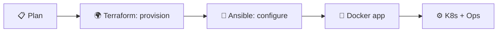
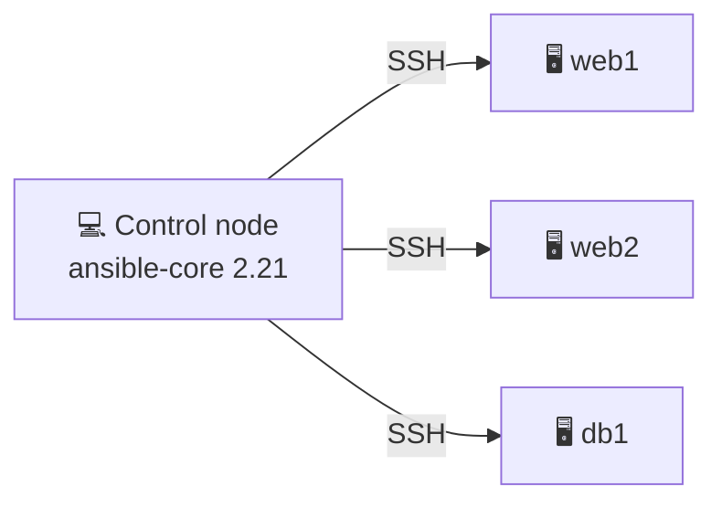
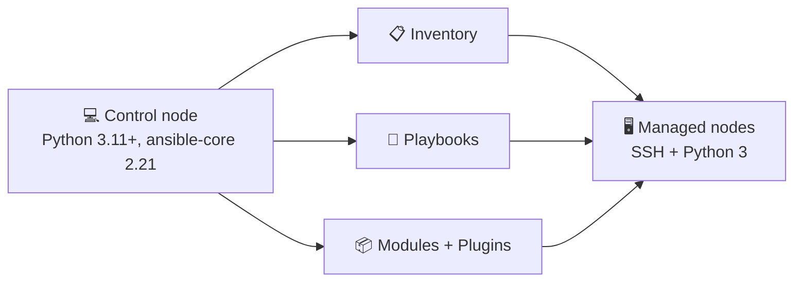
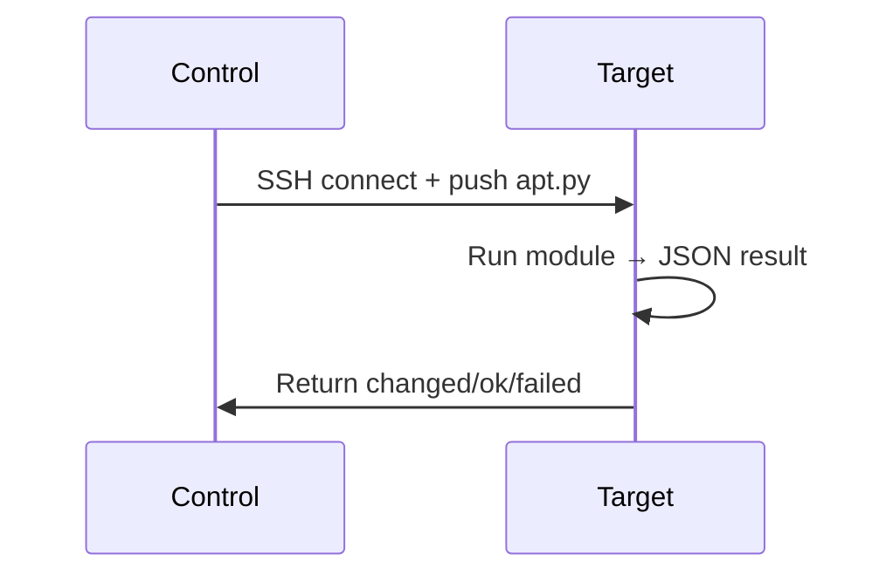
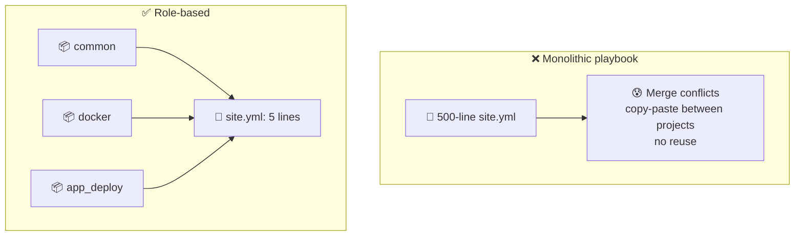
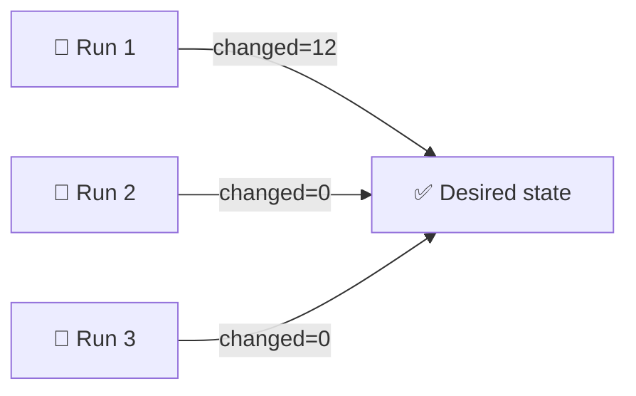
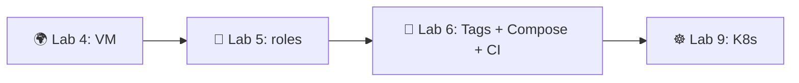

# 📌 Lecture 5 — Ansible Fundamentals: Configuration Management That Doesn't Bite

Лекция 5 — Основы Ansible: управление конфигурацией без боли

## 📍 Slide 1 – 🔧 Welcome to Configuration Management

Слайд 1 — Добро пожаловать в управление конфигурацией

* 🌍 **Lecture 4 provisioned the box** — Terraform/Pulumi created the VM, gave it an IP, opened ports
  * 🌍 **Лекция 4 подготовила сервер** — Terraform/Pulumi создал VM, выдал ей IP, открыл порты
* 🤔 But the box is empty: no Docker, no app user, no nginx config, no TLS, no daemon settings
  * 🤔 Но сервер пуст: нет Docker, нет пользователя приложения, нет конфига nginx, нет TLS, нет настроек демона
* 🔧 **Ansible configures what's inside** — packages, files, services, secrets — declaratively, with `ansible-core 2.21` (May 2026)
  * 🔧 **Ansible настраивает то, что внутри** — пакеты, файлы, сервисы, секреты — декларативно, с помощью `ansible-core 2.21` (май 2026)


Схема: 🌍 Terraform / Pulumi на лекции 4 создают VM → 🔧 Ansible на лекции 5 настраивает её → ✅ Docker и приложение запущены.

> 🔗 **Tie-in to Lab 5:** you'll build three roles (`common`, `docker`, `app_deploy`) and use them to provision the VM from Lab 4 and run your Lab 2 container image on it.
>
> 🔗 **Связь с лабой 5:** ты соберёшь три роли (`common`, `docker`, `app_deploy`) и с их помощью настроишь VM из лабы 4 и запустишь на ней контейнер с образом приложения из лабы 2.

---

## 📍 Slide 2 – 🎯 Learning Outcomes

Слайд 2 — Результаты обучения

| # | Outcome |
|---|---------|
| 1 | 🧠 Explain agentless, push-based configuration and how it differs from agent-based tools |
| 2 | 📋 Write and structure a static inventory; know when to switch to dynamic |
| 3 | 📝 Author idempotent playbooks using the right modules (`apt`, `service`, `template`, `lineinfile`) |
| 4 | 📦 Organise reusable logic into roles (tasks / handlers / defaults / templates) |
| 5 | 🔐 Encrypt secrets with Ansible Vault and pass them to playbooks safely |

| # | Результат |
|---|-----------|
| 1 | 🧠 Объяснить, как работает безагентная конфигурация по модели push и чем она отличается от инструментов с агентами |
| 2 | 📋 Написать и структурировать статический инвентарь; знать, когда переходить на динамический |
| 3 | 📝 Писать идемпотентные плейбуки с правильными модулями (`apt`, `service`, `template`, `lineinfile`) |
| 4 | 📦 Организовывать переиспользуемую логику в роли (tasks / handlers / defaults / templates) |
| 5 | 🔐 Шифровать секреты с помощью Ansible Vault и безопасно передавать их в плейбуки |

**Tech stack pinned for May 2026:** `ansible-core` **2.21** (community package **ansible 13.6.0**, April 2026), Python **3.11+** on the control node, `ansible-galaxy` for collections, OpenSSH on managed nodes.

**Технологический стек, зафиксированный на май 2026:** `ansible-core` **2.21** (community-пакет **ansible 13.6.0**, апрель 2026), Python **3.11+** на control-ноде, `ansible-galaxy` для коллекций, OpenSSH на управляемых нодах.

> 📌 **A note on "LTS":** Ansible-core has **no formal LTS label.** Red Hat ships *Ansible Automation Platform* with extended support, but the open-source `ansible-core` only commits to ~6 months of security fixes per minor release. The currently-supported open-source versions are **2.18, 2.19, 2.20, 2.21**. Older slides on the internet that say "2.17 LTS" predate the policy clarification — ignore them.
>
> 📌 **Замечание про «LTS»:** у ansible-core **нет официального статуса LTS.** Red Hat поставляет *Ansible Automation Platform* с расширенной поддержкой, но open-source `ansible-core` гарантирует лишь около 6 месяцев исправлений безопасности на каждый минорный релиз. Сейчас поддерживаются open-source версии **2.18, 2.19, 2.20, 2.21**. Старые слайды в интернете с надписью «2.17 LTS» появились до этого уточнения политики — не обращай на них внимания.

---

## 📍 Slide 3 – 🆚 Ansible vs the Rest of IaC

Слайд 3 — Ansible против остальных инструментов IaC

* 🌍 **Terraform / Pulumi (Lec 4)** = *provisioning* — "create 3 VMs, 1 LB, 1 RDS instance"
  * 🌍 **Terraform / Pulumi (лекция 4)** = *подготовка инфраструктуры* — «создай 3 VM, 1 балансировщик, 1 инстанс RDS»
* 🔧 **Ansible (Lec 5)** = *configuration* — "install Docker, render `daemon.json`, start the service"
  * 🔧 **Ansible (лекция 5)** = *конфигурация* — «установи Docker, отрендери `daemon.json`, запусти сервис»
* 🐳 **Docker (Lec 2)** = *packaging* — "freeze the app and its runtime"
  * 🐳 **Docker (лекция 2)** = *упаковка* — «зафиксируй приложение и его окружение»
* ☸️ **Kubernetes (Lec 9+)** = *orchestration* — "run N replicas, restart on failure, roll out updates"
  * ☸️ **Kubernetes (лекция 9+)** = *оркестрация* — «держи N реплик, перезапускай при сбое, раскатывай обновления»

> 🔥 **Don't confuse them.** Terraform makes the box exist. Ansible makes the box useful. Both live in Git; both belong in CI.
>
> 🔥 **Не путай их.** Terraform создаёт сервер. Ansible делает его полезным. И то и другое живёт в Git; и то и другое должно быть в CI.



Схема: 📋 планирование → 🌍 Terraform (подготовка инфраструктуры) → 🔧 Ansible (настройка) → 🐳 приложение в Docker → ⚙️ Kubernetes и эксплуатация.

---

## 📍 Slide 4 – 🔥 Section 1: The Configuration Problem

Слайд 4 — Раздел 1: Проблема конфигурации

```bash
# 😱 The bash script that "works" — once
#!/bin/bash
apt-get update
apt-get install -y nginx
echo "Welcome" > /var/www/html/index.html
systemctl start nginx
```

Пояснение к коду: этот bash-скрипт «работает» только один раз — строка `echo "Welcome" > /var/www/html/index.html` при каждом запуске перезаписывает файл.

Run it twice — `apt-get install` is fine, but `echo >` overwrites the file every single time. Run it on Ubuntu 22.04 vs 24.04 — package names drift. Run it on a server where someone hand-edited `index.html` — your edit silently wipes theirs.

Запусти его дважды — с `apt-get install` всё нормально, но `echo >` перезаписывает файл каждый раз. Запусти на Ubuntu 22.04 и 24.04 — имена пакетов отличаются. Запусти на сервере, где кто-то вручную правил `index.html`, — и твоя правка молча затрёт чужую.

**That's the problem in one slide.** Shell scripts are imperative recipes; they don't describe the *end state*, only the *steps*. Anything that doesn't match the author's mental model breaks them.

**Вот и вся проблема на одном слайде.** Shell-скрипты — это императивные рецепты: они описывают не *конечное состояние*, а только *шаги*. Любое расхождение с мысленной моделью автора ломает их.

---

## 📍 Slide 5 – 📝 Documentation Drift

Слайд 5 — Документация расходится с реальностью

* 📝 Docs written once, server modified a hundred times — nobody updates the wiki
  * 📝 Документацию написали один раз, а сервер меняли сотни раз — вики никто не обновляет
* 🚪 The engineer who knew the real config left in 2024
  * 🚪 Инженер, который знал настоящий конфиг, уволился ещё в 2024-м
* 💀 Reality ≠ documentation; the team trusts whichever fails them less today
  * 💀 Реальность ≠ документация; команда доверяет тому, что сегодня подводит меньше
* 🔇 "The runbook says X but production does Y now" — a phrase you'll hear in every postmortem
  * 🔇 «В runbook написано X, а прод сейчас делает Y» — фразу услышишь на каждом разборе инцидента
* 🧪 Disaster recovery test fails because the *real* config was never written down
  * 🧪 Тест восстановления после сбоя проваливается, потому что *настоящую* конфигурацию так и не записали

> ⚠️ **Outdated docs are worse than no docs** — they actively mislead.
>
> ⚠️ **Устаревшая документация хуже отсутствующей** — она активно вводит в заблуждение.

---

## 📍 Slide 6 – 💸 The Cost of Hand-Configured Servers

Слайд 6 — Цена серверов, настроенных вручную

| 🔥 Failure mode | 💥 Impact |
|---|---|
| 🐢 Manual patching, server-by-server | Critical CVEs sit unpatched for weeks |
| 📋 Hand-edits over SSH | Typos cause production outages |
| 👉 Snowflake servers | "Works on server 1, broken on server 2" |
| 🙈 No audit trail | Compliance audits fail; nobody knows who changed `sshd_config` |
| 🐶 Pet servers | One dies, nobody can rebuild it from scratch |

| 🔥 Режим отказа | 💥 Последствия |
|---|---|
| 🐢 Ручное обновление, сервер за сервером | Критические CVE остаются неисправленными неделями |
| 📋 Правки вручную по SSH | Опечатки вызывают сбои в проде |
| 👉 Серверы-«снежинки» | «На первом сервере работает, на втором сломано» |
| 🙈 Нет аудита | Комплаенс-аудит не проходит; никто не знает, кто менял `sshd_config` |
| 🐶 Серверы-«питомцы» | Один умирает — и никто не может воссоздать его с нуля |

> 📖 **2024 Verizon DBIR:** ~85% of breaches involve human-element factors — misconfiguration tops the list for cloud incidents. The goal of Ansible is to delete this entire table.
>
> 📖 **Verizon DBIR 2024:** около 85% утечек связаны с человеческим фактором — при облачных инцидентах лидирует ошибка конфигурации. Цель Ansible — устранить всю эту таблицу.

---

## 📍 Slide 7 – 💡 Section 2: What Ansible Is

Слайд 7 — Раздел 2: Что такое Ansible

* 🔧 **Configuration management tool** — describes the *desired state* of a fleet of machines
  * 🔧 **Инструмент управления конфигурацией** — описывает *желаемое состояние* целого парка машин
* 🌐 **Agentless** — talks over SSH (Linux) or WinRM (Windows); no daemon to install or patch on the targets
  * 🌐 **Без агентов** — общается по SSH (Linux) или WinRM (Windows); на целевых хостах не нужно ставить и обновлять демон
* 📤 **Push-based** — the control node pushes commands when you run it; no pull cycle, no agent heartbeat
  * 📤 **Модель push** — control-нода отправляет команды в момент запуска; нет цикла pull и heartbeat агента
* 📝 **YAML + Jinja2** — declarative-ish syntax, version-controllable like any code
  * 📝 **YAML + Jinja2** — почти декларативный синтаксис, который версионируется как любой код
* 🔄 **Idempotent by design** — running the same playbook twice converges to the same state
  * 🔄 **Идемпотентность по умолчанию** — повторный запуск того же плейбука приводит к тому же состоянию



Схема: 💻 control-нода (`ansible-core 2.21`) по SSH управляет тремя хостами — 🖥️ web1, 🖥️ web2 и 🖥️ db1.

> 📖 **Definition:** Ansible is an open-source automation engine that uses SSH and YAML to put a fleet of machines into a documented, version-controlled state.
>
> 📖 **Определение:** Ansible — это open-source движок автоматизации, который с помощью SSH и YAML приводит парк машин в задокументированное состояние под контролем версий.

---

## 📍 Slide 8 – 📜 A Brief History of Ansible

Слайд 8 — Краткая история Ansible

* 📅 **2012** — Michael DeHaan releases Ansible; explicit reaction to Puppet/Chef agent complexity
  * 📅 **2012** — Майкл ДеХан выпускает Ansible как прямой ответ на сложность агентов Puppet/Chef
* 📅 **2013** — AnsibleWorks founded; first commercial release
  * 📅 **2013** — основана AnsibleWorks; первый коммерческий релиз
* 📅 **2015** — **Red Hat acquires AnsibleWorks** for ~$150M
  * 📅 **2015** — **Red Hat покупает AnsibleWorks** примерно за $150 млн
* 📅 **2019** — IBM buys Red Hat; Ansible stays open-source
  * 📅 **2019** — IBM покупает Red Hat; Ansible остаётся open-source
* 📅 **2021** — Project split: **`ansible-core`** (the engine) vs **`ansible`** (community package with hundreds of pre-bundled collections)
  * 📅 **2021** — проект разделяется: **`ansible-core`** (сам движок) и **`ansible`** (community-пакет с сотнями предустановленных коллекций)
* 📅 **2024+** — Collections become the canonical distribution unit; `community.ansible` package bundles hundreds
  * 📅 **2024+** — коллекции становятся канонической единицей распространения; пакет `community.ansible` объединяет сотни коллекций
* 📅 **May 2026** — `ansible-core 2.21` (community package **ansible 13.6.0**) is what you'll use in Lab 5
  * 📅 **Май 2026** — в лабе 5 ты будешь использовать `ansible-core 2.21` (community-пакет **ansible 13.6.0**)

> 🤔 **Notice:** Ansible's bet — *no agents* — predates "GitOps" by years and is still the right call for fleet config.
>
> 🤔 **Обрати внимание:** ставка Ansible — *никаких агентов* — появилась за годы до «GitOps» и до сих пор остаётся верной для настройки парка машин.

---

## 📍 Slide 9 – 🚫 What Ansible is NOT

Слайд 9 — Чем Ansible НЕ является

| ❌ Myth | ✅ Reality |
|---|---|
| "Replaces Terraform" | 🤝 Terraform provisions, Ansible configures. Different layer. |
| "Requires agents on every server" | 🌐 SSH only. The whole point. |
| "Only Linux" | 🪟 Windows works via WinRM/PowerShell; network gear via API modules |
| "Just bash with YAML" | 📦 Idempotent modules + state model + handlers + Jinja2 |
| "Slow for big fleets" | ⚡ Default forks=5, scale up with `forks=50`, mitogen, or AAP |

| ❌ Миф | ✅ Реальность |
|---|---|
| «Заменяет Terraform» | 🤝 Terraform готовит инфраструктуру, Ansible настраивает. Это разные уровни. |
| «Требует агентов на каждом сервере» | 🌐 Только SSH. В этом весь смысл. |
| «Только Linux» | 🪟 Windows поддерживается через WinRM/PowerShell; сетевое оборудование — через API-модули |
| «Просто bash с YAML» | 📦 Идемпотентные модули + модель состояний + обработчики + Jinja2 |
| «Медленный на больших парках машин» | ⚡ По умолчанию forks=5, масштабируется через `forks=50`, mitogen или AAP |

> 🔥 **Hot take:** the moment your team has more than three servers, you need Ansible (or an equivalent). Hand-SSH does not scale.
>
> 🔥 **Резко, но честно:** как только у команды больше трёх серверов, нужен Ansible (или аналог). Ручной SSH не масштабируется.

---

## 📍 Slide 10 – 🏗️ Architecture

Слайд 10 — Архитектура



Схема: 💻 control-нода (Python 3.11+, ansible-core 2.21) использует 📋 инвентарь, 📝 плейбуки и 📦 модули с плагинами, чтобы управлять 🖥️ управляемыми нодами по SSH с Python 3.

| 🧱 Component | 🎯 Purpose |
|---|---|
| 💻 **Control node** | Your laptop or CI runner. Python 3.11+ and `ansible-core 2.21`. |
| 🖥️ **Managed nodes** | The servers you configure. SSH + Python 3. |
| 📋 **Inventory** | Static INI/YAML or dynamic cloud plugin. Lists hosts, groups, vars. |
| 📦 **Modules** | Python units of work (`apt`, `service`, `template`, `copy`, `file`). |
| 📚 **Collections** | Packaging unit. Installed via `ansible-galaxy collection install`. |

| 🧱 Компонент | 🎯 Назначение |
|---|---|
| 💻 **Control-нода** | Твой ноутбук или CI-раннер. Python 3.11+ и `ansible-core 2.21`. |
| 🖥️ **Управляемые ноды** | Серверы, которые ты настраиваешь. SSH + Python 3. |
| 📋 **Инвентарь** | Статический INI/YAML или динамический облачный плагин. Перечисляет хосты, группы, переменные. |
| 📦 **Модули** | Единицы работы на Python (`apt`, `service`, `template`, `copy`, `file`). |
| 📚 **Коллекции** | Единица упаковки. Устанавливаются через `ansible-galaxy collection install`. |

---

## 📍 Slide 11 – 🔁 How One Task Actually Runs

Слайд 11 — Как на самом деле выполняется одна задача

1. 📋 Read inventory → resolve target hosts
   * 📋 Прочитать инвентарь → определить целевые хосты
2. 🔐 SSH into each host (parallel, `forks=5` by default)
   * 🔐 Зайти по SSH на каждый хост (параллельно, по умолчанию `forks=5`)
3. 📤 Push a small Python module file into a temp dir, run it with the target's Python
   * 📤 Скопировать небольшой Python-модуль во временный каталог и запустить его интерпретатором Python на целевом хосте
4. 📊 Module returns JSON: `{"changed": true, "msg": "..."}`
   * 📊 Модуль возвращает JSON: `{"changed": true, "msg": "..."}`
5. 🧹 Clean up temp files, close SSH
   * 🧹 Удалить временные файлы, закрыть SSH



Схема: control-нода подключается по SSH и отправляет `apt.py`; на целевом хосте модуль выполняется и возвращает JSON-результат со статусом changed/ok/failed.

> 📝 **Implication:** the target needs Python — already on every Ubuntu 22.04+ box. That's the only "agent" Ansible needs.
>
> 📝 **Следствие:** на целевом хосте нужен Python — он уже есть на любом Ubuntu 22.04+. Это единственный «агент», который нужен Ansible.

---

## 📍 Slide 12 – 📋 Inventory: Static (INI / YAML)

Слайд 12 — Инвентарь: статический (INI / YAML)

```ini
# inventory/hosts.ini
[webservers]
web1 ansible_host=10.0.1.10
web2 ansible_host=10.0.1.11

[databases]
db1  ansible_host=10.0.2.10

[production:children]
webservers
databases

[all:vars]
ansible_user=ubuntu
ansible_ssh_private_key_file=~/.ssh/lab4_id_ed25519
```

Пояснение: файл `inventory/hosts.ini` описывает хосты `web1`, `web2` и `db1` с их адресами, группы `webservers` и `databases`, группу `production` из дочерних групп и общие переменные `[all:vars]` — SSH-пользователя и приватный ключ.

* 🏷️ **Groups** organise hosts by role, environment, or geography
  * 🏷️ **Группы** организуют хосты по роли, окружению или расположению
* 🪆 **Group of groups** (`:children`) builds hierarchies: `production` ⊃ `webservers`+`databases`
  * 🪆 **Группа групп** (`:children`) строит иерархию: `production` ⊃ `webservers`+`databases`
* 🎯 **Targeting**: `hosts: webservers`, `hosts: all`, `hosts: production:!web2` (exclude one host)
  * 🎯 **Выбор целей**: `hosts: webservers`, `hosts: all`, `hosts: production:!web2` (исключить один хост)

---

## 📍 Slide 13 – 🌐 Inventory: Dynamic (Cloud Plugins)

Слайд 13 — Инвентарь: динамический (облачные плагины)

Static lists rot the moment a VM is recreated and gets a new IP. Inventory plugins query the cloud provider at runtime.

Статические списки устаревают в тот самый момент, когда VM пересоздают и она получает новый IP. Плагины инвентаря запрашивают данные у облачного провайдера во время выполнения.

```yaml
# inventory/aws.yml
plugin: amazon.aws.aws_ec2
regions:
  - eu-central-1
filters:
  tag:Project: devops-core
  instance-state-name: running
keyed_groups:
  - key: tags.Role
    prefix: role
compose:
  ansible_host: public_ip_address
```

Пояснение: плагин `amazon.aws.aws_ec2` ищет запущенные инстансы в регионе `eu-central-1` с тегом `Project: devops-core`, группирует их по тегу `Role` с префиксом `role` и подставляет `public_ip_address` в `ansible_host`.

```bash
ansible-galaxy collection install amazon.aws
ansible-inventory -i inventory/aws.yml --graph
```

Пояснение: сначала ставим коллекцию `amazon.aws`, затем командой `ansible-inventory --graph` проверяем, какие хосты и группы получились из облака.

| Cloud | Collection | Plugin |
|---|---|---|
| AWS | `amazon.aws` | `aws_ec2` |
| GCP | `google.cloud` | `gcp_compute` |
| Azure | `azure.azcollection` | `azure_rm` |
| Yandex Cloud | `yandex.cloud` | `yandex_compute` |

| Облако | Коллекция | Плагин |
|---|---|---|
| AWS | `amazon.aws` | `aws_ec2` |
| GCP | `google.cloud` | `gcp_compute` |
| Azure | `azure.azcollection` | `azure_rm` |
| Yandex Cloud | `yandex.cloud` | `yandex_compute` |

> 🔗 **Lab 5 bonus task** uses this against the VM you created in Lab 4 with Terraform/Pulumi.
>
> 🔗 **Бонусное задание лабы 5** использует этот подход на VM, которую ты создал в лабе 4 с помощью Terraform/Pulumi.

---

## 📍 Slide 14 – 📝 First Playbook — Read Twice

Слайд 14 — Первый плейбук (прочитай дважды)

```yaml
---
- name: Configure web servers
  hosts: webservers
  become: true                # 🔐 sudo to root
  gather_facts: true          # 🧠 collect ansible_distribution, ansible_memtotal_mb, ...

  tasks:
    - name: Update apt cache (max 1h old)
      ansible.builtin.apt:
        update_cache: yes
        cache_valid_time: 3600

    - name: Install nginx
      ansible.builtin.apt:
        name: nginx
        state: present

    - name: Ensure nginx is running and enabled
      ansible.builtin.service:
        name: nginx
        state: started
        enabled: yes
```

Пояснение: плейбук настраивает веб-серверы с `sudo`, собирает факты о хостах и в трёх задачах обновляет кеш apt, ставит nginx и включает сервис. Задача `Ensure nginx is running and enabled` гарантирует, что nginx запущен и стартует при загрузке.

```bash
ansible-playbook -i inventory/hosts.ini playbook.yml
```

Пояснение: запуск плейбука `playbook.yml` с инвентарём `inventory/hosts.ini`.

> 📌 **Read the FQCN**: `ansible.builtin.apt` says collection `ansible.builtin`, module `apt`. Since the 2021 split this is the *canonical* way to reference modules.
>
> 📌 **Обрати внимание на FQCN**: `ansible.builtin.apt` означает коллекцию `ansible.builtin` и модуль `apt`. После разделения 2021 года это *канонический* способ ссылаться на модули.

---

## 📍 Slide 15 – 🎨 Reading the Output

Слайд 15 — Как читать вывод

```text
TASK [Install nginx] ********************************************************
changed: [web1]
TASK [Ensure nginx is running and enabled] **********************************
ok: [web1]

PLAY RECAP ******************************************************************
web1 : ok=3  changed=1  unreachable=0  failed=0
```

Пояснение: `changed` означает, что nginx был установлен; `ok` — что сервис уже в нужном состоянии. В итоговом `PLAY RECAP` видно: 3 задачи успешны, 1 изменила состояние, недостижимых и упавших хостов нет.

| Color | Status | Meaning |
|---|---|---|
| 🟢 | **ok** | Already in desired state — no change needed |
| 🟡 | **changed** | Module had to act to reach the desired state |
| 🔴 | **failed** | Module raised an error |
| ⚫ | **skipped** | A `when:` condition was false |

| Цвет | Статус | Значение |
|---|---|---|
| 🟢 | **ok** | Уже в нужном состоянии — изменений не требуется |
| 🟡 | **changed** | Модулю пришлось действовать, чтобы достичь нужного состояния |
| 🔴 | **failed** | Модуль завершился с ошибкой |
| ⚫ | **skipped** | Условие `when:` оказалось ложным |

> 🎯 **Goal of a mature playbook:** first run is mostly yellow. Every subsequent run is entirely green.
>
> 🎯 **Цель зрелого плейбука:** первый запуск в основном жёлтый. Каждый следующий — полностью зелёный.

---

## 📍 Slide 16 – 📦 The Modules You'll Use Most

Слайд 16 — Модули, которые понадобятся чаще всего

| Module | Job | Idempotent? |
|---|---|---|
| 🧰 `ansible.builtin.apt` | Install/remove .deb packages | ✅ |
| ⚙️ `ansible.builtin.service` / `systemd` | Manage services | ✅ |
| 📄 `ansible.builtin.template` | Render Jinja2 → remote file | ✅ |
| 🗃️ `ansible.builtin.copy` | Push static file | ✅ |
| 🧷 `ansible.builtin.file` | Manage permissions, symlinks, directories | ✅ |
| ➕ `ansible.builtin.lineinfile` / `blockinfile` | Edit a config file by line/block | ✅ |
| 👤 `ansible.builtin.user` / `group` | Manage Linux accounts | ✅ |
| 🐳 `community.docker.docker_container` | Run a container | ✅ |
| 💥 `ansible.builtin.shell` / `command` | Run arbitrary commands | ❌ — escape hatch |

| Модуль | Задача | Идемпотентен? |
|---|---|---|
| 🧰 `ansible.builtin.apt` | Устанавливать/удалять .deb-пакеты | ✅ |
| ⚙️ `ansible.builtin.service` / `systemd` | Управлять сервисами | ✅ |
| 📄 `ansible.builtin.template` | Рендерить Jinja2 → удалённый файл | ✅ |
| 🗃️ `ansible.builtin.copy` | Копировать статический файл | ✅ |
| 🧷 `ansible.builtin.file` | Управлять правами, симлинками, каталогами | ✅ |
| ➕ `ansible.builtin.lineinfile` / `blockinfile` | Править конфиг по строке/блоку | ✅ |
| 👤 `ansible.builtin.user` / `group` | Управлять учётными записями Linux | ✅ |
| 🐳 `community.docker.docker_container` | Запускать контейнер | ✅ |
| 💥 `ansible.builtin.shell` / `command` | Выполнять произвольные команды | ❌ — крайняя мера |

> ⚠️ **`shell` and `command` are last resorts.** They have no state model — Ansible has no idea whether your `echo >> file` changed anything. Reach for the idempotent module first; only fall back when no module exists.
>
> ⚠️ **`shell` и `command` — крайняя мера.** У них нет модели состояния: Ansible понятия не имеет, изменила ли что-то твоя команда `echo >> file`. Сначала ищи идемпотентный модуль и только при его отсутствии спускайся к shell.

---

## 📍 Slide 17 – 🎭 `command` vs `shell`: pick the right one

Слайд 17 — `command` против `shell`: что выбрать

```yaml
# command — exec(), no shell. Safer. No pipes, no redirects, no $VARS.
- ansible.builtin.command: /usr/bin/curl https://example.com/health

# shell — full /bin/sh. Use ONLY when you actually need shell features.
- ansible.builtin.shell: |
    set -euo pipefail
    journalctl -u nginx | grep -c "200 OK" > /tmp/ok_count

# When you must use them, bolt idempotency on with creates: / removes:
- name: Run init script only if marker file is missing
  ansible.builtin.command: /usr/local/bin/init-once
  args:
    creates: /var/lib/myapp/.initialized
```

Пояснение: `command` запускает процесс напрямую, без shell — это безопаснее, но не поддерживает пайпы, редиректы и `$VARS`. `shell` открывает полноценный `/bin/sh` и нужен только для shell-возможностей вроде `set -euo pipefail` или пайпа в `journalctl`. А `creates:` / `removes:` добавляют идемпотентность — скрипт запустится только при отсутствии (или наличии) файла-маркера.

`creates:` and `removes:` are how you bolt idempotency onto a one-shot script.

`creates:` и `removes:` — это способ добавить идемпотентность к одноразовому скрипту.

---

## 📍 Slide 18 – 📦 Section 3: Roles

Слайд 18 — Раздел 3: Роли

A *role* is just a directory tree with conventional subfolders. It packages tasks + variables + templates + handlers so you can drop them into any playbook with one line.

*Роль* — это просто дерево каталогов с общепринятыми подкаталогами. Она упаковывает задачи, переменные, шаблоны и обработчики, чтобы подключать их в любой плейбук одной строкой.

```text
roles/
└── docker/
    ├── tasks/main.yml          # the work
    ├── handlers/main.yml       # event reactions
    ├── defaults/main.yml       # variables (lowest precedence)
    ├── vars/main.yml           # variables (high precedence)
    ├── templates/daemon.json.j2
    ├── files/install.sh
    └── meta/main.yml           # dependencies, supported platforms
```

Пояснение: типовое дерево роли `docker` — задачи (`tasks/`), обработчики (`handlers/`), переменные с низшим и высшим приоритетом (`defaults/`, `vars/`), шаблоны (`templates/`), статические файлы (`files/`) и метаданные с зависимостями (`meta/`).

> 🔥 **One rule:** if you copy-paste the same block of tasks between two playbooks, it's a role.
>
> 🔥 **Одно правило:** если ты копируешь один и тот же блок задач из плейбука в плейбук, это роль.

---

## 📍 Slide 19 – 📁 Why Roles Beat One Giant Playbook

Слайд 19 — Почему роли лучше одного огромного плейбука



Схема: слева ❌ монолитный `site.yml` на 500 строк порождает конфликты слияния, копипаст между проектами и невозможность переиспользования; справа ✅ роли `common`, `docker` и `app_deploy` подключаются в `site.yml` несколькими строками.

* 🔄 **Reusable** — share roles across projects, organisations, even via Ansible Galaxy
  * 🔄 **Переиспользуемость** — роли можно делиться между проектами и организациями, в том числе через Ansible Galaxy
* 📁 **Discoverable** — every role has the same layout; new engineers find their way in minutes
  * 📁 **Предсказуемость** — у каждой роли одинаковое устройство; новый инженер разберётся за минуты
* 🧪 **Testable** — Molecule spins each role up in a container and runs its playbook independently
  * 🧪 **Тестируемость** — Molecule поднимает каждую роль в контейнере и независимо прогоняет её плейбук
* 🔬 **Composable** — a `webserver` role can depend on `common` via `meta/main.yml`
  * 🔬 **Компонуемость** — роль `webserver` может зависеть от `common` через `meta/main.yml`

---

## 📍 Slide 20 – 🐳 Role Example: `docker` (Lab 5's main deliverable)

Слайд 20 — Пример роли: `docker` (главный результат лабы 5)

```yaml
# roles/docker/tasks/main.yml
---
- name: Install prerequisites
  ansible.builtin.apt:
    name: [apt-transport-https, ca-certificates, curl, gnupg, lsb-release]
    state: present
    update_cache: yes

- name: Add Docker APT key
  ansible.builtin.apt_key:
    url: https://download.docker.com/linux/ubuntu/gpg
    state: present

- name: Add Docker repository
  ansible.builtin.apt_repository:
    repo: "deb https://download.docker.com/linux/ubuntu {{ ansible_distribution_release }} stable"
    state: present

- name: Install Docker Engine
  ansible.builtin.apt:
    name: [docker-ce, docker-ce-cli, containerd.io]
    state: present
  notify: restart docker

- name: Add user to docker group
  ansible.builtin.user:
    name: "{{ docker_user }}"
    groups: docker
    append: yes
```

Пояснение: роль `docker` ставит зависимости и ключ Docker, добавляет официальный репозиторий, устанавливает `docker-ce`, `docker-ce-cli` и `containerd.io`, затем добавляет пользователя `{{ docker_user }}` в группу `docker`. При изменении задачи установки срабатывает уведомление обработчику `restart docker`.

> 🔗 **Notice the Jinja2 fact:** `{{ ansible_distribution_release }}` resolves to `noble` on Ubuntu 24.04, `jammy` on 22.04. One role, both distros.
>
> 🔗 **Обрати внимание на факт из Jinja2:** `{{ ansible_distribution_release }}` на Ubuntu 24.04 превращается в `noble`, а на 22.04 — в `jammy`. Одна роль, оба дистрибутива.

---

## 📍 Slide 21 – 🔔 Handlers — Restart Only When You Actually Changed Something

Слайд 21 — Обработчики: перезапуск только при реальных изменениях

```yaml
# roles/docker/handlers/main.yml
---
- name: restart docker
  ansible.builtin.service:
    name: docker
    state: restarted
```

Пояснение: обработчик `restart docker` перезапускает сервис Docker; он срабатывает только при вызове из задачи через `notify`.

```yaml
# roles/docker/tasks/main.yml (continued)
- name: Render /etc/docker/daemon.json
  ansible.builtin.template:
    src: daemon.json.j2
    dest: /etc/docker/daemon.json
    mode: "0644"
  notify: restart docker     # 🔔 only fires if template changed
```

Пояснение: задача рендерит `daemon.json` из шаблона Jinja2 и вызывает `notify: restart docker` только тогда, когда файл действительно изменился.

**Key handler semantics:**

**Ключевая семантика обработчиков:**

* 🎯 **Triggered by `notify:`** — only when the notifying task reports `changed: true`
  * 🎯 **Запускается через `notify:`** — только когда уведомившая задача сообщает `changed: true`
* ⏱️ **Run once at the end of the play** — multiple notifies of the same handler collapse to one restart
  * ⏱️ **Выполняется один раз в конце play** — несколько уведомлений одного обработчика схлопываются в один перезапуск
* 🚦 **Skipped on second run** — the file is already correct, no change, no restart, no downtime
  * 🚦 **Пропускается при втором запуске** — файл уже правильный, изменений нет, перезапуска и простоя нет

> 💡 **This is the whole point.** A naive `service restart` on every run kicks Docker — and your containers — every single time. Handlers restart only when config actually drifted.
>
> 💡 **В этом весь смысл.** Наивный `service restart` при каждом запуске дёргает Docker — и твои контейнеры — каждый раз. Обработчики перезапускают сервис только когда конфиг действительно изменился.

---

## 📍 Slide 22 – 📊 Variables: Where They Live and Who Wins

Слайд 22 — Переменные: где они живут и кто побеждает

```yaml
# roles/docker/defaults/main.yml    (lowest precedence — easy to override)
---
docker_user: ubuntu
docker_data_root: /var/lib/docker
docker_log_max_size: "10m"
```

Пояснение: файл `defaults/main.yml` роли `docker` задаёт переменные с самым низким приоритетом, которые легко переопределить: пользователя `ubuntu`, каталог данных Docker и максимальный размер лога.

**Precedence — abbreviated, lowest to highest:**

**Приоритет переменных — кратко, от низшего к высшему:**

1. 📁 Role `defaults/main.yml`
   * 📁 `defaults/main.yml` роли
2. 📋 Inventory group_vars / host_vars
   * 📋 `group_vars` / `host_vars` инвентаря
3. 📄 Playbook `vars:` block
   * 📄 блок `vars:` в плейбуке
4. 🔧 Role `vars/main.yml`
   * 🔧 `vars/main.yml` роли
5. ⚡ `-e var=value` on the CLI (**always wins**)
   * ⚡ `-e var=value` в командной строке (**всегда побеждает**)

> 📖 **Convention:** *overridable* defaults in `defaults/`, *fixed* values in `vars/`. If a user shouldn't change it, it belongs in `vars/`.
>
> 📖 **Соглашение:** *переопределяемые* значения — в `defaults/`, *фиксированные* — в `vars/`. Если пользователь не должен это менять, значение принадлежит `vars/`.

---

## 📍 Slide 23 – 🔄 Section 4: Idempotency — Ansible's Killer Feature

Слайд 23 — Раздел 4: Идемпотентность — главная суперсила Ansible



Схема: 🚀 первый запуск даёт `changed=12` и приводит к ✅ нужному состоянию; второй и третий запуски дают `changed=0` — состояние уже достигнуто.

**A task is idempotent when** running it twice has the same effect as running it once.

**Задача идемпотентна, если** её повторный запуск даёт тот же эффект, что и первый.

Modules achieve this by checking state *before* acting:

Модули добиваются этого, проверяя состояние *до* действия:

* `apt: state=present` → query dpkg, install only if missing
  * `apt: state=present` → проверить dpkg и установить, только если пакета нет
* `service: state=started` → query systemd, start only if stopped
  * `service: state=started` → проверить systemd и запустить, только если сервис остановлен
* `file: state=directory` → stat the path, create only if absent
  * `file: state=directory` → проверить путь и создать каталог, только если его нет
* `template:` → diff rendered output against current file, write only if different
  * `template:` → сравнить отрендеренный результат с текущим файлом и записать, только если они различаются

```bash
# Dry-run: report changes without making them
ansible-playbook playbook.yml --check --diff
```

Пояснение: режим `--check` показывает, что изменилось бы, а `--diff` — различия в файлах, но ни то ни другое ничего не меняет на серверах.

> 🧪 **The acceptance test:** second consecutive run reports `changed=0`. If anything still changes, a task isn't idempotent — usually a stray `shell:` or a templated file with timestamps. **Lab 5 grades you on this.**
>
> 🧪 **Критерий приёмки:** второй запуск подряд сообщает `changed=0`. Если что-то всё ещё меняется, задача неидемпотентна — обычно виноват случайный `shell:` или шаблон с таймстампами. **Лаба 5 оценивается именно по этому.**

---

## 📍 Slide 24 – 🔐 Ansible Vault — Secrets in Git Without Tears

Слайд 24 — Ansible Vault: секреты в Git без слёз

```bash
# Create / edit / view encrypted files (AES-256)
ansible-vault create  group_vars/all/vault.yml
ansible-vault edit    group_vars/all/vault.yml

# Encrypt a string inline
ansible-vault encrypt_string 'supersecret' --name dockerhub_password
```

Пояснение: `ansible-vault create`/`edit` работают с зашифрованными файлами (AES-256), а `encrypt_string` шифрует одну строку и выдаёт готовый YAML-фрагмент для вставки.

```yaml
# group_vars/all/vault.yml (encrypted at rest)
dockerhub_username: lab5student
dockerhub_password: dckr_pat_xxxxxxxxxxxxxxxxxxxxxxxxxx
```

Пояснение: в файле `vault.yml` учётные данные Docker Hub хранятся в зашифрованном виде, а в Git попадает только шифротекст.

```bash
ansible-playbook deploy.yml --ask-vault-pass                       # prompt
ansible-playbook deploy.yml --vault-password-file ~/.vault_pass    # file (gitignored)
ansible-playbook deploy.yml --vault-id dev@~/.vd --vault-id prod@prompt   # multi-env
```

Пояснение: пароль Vault можно вводить вручную, брать из файла (он в `.gitignore`) или использовать отдельные `--vault-id` для разных окружений.

> 🔗 **Lab 11 ties this to OpenBao** — for production you graduate from Vault-the-file-encryptor to Vault-the-secret-store. Lab 5 uses Ansible Vault because it's the right scope: a few credentials, encrypted in Git, no extra infra.
>
> 🔗 **Лаба 11 связывает это с OpenBao** — в продакшене ты переходишь от Vault-как-шифратора-файлов к Vault-как-хранилищу-секретов. В лабе 5 используется Ansible Vault, потому что это верный масштаб: несколько учётных данных, зашифрованных в Git, без дополнительной инфраструктуры.

---

## 📍 Slide 25 – 🌍 Real-World Ansible

Слайд 25 — Ansible в реальном мире

* 🛡️ **NASA JPL** — manages Mars-mission ground systems (public talks since 2016)
  * 🛡️ **NASA JPL** — управляет наземными системами марсианских миссий (публичные доклады с 2016 года)
* 🏦 **Capital One** — Ansible Tower drives nightly compliance across tens of thousands of EC2 instances
  * 🏦 **Capital One** — Ansible Tower проводит ночные проверки соответствия на десятках тысяч инстансов EC2
* 🎮 **Riot Games** — League of Legends server fleet provisioning
  * 🎮 **Riot Games** — подготовка парка серверов League of Legends
* 🔭 **CERN** — patch management on the LHC compute grid
  * 🔭 **CERN** — управление патчами на вычислительной сети LHC
* 🐧 **Red Hat** — OpenShift installer is essentially a giant Ansible playbook collection
  * 🐧 **Red Hat** — установщик OpenShift по сути представляет собой огромную коллекцию плейбуков Ansible

> 🔥 **Common thread:** every fleet bigger than ~50 machines runs *some* config-management tool. Ansible is the most common answer because the agentless model lowers the barrier to "yes" by an order of magnitude.
>
> 🔥 **Общая закономерность:** любой парк больше примерно 50 машин использует *какой-нибудь* инструмент управления конфигурацией. Ansible — самый частый ответ, потому что модель без агентов на порядок снижает порог для «да».

---

## 📍 Slide 26 – ⚡ Before vs After Ansible

Слайд 26 — До и после Ansible

| 😰 Before | 🚀 After |
|---|---|
| 📞 SSH into 30 servers one by one | One `ansible-playbook` invocation |
| 📝 "Run these 14 commands" runbook | YAML in Git, diffable in PR |
| 🐶 Each server hand-tuned, fragile | Roles guarantee identical state |
| 😨 Patch-day takes the team a full day | Patch-day takes one CI run |
| 📚 Documentation drifts from reality | The playbook *is* the documentation |
| 🔥 Recovery = rebuild from memory | Recovery = `terraform apply` + `ansible-playbook` |

| 😰 До | 🚀 После |
|---|---|
| 📞 Заходить по SSH на 30 серверов по одному | Один запуск `ansible-playbook` |
| 📝 Runbook «выполните эти 14 команд» | YAML в Git, который видно в diff на PR |
| 🐶 Каждый сервер настроен вручную и хрупок | Роли гарантируют одинаковое состояние |
| 😨 День патчей занимает у команды целый день | День патчей — это один прогон CI |
| 📚 Документация расходится с реальностью | Плейбук *и есть* документация |
| 🔥 Восстановление = собрать по памяти | Восстановление = `terraform apply` + `ansible-playbook` |

---

## 📍 Slide 27 – 🎯 Key Takeaways

Слайд 27 — Ключевые выводы

1. 🔧 **Ansible is agentless** — SSH + Python on the target is the whole "agent"
   * 🔧 **Ansible работает без агентов** — SSH и Python на целевом хосте и есть весь «агент»
2. 📋 **Inventory is half the battle** — static for labs, dynamic for production fleets
   * 📋 **Инвентарь — половина дела** — статический для лаб, динамический для продакшн-парка
3. 📦 **Roles are the unit of reuse** — `tasks/`, `handlers/`, `defaults/`, `templates/`
   * 📦 **Роль — единица переиспользования** — `tasks/`, `handlers/`, `defaults/`, `templates/`
4. 🔄 **Idempotency is a feature** — `changed=0` on a second run is the acceptance test
   * 🔄 **Идемпотентность — это фича** — `changed=0` при втором запуске и есть критерий приёмки
5. 🔔 **Handlers prevent flapping** — restart Docker only when its config actually changed
   * 🔔 **Обработчики защищают от лишних перезапусков** — перезапускай Docker только когда его конфиг действительно изменился
6. 📌 **Use FQCN modules** — `ansible.builtin.apt`, not bare `apt`; future-proof since the 2021 split
   * 📌 **Используй FQCN-модули** — `ansible.builtin.apt`, а не голый `apt`; это защищает от будущих изменений после разделения 2021 года
7. 🛑 **`shell:` is a last resort** — wrap with `creates:` / `removes:` when unavoidable
   * 🛑 **`shell:` — крайняя мера** — оборачивай через `creates:` / `removes:`, если без него не обойтись
8. 🔐 **Vault encrypts secrets at rest** — bridge to Lab 11's OpenBao for production
   * 🔐 **Vault шифрует секреты на диске** — мостик к OpenBao из лабы 11 для продакшена

> 💡 **The mindset shift:** stop telling the server *how* to get there. Tell it *where to end up*. Ansible figures out the rest.
>
> 💡 **Смена мышления:** перестань говорить серверу, *как* к цели прийти. Скажи, *где* он должен оказаться. Остальное Ansible додумает сам.

---

## 📍 Slide 28 – 🚀 What Comes Next

Слайд 28 — Что дальше

**📚 Lecture 6: *Advanced Ansible & Continuous Deployment*** — picks up from your Lab 5 roles and pushes them to production-grade:

**📚 Лекция 6: *Продвинутый Ansible и непрерывная доставка*** — продолжает роли из лабы 5 и доводит их до продакшн-уровня:

* 🏷️ **Tags** — `ansible-playbook --tags docker` to run a subset
  * 🏷️ **Теги** — `ansible-playbook --tags docker`, чтобы запустить только часть задач
* 🧱 **Blocks + `rescue:` / `always:`** — try/catch for tasks
  * 🧱 **Блоки + `rescue:` / `always:`** — try/catch для задач
* 🚀 **Deployment strategies** — rolling, serial, max_fail_percentage
  * 🚀 **Стратегии деплоя** — rolling, serial, max_fail_percentage
* 🐙 **Docker Compose templates** rendered by Ansible
  * 🐙 **Шаблоны Docker Compose**, которые рендерит Ansible
* 🤖 **CI/CD** — running Ansible from GitHub Actions on every push to `main`
  * 🤖 **CI/CD** — запуск Ansible из GitHub Actions при каждом пуше в `main`

**🔬 Lab 5 deliverables (this week):**

**🔬 Что сдать по лабе 5 (на этой неделе):**

* `roles/common` — base packages, timezone
  * `roles/common` — базовые пакеты, часовой пояс
* `roles/docker` — install Docker (the example on slide 20)
  * `roles/docker` — установка Docker (пример со слайда 20)
* `roles/app_deploy` — pull your Lab 2 image, run as a container, expose port 5000, verify `/health`
  * `roles/app_deploy` — скачать образ из лабы 2, запустить контейнер, открыть порт 5000, проверить `/health`
* `group_vars/all/vault.yml` — encrypted Docker Hub credentials
  * `group_vars/all/vault.yml` — зашифрованные учётные данные Docker Hub
* `docs/LAB05.md` — idempotency proof (output of two consecutive runs)
  * `docs/LAB05.md` — доказательство идемпотентности (вывод двух последовательных запусков)
* Optional bonus: **dynamic inventory** against your Lab 4 cloud
  * Бонус по желанию: **динамический инвентарь** по облаку из лабы 4



Схема: 🌍 VM из лабы 4 → 🔧 роли в лабе 5 → 🚀 теги + Compose + CI в лабе 6 → ☸️ Kubernetes в лабе 9.

**👋 See you in Lecture 6.**

**👋 Увидимся на лекции 6.**

---

## 📚 Resources

📚 Материалы и дополнительные ресурсы

* 📕 *Ansible for DevOps* — Jeff Geerling (updated yearly; the practical reference)
  * 📕 *Ansible for DevOps* — Джефф Гирлинг (обновляется ежегодно; практический справочник)
* 📕 *Ansible: Up & Running* — Hochstein & Moser, O'Reilly (3rd ed. covers `ansible-core`)
  * 📕 *Ansible: Up & Running* — Хохштейн и Мозер, O'Reilly (3-е изд. охватывает `ansible-core`)
* 🎥 [Jeff Geerling's Ansible 101 series](https://www.youtube.com/playlist?list=PL2_OBreMn7FqZkvMYt6ATmgC0KAGGJNAN) — free on YouTube
  * 🎥 [Серия Ansible 101 от Джеффа Гирлинга](https://www.youtube.com/playlist?list=PL2_OBreMn7FqZkvMYt6ATmgC0KAGGJNAN) — бесплатно на YouTube
* 🌐 [docs.ansible.com](https://docs.ansible.com/ansible-core/2.21/) — official `ansible-core 2.21` docs
  * 🌐 [docs.ansible.com](https://docs.ansible.com/ansible-core/2.21/) — официальная документация `ansible-core 2.21`
* 🌐 [galaxy.ansible.com](https://galaxy.ansible.com) — community roles and collections
  * 🌐 [galaxy.ansible.com](https://galaxy.ansible.com) — роли и коллекции сообщества
* 🌐 [Molecule](https://ansible.readthedocs.io/projects/molecule/) — role testing framework
  * 🌐 [Molecule](https://ansible.readthedocs.io/projects/molecule/) — фреймворк для тестирования ролей

**🎓 Post-lecture quiz feeds the weeks 4–6 leaderboard window.**

**🎓 Квиз после лекции идёт в зачёт лидерборда за недели 4–6.**
