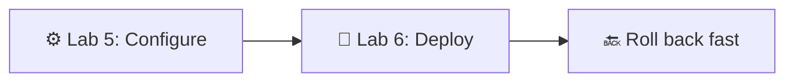
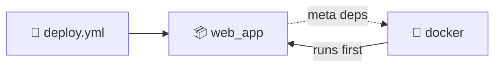
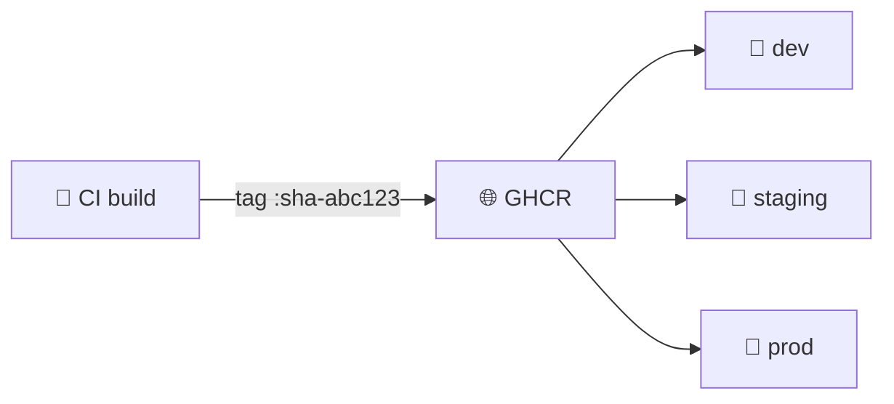
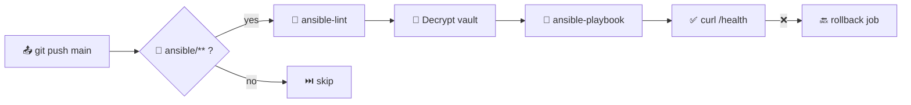
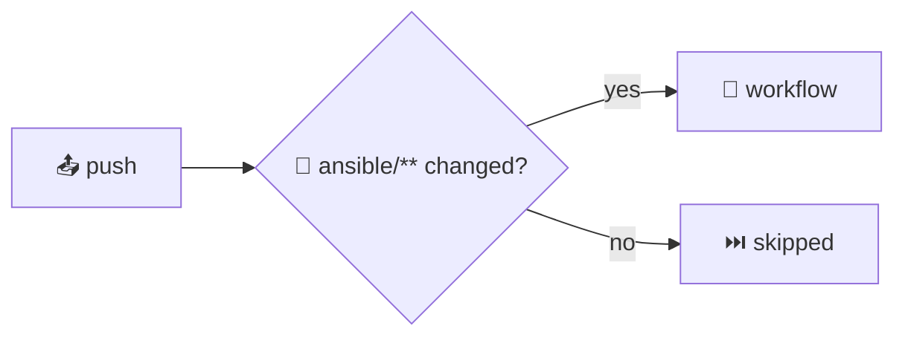
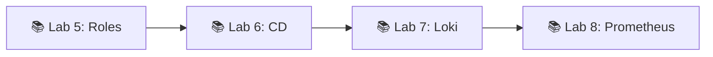

# 📌 Lecture 6 — Advanced Ansible & Continuous Deployment

Лекция 6 — Продвинутый Ansible и непрерывное развёртывание

## 📍 Slide 1 – 🚀 Welcome to Continuous Deployment

Слайд 1 — Добро пожаловать в непрерывное развёртывание

* 🧩 Lecture 5 gave you **playbooks, roles, inventory, idempotency, basic modules** — you can configure a server
  * 🧩 Лекция 5 дала тебе **playbook’и, роли, inventory, идемпотентность и базовые модули** — ты умеешь настраивать сервер
* 🚀 Today: turn that into a **deployment pipeline** — push to `main`, app on the box, rollback in minutes
  * 🚀 Сегодня превратим это в **пайплайн развёртывания**: пуш в `main`, приложение на сервере, откат за минуты
* 🛠️ Production patterns: `block`/`rescue`/`always`, tags, Jinja2-templated Docker Compose, GitHub Actions runners
  * 🛠️ Продакшен-паттерны: `block`/`rescue`/`always`, теги, Docker Compose на шаблонах Jinja2, раннеры GitHub Actions
* 🎯 Stack pinned for May 2026: **ansible-core 2.21**, **Docker Compose v2**, `community.docker` 4.x
  * 🎯 Стек зафиксирован на май 2026: **ansible-core 2.21**, **Docker Compose v2**, `community.docker` 4.x



Схема: ⚙️ настройка из лабы 5 → 🚀 развёртывание в лабе 6 → 🔙 быстрый откат.

> 🔗 **Tie-in to Lab 6:** you refactor Lab 5's playbooks with blocks + tags, template a `docker-compose.yml.j2`, add `web_app_wipe` clean-reinstall logic, and trigger the whole thing from GitHub Actions on every push to `ansible/**`.
>
> 🔗 **Связь с лабой 6:** ты переделываешь playbook’и из лабы 5 с блоками и тегами, пишешь шаблон `docker-compose.yml.j2`, добавляешь логику чистой переустановки через `web_app_wipe` и запускаешь всё это из GitHub Actions на каждый пуш в `ansible/**`.

---

## 📍 Slide 2 – 🎯 Learning Outcomes

Слайд 2 — Результаты обучения

| # | Outcome |
|---|---------|
| 1 | 🧱 Use `block` / `rescue` / `always` for fail-fast playbooks |
| 2 | 🏷️ Design a tag strategy that supports `--tags` and `--skip-tags` |
| 3 | 📝 Template `docker-compose.yml` with Jinja2 + `community.docker.docker_compose_v2` |
| 4 | 🧹 Implement double-gated wipe logic (variable + tag) |
| 5 | 🤖 Run Ansible from GitHub Actions with secrets and path filters |
| 6 | 🔙 Reason about rolling, all-at-once, and serial-percentage rollouts |

| # | Результат |
|---|-----------|
| 1 | 🧱 Использовать `block` / `rescue` / `always` для fail-fast-поведения playbook’ов |
| 2 | 🏷️ Спроектировать стратегию тегов, поддерживающую `--tags` и `--skip-tags` |
| 3 | 📝 Шаблонизировать `docker-compose.yml` через Jinja2 + `community.docker.docker_compose_v2` |
| 4 | 🧹 Реализовать логику wipe с двойной защитой (переменная + тег) |
| 5 | 🤖 Запускать Ansible из GitHub Actions с секретами и фильтрами путей |
| 6 | 🔙 Разобраться в rolling-, all-at-once- и serial-percentage-развёртываниях |

> ⚙️ **Prerequisites from Lecture 5:** YAML playbook syntax, role layout (`tasks/`, `handlers/`, `defaults/`, `meta/`), inventory + group_vars, Ansible Vault. We will **not** re-introduce those.
>
> ⚙️ **Что нужно знать из лекции 5:** синтаксис YAML-playbook’ов, структура роли (`tasks/`, `handlers/`, `defaults/`, `meta/`), inventory + group_vars, Ansible Vault. Заново это **разбирать не будем**.

---

## 📍 Slide 3 – 🔥 From Configuration to Delivery

Слайд 3 — От настройки к доставке

Lecture 5 ended with: *"the server is configured — now what?"*

Лекция 5 закончилась на: *«сервер настроен — и что дальше?»*

* 📦 Configuration management answers **what should be installed**
  * 📦 Управление конфигурацией отвечает на вопрос, **что должно быть установлено**
* 🚀 Continuous deployment answers **what version is running, right now**
  * 🚀 Непрерывное развёртывание отвечает на вопрос, **какая версия работает прямо сейчас**
* 🔄 Same playbook engine, different cadence — provision once a quarter, deploy ten times a day
  * 🔄 Тот же движок playbook’ов, другая частота: провижининг раз в квартал, деплой десять раз в день

> 🔥 **Hot take:** if your deploy script is a Bash file someone SSHs into the box to run, you have automation **for setup** but not **for delivery**. Same gap as Dev vs Ops in Lecture 1.
>
> 🔥 **Резко, но честно:** если твой скрипт деплоя — это Bash-файл, в который кто-то заходит по SSH и запускает его там вручную, у тебя есть автоматизация **для настройки**, но не **для доставки**. Тот же разрыв, что между Dev и Ops из лекции 1.

---

## 📍 Slide 4 – 😱 Manual Deploy Hell

Слайд 4 — Ад ручных деплоев

The real-world script most teams start with:

Реальный скрипт, с которого начинает большинство команд:

```bash
ssh prod-1
cd /opt/app && git pull
docker stop app; docker rm app
docker pull myorg/app:latest && docker run -d --name app -p 80:8080 myorg/app:latest
```

Why it breaks at scale:

Почему это ломается при масштабировании:

* 🐢 SSH to N hosts in sequence — minutes per deploy, hours at 50 hosts
  * 🐢 SSH на N хостов по очереди — минуты на деплой, часы при 50 хостах
* 🤷 No record of *what* shipped *when* — `:latest` is mutable
  * 🤷 Нет записи о том, **что** и **когда** выкатили — `:latest` изменяем
* 💥 Failure on host 3 leaves 1+2 on new code, 3-N on old — **split-brain prod**
  * 💥 Сбой на третьем хосте оставляет хосты 1 и 2 на новом коде, а 3–N на старом — **расщеплённый прод**
* 🌙 Nobody dares deploy on Friday because there is no rollback button
  * 🌙 Никто не решается деплоить в пятницу, потому что нет кнопки отката

> 📊 DORA 2024: **change failure rate** for low performers is **46–60%**. Most are bad manual deploys, not bad code.
>
> 📊 DORA 2024: **доля неудачных изменений** у отстающих команд — **46–60%**. Большинство из них — плохие ручные деплои, а не плохой код.

---

## 📍 Slide 5 – 🔙 Rollback Nightmares

Слайд 5 — Кошмары отката

Reverting code is the easy part. What about:

Откатить код — простая часть. А как насчёт:

| 🔥 Concern | 💥 What blows up |
|------------|------------------|
| 💾 Database migration | New schema deployed; old binary can't read it |
| ⚙️ Config drift | Restarted container picks up new env vars only |
| 🏷️ Mutable tag | `myorg/app:latest` now points to the broken build |
| 🔐 Secret rotation | New Vault value already pulled; rollback hits 403s |

| 🔥 Проблема | 💥 Что взрывается |
|------------|------------------|
| 💾 Миграция базы данных | Новая схема уже задеплоена; старый бинарник не может её прочитать |
| ⚙️ Конфигурационный дрейф | Перезапущенный контейнер подхватывает только новые переменные окружения |
| 🏷️ Изменяемый тег | `myorg/app:latest` теперь указывает на сломанную сборку |
| 🔐 Ротация секретов | Новое значение из Vault уже получено; откат упирается в 403 |

> ⚠️ **Rule of thumb:** if you can't roll back in **under 5 minutes**, you don't really deploy — you *commit*. Lab 6's wipe logic + immutable tag (`docker_tag: 1.2.3`) is the floor.
>
> ⚠️ **Правило большого пальца:** если ты не можешь откатиться **меньше чем за 5 минут**, ты на самом деле не деплоишь — ты *коммитишь*. Минимальная планка для лабы 6 — логика wipe + неизменяемый тег (`docker_tag: 1.2.3`).

---

## 📍 Slide 6 – 🧱 Blocks: Group + Handle Errors

Слайд 6 — Блоки: группировка и обработка ошибок

In Lab 5 you wrote linear task lists. A `block` groups tasks under shared directives **and** lets you handle failures.

В лабе 5 ты писал линейные списки задач. `block` группирует задачи под общими директивами **и** позволяет обрабатывать сбои.

```yaml
- name: Install Docker engine
  block:
    - ansible.builtin.apt_repository:
        repo: "deb https://download.docker.com/linux/ubuntu jammy stable"
    - ansible.builtin.apt: { name: docker-ce, update_cache: true }
  rescue:
    - name: GPG / mirror flake — retry
      ansible.builtin.apt: { name: docker-ce, update_cache: true }
      retries: 3
      delay: 10
  always:
    - ansible.builtin.systemd: { name: docker, enabled: true }
  become: true
  tags: [docker, docker_install]
```

Пояснение: `block` устанавливает Docker; если установка падает, `rescue` повторяет попытку до трёх раз с паузой 10 секунд, а `always` в любом случае включает и запускает Docker через systemd.

> 📖 `block` accepts `become`, `when`, `tags`, `vars` — applied to every task inside. Way cleaner than copy-pasting `become: true` everywhere.
>
> 📖 `block` принимает `become`, `when`, `tags`, `vars` — и они применяются к каждой задаче внутри. Гораздо чище, чем копировать `become: true` в каждую задачу.

---

## 📍 Slide 7 – 🎯 Block / Rescue / Always Semantics

Слайд 7 — Семантика block / rescue / always

```mermaid
flowchart TD
  Block[🧱 block: try these] -->|✅ all ok| Always[♾️ always]
  Block -->|❌ any task fails| Rescue[🔧 rescue]
  Rescue --> Always
  Rescue -->|❌ rescue also fails| Fail[💀 host marked failed]
```



Схема: 🧱 блок выполняется успешно → работает ♾️ `always`; если какая-то задача падает → запускается 🔧 `rescue`, затем `always`; если падает и `rescue` → хост помечается как сбойный 💀.

* 🟢 `block` succeeds → `always` runs
  * 🟢 `block` завершился успешно → выполняется `always`
* 🔴 task in `block` fails → `rescue` runs → `always` runs → host **continues** if rescue succeeded
  * 🔴 задача в `block` упала → выполняется `rescue` → затем `always` → хост **продолжает работу**, если `rescue` справился
* ⛔ `rescue` also fails → host marked failed, `always` still runs (cleanup is sacred)
  * ⛔ `rescue` тоже упал → хост помечается как сбойный, `always` всё равно выполняется (очистка священна)

> ⚠️ `rescue` does **not** mean "ignore errors" — it means "I have a recovery plan." Without rescue, the playbook stops on the failing host.
>
> ⚠️ `rescue` **не** означает «игнорировать ошибки» — он означает «у меня есть план восстановления». Без `rescue` playbook останавливается на сбойном хосте.

---

## 📍 Slide 8 – ⚡ Fail-Fast vs Forgive

Слайд 8 — Падать быстро или прощать ошибки

| 🎚️ Strategy | When | Example |
|--------------|------|---------|
| ❌ **Fail fast** (default) | Provisioning, migrations | A failed Docker install must stop the run |
| 🔄 **Rescue + retry** | Flaky network, GPG mirrors | Re-run `apt update` after 10s |
| 😶 `ignore_errors: yes` | Cosmetic cleanups | `rm /tmp/stale.lock` you don't care about |
| 🔁 `until:` + `retries:` | Health checks | Wait up to 10 × 6s for `/health` 200 |

| 🎚️ Стратегия | Когда | Пример |
|--------------|------|---------|
| ❌ **Fail fast** (по умолчанию) | Провижининг, миграции | Неудачная установка Docker должна остановить запуск |
| 🔄 **Rescue + retry** | Нестабильная сеть, зеркала GPG | Повторить `apt update` через 10 с |
| 😶 `ignore_errors: yes` | Косметическая очистка | `rm /tmp/stale.lock`, который тебе не важен |
| 🔁 `until:` + `retries:` | Проверки здоровья | Ждать до 10 × 6 с ответа 200 от `/health` |

```yaml
- name: Wait for app to come up
  ansible.builtin.uri:
    url: "http://localhost:{{ app_port }}/health"
    status_code: 200
  register: hc
  retries: 10
  delay: 6
  until: hc.status == 200
```

Пояснение: задача опрашивает `/health` до 10 раз с паузой 6 секунд, пока не получит код 200.

> 🔥 **Anti-pattern:** sprinkling `ignore_errors: yes` to green up CI. You just turned a deploy into a coin flip.
>
> 🔥 **Антипаттерн:** разбрасывать `ignore_errors: yes`, чтобы CI стал зелёным. Так ты превращаешь деплой в подбрасывание монетки.

---

## 📍 Slide 9 – 🏷️ Tags: Run Only What You Need

Слайд 9 — Теги: запускай только нужное

Tags label tasks so you can pick subsets at run time. Every task, block, or role can be tagged.

Теги помечают задачи, чтобы во время запуска можно было выбрать подмножество. Тегировать можно каждую задачу, блок или роль.

```bash
ansible-playbook site.yml --tags "docker,app_deploy"
ansible-playbook site.yml --skip-tags "common"
ansible-playbook site.yml --list-tags
ansible-playbook site.yml --tags "docker" --check     # dry-run
```

* 🏷️ Tags **inherit** down — a tag on a block applies to every task inside
  * 🏷️ Теги **наследуются** вниз — тег на блоке применяется ко всем задачам внутри
* 🔒 Two **special tags**: `always` (always runs unless skipped) and `never` (never runs unless asked)
  * 🔒 Два **специальных тега**: `always` (выполняется всегда, если не пропущен) и `never` (не выполняется, пока его явно не попросят)
* 📦 Roles can be tagged at import time: `roles: [{ role: docker, tags: [docker] }]`
  * 📦 Роли можно тегировать при импорте: `roles: [{ role: docker, tags: [docker] }]`

> 🔥 **In Lab 6** you tag at three levels — role, block, individual task — so `--tags docker_install` reaches the right slice without dragging in unrelated work.
>
> 🔥 **В лабе 6** ты ставишь теги на трёх уровнях — роль, блок, отдельная задача — чтобы `--tags docker_install` попадал в нужный срез и не тянул за собой постороннюю работу.

---

## 📍 Slide 10 – 🗂️ A Tag Strategy That Survives

Слайд 10 — Стратегия тегов, которая выживает

Pick **three tag axes** and stick to them:

Выбери **три оси тегов** и держись их:

| 🧭 Axis | Tag names | Example |
|---------|-----------|---------|
| 🧩 **Component** | `common`, `docker`, `web_app` | `--tags docker` to touch only the docker role |
| 🛠️ **Action** | `install`, `config`, `deploy`, `wipe` | `--tags deploy` skips installs |
| ⚠️ **Risk gate** | `web_app_wipe`, `db_migrate` | Dangerous, opt-in only |

| 🧭 Ось | Имена тегов | Пример |
|---------|-----------|---------|
| 🧩 **Компонент** | `common`, `docker`, `web_app` | `--tags docker`, чтобы затронуть только роль docker |
| 🛠️ **Действие** | `install`, `config`, `deploy`, `wipe` | `--tags deploy` пропускает установку |
| ⚠️ **Риск-гейт** | `web_app_wipe`, `db_migrate` | Опасно, только по явному запросу |

```yaml
- name: Application deployment
  block: [...]
  tags: [web_app, app_deploy, deploy]

- name: Application wipe
  block: [...]
  when: web_app_wipe | bool
  tags: [web_app, web_app_wipe]   # gated by both when + tag
```

Пояснение: блок развёртывания доступен по тегам, а блок wipe дополнительно защищён условием `when: web_app_wipe | bool` и отдельным тегом.

> 📖 **Source:** Ansible docs — *Tags* and *Common Tagging Patterns*. A clean tag taxonomy is the difference between a 10-minute deploy and a 90-minute one.
>
> 📖 **Источник:** документация Ansible — *Tags* и *Common Tagging Patterns*. Чистая таксономия тегов — это разница между деплоем на 10 минут и на 90 минут.

---

## 📍 Slide 11 – 📝 Jinja2 — The Templating Layer

Слайд 11 — Jinja2: слой шаблонизации

Ansible's `template` module renders **Jinja2** files at runtime. Lecture 5 used it in passing; Lab 6 leans on it heavily.

Модуль `template` в Ansible рендерит **Jinja2**-файлы во время выполнения. В лекции 5 он упоминался вскользь; в лабе 6 он используется активно.

```jinja
{# roles/web_app/templates/docker-compose.yml.j2 #}
services:
  {{ app_name }}:
    image: {{ docker_image }}:{{ docker_tag }}
    ports:
      - "{{ app_port }}:{{ app_internal_port }}"
    environment:

      {{ k }}: "{{ v }}"

    restart: {{ restart_policy | default('unless-stopped') }}
```

* `{{ var }}` — interpolation
  * `{{ var }}` — подстановка значения
* `` / `` — control flow
  * `` / `` — управляющие конструкции
* `| default('x')`, `| upper`, `| to_json` — **filters** chain with `|`
  * `| default('x')`, `| upper`, `| to_json` — **фильтры**, объединяются через `|`

> ⚠️ Compose v2 dropped the `version:` top-level field. If a tutorial still writes `version: '3.8'`, it predates 2023 — leave it off.
>
> ⚠️ Compose v2 убрал верхнеуровневое поле `version:`. Если туториал всё ещё пишет `version: '3.8'`, он старше 2023 года — не добавляй это поле.

---

## 📍 Slide 12 – 🎛️ Useful Jinja2 Filters

Слайд 12 — Полезные фильтры Jinja2

```yaml
image_tag: "{{ docker_tag | default('latest') }}"
when:      "{{ web_app_wipe | bool }}"            # '-e wipe=true' is a string!
api_key:   "{{ lookup('env', 'API_KEY') | b64encode }}"
```

| 🎛️ Filter | What it does |
|------------|--------------|
| `default(x)` | Fallback when var is undefined |
| `bool` | Coerce `"true"`/`"false"` strings |
| `to_nice_yaml`, `to_json` | Render structured config |
| `combine(dict2)` | Merge two dicts (group_vars + host_vars) |
| `regex_replace(p, r)` | Inline sed |

| 🎛️ Фильтр | Что делает |
|------------|--------------|
| `default(x)` | Значение по умолчанию, если переменная не определена |
| `bool` | Приводит строки "true"/"false" к булеву типу |
| `to_nice_yaml`, `to_json` | Рендерят структурированный конфиг |
| `combine(dict2)` | Объединяет два словаря (group_vars + host_vars) |
| `regex_replace(p, r)` | Замена по регулярке — аналог sed прямо в выражении |

> 📚 Full filter list: `ansible-doc -t filter -l` (ships with ansible-core).
>
> 📚 Полный список фильтров: `ansible-doc -t filter -l` (поставляется с ansible-core).

---

## 📍 Slide 13 – 🐳 Docker Compose via Ansible

Слайд 13 — Docker Compose через Ansible

Use `community.docker.docker_compose_v2` (Python `docker` SDK + the Compose plugin — **not** the deprecated `docker_compose` v1 module).

Используй `community.docker.docker_compose_v2` (Python SDK `docker` + плагин Compose — **не** устаревший модуль `docker_compose` v1).

```yaml
- name: Render compose file
  ansible.builtin.template:
    src: docker-compose.yml.j2
    dest: "{{ compose_project_dir }}/docker-compose.yml"
    mode: "0644"

- name: docker compose up -d
  community.docker.docker_compose_v2:
    project_src: "{{ compose_project_dir }}"
    state: present
    pull: always              # always re-pull the tag
    remove_orphans: true
  register: compose_result
```

* 🔌 Install the collection: `ansible-galaxy collection install community.docker`
  * 🔌 Установи коллекцию: `ansible-galaxy collection install community.docker`
* 🐍 Needs `python3-docker` on the **target** (not the controller)
  * 🐍 Нужен `python3-docker` на **целевом хосте** (не на контроллере)
* ♻️ Idempotent — re-run shows `changed=0` if the rendered file is identical
  * ♻️ Идемпотентно — повторный запуск показывает `changed=0`, если отрендеренный файл не изменился

> 🔗 **Lab 6 §2.5** walks the whole thing end to end.
>
> 🔗 **Раздел 2.5 лабы 6** проходит через всё это от начала до конца.

---

## 📍 Slide 14 – 🔗 Role Dependencies (`meta/main.yml`)

Слайд 14 — Зависимости ролей (`meta/main.yml`)

A role can declare what must run first. Lecture 5 covered role layout; we now exploit `meta/main.yml`.

Роль может объявить, что должно выполниться раньше. Структуру ролей разбирали в лекции 5; теперь используем `meta/main.yml`.

```yaml
# roles/web_app/meta/main.yml
---
dependencies:
  - role: docker
    vars:
      docker_users: ["{{ ansible_user }}"]
```



Схема: playbook `deploy.yml` → роль 📦 `web_app`; через зависимости `meta` подтягивается 🐳 `docker`, и он выполняется перед `web_app`.

* ✅ `ansible-playbook deploy.yml` with `roles: [web_app]` now also runs `docker`
  * ✅ `ansible-playbook deploy.yml` с `roles: [web_app]` теперь запускает и `docker`
* ⚠️ Deps run **once per play**, not per role import — keep them lean
  * ⚠️ Зависимости выполняются **один раз на play**, а не при каждом импорте роли — держи их лёгкими
* 🚫 Don't chain three layers deep; you lose execution-order intuition fast
  * 🚫 Не выстраивай цепочку из трёх уровней — интуиция о порядке выполнения быстро теряется

---

## 📍 Slide 15 – 🧹 Wipe Logic: Why and How

Слайд 15 — Логика wipe: зачем и как

**Why:** clean reinstall is sometimes the only safe rollback (corrupted volume, broken cache, secrets rotated). You need a button — and you need it **gated**.

**Зачем:** чистая переустановка иногда — единственный безопасный откат (повреждённый volume, сломанный кэш, ротированные секреты). Нужна кнопка — и нужна она **с защитой**.

**Double-gate pattern** (Lab 6 §3):

**Паттерн двойной защиты** (лаба 6, §3):

```yaml
# roles/web_app/tasks/wipe.yml
- name: Wipe web application
  block:
    - name: Compose down
      community.docker.docker_compose_v2:
        project_src: "{{ compose_project_dir }}"
        state: absent
    - name: Remove compose dir
      ansible.builtin.file:
        path: "{{ compose_project_dir }}"
        state: absent
  when: web_app_wipe | bool   # gate 1: variable
  tags: [web_app_wipe]        # gate 2: tag
```

Пояснение: wipe выполняется только при одновременном соблюдении двух условий — переменная `web_app_wipe` истинна **и** запрошен тег `web_app_wipe`.

| Invocation | Wipe? |
|------------|-------|
| `deploy.yml` | ❌ var false, tag not requested |
| `deploy.yml --tags web_app_wipe` | ❌ `when` blocks it |
| `deploy.yml -e web_app_wipe=true` | ✅ wipe **then** deploy (clean reinstall) |
| `deploy.yml -e web_app_wipe=true --tags web_app_wipe` | ✅ wipe only |

| Вызов | Wipe? |
|------------|-------|
| `deploy.yml` | ❌ переменная false, тег не запрошен |
| `deploy.yml --tags web_app_wipe` | ❌ `when` блокирует |
| `deploy.yml -e web_app_wipe=true` | ✅ wipe, **затем** деплой (чистая переустановка) |
| `deploy.yml -e web_app_wipe=true --tags web_app_wipe` | ✅ только wipe |

> 🔥 **Why not the `never` tag alone?** A typo in `--tags` could still trigger it. Two independent gates = a typo can't destroy prod by itself.
>
> 🔥 **Почему не только тег `never`?** Опечатка в `--tags` всё равно могла бы его запустить. Два независимых гейта = опечатка сама по себе не уничтожит прод.

---

## 📍 Slide 16 – 🌍 Multi-Environment Inventories

Слайд 16 — Inventory для нескольких окружений

Same role, different **group_vars** per environment.

Одна и та же роль, разные **group_vars** для каждого окружения.

```
ansible/inventories/
  dev/hosts.ini       group_vars/all.yml   → docker_tag: main
  staging/hosts.ini   group_vars/all.yml   → docker_tag: 1.2.3-rc1
  prod/hosts.ini      group_vars/all.yml   → docker_tag: 1.2.2   # pinned
```

Пояснение: у каждого окружения свой inventory и свой `docker_tag` в group_vars — в prod версия зафиксирована.

```bash
ansible-playbook -i inventories/staging deploy.yml
ansible-playbook -i inventories/prod    deploy.yml --check    # dry-run prod first
```

* 🎯 **Promote** the same artifact: dev → staging → prod uses identical roles + image
  * 🎯 **Продвигай** один и тот же артефакт: dev → staging → prod используют одинаковые роли и образ
* 🔐 Vault files **per env** so a leak in dev doesn't expose prod
  * 🔐 Vault-файлы **для каждого окружения**, чтобы утечка в dev не раскрыла prod
* 🚫 Don't branch the playbook on `inventory_hostname == 'prod'` — branch on vars
  * 🚫 Не ветви playbook по `inventory_hostname == 'prod'` — ветвись по переменным

---

## 📍 Slide 17 – 📦 Promoting an Image Through Envs

Слайд 17 — Продвижение образа по окружениям



Схема: 🔨 CI-сборка тегирует образ как `:sha-abc123` и кладёт его в 🌐 GHCR; один и тот же образ затем попадает в 🧪 dev, 🧪 staging и 🚀 prod.

* 🏷️ **One immutable tag** (SHA or SemVer) flows through every env — never retag
  * 🏷️ **Один неизменяемый тег** (SHA или SemVer) проходит через все окружения — никогда не перетегируй
* 📌 Pin `docker_tag` per env in group_vars; bump it in a PR, not by SSH
  * 📌 Фиксируй `docker_tag` для каждого окружения в group_vars; поднимай его через PR, а не по SSH

> 🔥 **From Lecture 2:** "never deploy `:latest` to production." Lab 6 enforces that — `docker_tag` is required in `group_vars` and validated by `ansible-lint`.
>
> 🔥 **Из лекции 2:** «никогда не деплой `:latest` в прод». Лаба 6 это принуждает — `docker_tag` обязателен в `group_vars` и проверяется `ansible-lint`.

---

## 📍 Slide 18 – 🤖 CI/CD Integration: The Big Picture

Слайд 18 — Интеграция с CI/CD: общая картина



Схема: 📤 `git push` в `main` → фильтр 📁 `ansible/**`; если изменения есть — 🧹 `ansible-lint` → 🔐 расшифровка vault → 🚀 `ansible-playbook` → ✅ `curl /health`; при провале проверки — 🔙 задача отката.

* 🔄 Trigger: push to `main` **or** `workflow_dispatch` for manual deploys
  * 🔄 Триггер: пуш в `main` **или** `workflow_dispatch` для ручных деплоев
* 🧹 Lint first — failed YAML on prod is the dumbest outage
  * 🧹 Сначала линт — упавший YAML на проде это самая глупая авария
* 🚀 Then deploy via `ansible-playbook` against the right inventory
  * 🚀 Затем деплой через `ansible-playbook` против нужного inventory
* ✅ Verify with HTTP probe before declaring success
  * ✅ Проверь HTTP-запросом, прежде чем объявлять успех

> 🔗 **Lab 6 §4** writes `.github/workflows/ansible-deploy.yml` from scratch.
>
> 🔗 **Раздел 4 лабы 6** пишет `.github/workflows/ansible-deploy.yml` с нуля.

---

## 📍 Slide 19 – 🛠️ GitHub Actions Workflow Skeleton

Слайд 19 — Скелет workflow GitHub Actions

```yaml
# .github/workflows/ansible-deploy.yml
name: Ansible Deploy
on:
  push:
    branches: [main]
    paths: ['ansible/**', '.github/workflows/ansible-deploy.yml']
  workflow_dispatch:

jobs:
  lint:
    runs-on: ubuntu-24.04
    steps:
      - uses: actions/checkout@v4
      - uses: actions/setup-python@v5
        with: { python-version: '3.12' }
      - run: pip install 'ansible-core==2.21.*' ansible-lint
      - run: ansible-lint ansible/

  deploy:
    needs: lint
    runs-on: ubuntu-24.04
    environment: production    # GH approval gate + per-env secrets
    steps:
      - uses: actions/checkout@v4
      - env:
          VAULT: ${{ secrets.VAULT_PASS }}
          SSH:   ${{ secrets.SSH_KEY }}
        run: |
          install -m 600 /dev/stdin ~/.ssh/id_ed25519 <<< "$SSH"
          install -m 600 /dev/stdin /tmp/vault       <<< "$VAULT"
          ansible-playbook -i ansible/inventories/prod \
            ansible/playbooks/deploy.yml --vault-password-file /tmp/vault
```

Пояснение: workflow состоит из двух job’ов — `lint` ставит `ansible-core` и `ansible-lint` и проверяет код, а `deploy` после успешного линта восстанавливает SSH-ключ и vault-пароль из секретов и запускает playbook против prod-inventory.

> 🔧 Pin `ansible-core==2.21.*` for the semester to match Lab 5/6 lockfiles. (Ansible-core has **no LTS label** — pin the exact minor that matches your collection lockfile.)
>
> 🔧 Зафиксируй `ansible-core==2.21.*` на семестр, чтобы совпадать с lock-файлами лаб 5/6. (У ansible-core **нет метки LTS** — фиксируй точный минор, соответствующий lock-файлу коллекции.)

---

## 📍 Slide 20 – 🔐 Secrets, OIDC, and Self-Hosted Runners

Слайд 20 — Секреты, OIDC и self-hosted раннеры

Three secret-handling tiers, weakest → strongest:

Три уровня работы с секретами, от слабого к сильному:

| 🔐 Tier | Mechanism | Trade-off |
|---------|-----------|-----------|
| 🟡 Repo secret as env | `secrets.SSH_KEY` → `~/.ssh/id_ed25519` | Simple; never echo to logs |
| 🟠 GitHub Environment | Per-env secrets + manual approval | Needed for prod; small ops overhead |
| 🟢 **OIDC + cloud IAM** | Short-lived federated tokens | No long-lived keys at all — recommended |

| 🔐 Уровень | Механизм | Компромисс |
|---------|-----------|-----------|
| 🟡 Секрет репозитория как env | `secrets.SSH_KEY` → `~/.ssh/id_ed25519` | Просто; никогда не выводи в логи |
| 🟠 GitHub Environment | Секреты для каждого окружения + ручное одобрение | Нужен для прода; небольшие операционные затраты |
| 🟢 **OIDC + облачный IAM** | Короткоживущие федеративные токены | Долгоживущих ключей нет вообще — рекомендовано |

```yaml
# OIDC example: assume an AWS role with no static creds
- uses: aws-actions/configure-aws-credentials@v4
  with:
    role-to-assume: arn:aws:iam::123:role/ansible-deploy
    aws-region: eu-central-1
```

* 🖥️ **Self-hosted runner** on the target network = no SSH key in CI, faster runs
  * 🖥️ **Self-hosted раннер** в целевой сети = ключ SSH не нужен в CI, запуски быстрее
* ⚠️ Self-hosted runners are **trust boundaries** — never run on PRs from forks
  * ⚠️ Self-hosted раннеры — это **границы доверия** — никогда не запускай их на PR из форков

> 🔥 **Hot take:** in 2026, putting a long-lived SSH key in `secrets.SSH_KEY` is the new "password in source." Use OIDC where the target supports it.
>
> 🔥 **Резко, но честно:** в 2026 году долгоживущий SSH-ключ в `secrets.SSH_KEY` — это новый «пароль в исходниках». Используй OIDC там, где цель это поддерживает.

---

## 📍 Slide 21 – 📁 Path Filters: Don't Burn CI Minutes

Слайд 21 — Фильтры путей: не сжигай минуты CI

```yaml
on:
  push:
    paths:
      - 'ansible/**'
      - '!ansible/docs/**'                # exclude docs
      - '.github/workflows/ansible-deploy.yml'
  pull_request:
    paths: ['ansible/**']
```

* ⚡ Doc-only PR → no deploy run, no minutes burned
  * ⚡ PR только с документацией → деплой не запускается, минуты не тратятся
* 🎯 Path filter on the **workflow file itself** so editing it triggers a self-test
  * 🎯 Фильтр путей на **сам файл workflow**, чтобы его правка запускала самопроверку
* ❗ `paths-ignore` and `paths` are mutually exclusive; pick one
  * ❗ `paths-ignore` и `paths` взаимоисключающие; выбери одно



Схема: 📤 push → проверка «изменилось ли что-то в 📁 `ansible/**`?»; если да — 🚀 workflow, если нет — ⏭️ пропуск.

> 💰 GitHub bills minutes on private repos. A team of 20 with no path filters can burn 10× more CI than needed.
>
> 💰 GitHub считает минуты в приватных репозиториях. Команда из 20 человек без фильтров путей может сжигать в 10 раз больше CI, чем нужно.

---

## 📍 Slide 22 – 🚀 Deployment Strategies

Слайд 22 — Стратегии развёртывания

For N hosts, Ansible exposes a single magic knob: `serial:`.

Для N хостов у Ansible есть одна волшебная ручка: `serial:`.

```yaml
- name: Deploy web tier
  hosts: webservers
  serial: "25%"          # 25% of hosts at a time
  max_fail_percentage: 10  # abort if >10% of a batch fails
  roles: [web_app]
```

| 🚀 Strategy | `serial:` | When |
|-------------|-----------|------|
| 🔄 **Rolling** | `1` or `25%` | Zero-downtime; load balancer keeps draining hosts |
| 🐤 **Canary** | `1` (first batch only, then pause) | Test on one host, observe, continue |
| 💥 **All at once** | omit `serial:` | Dev/staging only — outage on prod |
| 🔵 **Blue/green** | two inventories (`blue`, `green`) + LB cutover | Heavier setup, instant rollback |

| 🚀 Стратегия | `serial:` | Когда |
|-------------|-----------|------|
| 🔄 **Rolling** | `1` или `25%` | Без простоя; балансировщик продолжает выводить хосты из ротации |
| 🐤 **Canary** | `1` (только первая партия, затем пауза) | Проверить на одном хосте, понаблюдать, продолжить |
| 💥 **All at once** | не указывать `serial:` | Только dev/staging — на проде это авария |
| 🔵 **Blue/green** | два inventory (`blue`, `green`) + переключение LB | Более сложная настройка, мгновенный откат |

> 📖 Ansible's strategy is **push-based**: the controller drives the cadence. K8s (Lab 9+) flips this to pull-based, but the patterns transfer.
>
> 📖 Стратегия Ansible — **push-based**: контроллер задаёт ритм. K8s (лаба 9+) переворачивает это в pull-based, но паттерны переносятся.

---

## 📍 Slide 23 – ✅ Verification + 🔙 Rollback

Слайд 23 — Проверка + откат

A deploy isn't done when `ansible-playbook` exits 0 — it's done when **the app responds**.

Деплой не завершён, когда `ansible-playbook` вышел с кодом 0 — он завершён, когда **приложение отвечает**.

```yaml
- name: Smoke test
  ansible.builtin.uri:
    url: "http://{{ inventory_hostname }}:{{ app_port }}/health"
    status_code: 200
  register: hc
  retries: 10
  delay: 6
  until: hc.status == 200

- name: Roll back on failure
  community.docker.docker_compose_v2:
    project_src: "{{ compose_project_dir }}"
    state: present
  vars:
    docker_tag: "{{ previous_tag }}"
  when: hc is failed
```

Пояснение: после деплоя выполняется smoke-тест `/health` с повторами; если проверка провалилась, playbook подставляет предыдущий тег `previous_tag` и заново разворачивает Compose.

**Rollback checklist:**

**Чек-лист отката:**

* 🏷️ Previous immutable tag captured **before** deploy (`previous_tag` fact)
  * 🏷️ Предыдущий неизменяемый тег сохранён **до** деплоя (факт `previous_tag`)
* 💾 DB migrations are forward-compatible OR rolled back separately
  * 💾 Миграции БД совместимы вперёд ИЛИ откатываются отдельно
* 🔔 Alert fires on the verify failure so a human knows
  * 🔔 Алерт срабатывает при провале проверки, чтобы человек об этом узнал

> ⏱️ **DORA "failed deployment recovery time"**: elite < 1h, low > 1 month. Automated rollback is the gap.
>
> ⏱️ **Метрика DORA «время восстановления после неудачного деплоя»**: у элитных команд < 1 часа, у отстающих > 1 месяца. Автоматический откат — вот этот разрыв.

---

## 📍 Slide 24 – 🌍 Real-World Patterns

Слайд 24 — Паттерны из реального мира

* 🎬 **Netflix Spinnaker** — versioned artifact per commit; automated canary analysis (open-sourced 2015)
  * 🎬 **Netflix Spinnaker** — версионируемый артефакт на каждый коммит; автоматический канареечный анализ (открыт в 2015-м)
* 🏦 **Capital One** — Ansible for OS provisioning, container CD on top; one role catalog across AWS and on-prem
  * 🏦 **Capital One** — Ansible для провижининга ОС, поверх него контейнерный CD; единый каталог ролей для AWS и on-prem
* 📦 **Shopify** — 30+ deploys/day via "shipit" with per-stage approval gates
  * 📦 **Shopify** — 30+ деплоев в день через «shipit» с гейтами одобрения на каждом этапе
* 🇺🇸 **Red Hat AAP** — Ansible Automation Platform as the standard CD layer for non-K8s workloads
  * 🇺🇸 **Red Hat AAP** — Ansible Automation Platform как стандартный слой CD для не-K8s-нагрузок
* 🚀 **GitLab Pages** — serial rollouts to hundreds of edge nodes from Ansible
  * 🚀 **GitLab Pages** — serial-раскатки на сотни edge-узлов из Ansible

> 🔥 **Common thread:** small, automated, observable deploys. Big-bang quarterly releases are an artefact of a different era.
>
> 🔥 **Общая нить:** маленькие, автоматизированные, наблюдаемые деплои. Ежеквартальные «большие взрывы» — артефакт другой эпохи.

---

## 📍 Slide 25 – 🎯 Key Takeaways

Слайд 25 — Главное из лекции

1. 🧱 **Blocks** group tasks and give you `rescue` + `always` — use them at every error boundary
   * 🧱 **Блоки** группируют задачи и дают `rescue` + `always` — используй их на каждой границе ошибок
2. 🏷️ **Tags** are a strategy, not labels — three axes (component, action, risk) keep them maintainable
   * 🏷️ **Теги** — это стратегия, а не просто метки; три оси (компонент, действие, риск) держат их управляемыми
3. 📝 **Jinja2 templates** turn one role into N apps via `group_vars` / `vars_files`
   * 📝 **Шаблоны Jinja2** превращают одну роль в N приложений через `group_vars` / `vars_files`
4. 🐳 `community.docker.docker_compose_v2` is the only Compose module to use in 2026
   * 🐳 `community.docker.docker_compose_v2` — единственный модуль Compose, который стоит использовать в 2026
5. 🧹 **Wipe logic is double-gated** — variable AND tag, never one or the other
   * 🧹 **Логика wipe защищена дважды** — переменная И тег, никогда что-то одно
6. 🤖 **GitHub Actions + path filters** make Ansible push-button — lint, run, verify, rollback
   * 🤖 **GitHub Actions + фильтры путей** делают Ansible кнопочным: линт, запуск, проверка, откат
7. 🚀 `serial:` + `max_fail_percentage:` is your deployment-strategy knob
   * 🚀 `serial:` + `max_fail_percentage:` — твоя ручка стратегии развёртывания

> 💡 **A good deploy is small, automated, observable, and reversible.** Three out of four still hurts.
>
> 💡 **Хороший деплой — маленький, автоматизированный, наблюдаемый и обратимый.** Если выполнены только три условия из четырёх, всё ещё больно.

---

## 📍 Slide 26 – 🚀 What Comes Next

Слайд 26 — Что дальше

**📚 Next lecture: *Loki Logging*** — you've shipped the app; now find out what it said.

**📚 Следующая лекция: *Логирование с Loki*** — ты уже выкатил приложение; теперь узнай, что оно говорило.

* 📋 Why log aggregation matters once you have >1 host
  * 📋 Почему агрегация логов важна, когда у тебя больше одного хоста
* 🛠️ Loki + Promtail + Grafana architecture
  * 🛠️ Архитектура Loki + Promtail + Grafana
* 🔍 LogQL: `{job="web_app"} |= "ERROR"`
  * 🔍 LogQL: `{job="web_app"} |= "ERROR"`
* 🧪 Lab 7 deploys the logging stack with the very Ansible patterns you just learned
  * 🧪 Лаба 7 разворачивает стек логирования теми же Ansible-паттернами, которые ты только что выучил



Схема: 📚 лаба 5 (роли) → лаба 6 (CD) → лаба 7 (Loki) → лаба 8 (Prometheus).

**🔬 Lab 6 deliverables recap:** refactored `common` + `docker` roles with blocks/rescue/tags; `web_app` role with `docker-compose.yml.j2` + `community.docker.docker_compose_v2`; double-gated `web_app_wipe`; `.github/workflows/ansible-deploy.yml` running lint → deploy → verify.

**🔬 Что сдать в лабе 6:** переработанные роли `common` и `docker` с блоками/rescue/тегами; роль `web_app` с `docker-compose.yml.j2` и `community.docker.docker_compose_v2`; `web_app_wipe` с двойной защитой; `.github/workflows/ansible-deploy.yml`, выполняющий линт → деплой → проверку.

**👋 See you in Lecture 7.**

**👋 До встречи на лекции 7.**

---

## 📚 Resources

Материалы

* 📕 *Continuous Delivery* — Jez Humble, David Farley (2010) — the canonical text
  * 📕 *Continuous Delivery* — Джез Хамбл, Дэвид Фарли (2010) — канонический текст
* 📕 *Ansible for DevOps* — Jeff Geerling (2024 edition; ansible-core has moved on to 2.21 but the patterns are unchanged)
  * 📕 *Ansible for DevOps* — Джефф Гирлинг (издание 2024 года; ansible-core уже ушёл вперёд к 2.21, но паттерны не изменились)
* 🌐 [Ansible Blocks](https://docs.ansible.com/ansible/latest/user_guide/playbooks_blocks.html)
  * 🌐 [Ansible Blocks](https://docs.ansible.com/ansible/latest/user_guide/playbooks_blocks.html)
* 🌐 [Ansible Tags](https://docs.ansible.com/ansible/latest/user_guide/playbooks_tags.html)
  * 🌐 [Ansible Tags](https://docs.ansible.com/ansible/latest/user_guide/playbooks_tags.html)
* 🌐 [`community.docker.docker_compose_v2`](https://docs.ansible.com/ansible/latest/collections/community/docker/docker_compose_v2_module.html)
  * 🌐 [`community.docker.docker_compose_v2`](https://docs.ansible.com/ansible/latest/collections/community/docker/docker_compose_v2_module.html)
* 🌐 [GitHub Actions: `paths` filters](https://docs.github.com/en/actions/using-workflows/triggering-a-workflow#using-filters)
  * 🌐 [GitHub Actions: фильтры `paths`](https://docs.github.com/en/actions/using-workflows/triggering-a-workflow#using-filters)
* 🌐 [GitHub OIDC for cloud deploys](https://docs.github.com/en/actions/deployment/security-hardening-your-deployments/about-security-hardening-with-openid-connect)
  * 🌐 [GitHub OIDC для облачных деплоев](https://docs.github.com/en/actions/deployment/security-hardening-your-deployments/about-security-hardening-with-openid-connect)

> 🎓 Post-lecture quiz feeds the weeks 4–6 leaderboard window.
>
> 🎓 Квиз после лекции идёт в зачёт лидерборда недель 4–6.
