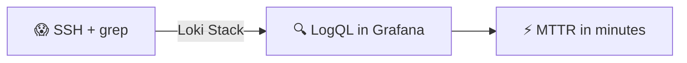
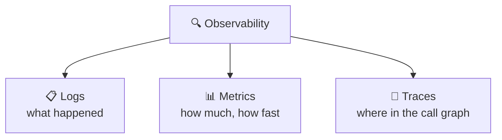
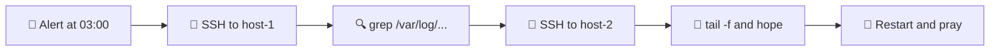
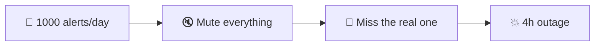
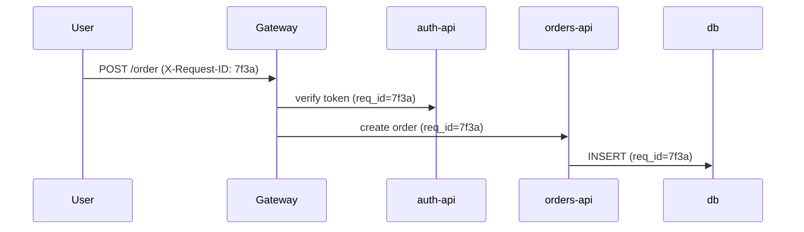
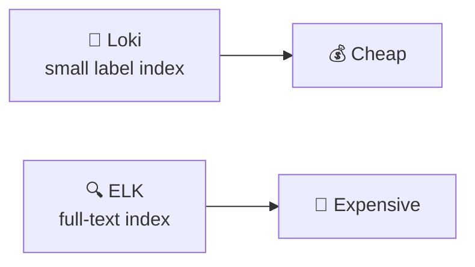
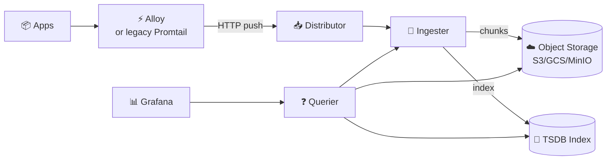
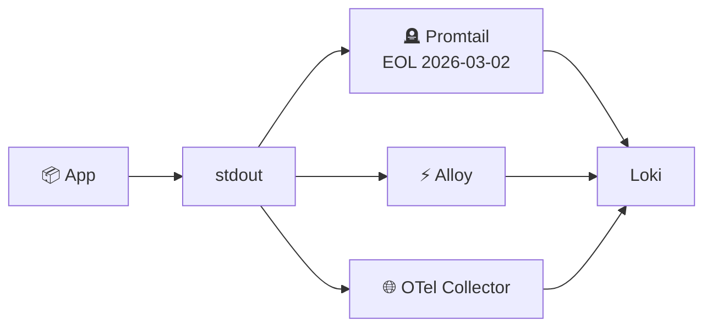
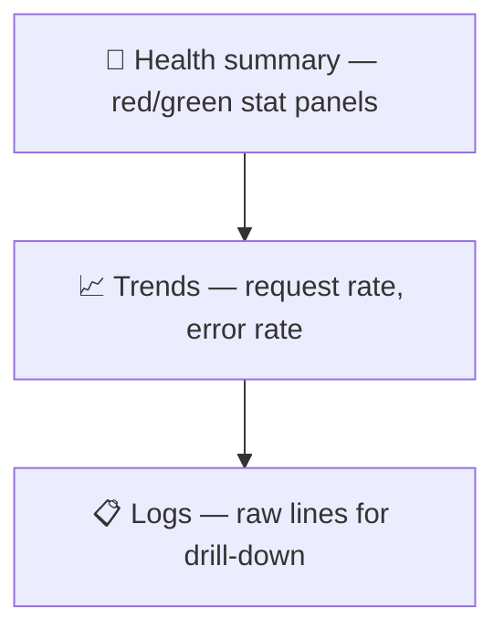
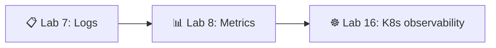

# 📌 Lecture 7 — Observability & Logging: From Blind Operations to Insight

Лекция 7 — Наблюдаемость и логирование: от слепой эксплуатации к пониманию

## 📍 Slide 1 – 🔍 Welcome to Observability

Слайд 1 — Добро пожаловать в наблюдаемость

* 🌍 **Your app runs in production** — but do you actually know what it's doing?
  * 🌍 **Твоё приложение работает в проде** — но знаешь ли ты, что оно на самом деле делает?
* 😰 Lecture 1 named the failure mode: **Scenario 4 — Blind Operations** (users on Twitter, no metrics, no logs, restart in desperation)
  * 😰 В лекции 1 мы назвали этот тип отказа: **сценарий 4 — слепая эксплуатация** (пользователи пишут в Twitter, нет ни метрик, ни логов, перезапуск в отчаянии)
* 🔧 This is the lecture that **fixes it**: centralised logs you can query in seconds
  * 🔧 Эта лекция **это исправляет**: централизованные логи, которые можно запросить за секунды
* 🎯 Today: deploy the Loki stack and learn to ask questions of your production logs
  * 🎯 Сегодня: развернём стек Loki и научимся задавать вопросы своим продовым логам



Схема: 😱 SSH + grep → (стек Loki) → 🔍 LogQL в Grafana → ⚡ MTTR в минутах.

> 🔗 **Lab 7 tie-in:** you'll deploy Loki 3.7 + **Grafana Alloy** + Grafana 13 via docker-compose, ship JSON logs from your Lab 1 Python app, and build a 4-panel dashboard. (Promtail is preserved in slides 14–15 below as historical context — it reached **End-of-Life on March 2, 2026**.)
>
> 🔗 **Связь с лабой 7:** ты развернёшь Loki 3.7 + **Grafana Alloy** + Grafana 13 через docker-compose, будешь отправлять JSON-логи из Python-приложения из лабы 1 и соберёшь дашборд из четырёх панелей. (Promtail сохранён в слайдах 14–15 ниже как исторический контекст — он достиг **End-of-Life 2 марта 2026 года**.)

---

## 📍 Slide 2 – 🎯 Learning Outcomes

Слайд 2 — Результаты обучения

| # | Outcome |
|---|---------|
| 1 | 🧠 Distinguish the three pillars: **logs, metrics, traces** — and what each is for |
| 2 | 🔍 Explain how Loki indexes by **labels**, not full text, and why that controls cost |
| 3 | 📝 Emit **structured JSON logs** with correlation IDs from a Python service |
| 4 | 🛠️ Write **LogQL** stream selectors, line filters, and log-range queries |
| 5 | 📊 Build a Grafana log dashboard answering one operational question per panel |

| # | Результат |
|---|-----------|
| 1 | 🧠 Различать три столпа: **логи, метрики, трейсы** — и понимать, зачем нужен каждый |
| 2 | 🔍 Объяснять, как Loki индексирует по **лейблам**, а не по полному тексту, и почему это ограничивает затраты |
| 3 | 📝 Выводить **структурированные JSON-логи** с correlation ID из Python-сервиса |
| 4 | 🛠️ Писать селекторы потоков, фильтры по строкам и запросы по диапазону логов на **LogQL** |
| 5 | 📊 Собрать дашборд логов в Grafana, где каждая панель отвечает на один операционный вопрос |

**Tech stack pinned for May 2026:**

**Технологический стек, зафиксированный на май 2026:**

* 💾 **Loki 3.7** (3.0 launched May 2024; 3.x stabilised TSDB schema v13)
  * 💾 **Loki 3.7** (3.0 вышла в мае 2024; ветка 3.x стабилизировала схему TSDB v13)
* 📊 **Grafana 13** (13.0.1+security-01, released May 12 2026)
  * 📊 **Grafana 13** (13.0.1+security-01, выпущена 12 мая 2026)
* ⚡ **Grafana Alloy 1.16.1** (May 6 2026) — the canonical agent; **use this for new deployments**
  * ⚡ **Grafana Alloy 1.16.1** (6 мая 2026) — канонический агент; **используй его для новых развёртываний**
* 🪦 **Promtail** reached **End-of-Life on March 2, 2026**. Still works on existing setups, no further fixes. Slides 14–15 cover it for context only.
  * 🪦 **Promtail** достиг **End-of-Life 2 марта 2026 года**. На существующих установках он ещё работает, но исправлений больше не будет. Слайды 14–15 рассказывают о нём только для контекста.

---

## 📍 Slide 3 – 🧱 The Three Pillars of Observability

Слайд 3 — Три столпа наблюдаемости



Схема: наблюдаемость складывается из трёх столпов — 📋 логов (что произошло), 📊 метрик (сколько и как быстро) и 🔗 трейсов (где в графе вызовов).

| 📊 Pillar | 🎯 Question | 🛠️ This course |
|-----------|------------|----------------|
| 📋 **Logs** | *What event occurred?* | **Lecture 7 + Lab 7** (Loki) |
| 📊 **Metrics** | *How much / how fast / how often?* | Lecture 8 + Lab 8 (Prometheus) |
| 🔗 **Traces** | *Where in the request did time go?* | Out of scope for Core — covered in SRE-Intro elective |
| ☸️ **K8s view** | *All three on the cluster* | Lectures 15–16, Lab 16 |

| 📊 Столп | 🎯 Вопрос | 🛠️ В этом курсе |
|----------|-----------|----------------|
| 📋 **Логи** | *Какое событие произошло?* | **Лекция 7 + лаба 7** (Loki) |
| 📊 **Метрики** | *Сколько / как быстро / как часто?* | Лекция 8 + лаба 8 (Prometheus) |
| 🔗 **Трейсы** | *Где в обработке запроса ушло время?* | Вне рамок Core — разбираются в элективе SRE-Intro |
| ☸️ **Взгляд из K8s** | *Все три столпа на кластере* | Лекции 15–16, лаба 16 |

> 📖 **Charity Majors** (Honeycomb co-founder, *Observability Engineering*, 2022): *"Observability is the ability to ask new questions of your system without shipping new code."*
>
> 📖 **Чэрити Мейджорс** (соучредитель Honeycomb, *Observability Engineering*, 2022): *«Наблюдаемость — это способность задавать системе новые вопросы, не выпуская новый код»*.

---

## 📍 Slide 4 – 🙈 The Visibility Problem

Слайд 4 — Проблема невидимости

Without centralised logs, debugging looks like this:

Без централизованных логов отладка выглядит так:



Схема: алерт в 03:00 → SSH на host-1 → grep по /var/log/... → SSH на host-2 → tail -f в надежде → перезапуск и молитва.

* 📁 Each host has its own log files, in its own format, with its own rotation
  * 📁 У каждого хоста свои файлы логов, свой формат и своя ротация
* 🔍 Correlating one request across three services means three SSH sessions
  * 🔍 Чтобы проследить один запрос по трём сервисам, нужно три SSH-сессии
* 📅 Logs older than the rotation window are simply **gone** when you need them
  * 📅 Логи старше окна ротации просто **исчезают** именно тогда, когда нужны
* 💀 By the time you find the relevant line, the incident has run an extra hour
  * 💀 К тому моменту, как ты найдёшь нужную строку, инцидент длится уже лишний час

> 🔥 **Reality check (DORA 2024):** elite teams recover from incidents in under 1 hour. You can't do that with SSH + grep.
>
> 🔥 **Проверка реальностью (DORA 2024):** элитные команды восстанавливаются после инцидента меньше чем за час. С SSH + grep так не получится.

---

## 📍 Slide 5 – 🚨 Alert Fatigue & "Works for Me"

Слайд 5 — Усталость от алертов и «у меня всё работает»

Two pathologies that signal you need observability, not more dashboards:

Две болезни, которые сигналят, что тебе нужна наблюдаемость, а не новые дашборды:

**1. Alert fatigue** — 200 warnings/day, every one a false positive. Real outages get muted.

**1. Усталость от алертов** — 200 предупреждений в день, каждое — ложное срабатывание. Реальные аварии при этом замьючены.

**2. "It's working for me"** — users say the app is slow, the team can't reproduce, there's no data to settle the argument. Hours of cargo-cult debugging follow.

**2. «У меня всё работает»** — пользователи говорят, что приложение тормозит, команда не может воспроизвести проблему, и данных, чтобы разрешить спор, нет. Дальше — часы отладки по принципу карго-культа.



Схема: 📣 1000 алертов в день → 🔇 замьютить всё → 🙈 пропустить настоящую аварию → 💥 4 часа простоя.

> 📖 **Cindy Sridharan**, *Distributed Systems Observability* (O'Reilly, 2018): the cure is **high-cardinality, structured data** you can slice on demand — not more pre-baked alerts.
>
> 📖 **Синди Шридхаран**, *Distributed Systems Observability* (O'Reilly, 2018): лекарство — **структурированные данные с высокой кардинальностью**, которые можно нарезать по запросу, а не новые готовые алерты.

---

## 📍 Slide 6 – 💸 The Cost of Flying Blind

Слайд 6 — Цена слепой работы

| 🔥 Symptom | 💥 Cost |
|-----------|---------|
| 🐢 Slow debugging | 4+ hour MTTR, escalations, missed SLOs |
| 📋 No correlation across services | Microservice outages take days to triangulate |
| 👉 No data → blame culture | Senior engineers leave |
| 🙈 Silent failures | Issues only surface when customers tweet |

| 🔥 Симптом | 💥 Цена |
|-----------|---------|
| 🐢 Медленная отладка | MTTR 4+ часа, эскалации, сорванные SLO |
| 📋 Нет корреляции между сервисами | Инциденты в микросервисах ищутся днями |
| 👉 Нет данных → культура обвинений | Опытные инженеры уходят |
| 🙈 Молчаливые сбои | Проблемы всплывают, только когда клиенты пишут в соцсети |

**📈 Concrete benchmark (DORA 2024 + Google SRE Book):**

**📈 Конкретный ориентир (DORA 2024 + Google SRE Book):**

* MTTR without observability: **4+ hours** typical
  * MTTR без наблюдаемости: обычно **4+ часа**
* MTTR with a Loki-class stack: **under 30 minutes**
  * MTTR со стеком уровня Loki: **меньше 30 минут**
* Self-hosted Loki on object storage: **single-digit dollars/month** for tens of GB/day
  * self-hosted Loki на объектном хранилище: **менее $10 в месяц** за десятки ГБ в сутки

> 🔥 **Hot take:** observability is the cheapest insurance policy in your stack. The break-even versus one prevented outage is measured in **seconds**.
>
> 🔥 **Резко, но честно:** наблюдаемость — самая дешёвая страховка в твоём стеке. Точка окупаемости по сравнению с одним предотвращённым инцидентом измеряется **секундами**.

---

## 📍 Slide 7 – 💡 Observability ≠ Monitoring

Слайд 7 — Наблюдаемость ≠ мониторинг

A distinction popularised by Charity Majors and the Honeycomb team:

Различие, которое популяризировали Чэрити Мейджорс и команда Honeycomb:

| ❓ Question | 📊 Monitoring | 🔍 Observability |
|------------|---------------|------------------|
| What it answers | *"Is the system up?"* | *"Why is the system doing this?"* |
| Failure modes covered | **Known knowns** (pre-defined alerts) | **Unknown unknowns** (novel issues) |
| Data shape | Low-cardinality time series | High-cardinality structured events |
| You design alerts for… | Specific failure modes | Service-level objectives |

| ❓ Вопрос | 📊 Мониторинг | 🔍 Наблюдаемость |
|------------|---------------|------------------|
| На что отвечает | *«Система жива?»* | *«Почему система ведёт себя так?»* |
| Какие сбои покрывает | **Известные известные** (заранее заданные алерты) | **Неизвестные неизвестные** (новые проблемы) |
| Форма данных | Временные ряды с низкой кардинальностью | Структурированные события с высокой кардинальностью |
| Под что проектируются алерты | Конкретные типы сбоев | Service-level objectives |

> 💬 **Charity Majors:** *"Monitoring is for known unknowns. Observability is for unknown unknowns."*
>
> 💬 **Чэрити Мейджорс:** *«Мониторинг — для известных неизвестных. Наблюдаемость — для неизвестных неизвестных»*.

**🎯 Practical implication:** a healthy stack does both. Prometheus alerts (Lecture 8) handle the known. Loki + structured logs let you investigate the unknown.

**🎯 Практический вывод:** здоровый стек делает и то и другое. Алерты Prometheus (лекция 8) закрывают известное. Loki + структурированные логи позволяют разобраться с неизвестным.

---

## 📍 Slide 8 – 📝 Why Structured Logging (JSON)

Слайд 8 — Зачем структурированное логирование (JSON)

**❌ Unstructured — write-only:**

**❌ Неструктурированные — только на запись:**

```
2026-04-15 10:23:45 ERROR Connection to database failed on server-1 for user alice (req=7f3a)
```

To filter on `user=alice` you write a regex. To aggregate by host you write a worse regex.

Чтобы отфильтровать по `user=alice`, ты пишешь регулярку. Чтобы агрегировать по хосту — пишешь регулярку похуже.

**✅ Structured (JSON) — queryable:**

**✅ Структурированные (JSON) — можно запрашивать:**

```json
{"ts":"2026-04-15T10:23:45Z","level":"ERROR","service":"user-api",
 "msg":"db connection failed","user":"alice","host":"server-1","req_id":"7f3a"}
```

Now `level="ERROR" and user="alice"` is one LogQL clause. Aggregating errors per host is a one-liner.

Теперь `level="ERROR" and user="alice"` — это одно условие LogQL. А агрегация ошибок по хостам — одна строка.

> 🔥 **Rule:** if a human reads your logs more often than a machine, you've already lost. Logs are an API for your future on-call self.
>
> 🔥 **Правило:** если человек читает твои логи чаще машины — ты уже проиграл. Логи — это API для твоего будущего себя на дежурстве.

---

## 📍 Slide 9 – 🔗 Correlation IDs — One Request, Many Services

Слайд 9 — Correlation ID — один запрос, много сервисов

A single user click can touch 5+ services. Without a correlation ID, you can't follow it across log streams.

Один клик пользователя может затронуть 5+ сервисов. Без correlation ID проследить его по разным потокам логов невозможно.



Схема: пользователь отправляет POST /order с `X-Request-ID: 7f3a`; gateway проверяет токен и создаёт заказ, передавая тот же `req_id=7f3a` в auth-api, orders-api и базу данных — так один идентификатор связывает все записи логов.

**The pattern:**

**Паттерн:**

1. 🆔 Gateway generates a UUID per inbound request → `X-Request-ID` header
   * 🆔 Gateway генерирует UUID на каждый входящий запрос → заголовок `X-Request-ID`
2. 📨 Every downstream call forwards the header
   * 📨 Каждый последующий вызов передаёт этот заголовок дальше
3. 📝 Every log line includes the ID as a JSON field
   * 📝 Каждая строка лога включает ID как JSON-поле
4. 🔍 In Grafana: `{service=~".+"} | json | req_id="7f3a"` → the entire request, in order
   * 🔍 В Grafana: `{service=~".+"} | json | req_id="7f3a"` → весь запрос целиком, по порядку

> 📖 The OpenTelemetry spec calls this `traceparent` — the same idea, standardised.
>
> 📖 В спецификации OpenTelemetry это называется `traceparent` — та же идея, но стандартизированная.

---

## 📍 Slide 10 – ⚡ Loki vs ELK: Why Loki Won for Logs

Слайд 10 — Loki против ELK: почему Loki победил в логах

The traditional log stack — Elasticsearch + Logstash + Kibana — indexes **every word** of every log. That's expensive.

Классический стек логов — Elasticsearch + Logstash + Kibana — индексирует **каждое слово** каждой записи. Это дорого.

| 📊 Aspect | 💾 Loki | 🔍 ELK |
|-----------|---------|--------|
| Index | **Labels only** (service, env, level…) | **Full text** of every line |
| Storage | Cheap object store (S3/GCS/MinIO) | Local SSD for hot index |
| Cost at 100GB/day | ~$10–30/mo | ~$500–2000/mo |
| Query language | LogQL (Prometheus-style) | Lucene |
| Best for | Cloud-native, label-driven | Free-text forensics |

| 📊 Аспект | 💾 Loki | 🔍 ELK |
|-----------|---------|--------|
| Индекс | **Только лейблы** (service, env, level…) | **Полный текст** каждой строки |
| Хранение | Дешёвое объектное хранилище (S3/GCS/MinIO) | Локальный SSD под горячий индекс |
| Стоимость при 100 ГБ/сутки | ~$10–30/мес | ~$500–2000/мес |
| Язык запросов | LogQL (в стиле Prometheus) | Lucene |
| Лучше всего подходит для | Cloud-native, работа по лейблам | Поиска по свободному тексту (форензика) |



Схема: 💾 Loki хранит маленький индекс лейблов и обходится дёшево; 🔍 ELK строит полнотекстовый индекс и обходится дорого.

> 💬 **Grafana Labs' pitch (2019):** *"Like Prometheus, but for logs."* — same labels, same federation model, same querier ergonomics.
>
> 💬 **Как позиционировали Grafana Labs (2019):** *«Как Prometheus, только для логов»* — те же лейблы, та же модель федерации, та же эргономика запросов.

---

## 📍 Slide 11 – 🏗️ Loki Architecture

Слайд 11 — Архитектура Loki



Схема: 📦 приложения отправляют логи агенту (⚡ Alloy или легаси Promtail); 📥 distributor валидирует данные и распределяет их по 💾 ingesters, которые пишут сжатые чанки в ☁️ объектное хранилище, а индекс — в 📇 TSDB; ❓ querier читает индекс и чанки, а 📊 Grafana обращается к нему с запросами LogQL.

* 📥 **Distributor** — receives pushes, validates, fans out to ingesters
  * 📥 **Distributor** — принимает пуш-запросы, валидирует и распределяет их по ingesters
* 💾 **Ingester** — buffers in memory, flushes compressed chunks to object storage
  * 💾 **Ingester** — буферизует в памяти и сбрасывает сжатые чанки в объектное хранилище
* ❓ **Querier** — answers LogQL by reading the TSDB index, then fetching matching chunks
  * ❓ **Querier** — выполняет LogQL: читает индекс TSDB, затем достаёт подходящие чанки
* 📇 **TSDB index** (default since Loki 3.0, schema v13) — small, fast, replaces the old boltdb-shipper
  * 📇 **Индекс TSDB** (по умолчанию с Loki 3.0, схема v13) — компактный, быстрый, заменяет прежний boltdb-shipper

> 🔧 **Two deployment modes:** *single-binary* (one container, fine up to ~100GB/day — what Lab 7 uses) and *microservices* (each component scales independently — production at scale).
>
> 🔧 **Два режима развёртывания:** *single-binary* (один контейнер, подходит примерно до 100 ГБ/сутки — его использует лаба 7) и *microservices* (каждый компонент масштабируется независимо — продакшен на масштабе).

---

## 📍 Slide 12 – 🏷️ Labels: The One Thing You Must Get Right

Слайд 12 — Лейблы: то, что обязательно нужно сделать правильно

Loki indexes by **labels**. Each unique label combination = one **stream**. Every stream costs index space and memory.

Loki индексирует по **лейблам**. Каждая уникальная комбинация лейблов = один **поток (stream)**. Каждый поток стоит места в индексе и памяти.

**✅ Good labels — low cardinality:**

**✅ Хорошие лейблы — низкая кардинальность:**

* `service="user-api"` (10s of services)
  * `service="user-api"` (десятки сервисов)
* `env="prod"` (3 values)
  * `env="prod"` (3 значения)
* `level="ERROR"` (5 values)
  * `level="ERROR"` (5 значений)

**❌ Bad labels — high cardinality:**

**❌ Плохие лейблы — высокая кардинальность:**

* `user_id="12345"` (millions of users → **millions of streams** → ingester OOM)
  * `user_id="12345"` (миллионы пользователей → **миллионы потоков** → ingester падает по OOM)
* `request_id="7f3a..."` (one per request → instant collapse)
  * `request_id="7f3a..."` (один на запрос → мгновенное схлопывание)
* `trace_id`, `email`, `path` with IDs in it…
  * `trace_id`, `email`, `path` с ID внутри…

> 🔥 **The rule:** if a value is unique per request or per user, **it goes in the log line, not the label.** Use `| json | user_id="12345"` at query time.
>
> 🔥 **Правило:** если значение уникально для запроса или пользователя, **оно идёт в строку лога, а не в лейбл.** Используй `| json | user_id="12345"` уже во время запроса.

```logql
# ✅ Good — small label set, filter on parsed JSON field
{service="user-api", env="prod"} | json | user_id="12345"
```

---

## 📍 Slide 13 – ⚙️ Loki Single-Binary Config (Lab 7 baseline)

Слайд 13 — Конфигурация Loki в режиме single-binary (базовая для лабы 7)

```yaml
# loki/config.yml — Loki 3.7, schema v13, single-binary
auth_enabled: false

server:
  http_listen_port: 3100

common:
  path_prefix: /loki
  storage:
    filesystem:
      chunks_directory: /loki/chunks
      rules_directory: /loki/rules
  replication_factor: 1
  ring:
    kvstore: { store: inmemory }

schema_config:
  configs:
    - from: 2024-01-01
      store: tsdb              # 🚀 Replaces boltdb-shipper
      object_store: filesystem # 🪣 Swap to s3/gcs in production
      schema: v13              # 📐 Latest stable
      index: { prefix: index_, period: 24h }

limits_config:
  retention_period: 168h       # 🗓️ 7 days

compactor:
  working_directory: /loki/compactor
  retention_enabled: true      # ⚠️ Required when retention is set
```

Пояснение к коду: `store: tsdb` заменяет устаревший boltdb-shipper; `object_store: filesystem` в проде меняют на s3/gcs; `schema: v13` — актуальная стабильная схема; `retention_period: 168h` — хранение логов 7 дней.

> ⚠️ **Common gotcha:** enabling `retention_period` without the `compactor` block = logs never actually delete. Loki silently ignores the limit.
>
> ⚠️ **Частая ошибка:** если включить `retention_period` без блока `compactor`, логи фактически никогда не удаляются. Loki молча игнорирует лимит.

---

## 📍 Slide 14 – 🔧 Alloy, Promtail, and the OTel Collector

Слайд 14 — Alloy, Promtail и OTel Collector

**Three ways to ship logs into Loki in 2026:**

**Три способа отправлять логи в Loki в 2026 году:**

| Agent | Status (May 2026) | When to pick |
|-------|-------------------|--------------|
| ⚡ **Grafana Alloy 1.16.1** | **Canonical agent** — Promtail + Prometheus agent + OTel in one binary | **All new deployments** (including Lab 7); all three pillars from one agent |
| 🪦 **Promtail 3.x** | **End-of-Life March 2, 2026** — no further releases, no security fixes | Existing setups you haven't migrated yet; understanding legacy configs |
| 🌐 **OpenTelemetry Collector** | Vendor-neutral CNCF standard | Multi-backend (Loki + Datadog + …), traces too |

| Агент | Статус (май 2026) | Когда выбирать |
|-------|-------------------|--------------|
| ⚡ **Grafana Alloy 1.16.1** | **Канонический агент** — Promtail + агент Prometheus + OTel в одном бинарнике | **Все новые развёртывания** (включая лабу 7); все три столпа из одного агента |
| 🪦 **Promtail 3.x** | **End-of-Life 2 марта 2026** — новых релизов и исправлений безопасности нет | Существующие установки, которые ещё не мигрированы; понимание легаси-конфигов |
| 🌐 **OpenTelemetry Collector** | Вендор-нейтральный стандарт CNCF | Несколько бэкендов (Loki + Datadog + …), а также трейсы |



Схема: приложение пишет логи в stdout, откуда их забирает один из агентов — ⚡ Alloy, 🪦 Promtail (EOL 2026-03-02) или 🌐 OTel Collector — и отправляет в Loki.

> 🔗 **Lab 7 walks through Alloy** because Promtail is no longer maintained. The Promtail config on the next slide is preserved so you can read and migrate brownfield deployments — but **do not stand up a new Promtail in 2026**.
>
> 🔗 **В лабе 7 разбирается Alloy**, потому что Promtail больше не поддерживается. Конфиг Promtail со следующего слайда сохранён, чтобы ты мог читать и мигрировать brownfield-развёртывания, — но **не поднимай новый Promtail в 2026 году**.

---

## 📍 Slide 15 – 🪦 Promtail Config (legacy / historical context)

Слайд 15 — Конфигурация Promtail (легаси / исторический контекст)

> ⚠️ **Promtail is EOL since March 2, 2026.** This slide is preserved so you can read existing configs in production and migrate them to Alloy. Do **not** stand up a new Promtail.
>
> ⚠️ **Promtail не поддерживается с 2 марта 2026 года.** Этот слайд сохранён, чтобы ты мог читать существующие конфиги в проде и мигрировать их на Alloy. **Не** поднимай новый Promtail.

```yaml
# promtail/config.yml — LEGACY, see Alloy slide for the modern equivalent
server:
  http_listen_port: 9080

positions:
  filename: /tmp/positions.yaml  # 📍 Resume reading after restart

clients:
  - url: http://loki:3100/loki/api/v1/push

scrape_configs:
  - job_name: docker
    docker_sd_configs:
      - host: unix:///var/run/docker.sock
        refresh_interval: 5s
        filters:
          - name: label
            values: ["logging=promtail"]   # 🏷️ Opt-in via container label
    relabel_configs:
      - source_labels: ['__meta_docker_container_label_app']
        target_label: 'app'
      - source_labels: ['__meta_docker_container_name']
        regex: '/(.*)'
        target_label: 'container'
```

* 📍 **`positions`** — survives restarts so you don't double-ship
  * 📍 **`positions`** — переживает перезапуски, чтобы не отправлять одни и те же логи дважды
* 🐳 **Docker SD** — auto-discovers any container with `logging=promtail` label
  * 🐳 **Docker SD** — автоматически находит контейнеры с лейблом `logging=promtail`
* 🏷️ **Relabel** — promotes Docker labels to Loki labels (cardinality-controlled)
  * 🏷️ **Relabel** — превращает Docker-лейблы в лейблы Loki (с контролем кардинальности)

**Migration to Alloy** (`config.alloy`, River syntax — Lab 7 ships this):

**Миграция на Alloy** (`config.alloy`, синтаксис River — именно это использует лаба 7):

```hcl
discovery.docker "containers" {
  host             = "unix:///var/run/docker.sock"
  refresh_interval = "5s"
  filter { name = "label" values = ["logging=alloy"] }
}

loki.source.docker "containers" {
  host    = "unix:///var/run/docker.sock"
  targets = discovery.docker.containers.targets
  forward_to = [loki.write.default.receiver]
}

loki.write "default" {
  endpoint { url = "http://loki:3100/loki/api/v1/push" }
}
```

> 🔁 Same three steps (discover → scrape → push), but Alloy speaks Prometheus + OTel from the same binary.
>
> 🔁 Те же три шага (обнаружить → собрать → отправить), но Alloy умеет и Prometheus, и OTel из одного бинарника.

---

## 📍 Slide 16 – 🔍 LogQL Part 1: Stream Selectors & Line Filters

Слайд 16 — LogQL, часть 1: селекторы потоков и фильтры по строкам

LogQL has two halves: **log queries** (return log lines) and **metric queries** (return numbers from logs).

В LogQL две половины: **запросы логов** (возвращают строки логов) и **метрические запросы** (возвращают числа, вычисленные из логов).

**Anatomy:**

**Анатомия:**

```logql
{service="user-api", env="prod"}    |= "error"   != "healthcheck"   |~ "5\\d\\d"
└── stream selector ──────────────┘ └─ contains ┘ └─ excludes ────┘ └─ regex ─┘
```

Пояснение: селектор потока выбирает нужные логи, затем фильтры слева направо оставляют строки, содержащие `error`, исключают `healthcheck` и проверяют совпадение с регуляркой `5\d\d`.

| 🔧 Operator | 🎯 Meaning |
|-------------|-----------|
| `{label="v"}` | Exact label match |
| `{label=~"re"}` | Regex label match |
| `\|= "x"` | Line contains `x` |
| `!= "x"` | Line does **not** contain `x` |
| `\|~ "re"` | Line matches regex |
| `!~ "re"` | Line does not match regex |

| 🔧 Оператор | 🎯 Значение |
|-------------|-----------|
| `{label="v"}` | Точное совпадение лейбла |
| `{label=~"re"}` | Совпадение лейбла по регулярному выражению |
| `\|= "x"` | Строка содержит `x` |
| `!= "x"` | Строка **не** содержит `x` |
| `\|~ "re"` | Строка совпадает с регулярным выражением |
| `!~ "re"` | Строка не совпадает с регулярным выражением |

> 💡 **Filters cascade left-to-right.** Put the cheapest, most-selective filter first — it cuts the data the others have to process.
>
> 💡 **Фильтры применяются каскадом слева направо.** Ставь самым первым самый дешёвый и избирательный фильтр — он сокращает данные, которые придётся обрабатывать остальным.

---

## 📍 Slide 17 – 🔍 LogQL Part 2: Parsers & Field Filters

Слайд 17 — LogQL, часть 2: парсеры и фильтры по полям

Once logs are JSON, you can pull fields out and filter on them:

Когда логи в формате JSON, из них можно вытаскивать поля и фильтровать по ним:

```logql
# Parse JSON, keep only ERRORs from one user
{service="user-api"} | json | level="ERROR" | user_id="alice"

# logfmt instead (key=value lines)
{service="proxy"} | logfmt | status >= 500

# Format the output line
{service="user-api"} | json | line_format "{{.level}} {{.user_id}} {{.msg}}"
```

| 🔧 Stage | 🎯 Purpose |
|----------|-----------|
| `\| json` | Parse JSON → fields become filterable |
| `\| logfmt` | Parse `key=value` format |
| `\| regexp "..."` | Extract via named capture groups |
| `\| line_format "..."` | Rewrite the displayed line |
| `\| label_format` | Rewrite/add labels post-query |

| 🔧 Этап | 🎯 Назначение |
|----------|-----------|
| `\| json` | Разобрать JSON → поля становятся доступны для фильтрации |
| `\| logfmt` | Разобрать формат `key=value` |
| `\| regexp "..."` | Извлечь через именованные группы захвата |
| `\| line_format "..."` | Переписать отображаемую строку |
| `\| label_format` | Переписать или добавить лейблы после запроса |

> 🔥 **High-cardinality without the pain:** because `user_id` lives in the JSON body (not in labels), Loki doesn't index it — but you can still filter on it at query time.
>
> 🔥 **Высокая кардинальность без боли:** поскольку `user_id` хранится в теле JSON, а не в лейблах, Loki его не индексирует — но при запросе по нему всё равно можно фильтровать.

---

## 📍 Slide 18 – 📊 LogQL Part 3: Metrics from Logs

Слайд 18 — LogQL, часть 3: метрики из логов

Log-range aggregations turn streams into time series — perfect for Grafana graphs and alert rules.

Агрегации по диапазону логов превращают потоки во временные ряды — идеально для графиков Grafana и правил алертинга.

```logql
# 📈 Request rate per service (logs/sec)
sum by (service) (rate({env="prod"} [1m]))

# 📈 Error rate per service
sum by (service) (rate({env="prod"} |= "ERROR" [1m]))

# 🥧 Distribution of log levels
sum by (level) (count_over_time({env="prod"} | json [5m]))

# 🐢 P95 latency from JSON field
quantile_over_time(0.95,
  {service="user-api"} | json | unwrap duration_ms [5m])
```

Пояснение: `rate` и `count_over_time` считают события в окне времени, а `quantile_over_time` по `unwrap duration_ms` даёт перцентили задержки.

| 🔧 Function | 🎯 Use case |
|-------------|-------------|
| `rate([range])` | Lines per second |
| `count_over_time([range])` | Total in window |
| `bytes_rate([range])` | Bytes/sec (cost monitoring) |
| `quantile_over_time(q, ...)` | P50/P95/P99 from numeric fields |

| 🔧 Функция | 🎯 Применение |
|-------------|-------------|
| `rate([range])` | Строк в секунду |
| `count_over_time([range])` | Всего за окно |
| `bytes_rate([range])` | Байт в секунду (контроль затрат) |
| `quantile_over_time(q, ...)` | P50/P95/P99 по числовым полям |

---

## 📍 Slide 19 – 🐍 Structured Logging in Python

Слайд 19 — Структурированное логирование в Python

**Lab 1's Python app** gets one upgrade — JSON output. Two idiomatic paths:

**Python-приложение из лабы 1** получает одно улучшение — вывод в JSON. Два идиоматичных пути:

```python
# Option A — python-json-logger (drop-in, no app changes)
import logging
from pythonjsonlogger.json import JsonFormatter

handler = logging.StreamHandler()
handler.setFormatter(JsonFormatter(
    "%(asctime)s %(levelname)s %(name)s %(message)s",
    rename_fields={"asctime": "ts", "levelname": "level"},
))
logging.basicConfig(level=logging.INFO, handlers=[handler])
logging.info("user login", extra={"user_id": 12345, "req_id": "7f3a"})
```

```python
# Option B — structlog (richer, context vars, recommended for new code)
import structlog
log = structlog.get_logger()
log.info("user login", user_id=12345, req_id="7f3a", path="/login")
# → {"event": "user login", "level": "info", "user_id": 12345, ...}
```

> 🔗 **Lab 7 deliverable:** add JSON logging to your Lab 1 service, log startup, every HTTP request (method, path, status, client IP), and every error. Tests pass when `curl localhost:8000/health` produces a JSON line in `docker logs`.
>
> 🔗 **Результат лабы 7:** добавь JSON-логирование в сервис из лабы 1, логируй старт, каждый HTTP-запрос (метод, путь, статус, IP клиента) и каждую ошибку. Тест считается пройденным, когда `curl localhost:8000/health` даёт JSON-строку в `docker logs`.

---

## 📍 Slide 20 – 📊 Grafana Dashboard Design Principles

Слайд 20 — Принципы проектирования дашбордов Grafana

A dashboard answers **one question** for **one audience**. If you can't summarise it in a sentence, split it.

Дашборд отвечает на **один вопрос** для **одной аудитории**. Если не можешь описать его одним предложением — раздели его.



Схема: сверху — 🚨 сводка состояния в виде красно-зелёных stat-панелей, в середине — 📈 тренды (частота запросов и ошибок), внизу — 📋 сырые строки логов для детального разбора.

* 🎯 **One question per dashboard** — *"Is user-api healthy?"*, not *"Show me everything."*
  * 🎯 **Один вопрос на дашборд** — *«user-api здоров?»*, а не *«Покажи всё»*
* 🚦 **Stat panels at the top** — red/green, glanceable in 2 seconds
  * 🚦 **Stat-панели сверху** — красно-зелёные, понятные за 2 секунды
* 📈 **Time series in the middle** — context for the stats
  * 📈 **Временные ряды в середине** — контекст для цифр
* 📋 **Log panel at the bottom** — raw lines, scoped to the same time range
  * 📋 **Панель логов внизу** — сырые строки в том же временном диапазоне
* 🔁 **Variables** for `$service` and `$env` — one dashboard, many environments
  * 🔁 **Переменные** для `$service` и `$env` — один дашборд для множества окружений

> 📖 *"The Hierarchy of Visual Communication"* — Tufte's law applied: most-important data takes the most pixels and the brightest colour.
>
> 📖 *«Иерархия визуальной коммуникации»* — закон Тафти на практике: самые важные данные занимают больше всего пикселей и имеют самый яркий цвет.

---

## 📍 Slide 21 – 📊 Lab 7's Four Panels (LogQL)

Слайд 21 — Четыре панели лабы 7 (LogQL)

The Lab 7 dashboard ships four panels covering the most common questions:

Дашборд лабы 7 включает четыре панели, закрывающие самые частые вопросы:

```logql
# 1️⃣ Logs panel — recent activity, all your apps
{app=~"devops-.*"}

# 2️⃣ Request rate (time series) — traffic per app
sum by (app) (rate({app=~"devops-.*"} [1m]))

# 3️⃣ Errors only (logs panel) — drill into failures
{app=~"devops-.*"} | json | level="ERROR"

# 4️⃣ Level distribution (pie) — health at a glance
sum by (level) (count_over_time({app=~"devops-.*"} | json [5m]))
```

| Panel | Visualisation | Answers |
|-------|---------------|---------|
| 1 | Logs | *"What's happening right now?"* |
| 2 | Time series | *"How busy are we?"* |
| 3 | Logs | *"What broke?"* |
| 4 | Pie / Stat | *"How noisy is the app?"* |

| Панель | Визуализация | Отвечает на |
|-------|---------------|---------|
| 1 | Логи | *«Что происходит прямо сейчас?»* |
| 2 | Временной ряд | *«Насколько мы загружены?»* |
| 3 | Логи | *«Что сломалось?»* |
| 4 | Круговая / Stat | *«Насколько шумное приложение?»* |

> 🔗 **Evidence required:** screenshot of all four panels with real data generated by `curl` loops against your app.
>
> 🔗 **Что нужно сдать:** скриншот всех четырёх панелей с реальными данными, сгенерированными циклами `curl` по твоему приложению.

---

## 📍 Slide 22 – 🏭 Production Considerations

Слайд 22 — Продакшен-соображения

Single-binary Loki on a laptop is Lab 7. Production needs four more decisions:

Single-binary Loki на ноутбуке — это лаба 7. Для продакшена нужно принять ещё четыре решения:

| 🔧 Decision | 🪜 Lab default | 🏭 Production |
|-------------|----------------|---------------|
| 💾 Storage | `filesystem` | **S3 / GCS / MinIO** — cheap, durable, scales independently |
| 👥 Tenancy | `auth_enabled: false` | **Multi-tenant** with `X-Scope-OrgID` header; each team isolated |
| 🗓️ Retention | 168h (7 days) | **Tiered** — 30d for INFO, 1y for security/audit logs |
| 📦 Topology | Single binary | **Microservices mode** — distributor, ingester, querier scale separately |
| 🔐 Auth | None | **OIDC / mTLS** at the Grafana edge + Loki tenancy header |
| 💰 Cost guard | None | **Rate limits + ingestion quotas** per tenant |

| 🔧 Решение | 🪜 По умолчанию в лабе | 🏭 В продакшене |
|-------------|----------------|---------------|
| 💾 Хранение | `filesystem` | **S3 / GCS / MinIO** — дешёво, надёжно, масштабируется независимо |
| 👥 Мультитенантность | `auth_enabled: false` | **Multi-tenant** с заголовком `X-Scope-OrgID`; каждая команда изолирована |
| 🗓️ Хранение логов (retention) | 168h (7 дней) | **Уровнями** — 30 дней для INFO, 1 год для логов безопасности и аудита |
| 📦 Топология | Один бинарник | **Режим микросервисов** — distributor, ingester и querier масштабируются отдельно |
| 🔐 Аутентификация | Нет | **OIDC / mTLS** на входе в Grafana + заголовок тенанта в Loki |
| 💰 Контроль затрат | Нет | **Лимиты скорости + квоты на приём** для каждого тенанта |

> ⚠️ **Cost trap:** unbounded log volume is the #1 way teams burn through their observability budget. Set per-tenant `ingestion_rate_mb` and `max_streams_per_user` from day one.
>
> ⚠️ **Ловушка затрат:** неограниченный объём логов — способ номер один сжечь бюджет на наблюдаемость. С первого дня задавай `ingestion_rate_mb` и `max_streams_per_user` для каждого тенанта.

---

## 📍 Slide 23 – 🌍 Logging in Real Companies

Слайд 23 — Логирование в реальных компаниях

* 🎬 **Netflix** — Atlas for metrics, **Mantis** + custom log platform; thousands of microservices stream structured events
  * 🎬 **Netflix** — Atlas для метрик, **Mantis** + собственная платформа логов; тысячи микросервисов стримят структурированные события
* 🦄 **GitHub** — Splunk for security audit + Loki for application logs (~PB/month combined)
  * 🦄 **GitHub** — Splunk для аудита безопасности + Loki для логов приложений (~петабайты в месяц суммарно)
* 🚀 **SpaceX** — *"telemetry-everything"* — every launch streams ~3,000 sensor channels into a time-series store
  * 🚀 **SpaceX** — *«телеметрия на всё»* — каждый запуск стримит около 3 000 каналов с датчиков во временной ряд
* 🏦 **Stripe** — structured logs are an API; every line is a JSON event with a stable schema, used by data scientists and on-call alike
  * 🏦 **Stripe** — структурированные логи как API; каждая строка — JSON-событие со стабильной схемой, которым пользуются и дата-сайентисты, и дежурные
* 🎮 **Riot Games** — Loki + Grafana for player-session telemetry across 100M+ monthly actives
  * 🎮 **Riot Games** — Loki + Grafana для телеметрии игровых сессий при 100+ млн активных игроков в месяц
* 📦 **Spotify** — Loki at ~1.5PB ingested/month, multi-tenant per squad
  * 📦 **Spotify** — Loki принимает ~1,5 ПБ в месяц, отдельный тенант на каждую команду

> 🔥 **Common thread:** every one of them logs in **structured JSON** with **correlation IDs** and treats logs as a queryable data source, not a debug dump.
>
> 🔥 **Общая черта:** все они пишут логи в **структурированном JSON** с **correlation ID** и относятся к логам как к источнику данных, по которому можно делать запросы, а не как к свалке отладки.

---

## 📍 Slide 24 – 🎯 Key Takeaways

Слайд 24 — Главное из лекции

1. 🔍 **Observability = logs + metrics + traces.** This lecture covered logs. Lecture 8 covers metrics.
   * 🔍 **Наблюдаемость = логи + метрики + трейсы.** Эта лекция была про логи. Лекция 8 — про метрики.
2. 📝 **Structured JSON or you're not really logging** — you're writing a diary nobody can search.
   * 📝 **Либо структурированный JSON, либо ты на самом деле не логируешь** — а пишешь дневник, в котором никто не сможет ничего найти.
3. 🆔 **Correlation IDs** stitch one request across many services. Generate at the edge, propagate everywhere.
   * 🆔 **Correlation ID** сшивают один запрос через множество сервисов. Генерируй на периферии и передавай повсюду.
4. 🏷️ **Loki indexes labels, not text.** Keep label cardinality low. High-cardinality fields belong in the JSON body and `| json` at query time.
   * 🏷️ **Loki индексирует лейблы, а не текст.** Держи кардинальность лейблов низкой. Поля с высокой кардинальностью должны быть в теле JSON и извлекаться через `| json` при запросе.
5. 🛠️ **LogQL** = stream selector → line filter → parser → metric function. Cheapest filter first.
   * 🛠️ **LogQL** = селектор потока → фильтр строк → парсер → метрическая функция. Сначала самый дешёвый фильтр.
6. 📊 **Dashboards answer one question** for one audience. Red/green at the top, raw logs at the bottom.
   * 📊 **Дашборды отвечают на один вопрос** для одной аудитории. Красно-зелёное сверху, сырые логи снизу.
7. ⚡ **Promtail is EOL (March 2, 2026), Alloy is canonical.** Pick Alloy 1.16.1+ for every new deployment; OTel Collector if you need multi-backend.
   * ⚡ **Promtail не поддерживается (2 марта 2026), канонический агент — Alloy.** Для каждого нового развёртывания бери Alloy 1.16.1+; OTel Collector — если нужны несколько бэкендов.

> 💡 **You can't fix what you can't see. Today you gave production eyes.**
>
> 💡 **Нельзя починить то, чего не видишь. Сегодня ты дал продакшену глаза.**

---

## 📍 Slide 25 – 🧠 The Mindset Shift

Слайд 25 — Смена мышления

| 😰 Old | 🔍 Observable |
|-------|---------------|
| 🔌 "SSH and grep" | 📊 "Open Grafana and LogQL" |
| 📁 "Check the logs on server-3" | 🌐 "All logs, one place, one query" |
| 👉 "It's probably the database" | 📊 "Data shows it's the cache layer" |
| 😨 "Debugging takes hours" | ⚡ "Root cause in 5 minutes" |
| 💻 "Works on my machine" | 📋 "Production says otherwise — here's the log line" |

| 😰 Старое | 🔍 Наблюдаемое |
|-------|---------------|
| 🔌 «SSH и grep» | 📊 «Открыл Grafana и LogQL» |
| 📁 «Посмотри логи на server-3» | 🌐 «Все логи в одном месте, одним запросом» |
| 👉 «Наверное, база» | 📊 «Данные показывают, что дело в кэше» |
| 😨 «Отладка занимает часы» | ⚡ «Корневая причина за 5 минут» |
| 💻 «У меня локально работает» | 📋 «Прод говорит обратное — вот строка лога» |

> ❓ Which column describes your team's last incident review?
>
> ❓ Какая колонка описывает последний разбор инцидента в твоей команде?

---

## 📍 Slide 26 – 🚀 What Comes Next

Слайд 26 — Что дальше

**📚 Next lecture: *Monitoring with Prometheus*** — the metrics pillar.

**📚 Следующая лекция: *Мониторинг с Prometheus*** — столп метрик.

* 📊 Why time-series metrics complement logs (and where each wins)
  * 📊 Почему метрики-временные-ряды дополняют логи (и в чём каждый сильнее)
* 🔢 PromQL — same query model you just learned in LogQL, applied to numbers
  * 🔢 PromQL — та же модель запросов, что ты только что изучил в LogQL, но для чисел
* 📈 Instrumenting the Python app with `prometheus_client` (counters, histograms, gauges)
  * 📈 Инструментирование Python-приложения через `prometheus_client` (счётчики, гистограммы, gauge-метрики)
* 🚨 Alert rules with thresholds, durations, and SLO-style burn rates
  * 🚨 Правила алертинга с порогами, длительностями и SLO-ориентированными burn rate
* 📊 Building a Prometheus + Grafana dashboard for Lab 1's service
  * 📊 Сборка дашборда Prometheus + Grafana для сервиса из лабы 1

**🔬 Lab 7:** deploy Loki 3.7 + Grafana Alloy 1.16.1 + Grafana 13 via docker-compose, add JSON logging to your Lab 1 Python app, build the 4-panel dashboard, harden for production (resource limits, health checks, no anonymous Grafana). Bonus 2.5 pts: automate the whole thing with an Ansible role from Lab 6.

**🔬 Лаба 7:** разверни Loki 3.7 + Grafana Alloy 1.16.1 + Grafana 13 через docker-compose, добавь JSON-логирование в Python-приложение из лабы 1, собери дашборд из четырёх панелей, укрепи его для продакшена (лимиты ресурсов, health checks, никакой анонимной Grafana). Бонус 2,5 балла: автоматизируй всё это Ansible-ролью из лабы 6.



Схема: 📋 лаба 7 (логи) → 📊 лаба 8 (метрики) → ☸️ лаба 16 (наблюдаемость в Kubernetes).

**👋 See you in Lecture 8.**

**👋 До встречи на лекции 8.**

---

## 📚 Resources & Further Reading

📚 Материалы и дополнительное чтение

**📕 Books:**

**📕 Книги:**

* *Observability Engineering* — Charity Majors, Liz Fong-Jones, George Miranda (O'Reilly, 2022). The reference.
  * *Observability Engineering* — Чэрити Мейджорс, Лиз Фонг-Джонс, Джордж Миранда (O'Reilly, 2022). Базовый справочник по теме.
* *Distributed Systems Observability* — Cindy Sridharan (O'Reilly, 2018). Free PDF at humio.com.
  * *Distributed Systems Observability* — Синди Шридхаран (O'Reilly, 2018). Бесплатный PDF на humio.com.
* *Site Reliability Engineering* — Beyer et al. — Chapters 10–12 on monitoring philosophy. Free at sre.google/books.
  * *Site Reliability Engineering* — Байер и др. — главы 10–12 о философии мониторинга. Бесплатно на sre.google/books.

**🔗 Links:**

**🔗 Ссылки:**

* 🌐 [grafana.com/docs/loki/latest](https://grafana.com/docs/loki/latest/) — Loki 3.x docs
  * 🌐 [grafana.com/docs/loki/latest](https://grafana.com/docs/loki/latest/) — документация Loki 3.x
* 🌐 [grafana.com/docs/alloy/latest](https://grafana.com/docs/alloy/latest/) — Alloy (Promtail's successor)
  * 🌐 [grafana.com/docs/alloy/latest](https://grafana.com/docs/alloy/latest/) — Alloy (преемник Promtail)
* 🌐 [LogQL reference](https://grafana.com/docs/loki/latest/query/) — every operator, with examples
  * 🌐 [Справочник LogQL](https://grafana.com/docs/loki/latest/query/) — все операторы с примерами
* 🌐 [opentelemetry.io](https://opentelemetry.io) — the CNCF observability standard
  * 🌐 [opentelemetry.io](https://opentelemetry.io) — стандарт наблюдаемости от CNCF
* 🌐 [structlog.org](https://www.structlog.org) — the Python structured-logging library
  * 🌐 [structlog.org](https://www.structlog.org) — библиотека структурированного логирования для Python

**🎓 Quiz:** post-lecture quiz feeds the weeks 7–9 leaderboard window.

**🎓 Квиз:** квиз после лекции идёт в зачёт лидерборда недель 7–9.
