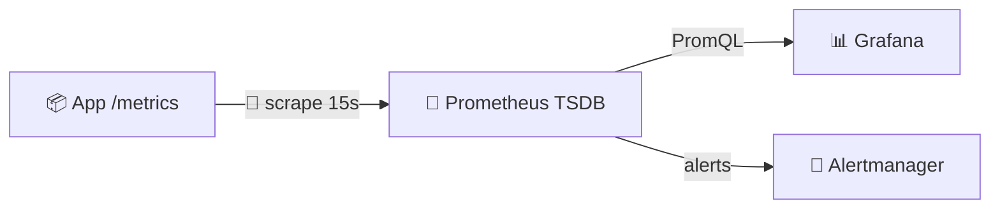
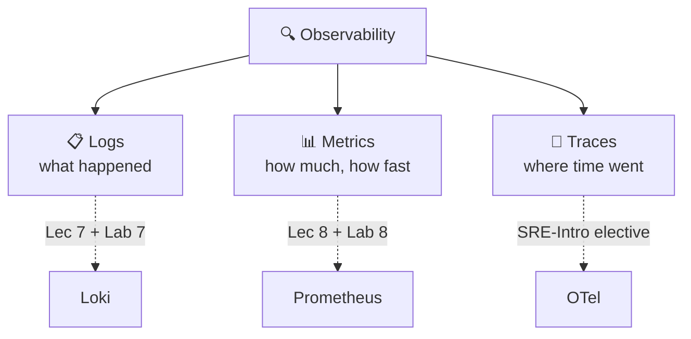
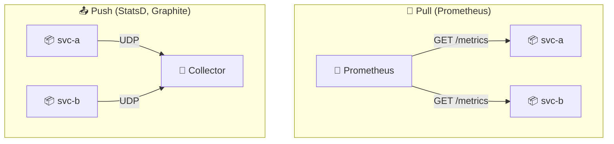
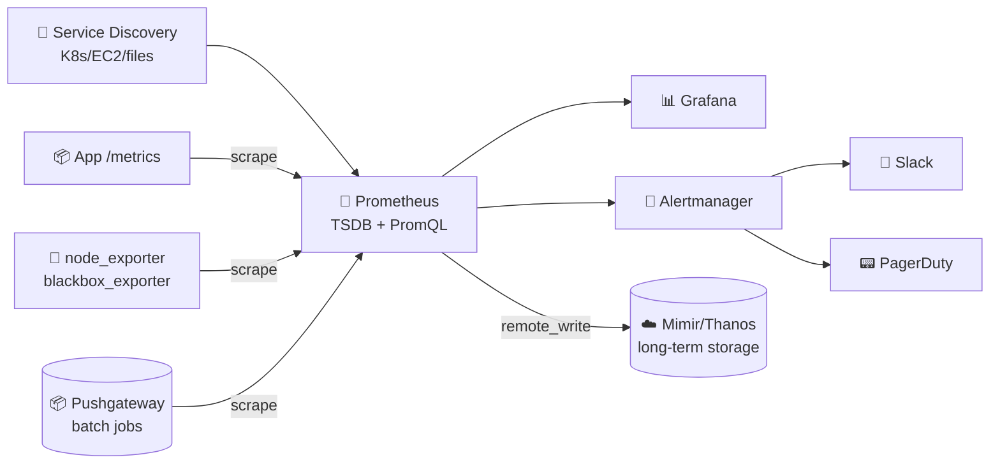
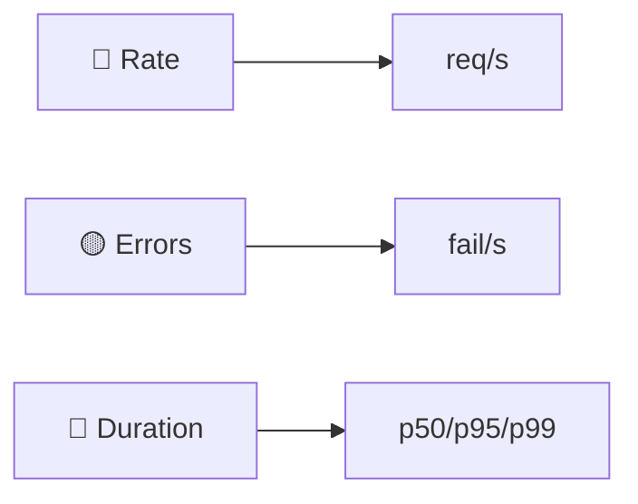
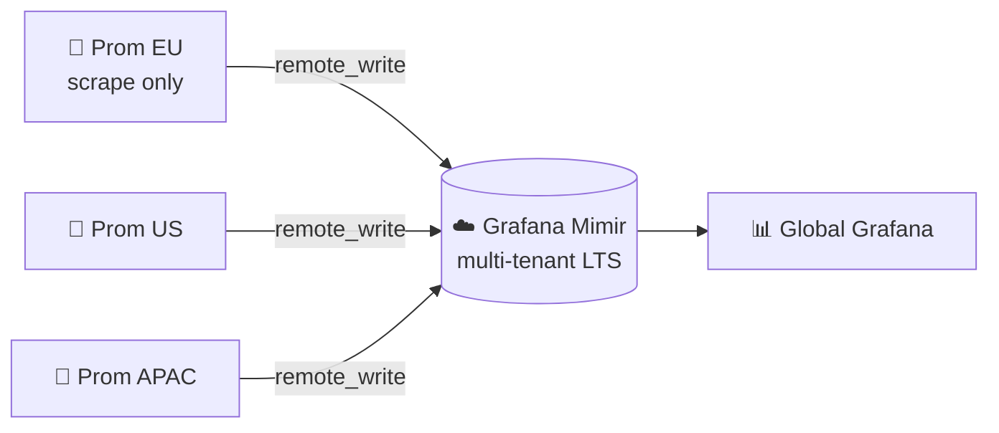
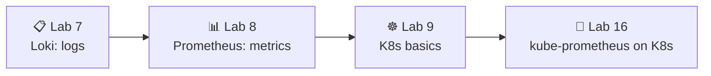

# 📌 Lecture 8 — Metrics & Monitoring with Prometheus: From Guessing to Measuring

Лекция 8 — Метрики и мониторинг с Prometheus: от догадок к измерениям

## 📍 Slide 1 – 📊 Welcome to the Metrics Pillar

Слайд 1 — Добро пожаловать в столп метрик

* 🌍 **Lecture 7 gave production eyes — logs.** This lecture gives it a *pulse* — metrics.
  * 🌍 **Лекция 7 дала продакшену зрение — логи.** Эта лекция даёт ему *пульс* — метрики.
* ⏱️ Logs answer *"what happened?"*. Metrics answer *"how much, how fast, how often?"* — every 15 seconds, forever.
  * ⏱️ Логи отвечают на вопрос *«что произошло?»*. Метрики отвечают на вопрос *«сколько, как быстро, как часто?»* — каждые 15 секунд, бесконечно.
* 📊 **Prometheus** is the CNCF-graduated standard for metrics; it powers monitoring at Spotify, GitHub, DigitalOcean, and most Kubernetes deployments on Earth.
  * 📊 **Prometheus** — стандарт метрик, получивший статус graduated в CNCF; на нём построен мониторинг в Spotify, GitHub, DigitalOcean и в большинстве Kubernetes-кластеров на планете.
* 🎯 Today: scrape model, metric types, PromQL, RED + USE methods, and the dashboard you'll build in Lab 8.
  * 🎯 Сегодня: модель scrape, типы метрик, PromQL, методы RED и USE, а также дашборд, который ты соберёшь в лабе 8.



Схема: приложение отдаёт `/metrics`, Prometheus опрашивает его каждые 15 секунд и пишет в TSDB; из неё Grafana строит графики через PromQL, а Alertmanager рассылает алерты.

> 🔗 **Lab 8 tie-in:** you'll instrument your Lab 1 Python app with `prometheus_client`, deploy Prometheus 3.x + Grafana 13 alongside last week's Loki stack, write PromQL for the **RED method**, and ship a 6-panel dashboard.
>
> 🔗 **Связь с лабой 8:** ты инструментируешь своё Python-приложение из лабы 1 через `prometheus_client`, развернёшь Prometheus 3.x + Grafana 13 рядом со стеком Loki из прошлой недели, напишешь PromQL для **метода RED** и выпустишь дашборд на шесть панелей.

---

## 📍 Slide 2 – 🎯 Learning Outcomes

Слайд 2 — Результаты обучения

| # | Outcome |
|---|---------|
| 1 | 🧠 Pick the right metric type — **counter, gauge, histogram, summary, native histogram** — for any signal |
| 2 | 🔄 Explain why Prometheus is **pull-based** and what that buys you operationally |
| 3 | 🐍 Instrument a Python service with `prometheus_client` and control **label cardinality** |
| 4 | 🔍 Write **PromQL** for rates, percentiles, and per-service aggregations |
| 5 | 📊 Design dashboards around the **RED** method (services) and **USE** method (resources) |

| # | Результат |
|---|-----------|
| 1 | 🧠 Выбирать правильный тип метрики — **counter, gauge, histogram, summary, native histogram** — для любого сигнала |
| 2 | 🔄 Объяснять, почему Prometheus работает **по модели pull**, и что это даёт в эксплуатации |
| 3 | 🐍 Инструментировать Python-сервис через `prometheus_client` и контролировать **кардинальность меток** |
| 4 | 🔍 Писать **PromQL** для rates, перцентилей и агрегаций по сервисам |
| 5 | 📊 Проектировать дашборды вокруг **метода RED** (сервисы) и **метода USE** (ресурсы) |

**Tech stack pinned for May 2026:**

**Технологический стек, зафиксированный на май 2026:**

* 💾 **Prometheus 3.12** (latest stable, May 2026) / **3.5 LTS** (supported through Jul 31 2026)
  * 💾 **Prometheus 3.12** (последняя стабильная версия, май 2026) / **3.5 LTS** (поддержка до 31 июля 2026)
* 📊 **Grafana 13.0.1+security-01** (May 12 2026)
  * 📊 **Grafana 13.0.1+security-01** (12 мая 2026)
* 🐍 **`prometheus_client` 0.23+** for Python (lab pins 0.23.1; 0.25 is latest)
  * 🐍 **`prometheus_client` 0.23+** для Python (в лабе зафиксирована 0.23.1; последняя — 0.25)
* 📦 **`prom/prometheus:v3.9.0`** container image used by Lab 8
  * 📦 **`prom/prometheus:v3.9.0`** — образ контейнера, используемый в лабе 8

> 🆕 **Prometheus 3.x defaults** (vs 2.x): UTF-8 in metric/label names, **native histograms GA**, OTLP receiver built-in, new remote-write 2.0 protocol. Seven feature flags were promoted to defaults at 3.0.
>
> 🆕 **Новые значения по умолчанию в Prometheus 3.x** (по сравнению с 2.x): UTF-8 в именах метрик и меток, **нативные гистограммы GA**, встроенный OTLP-приёмник, новый протокол remote-write 2.0. Семь feature-флагов стали значениями по умолчанию в версии 3.0.

---

## 📍 Slide 3 – 🧱 Where Metrics Fit (Recap from Lec 7)

Слайд 3 — Где место метрикам (повторение лекции 7)



Схема: наблюдаемость состоит из трёх столпов — логов (что произошло), метрик (сколько и как быстро) и трейсов (куда ушло время). Логи ведёт Loki (лекция 7 и лаба 7), метрики — Prometheus (лекция 8 и лаба 8), трейсы разбираются в элективе SRE-Intro через OpenTelemetry.

* 📋 **Logs (Loki):** unbounded text, high cardinality, kept days–weeks, perfect for *forensics*
  * 📋 **Логи (Loki):** неограниченный текст, высокая кардинальность, хранятся дни–недели, идеальны для *форензики*
* 📊 **Metrics (Prometheus):** numeric time series, low cardinality, kept months, perfect for *alerts + trends*
  * 📊 **Метрики (Prometheus):** числовые временные ряды, низкая кардинальность, хранятся месяцами, идеальны для *алертов и трендов*
* 🔗 **Traces:** request-level latency breakdown; out of Core scope, covered in the SRE-Intro elective
  * 🔗 **Трейсы:** разбивка задержек на уровне запросов; вне рамок Core, разбираются в элективе SRE-Intro

> 🔥 **Together, not instead.** A 5xx alert from Prometheus fires the page. A LogQL query in Grafana finds the stack trace. A trace tells you which downstream call was slow. Three pillars, one Grafana.
>
> 🔥 **Вместе, а не вместо.** Алерт на 5xx из Prometheus поднимает дежурного. Запрос LogQL в Grafana находит стектрейс. Трейс показывает, какой вызов ниже по цепочке был медленным. Три столпа — одна Grafana.

---

## 📍 Slide 4 – 💸 Without Metrics You're Flying Blind

Слайд 4 — Без метрик ты летишь вслепую

Logs alone don't answer the questions your boss asks at 09:00:

Одни логи не отвечают на вопросы, которые начальник задаёт в девять утра:

* *"How many users hit the API yesterday?"* — you need a counter.
  * *«Сколько пользователей вчера обратились к API?»* — нужен counter.
* *"Is the p95 latency creeping up week over week?"* — you need a histogram.
  * *«Растёт ли p95-задержка от недели к неделе?»* — нужна histogram.
* *"Are we close to running out of database connections?"* — you need a gauge.
  * *«Мы близки к исчерпанию соединений с базой?»* — нужен gauge.
* *"Did the deploy 20 minutes ago change the error rate?"* — you need a graph, not a `grep`.
  * *«Изменил ли деплой 20 минут назад долю ошибок?»* — нужен график, а не `grep`.

| 🔥 Symptom | 💥 Cost |
|-----------|---------|
| 🐢 No baseline | Can't tell normal from broken |
| 📅 No trend | Can't predict capacity exhaustion |
| 🚨 No alerts | Users (or Twitter) detect outages first |
| 🤷 No attribution | Microservice slowdowns become unsolved mysteries |

| 🔥 Симптом | 💥 Цена |
|-----------|---------|
| 🐢 Нет базового уровня | Нельзя отличить норму от поломки |
| 📅 Нет тренда | Нельзя предсказать исчерпание ресурсов |
| 🚨 Нет алертов | Аварии первыми замечают пользователи (или Twitter) |
| 🤷 Нет атрибуции | Замедления микросервисов превращаются в неразгаданные тайны |

> 💬 **Brendan Gregg, Netflix:** *"You can't optimise what you can't measure, and you can't measure what you don't instrument."*
>
> 💬 **Брендан Грегг, Netflix:** *«Нельзя оптимизировать то, что не измеряешь, и нельзя измерить то, что не инструментируешь»*

---

## 📍 Slide 5 – 🔄 Pull vs Push — Why Prometheus Chose Pull

Слайд 5 — Pull или push: почему Prometheus выбрал pull



Схема: при pull-модели сам Prometheus периодически запрашивает `/metrics` у каждого сервиса; при push-модели (StatsD, Graphite) сервисы сами отправляют метрики в коллектор по UDP.

| 🔧 Aspect | 🔄 Pull | 📤 Push |
|-----------|---------|---------|
| Target health | **Free** — a failed scrape = `up == 0` alert | Hard — silence ≠ healthy |
| Scrape rate control | Prometheus owns it | Each app decides (chaos) |
| Service discovery | Native (K8s, EC2, Consul, files) | Apps must know the collector |
| Firewall direction | Outbound from monitor | Inbound to collector (often blocked) |
| Short-lived jobs | ⚠️ Need **Pushgateway** | Native fit |

| 🔧 Аспект | 🔄 Pull | 📤 Push |
|-----------|---------|---------|
| Здоровье цели | **Бесплатно** — неудачный scrape = алерт `up == 0` | Сложно — тишина ≠ здоровье |
| Управление частотой scrape | Им управляет Prometheus | Каждое приложение решает само (хаос) |
| Service discovery | Встроенный (K8s, EC2, Consul, файлы) | Приложения должны знать коллектор |
| Направление в файрволе | Исходящее от монитора | Входящее в коллектор (часто заблокировано) |
| Короткоживущие задачи | ⚠️ Нужен **Pushgateway** | Подходит из коробки |

> 🔥 **Rule of thumb:** pull for long-running services; push (via Pushgateway) only for cron-style jobs that finish before the next scrape. **Don't use Pushgateway as a metric proxy** — it's a hack for the batch-job case only.
>
> 🔥 **Практическое правило:** pull — для долгоживущих сервисов; push (через Pushgateway) — только для задач в стиле cron, которые завершаются до следующего scrape. **Не используй Pushgateway как прокси для метрик** — это костыль исключительно для случая batch-задач.

---

## 📍 Slide 6 – 🏗️ Prometheus Architecture

Слайд 6 — Архитектура Prometheus



Схема: service discovery находит цели; Prometheus опрашивает приложения и экспортёры, а также Pushgateway с метриками batch-задач. Данные ложатся в TSDB, откуда их читает Grafana через PromQL, а Alertmanager отправляет алерты в Slack и PagerDuty. Для долгосрочного хранения всё уезжает через `remote_write` в Mimir или Thanos.

| 🧱 Component | 🎯 Role |
|-------------|---------|
| 💾 **Prometheus server** | Scrapes, stores in TSDB, evaluates rules, serves PromQL |
| 🔌 **Exporters** | Translate non-Prometheus systems (Postgres, Redis, Linux) into `/metrics` |
| 🧭 **Service discovery** | Find targets dynamically (Kubernetes API, EC2 tags, Consul…) |
| 🚨 **Alertmanager** | Deduplicate, group, route, silence alerts |
| 📦 **Pushgateway** | Receive metrics from short-lived batch jobs (use sparingly) |
| ☁️ **Mimir / Thanos** | Horizontal scale + multi-tenant long-term storage (Slide 19) |

| 🧱 Компонент | 🎯 Роль |
|-------------|---------|
| 💾 **Сервер Prometheus** | Опрашивает цели, хранит данные в TSDB, вычисляет правила, отдаёт PromQL |
| 🔌 **Экспортёры** | Переводят системы, не умеющие Prometheus (Postgres, Redis, Linux), в `/metrics` |
| 🧭 **Service discovery** | Находит цели динамически (API Kubernetes, теги EC2, Consul…) |
| 🚨 **Alertmanager** | Дедуплицирует, группирует, маршрутизирует и заглушает алерты |
| 📦 **Pushgateway** | Принимает метрики от короткоживущих batch-задач (использовать осторожно) |
| ☁️ **Mimir / Thanos** | Горизонтальное масштабирование и мультитенантное долгосрочное хранение (слайд 19) |

---

## 📍 Slide 7 – 🔌 Exporters: The Translation Layer

Слайд 7 — Экспортёры: слой перевода

You will rarely run vanilla Prometheus alone. The ecosystem is dozens of **exporters** that expose existing systems on `/metrics`:

Prometheus редко запускают в чистом виде. Вокруг него десятки **экспортёров**, которые публикуют существующие системы на `/metrics`:

| 🔌 Exporter | 🎯 Exposes |
|-------------|-----------|
| `node_exporter` | Linux host metrics (CPU, RAM, disk, network) |
| `postgres_exporter` | Postgres replication lag, connections, slow queries |
| `redis_exporter` | Redis ops/sec, memory, keyspace |
| `blackbox_exporter` | Synthetic probes — HTTP/HTTPS/TCP/DNS/ICMP |
| `cAdvisor` | Per-container CPU/memory (built into kubelet) |
| `kube-state-metrics` | Kubernetes object state — deployment replicas, pod phase |

| 🔌 Экспортёр | 🎯 Что отдаёт |
|-------------|-----------|
| `node_exporter` | Метрики Linux-хоста (CPU, RAM, диск, сеть) |
| `postgres_exporter` | Лаг репликации Postgres, соединения, медленные запросы |
| `redis_exporter` | Операции/сек Redis, память, keyspace |
| `blackbox_exporter` | Синтетические пробы — HTTP/HTTPS/TCP/DNS/ICMP |
| `cAdvisor` | CPU/память по контейнерам (встроен в kubelet) |
| `kube-state-metrics` | Состояние объектов Kubernetes — реплики деплойментов, фаза подов |

* 📦 **One exporter per dependency.** Lab 8 scrapes Loki and Grafana directly (both ship `/metrics` natively — no exporter needed).
  * 📦 **Один экспортёр на зависимость.** Лаба 8 опрашивает Loki и Grafana напрямую (оба отдают `/metrics` нативно — экспортёр не нужен).
* 🐍 **For your own apps:** instrument with a **client library** (`prometheus_client` for Python) instead of writing an exporter.
  * 🐍 **Для собственных приложений:** инструментируй через **клиентскую библиотеку** (`prometheus_client` для Python), а не пиши экспортёр.

> 💡 **OpenMetrics** is the IETF-track spec born from the Prometheus exposition format — every exporter and client library speaks it.
>
> 💡 **OpenMetrics** — спецификация IETF, выросшая из формата экспозиции Prometheus; её понимает каждый экспортёр и клиентская библиотека.

---

## 📍 Slide 8 – 📊 Metric Types: Counter

Слайд 8 — Типы метрик: counter

A **counter** only ever increases. Reset to zero when the process restarts.

**Counter** только возрастает. При перезапуске процесса сбрасывается в ноль.

```python
from prometheus_client import Counter

http_requests_total = Counter(
    "http_requests_total", "Total HTTP requests",
    ["method", "endpoint", "status"],
)
http_requests_total.labels("GET", "/", "200").inc()
```

Пояснение к коду: создаётся счётчик `http_requests_total` с тремя метками; `.labels(...).inc()` увеличивает его на единицу для конкретной комбинации меток.

**You almost never query the counter directly — you query its `rate()`:**

**Сам counter в запросах почти никогда не используется — используется его `rate()`:**

```promql
# requests per second, last 5 minutes
rate(http_requests_total[5m])

# error rate per endpoint
sum by (endpoint) (rate(http_requests_total{status=~"5.."}[5m]))
```

> ⚠️ **Counters can reset** (pod restart). `rate()` and `increase()` handle the wraparound automatically — `irate()` and raw subtraction do **not**. Stick with `rate()` for graphs.
>
> ⚠️ **Counter может сброситься** (перезапуск пода). `rate()` и `increase()` корректно обрабатывают сброс — `irate()` и голое вычитание **нет**. Для графиков держись `rate()`.

---

## 📍 Slide 9 – 📊 Metric Types: Gauge

Слайд 9 — Типы метрик: gauge

A **gauge** goes up *and* down. Snapshot of "right now".

**Gauge** растёт *и* падает. Это снимок состояния «прямо сейчас».

```python
from prometheus_client import Gauge

queue_depth = Gauge("worker_queue_depth", "Pending jobs")
queue_depth.set(42)
queue_depth.inc()      # +1
queue_depth.dec(5)     # -5
in_flight = Gauge("http_in_flight", "Concurrent requests")
in_flight.track_inprogress()  # context-managed
```

Пояснение к коду: `Gauge` поддерживает `set()`, `inc()` и `dec()`; `track_inprogress()` считает одновременные запросы, автоматически увеличивая и уменьшая значение при входе и выходе из блока.

**Query patterns:**

**Типовые запросы:**

```promql
# current value across all instances
sum(worker_queue_depth)

# how fast is memory growing? (derivative)
deriv(process_resident_memory_bytes[10m])

# fastest-growing pods
topk(5, rate(container_memory_working_set_bytes[5m]))
```

> 🎯 **Use a gauge for:** active connections, queue depth, temperature, memory in use, current replica count. **Anything that can shrink.**
>
> 🎯 **Gauge подходит для:** активных соединений, глубины очереди, температуры, используемой памяти, текущего числа реплик. **Для всего, что может уменьшаться.**

---

## 📍 Slide 10 – 📊 Metric Types: Histogram

Слайд 10 — Типы метрик: histogram

Counters tell you *how many*. Histograms tell you *how the values are distributed* — perfect for **latency**.

Counters отвечают на вопрос *сколько*. Гистограммы показывают *как распределены значения* — идеально для **задержек**.

```python
from prometheus_client import Histogram

request_latency = Histogram(
    "http_request_duration_seconds", "Request latency",
    ["method", "endpoint"],
    buckets=(0.005, 0.01, 0.025, 0.05, 0.1, 0.25, 0.5, 1.0, 2.5, 5.0),
)
with request_latency.labels("GET", "/api").time():
    handle_request()
```

Пояснение к коду: гистограмма получает набор бакетов (границ), а `with ... .time():` измеряет длительность блока и кладёт её в гистограмму.

**A classic histogram exposes three families** of time series per bucket set:
* `*_bucket{le="0.1"}` — cumulative count of observations ≤ 0.1s
  * `*_bucket{le="0.1"}` — накопленное количество наблюдений ≤ 0,1 с
* `*_sum` — total time
  * `*_sum` — суммарное время
* `*_count` — total observations
  * `*_count` — общее количество наблюдений

**The killer query — percentiles, server-side:**

**Главный запрос — перцентили на стороне сервера:**

```promql
# p95 latency, last 5 minutes
histogram_quantile(0.95,
  sum by (le) (rate(http_request_duration_seconds_bucket[5m])))
```

> ⚠️ **Bucket choice matters.** Buckets that don't bracket the real distribution give wildly wrong percentiles. Start with the SRE default `(.005, .01, .025, .05, .1, .25, .5, 1, 2.5, 5, 10)` and tune from production data.
>
> ⚠️ **Выбор бакетов важен.** Бакеты, не покрывающие реальное распределение, дают катастрофически неверные перцентили. Начни с набора по умолчанию из SRE-практики `(.005, .01, .025, .05, .1, .25, .5, 1, 2.5, 5, 10)` и настраивай его по продакшен-данным.

---

## 📍 Slide 11 – ✨ Native Histograms (Prometheus 3.x GA)

Слайд 11 — Нативные гистограммы (GA в Prometheus 3.x)

**Classic histograms** force you to pre-pick buckets. Get them wrong and your p99 lies to you. **Native histograms** (GA since Prometheus 3.x, stable in v3.8) fix this with **exponential bucket schemas** chosen automatically.

**Классические гистограммы** заставляют заранее выбирать бакеты. Ошибёшься — и твой p99 будет врать. **Нативные гистограммы** (GA начиная с Prometheus 3.x, стабильны в v3.8) решают это **экспоненциальными схемами бакетов**, которые выбираются автоматически.

| 🔧 Aspect | 📊 Classic Histogram | ✨ Native Histogram |
|-----------|---------------------|---------------------|
| Buckets | Manually defined per metric | Auto, exponential, dynamic |
| Time series per metric | One per bucket (10–20) | **One** |
| Resolution | Fixed | Configurable schema (powers of 2) |
| Storage | High (each bucket = a series) | ~5× cheaper |
| `histogram_quantile()` | Works | Works — same function |

| 🔧 Аспект | 📊 Классическая гистограмма | ✨ Нативная гистограмма |
|-----------|---------------------|---------------------|
| Бакеты | Задаются вручную для каждой метрики | Автоматические, экспоненциальные, динамические |
| Временных рядов на метрику | Один на бакет (10–20) | **Один** |
| Разрешение | Фиксированное | Настраиваемая схема (степени двойки) |
| Хранение | Дорогое (каждый бакет — отдельный ряд) | Примерно в 5 раз дешевле |
| `histogram_quantile()` | Работает | Работает — та же функция |

```python
# Python client (0.23+): opt in by passing `native_histogram_bucket_factor`
Histogram(
    "http_request_duration_seconds", "Latency",
    native_histogram_bucket_factor=1.1,  # ~10% resolution
)
```

Пояснение к коду: передав `native_histogram_bucket_factor`, ты включаешь для метрики нативные гистограммы; factor 1.1 соответствует разрешению около 10%.

> 🆕 **In Prometheus 3.x they're a default-on feature** (the `native-histograms` flag was promoted to default at 3.0). Mix freely: a single metric can expose both classic *and* native — clients negotiate via the scrape protocol.
>
> 🆕 **В Prometheus 3.x они включены по умолчанию** (флаг `native-histograms` стал дефолтным в 3.0). Смешивай свободно: одна метрика может отдавать и классическую, *и* нативную гистограмму — клиенты договариваются через протокол scrape.

---

## 📍 Slide 12 – 📊 Counter vs Gauge vs Histogram vs Summary

Слайд 12 — Counter, gauge, histogram или summary

| 📊 Type | ⬆️⬇️ Behaviour | 🎯 Use for | 🔍 Query with |
|---------|----------------|-----------|----------------|
| 🔢 **Counter** | Only up (resets on restart) | Events: requests, errors, bytes | `rate()`, `increase()` |
| 📈 **Gauge** | Up and down | State: temperature, queue depth | direct, `avg()`, `max()` |
| 📊 **Histogram (classic)** | Multiple time series per metric | Latency, size, durations | `histogram_quantile()` server-side |
| ✨ **Native histogram** | One time series, auto buckets | Same as histogram, ~5× cheaper | `histogram_quantile()` — same fn |
| 📐 **Summary** | Quantiles computed in-process | Legacy quantile reporting | Direct — but **can't aggregate across instances** |

| 📊 Тип | ⬆️⬇️ Поведение | 🎯 Для чего | 🔍 Чем запрашивать |
|---------|----------------|-----------|----------------|
| 🔢 **Counter** | Только вверх (сброс при перезапуске) | События: запросы, ошибки, байты | `rate()`, `increase()` |
| 📈 **Gauge** | Вверх и вниз | Состояние: температура, глубина очереди | напрямую, `avg()`, `max()` |
| 📊 **Histogram (классическая)** | Несколько временных рядов на метрику | Задержки, размеры, длительности | `histogram_quantile()` на сервере |
| ✨ **Нативная гистограмма** | Один временной ряд, автоматические бакеты | То же, что гистограмма, но примерно в 5 раз дешевле | `histogram_quantile()` — та же функция |
| 📐 **Summary** | Квантили считаются в процессе | Устаревший вариант отчёта о квантилях | Напрямую — но **не агрегируется между инстансами** |

> 🔥 **Default to histograms (native if Prometheus 3.x).** Summaries are last-resort: their pre-computed quantiles can't be merged across pods, so they break the moment you scale past one replica.
>
> 🔥 **По умолчанию выбирай гистограммы (нативные, если у тебя Prometheus 3.x).** Summary — крайний вариант: их заранее вычисленные квантили нельзя объединить между подами, поэтому они ломаются, как только у тебя больше одной реплики.

---

## 📍 Slide 13 – 🐍 Instrumenting the Lab 1 Python App

Слайд 13 — Инструментируем Python-приложение из лабы 1

Two-file change to add metrics to your Flask/FastAPI service:

Два файла — и в твоём сервисе на Flask/FastAPI появятся метрики:

```python
# app.py
from prometheus_client import Counter, Histogram, Gauge, generate_latest
from flask import Flask, Response, request
import time

app = Flask(__name__)

REQS = Counter("http_requests_total", "HTTP requests",
               ["method", "endpoint", "status"])
LAT  = Histogram("http_request_duration_seconds", "Latency",
                 ["method", "endpoint"])
INF  = Gauge("http_requests_in_progress", "In-flight requests")

@app.before_request
def _before():
    request._t0 = time.perf_counter()
    INF.inc()

@app.after_request
def _after(resp):
    dur = time.perf_counter() - request._t0
    endpoint = request.url_rule.rule if request.url_rule else "unknown"
    REQS.labels(request.method, endpoint, resp.status_code).inc()
    LAT.labels(request.method, endpoint).observe(dur)
    INF.dec()
    return resp

@app.route("/metrics")
def metrics():
    return Response(generate_latest(), mimetype="text/plain")
```

Пояснение к коду: три метрики (`Counter`, `Histogram`, `Gauge`) регистрируются на старте; хуки `before_request` и `after_request` измеряют длительность и увеличивают счётчики, а `/metrics` отдаёт их в формате exposition.

```txt
# requirements.txt
prometheus-client==0.23.1
```

Пояснение: версия `prometheus-client` фиксируется в `requirements.txt`, чтобы поведение метрик было воспроизводимым.

> 🔗 **Lab 8 deliverable:** the `/metrics` endpoint above plus one **business metric** (e.g. `devops_info_endpoint_calls`) — graded under Task 1.
>
> 🔗 **Что сдать в лабе 8:** эндпоинт `/metrics` как выше плюс одну **бизнес-метрику** (например, `devops_info_endpoint_calls`) — оценивается в задании 1.

---

## 📍 Slide 14 – 🏷️ Label Cardinality — The #1 Way to OOM Prometheus

Слайд 14 — Кардинальность меток — способ №1 исчерпать память Prometheus

Each unique label combination = one **time series**. A series costs ~3–5 KB in memory. Do the maths.

Каждая уникальная комбинация меток = один **временной ряд**. Ряд занимает около 3–5 КБ памяти. Посчитай сам.

```python
# ❌ MELT YOUR PROMETHEUS — one series per user, forever
REQS.labels(user_id=u, request_id=r).inc()

# ✅ Use bounded enumerations only
REQS.labels(method="GET", endpoint="/api", status="200").inc()
```

Пояснение к коду: ❌ метки `user_id` и `request_id` дают неограниченное число рядов и быстро съедают память; ✅ ограниченные перечисления (`method`, `endpoint`, `status`) — безопасны.

| ✅ Good label (bounded) | ❌ Bad label (unbounded) |
|------------------------|--------------------------|
| `method` (8 values) | `user_id` (millions) |
| `endpoint` (dozens, normalised) | `request_id` (one per call) |
| `status_code` (~10) | `email`, `path` with IDs |
| `env="prod"` (3) | `timestamp`, `trace_id` |

| ✅ Хорошая метка (ограниченная) | ❌ Плохая метка (неограниченная) |
|------------------------|--------------------------|
| `method` (8 значений) | `user_id` (миллионы) |
| `endpoint` (десятки, нормализованные) | `request_id` (по одному на вызов) |
| `status_code` (~10) | `email`, `path` с идентификаторами |
| `env="prod"` (3) | `timestamp`, `trace_id` |

**Targets:**

**Целевые ориентиры:**

* 📊 **<1000** unique label combinations per metric is healthy.
  * 📊 **<1000** уникальных комбинаций меток на метрику — это здорово.
* 🚨 **>100,000** and you're a few hours from an OOM.
  * 🚨 **>100 000** — и ты в паре часов от OOM.
* 🛡️ Track your series count with `prometheus_tsdb_head_series` and alert on growth.
  * 🛡️ Следи за числом рядов через `prometheus_tsdb_head_series` и настрой алерт на рост.

> 🔥 **The rule:** if a value is unique per request or per user, **it doesn't go in a label**. Same lesson as Loki (Lec 7), same blast radius.
>
> 🔥 **Правило:** если значение уникально для каждого запроса или пользователя, **ему не место в метке**. Тот же урок, что и в Loki (лекция 7), и тот же масштаб последствий.

---

## 📍 Slide 15 – 🔍 PromQL Part 1: Instant vs Range Vectors

Слайд 15 — PromQL, часть 1: instant- и range-векторы

Every PromQL expression returns one of four types. The two you'll use constantly:

Любое выражение PromQL возвращает один из четырёх типов. Два из них ты будешь использовать постоянно:

```promql
# 🎯 Instant vector — one sample per series, at evaluation time
http_requests_total{status="500"}

# 🎯 Range vector — all samples per series, over a duration
http_requests_total[5m]
```

Пояснение: instant-вектор — одно значение на каждый ряд в момент вычисления; range-вектор — все значения за указанный интервал.

You **can't graph a range vector directly** — you must collapse it with a function (`rate`, `avg_over_time`, …):

**Range-вектор нельзя сразу вывести на график** — его нужно свернуть функцией (`rate`, `avg_over_time`, …):

```promql
# req/sec averaged over 5-minute windows
rate(http_requests_total[5m])
```

| 🔧 Operator | 🎯 Meaning |
|-------------|-----------|
| `{label="v"}` / `{label!="v"}` | Exact match / negation |
| `{label=~"re"}` / `{label!~"re"}` | Regex / negated regex |
| `[5m]`, `[1h]` | Lookback window for range vectors |
| `offset 1h` | Shift the query back in time |
| `@ 1700000000` | Pin evaluation to a Unix timestamp |

| 🔧 Оператор | 🎯 Смысл |
|-------------|-----------|
| `{label="v"}` / `{label!="v"}` | Точное совпадение / отрицание |
| `{label=~"re"}` / `{label!~"re"}` | Regex / отрицательный regex |
| `[5m]`, `[1h]` | Окно ретроспективы для range-векторов |
| `offset 1h` | Сдвиг запроса назад во времени |
| `@ 1700000000` | Привязка вычисления к Unix-времени |

> 💡 **Rule of thumb:** the range `[Xm]` should be ≥ **4× the scrape interval** so each evaluation has enough samples. With 15s scrapes, `[1m]` is the minimum that doesn't lie.
>
> 💡 **Практическое правило:** окно `[Xm]` должно быть ≥ **4× интервала scrape**, чтобы на каждое вычисление хватало сэмплов. При scrape раз в 15 секунд `[1m]` — минимум, который не врёт.

---

## 📍 Slide 16 – 🔍 PromQL Part 2: Aggregation & rate()

Слайд 16 — PromQL, часть 2: агрегация и rate()

```promql
# Total req/s across the whole fleet
sum(rate(http_requests_total[5m]))

# Per-endpoint req/s (keep that label, sum away the rest)
sum by (endpoint) (rate(http_requests_total[5m]))

# Per-pod req/s, drop a noisy label
sum without (instance) (rate(http_requests_total[5m]))

# Top 5 slowest endpoints (p95)
topk(5,
  histogram_quantile(0.95,
    sum by (endpoint, le) (rate(http_request_duration_seconds_bucket[5m]))))

# Error ratio (5xx as a fraction of total)
sum(rate(http_requests_total{status=~"5.."}[5m]))
  / sum(rate(http_requests_total[5m]))
```

| 🔧 Aggregator | 🎯 Use case |
|---------------|-------------|
| `sum`, `avg`, `min`, `max` | Combine series |
| `count` | Number of series matching |
| `topk(N, expr)` / `bottomk` | The N highest/lowest |
| `quantile(0.5, expr)` | Fleet-level percentile |
| `group by (l) / without (l)` | Drop or keep label dimensions |

| 🔧 Агрегатор | 🎯 Случай использования |
|---------------|-------------|
| `sum`, `avg`, `min`, `max` | Объединить ряды |
| `count` | Количество подходящих рядов |
| `topk(N, expr)` / `bottomk` | N наибольших/наименьших |
| `quantile(0.5, expr)` | Перцентиль по всему парку |
| `group by (l) / without (l)` | Убрать или сохранить измерения меток |

> ⚠️ **Don't average percentiles.** `avg(histogram_quantile(...))` is mathematical nonsense. Always `histogram_quantile()` *outside* the `sum by (le, …)`.
>
> ⚠️ **Не усредняй перцентили.** `avg(histogram_quantile(...))` — математическая бессмыслица. `histogram_quantile()` всегда должен стоять *снаружи* `sum by (le, …)`.

---

## 📍 Slide 17 – 🔍 PromQL Part 3: Recording Rules

Слайд 17 — PromQL, часть 3: правила записи

Some queries are slow. Some you need many times a day. **Recording rules** evaluate a PromQL expression on a schedule and store the result as a new metric — like a materialised view.

Некоторые запросы медленные. Некоторые нужны по много раз в день. **Recording rules** вычисляют выражение PromQL по расписанию и сохраняют результат как новую метрику — по сути, материализованное представление.

```yaml
# prometheus.rules.yml
groups:
  - name: app_red
    interval: 30s
    rules:
      - record: job:http_requests:rate5m
        expr: sum by (job) (rate(http_requests_total[5m]))

      - record: job:http_errors:ratio5m
        expr: |
          sum by (job) (rate(http_requests_total{status=~"5.."}[5m]))
            / sum by (job) (rate(http_requests_total[5m]))

      - record: job:http_latency:p95_5m
        expr: |
          histogram_quantile(0.95,
            sum by (job, le) (rate(http_request_duration_seconds_bucket[5m])))
```

Пояснение к YAML: группа `app_red` раз в 30 секунд пересчитывает три записи — rate запросов, долю ошибок и p95-латентность — и складывает результаты в новые метрики с именами по конвенции `level:metric:operation`.

* 🏷️ **Naming convention:** `level:metric:operation` — e.g. `job:http_requests:rate5m`. The colons are intentional and reserved for recording rules.
  * 🏷️ **Соглашение об именах:** `level:metric:operation` — например, `job:http_requests:rate5m`. Двоеточия намеренные и зарезервированы для recording rules.
* 🚀 **Dashboards stay fast** because they query the pre-computed series, not the raw histogram buckets.
  * 🚀 **Дашборды остаются быстрыми**, потому что запрашивают заранее вычисленные ряды, а не сырые бакеты гистограмм.
* 🚨 **Alert rules** use the same syntax (`alert:` instead of `record:`) and fire to Alertmanager when their expression is non-empty for `for: Xm`.
  * 🚨 **Правила алертов** используют тот же синтаксис (`alert:` вместо `record:`) и срабатывают в Alertmanager, когда их выражение непустое в течение `for: Xm`.

---

## 📍 Slide 18 – 🔴 The RED Method (Tom Wilkie, Weaveworks, 2015)

Слайд 18 — Метод RED (Том Уилки, Weaveworks, 2015)

**For every request-driven service, monitor three things:**

**Для каждого сервиса, обслуживающего запросы, отслеживай три вещи:**

| 🔧 Metric | 🎯 Question | 📝 PromQL |
|-----------|-------------|------------|
| 🔴 **R**ate | How busy? | `sum by (svc) (rate(http_requests_total[5m]))` |
| 🟡 **E**rrors | How often failing? | `sum by (svc) (rate(http_requests_total{status=~"5.."}[5m]))` |
| 🔵 **D**uration | How slow? | `histogram_quantile(0.95, sum by (svc, le) (rate(http_request_duration_seconds_bucket[5m])))` |

| 🔧 Метрика | 🎯 Вопрос | 📝 PromQL |
|-----------|-------------|------------|
| 🔴 **R**ate | Насколько загружен? | `sum by (svc) (rate(http_requests_total[5m]))` |
| 🟡 **E**rrors | Как часто падает? | `sum by (svc) (rate(http_requests_total{status=~"5.."}[5m]))` |
| 🔵 **D**uration | Насколько медленно? | `histogram_quantile(0.95, sum by (svc, le) (rate(http_request_duration_seconds_bucket[5m])))` |



Схема: метод RED сводит мониторинг сервиса к трём сигналам — rate (запросов в секунду), errors (ошибок в секунду) и duration (перцентили задержки p50/p95/p99).

* 📊 **Why these three?** They map directly to the user's experience: *"is the service up, is it correct, is it fast?"*
  * 📊 **Почему именно эти три?** Они напрямую отражают опыт пользователя: *«сервис работает, отвечает правильно и быстро?»*
* 🪞 **Mirror the Four Golden Signals** from the Google SRE book (Rate + Errors + Latency + Saturation) — RED drops saturation because that's the **USE** method's job.
  * 🪞 **Отражают Four Golden Signals** из книги Google SRE (Rate + Errors + Latency + Saturation): в RED нет saturation, потому что это задача **метода USE**.
* 🎯 **If you only monitor three things per service, monitor these.**
  * 🎯 **Если по сервису ты отслеживаешь только три вещи, отслеживай эти.**

> 📖 First presented by **Tom Wilkie at the London Prometheus meetup, 2015** while he was at Weaveworks. Now standard practice across CNCF.
>
> 📖 Впервые представлен **Томом Уилки на лондонском митапе Prometheus в 2015 году**, когда он работал в Weaveworks. Сегодня это стандартная практика в CNCF.

---

## 📍 Slide 19 – 📊 The USE Method (Brendan Gregg, 2012)

Слайд 19 — Метод USE (Брендан Грегг, 2012)

**RED** is for services. **USE** is for **resources** — CPU, RAM, disk, network, file descriptors.

**RED** — для сервисов. **USE** — для **ресурсов**: CPU, RAM, диска, сети, файловых дескрипторов.

| 🔧 Metric | 🎯 Question | 📝 Example |
|-----------|-------------|-----------|
| 📊 **U**tilisation | How busy is the resource? | CPU at 80% |
| 🪣 **S**aturation | How much extra work is queued? | run-queue length > cores |
| ❌ **E**rrors | Are there error events? | disk I/O errors, NIC drops |

| 🔧 Метрика | 🎯 Вопрос | 📝 Пример |
|-----------|-------------|-----------|
| 📊 **U**tilisation | Насколько загружен ресурс? | CPU на 80% |
| 🪣 **S**aturation | Сколько работы стоит в очереди? | длина run-queue > числа ядер |
| ❌ **E**rrors | Есть ли события ошибок? | ошибки дискового I/O, drops на NIC |

```promql
# Node CPU utilisation (node_exporter)
1 - avg by (instance) (rate(node_cpu_seconds_total{mode="idle"}[5m]))

# Memory saturation — swap-in pages per second
rate(node_vmstat_pswpin[5m])

# Disk error counter
rate(node_disk_io_errors_total[5m])
```

> 📖 Published by **Brendan Gregg (then Joyent, now Netflix/Intel) in 2012** as *"Thinking Methodically about Performance"* (ACM Queue). The companion checklists at brendangregg.com/usemethod.html are still the gold-standard tour of Linux performance counters.
>
> 📖 Опубликован **Бренданом Греггом (тогда Joyent, сейчас Netflix/Intel) в 2012 году** как *«Thinking Methodically about Performance»* (ACM Queue). Сопроводительные чек-листы на brendangregg.com/usemethod.html до сих пор остаются эталонным обзором счётчиков производительности Linux.

**🎯 The recipe:** **RED for every service. USE for every resource. Together they cover both halves of every incident.**

**🎯 Рецепт:** **RED для каждого сервиса. USE для каждого ресурса. Вместе они покрывают обе половины любого инцидента.**

---

## 📍 Slide 20 – 📊 Grafana Dashboards for Metrics

Слайд 20 — Дашборды Grafana для метрик

Same Grafana from Lab 7 — add Prometheus as a second data source:

Та же Grafana, что и в лабе 7, — добавляем Prometheus вторым источником данных:

```yaml
# grafana/provisioning/datasources/datasources.yml
datasources:
  - name: Prometheus
    type: prometheus
    url: http://prometheus:9090
    access: proxy
  - name: Loki
    type: loki
    url: http://loki:3100
```

Пояснение к YAML: в provisioning-файле Grafana объявлены два источника данных — Prometheus (порт 9090) и Loki (порт 3100); режим `access: proxy` означает, что запросы идут через сервер Grafana.

**Panel-design principles (same as Lec 7):**
* 🎯 **One question per dashboard** — *"Is api healthy?"*, not *"show me everything"*.
  * 🎯 **Один вопрос на дашборд** — *«API в порядке?»*, а не *«покажи мне всё»*.
* 🚦 **Stat panels on top** — red/green at a glance.
  * 🚦 **Stat-панели сверху** — красное/зелёное с первого взгляда.
* 📈 **Time-series in the middle** — RED metrics, last hour, with thresholds.
  * 📈 **Временные ряды в середине** — метрики RED за последний час с порогами.
* 🔥 **Heatmap at the bottom** — latency distribution (use `*_bucket` series straight to the heatmap panel).
  * 🔥 **Heatmap внизу** — распределение задержек (ряды `*_bucket` подаются прямо в панель heatmap).
* 🔁 **Template variables** for `$service`, `$env`, `$instance` — one dashboard, many slices.
  * 🔁 **Шаблонные переменные** для `$service`, `$env`, `$instance` — один дашборд, множество срезов.
* 🔗 **Drill-down from a metric spike** to the matching LogQL query (Grafana lets you data-source-link).
  * 🔗 **Переход от всплеска метрики** к соответствующему запросу LogQL (Grafana позволяет связывать источники данных).

> 💡 **Heatmaps reveal what averages hide.** A p99 of 800ms can be "everyone is slow" or "1% of users are abandoned" — the heatmap shows which.
>
> 💡 **Heatmap показывает то, что скрывают средние.** p99 в 800 мс может означать «тормозит у всех» или «1% пользователей брошены» — heatmap покажет, что именно.

---

## 📍 Slide 21 – 📊 Lab 8's Dashboard Panels (PromQL)

Слайд 21 — Панели дашборда лабы 8 (PromQL)

The six (+) panels graded under Task 3:

Шесть (и более) панелей, оцениваемых в задании 3:

```promql
# 1️⃣ Request rate per endpoint
sum by (endpoint) (rate(http_requests_total[5m]))

# 2️⃣ Error rate per endpoint
sum by (endpoint) (rate(http_requests_total{status=~"5.."}[5m]))

# 3️⃣ p95 latency
histogram_quantile(0.95,
  sum by (endpoint, le) (rate(http_request_duration_seconds_bucket[5m])))

# 4️⃣ Latency heatmap (drives the Grafana Heatmap panel directly)
sum by (le) (rate(http_request_duration_seconds_bucket[5m]))

# 5️⃣ In-flight requests
http_requests_in_progress

# 6️⃣ Service uptime (1 = up, 0 = down)
up{job="app"}
```

Пояснение: каждый блок соответствует панели дашборда; панель №6 — классический индикатор доступности (`up = 1`), по которому ставятся alert-правила.

| Panel | Vis | Answers |
|-------|-----|---------|
| 1 | Time series | *"How busy?"* |
| 2 | Time series | *"How often failing?"* |
| 3 | Time series | *"How slow at the 95th?"* |
| 4 | Heatmap | *"What does the long tail look like?"* |
| 5 | Gauge | *"How many in flight right now?"* |
| 6 | Stat | *"Are we even alive?"* |

| Панель | Визуализация | Отвечает на вопрос |
|-------|-----|---------|
| 1 | Time series | *«Насколько загружен?»* |
| 2 | Time series | *«Как часто падает?»* |
| 3 | Time series | *«Насколько медленно на 95-м перцентиле?»* |
| 4 | Heatmap | *«Как выглядит длинный хвост?»* |
| 5 | Gauge | *«Сколько запросов в обработке прямо сейчас?»* |
| 6 | Stat | *«Мы вообще живы?»* |

> 🔗 **Evidence required:** screenshots of all panels with live traffic from a `curl` loop hitting your app — graded under Lab 8 Task 3.
>
> 🔗 **Какие доказательства нужны:** скриншоты всех панелей с живым трафиком от цикла `curl`, бьющего по твоему приложению, — оценивается в задании 3 лабы 8.

---

## 📍 Slide 22 – 🏭 Production: Federation, remote_write, Mimir

Слайд 22 — Продакшен: федерация, remote_write, Mimir

Lab 8 runs **one Prometheus container** with 15-day retention. Production needs four upgrades:

В лабе 8 работает **один контейнер Prometheus** с хранением 15 дней. Продакшену нужны четыре улучшения:

| 🔧 Concern | 🪜 Lab default | 🏭 Production |
|-----------|----------------|---------------|
| Storage | Local TSDB, 15 days | **`remote_write` to Mimir / Thanos** (years, multi-tenant) |
| HA | Single Prometheus | **Two Prometheus replicas** scraping the same targets; Alertmanager dedupes |
| Scale | Single binary | **Federation** — leaf Prometheus per cluster, global Prometheus aggregates |
| Retention | 15 d local | Local 24 h + Mimir for long-term (cheap object storage) |
| Cardinality guard | None | `remote_write` `relabel_configs` to drop high-card series before they ship |

| 🔧 Задача | 🪜 По умолчанию в лабе | 🏭 Продакшен |
|-----------|----------------|---------------|
| Хранение | Локальная TSDB, 15 дней | **`remote_write` в Mimir / Thanos** (годы, мультитенантность) |
| Высокая доступность | Один Prometheus | **Две реплики Prometheus** опрашивают одни и те же цели; Alertmanager дедуплицирует |
| Масштабирование | Один бинарник | **Федерация** — листовой Prometheus на кластер, глобальный Prometheus агрегирует |
| Срок хранения | 15 дней локально | 24 часа локально + Mimir для долгосрочного хранения (дешёвое объектное хранилище) |
| Защита от кардинальности | Нет | `relabel_configs` в `remote_write`, отбрасывающие высококардинальные ряды до отправки |



Схема: три региональных Prometheus (EU, US, APAC) отправляют данные через `remote_write` в мультитенантное долгосрочное хранилище Grafana Mimir, а глобальная Grafana запрашивает метрики из него.

> 🆕 **Mimir** (Grafana Labs, AGPL/open) replaces Cortex and scales to **1B+ active series**. **Thanos** (CNCF) is the sidecar-based alternative — pick Thanos if you already run vanilla Prometheus, Mimir if you're starting fresh.
>
> 🆕 **Mimir** (Grafana Labs, AGPL/open) заменяет Cortex и масштабируется до **1 млрд+ активных рядов**. **Thanos** (CNCF) — альтернатива на основе sidecar: выбирай Thanos, если у тебя уже есть классический Prometheus, и Mimir, если начинаешь с нуля.

---

## 📍 Slide 23 – 🌍 Prometheus in the Wild

Слайд 23 — Prometheus в реальном мире

* 🎵 **SoundCloud** — birthplace; open-sourced 2012, inspired by Google's internal **Borgmon**.
  * 🎵 **SoundCloud** — место рождения; открыт в 2012 году, вдохновлён внутренним **Borgmon** от Google.
* ☁️ **DigitalOcean** — ~1B active series across regional Prometheus + Cortex/Mimir.
  * ☁️ **DigitalOcean** — около 1 млрд активных рядов в региональных Prometheus + Cortex/Mimir.
* 🐙 **GitHub** — Prometheus + Grafana for infra; the public status page is Prometheus alerts dressed up.
  * 🐙 **GitHub** — Prometheus + Grafana для инфраструктуры; публичная страница статуса — это наряженные алерты Prometheus.
* 🚀 **SpaceX** — telemetry pipelines feed Prometheus + custom TSDB for engine and avionics monitoring.
  * 🚀 **SpaceX** — телеметрические пайплайны питают Prometheus + собственную TSDB для мониторинга двигателей и авионики.
* 🎬 **Netflix** — **Atlas** (their in-house TSDB) for product metrics, Prometheus widely for infra; Brendan Gregg's USE method came out of this team.
  * 🎬 **Netflix** — **Atlas** (собственная TSDB) для продуктовых метрик, Prometheus широко используется для инфраструктуры; метод USE Брендана Грегга вырос из этой команды.
* 🏛️ **CNCF** — Prometheus was the **second project to graduate** (Aug 2018, after Kubernetes). The exposition format begat **OpenMetrics**, now an IETF draft.
  * 🏛️ **CNCF** — Prometheus стал **вторым graduated-проектом** (август 2018, после Kubernetes). Из формата экспозиции родился **OpenMetrics**, сейчас это черновик IETF.

> 🔥 **Common pattern:** Prometheus scrapes locally for fast queries and alerting; everything ships to a long-term store (Mimir / Thanos / VictoriaMetrics / Cortex) for cross-region dashboards.
>
> 🔥 **Общий паттерн:** Prometheus опрашивает цели локально для быстрых запросов и алертов; всё отправляется в долгосрочное хранилище (Mimir / Thanos / VictoriaMetrics / Cortex) для дашбордов между регионами.

---

## 📍 Slide 24 – 🎯 Key Takeaways

Слайд 24 — Главное из лекции

1. 📊 **Metrics are the second pillar.** Logs say *what*, metrics say *how much / how fast*. Use both.
   * 📊 **Метрики — второй столп.** Логи говорят *что*, метрики — *сколько и как быстро*. Используй оба.
2. 🔄 **Pull beats push for services** — Prometheus owns the scrape, target health is free.
   * 🔄 **Для сервисов pull лучше push** — scrape контролирует Prometheus, здоровье цели достаётся бесплатно.
3. 📈 **Counter, gauge, histogram, summary, native histogram** — pick by the *question*, not the *value*. Counters need `rate()`. Histograms unlock server-side percentiles. Native histograms (Prom 3.x GA) are ~5× cheaper than classic.
   * 📈 **Counter, gauge, histogram, summary, нативная гистограмма** — выбирай по *вопросу*, а не по *значению*. Counter требует `rate()`. Гистограммы дают перцентили на стороне сервера. Нативные гистограммы (GA в Prom 3.x) примерно в 5 раз дешевле классических.
4. 🏷️ **Label cardinality is the foot-gun.** No user IDs, no request IDs, no timestamps. <1000 series per metric.
   * 🏷️ **Кардинальность меток — главная ловушка.** Никаких user ID, request ID и timestamps. Меньше 1000 рядов на метрику.
5. 🔍 **PromQL = stream selector → range vector → aggregation → quantile.** Recording rules pre-compute the expensive queries.
   * 🔍 **PromQL = селектор потоков → range-вектор → агрегация → квантиль.** Recording rules заранее вычисляют дорогие запросы.
6. 🔴 **RED** (Wilkie, 2015) for **services** — Rate, Errors, Duration.
   * 🔴 **RED** (Уилки, 2015) — для **сервисов**: Rate, Errors, Duration.
7. 📊 **USE** (Gregg, 2012) for **resources** — Utilisation, Saturation, Errors.
   * 📊 **USE** (Грегг, 2012) — для **ресурсов**: Utilisation, Saturation, Errors.
8. 🆕 **Prometheus 3.x** ships UTF-8 names, native histograms GA, OTLP receiver, remote-write 2.0 — modernise when you upgrade.
   * 🆕 **Prometheus 3.x** даёт UTF-8 имена, нативные гистограммы GA, OTLP-приёмник и remote-write 2.0 — обновляйся осознанно.

> 💡 **You can't fix what you can't measure — and you can't measure what you don't instrument.**
>
> 💡 **Нельзя починить то, что не измеряешь, — и нельзя измерить то, что не инструментируешь.**

---

## 📍 Slide 25 – 🚀 What Comes Next

Слайд 25 — Что дальше

**📚 Next lecture: *Kubernetes Fundamentals*** — Pods, Deployments, Services, the kubectl basics, and why every observability concept from Lec 7–8 gets rebuilt as a CRD.

**📚 Следующая лекция: *Основы Kubernetes*** — Pods, Deployments, Services, базовые команды kubectl и почему все концепции наблюдаемости из лекций 7–8 пересобираются в виде CRD.

* ☸️ Pods, ReplicaSets, Deployments, Services
  * ☸️ Pods, ReplicaSets, Deployments, Services
* 🔄 Self-healing & rolling updates
  * 🔄 Самовосстановление и rolling updates
* 🌐 Service discovery & ClusterIP / NodePort / LoadBalancer
  * 🌐 Service discovery и ClusterIP / NodePort / LoadBalancer
* 🧪 Lab 9: deploy your Lab 1 Python app + Lab 7/8 monitoring to a real Kubernetes cluster
  * 🧪 Лаба 9: развернуть Python-приложение из лабы 1 вместе с мониторингом из лаб 7–8 в реальном кластере Kubernetes

**🔬 Lab 8 deliverables (this week):** add `prometheus_client` to your Python app, deploy `prom/prometheus:v3.9.0` + Grafana 13 alongside Lab 7's Loki stack, write PromQL for the RED method, ship a 6+ panel dashboard, harden for production (healthchecks, resource limits, retention, volumes). Bonus 2.5 pts: extend the Ansible role from Lab 6/7 to template the whole stack.

**🔬 Что сдать в лабе 8 (на этой неделе):** добавить `prometheus_client` в Python-приложение, развернуть `prom/prometheus:v3.9.0` + Grafana 13 рядом со стеком Loki из лабы 7, написать PromQL для метода RED, выпустить дашборд на 6+ панелей, подготовить всё к продакшену (healthchecks, лимиты ресурсов, retention, volumes). Бонус 2,5 балла: расширить Ansible-роль из лаб 6–7, чтобы она шаблонизировала весь стек.



Схема: лаба 7 (логи Loki) → лаба 8 (метрики Prometheus) → лаба 9 (основы Kubernetes) → лаба 16 (kube-prometheus в Kubernetes).

> 🆕 **Lab 16 preview:** today's docker-compose stack will become a **`kube-prometheus-stack` Helm chart** (~v85, May 2026) with **ServiceMonitor** and **PodMonitor** CRDs auto-discovering targets — same metrics, same PromQL, Kubernetes-native plumbing.
>
> 🆕 **Превью лабы 16:** сегодняшний стек на docker-compose станет **Helm-чартом `kube-prometheus-stack`** (~v85, май 2026) с CRD **ServiceMonitor** и **PodMonitor**, автоматически обнаруживающими цели, — те же метрики, тот же PromQL, но «сантехника» нативная для Kubernetes.

**👋 See you in Lecture 9.**

**👋 До встречи на лекции 9.**

---

## 📚 Resources & Further Reading

📚 Материалы и дополнительное чтение

**📕 Books:**
* *Prometheus: Up & Running* — **Julien Pivotto & Brian Brazil** (O'Reilly, 2nd ed. 2023). The reference; Brazil is a core dev, Pivotto a server maintainer.
  * *Prometheus: Up & Running* — **Жюльен Пивотто и Брайан Бразил** (O'Reilly, 2-е изд. 2023). Эталонная книга; Бразил — core-разработчик, Пивотто — мейнтейнер сервера.
* *Site Reliability Engineering* — Beyer et al. — Ch. 6 (Monitoring) and Ch. 10 (Practical Alerting). Free at sre.google/books.
  * *Site Reliability Engineering* — Байер и др. — гл. 6 (Monitoring) и гл. 10 (Practical Alerting). Бесплатно на sre.google/books.
* *Observability Engineering* — Majors, Fong-Jones, Miranda (O'Reilly, 2022) — places metrics in the wider three-pillars picture.
  * *Observability Engineering* — Мейджорс, Фонг-Джонс, Миранда (O'Reilly, 2022) — помещает метрики в общую картину трёх столпов.

**🔗 Links:**
* 🌐 [prometheus.io/docs](https://prometheus.io/docs/) — official docs (3.x)
  * 🌐 [prometheus.io/docs](https://prometheus.io/docs/) — официальная документация (3.x)
* 🌐 [Prometheus 3.0 announcement](https://prometheus.io/blog/2024/11/14/prometheus-3-0/) — UTF-8, native histograms, OTLP
  * 🌐 [Анонс Prometheus 3.0](https://prometheus.io/blog/2024/11/14/prometheus-3-0/) — UTF-8, нативные гистограммы, OTLP
* 🌐 [PromQL basics](https://prometheus.io/docs/prometheus/latest/querying/basics/)
  * 🌐 [Основы PromQL](https://prometheus.io/docs/prometheus/latest/querying/basics/)
* 🌐 [RED method by Tom Wilkie (Grafana Labs blog)](https://grafana.com/blog/the-red-method-how-to-instrument-your-services/)
  * 🌐 [Метод RED от Тома Уилки (блог Grafana Labs)](https://grafana.com/blog/the-red-method-how-to-instrument-your-services/)
* 🌐 [USE method by Brendan Gregg](https://www.brendangregg.com/usemethod.html)
  * 🌐 [Метод USE от Брендана Грегга](https://www.brendangregg.com/usemethod.html)
* 🌐 [Grafana Mimir](https://grafana.com/oss/mimir/) — horizontally scalable Prometheus storage
  * 🌐 [Grafana Mimir](https://grafana.com/oss/mimir/) — горизонтально масштабируемое хранилище для Prometheus
* 🌐 [kube-prometheus-stack Helm chart](https://github.com/prometheus-community/helm-charts/tree/main/charts/kube-prometheus-stack) — Lab 16 preview
  * 🌐 [Helm-чарт kube-prometheus-stack](https://github.com/prometheus-community/helm-charts/tree/main/charts/kube-prometheus-stack) — превью лабы 16

**🎓 Quiz:** post-lecture quiz feeds the weeks 7–9 leaderboard window.

**🎓 Квиз:** квиз после лекции идёт в зачёт окна лидерборда недель 7–9.
