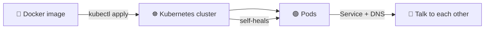
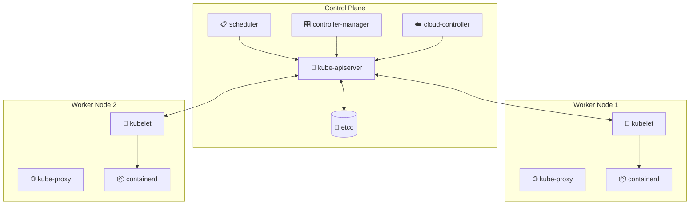
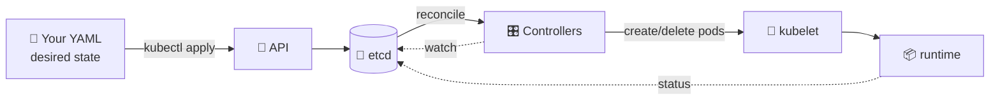
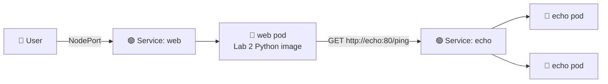
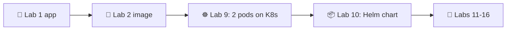

# 📌 Lecture 9 — Kubernetes Fundamentals: Container Orchestration

Лекция 9 — Основы Kubernetes: оркестрация контейнеров

## 📍 Slide 1 – ☸️ Welcome to Kubernetes

Слайд 1 — Добро пожаловать в Kubernetes

* 🌍 **Lectures 2 and 7-8 gave you a Docker image, logs, and metrics.** Now we orchestrate.
  * 🌍 **Лекции 2 и 7–8 дали тебе Docker-образ, логи и метрики.** Теперь оркестрируем.
* 🚢 **Kubernetes (K8s)** = the de-facto container orchestrator, born at Google in 2014, runs your image at scale, self-heals, rolls forward and back
  * 🚢 **Kubernetes (K8s)** — де-факто оркестратор контейнеров, родился в Google в 2014 году, запускает твой образ в масштабе, самовосстанавливается, обновляет и откатывает
* 🎯 This lecture: the mental model + just enough API to deploy your Lab 2 image as a real *cloud-native* workload
  * 🎯 Эта лекция: ментальная модель + ровно столько API, чтобы задеплоить образ из лабы 2 как настоящую *cloud-native*-нагрузку
* 🔗 **Tie-in to Lab 9:** you'll spin up a local cluster with **k3d** (k3s-in-Docker), deploy two pods (your Python service + a provided Go echo plumbing service), and meet them through `Service` and kube-DNS
  * 🔗 **Связь с лабой 9:** ты поднимешь локальный кластер на **k3d** (k3s-in-Docker), задеплоишь два пода (свой Python-сервис и готовый Go-сервис echo для связки) и познакомишься с ними через `Service` и kube-DNS



Схема: 🐳 Docker-образ → (kubectl apply) → ☸️ кластер Kubernetes; кластер создаёт 🟢 поды, поды общаются друг с другом через Service + DNS, а Kubernetes самовосстанавливает их.

---

## 📍 Slide 2 – 🎯 Learning Outcomes

Слайд 2 — Результаты обучения

| # | Outcome |
|---|---------|
| 1 | 🧠 Explain why orchestration exists and what problems Compose can't solve |
| 2 | 🏗️ Read & write `Pod`, `Deployment`, `ReplicaSet`, `Service`, `Namespace` manifests |
| 3 | 🛠️ Drive a cluster with `kubectl`: `get`, `describe`, `logs`, `exec`, `apply`, `port-forward` |
| 4 | 🔗 Understand label/selector binding — the glue of every K8s resource |
| 5 | 🌐 Reason about kube-DNS and inter-service networking (the *whole point* of running 2 pods) |
| 6 | 🩺 Configure liveness, readiness, and startup probes |

| # | Результат |
|---|-----------|
| 1 | 🧠 Объяснить, зачем нужна оркестрация и какие задачи Compose не решает |
| 2 | 🏗️ Читать и писать манифесты `Pod`, `Deployment`, `ReplicaSet`, `Service`, `Namespace` |
| 3 | 🛠️ Управлять кластером через `kubectl`: `get`, `describe`, `logs`, `exec`, `apply`, `port-forward` |
| 4 | 🔗 Понимать связывание labels/selectors — клей, соединяющий все ресурсы K8s |
| 5 | 🌐 Разбираться в kube-DNS и сетевом взаимодействии сервисов (в этом весь смысл запуска 2 подов) |
| 6 | 🩺 Настраивать liveness-, readiness- и startup-пробы |

**Tech stack pinned for May 2026:** Kubernetes **1.36** "Haru" (released Apr 22 2026), **kubectl 1.36**, **k3d 5.7+** (k3s-in-Docker — the course's standard local cluster), manifests in plain YAML (Helm comes next lecture).

**Технологический стек, зафиксированный на май 2026:** Kubernetes **1.36** «Haru» (выпущен 22 апреля 2026), **kubectl 1.36**, **k3d 5.7+** (k3s-in-Docker — стандартный локальный кластер курса), манифесты на чистом YAML (Helm будет в следующей лекции).

---

## 📍 Slide 3 – ❓ Why Compose Stops Being Enough

Слайд 3 — Почему Compose перестаёт хватать

You've shipped a single Python service (Labs 1-2), wired it through CI (Lab 3), provisioned a VM (Lab 4), configured it (Labs 5-6), and watched its logs + metrics (Labs 7-8). One service, one host, `docker compose up`. Why is that not the end of the story?

Ты уже выпустил один Python-сервис (лабы 1–2), провёл его через CI (лаба 3), подготовил виртуалку (лаба 4), настроил её (лабы 5–6) и наблюдал за логами и метриками (лабы 7–8). Один сервис, один хост, `docker compose up`. Почему это не конец истории?

* 💀 **No self-healing.** If the host dies, your service dies. Restart? You do it.
  * 💀 **Нет самовосстановления.** Если хост умирает, твой сервис умирает. Перезапуск? Сам.
* 📈 **No horizontal scaling.** Add traffic, add a second instance? You manually run a second `docker run` and put nginx in front.
  * 📈 **Нет горизонтального масштабирования.** Вырос трафик, нужен второй инстанс? Вручную запускаешь второй `docker run` и ставишь перед ним nginx.
* 🔄 **No rolling updates.** Deploying = stop / start. There is downtime.
  * 🔄 **Нет rolling updates.** Деплой = остановка и запуск. Есть простой.
* 🌐 **No service discovery.** Two services on two hosts need IP-and-port glue you maintain by hand.
  * 🌐 **Нет service discovery.** Двум сервисам на двух хостах нужна связка из IP и портов, которую ты поддерживаешь руками.
* 🛡️ **No resource isolation across tenants.** Compose is "one project per directory" not "ten teams in a cluster".
  * 🛡️ **Нет изоляции ресурсов между тенантами.** Compose — это «один проект на директорию», а не «десять команд в одном кластере».

Kubernetes solves all five — but at the cost of a steeper learning curve.

Kubernetes решает все пять проблем — но ценой более крутой кривой обучения.

> 🔥 **Reality check:** for a single small service, Compose is *still* the right answer. K8s is for when you have ≥ 3 services, multiple environments, or you need self-healing at 3am.
>
> 🔥 **Проверка реальностью:** для одного небольшого сервиса Compose — *всё ещё* правильный выбор. K8s нужен, когда у тебя ≥ 3 сервисов, несколько окружений или требуется самовосстановление в три часа ночи.

---

## 📍 Slide 4 – 📜 A Brief History

Слайд 4 — Краткая история

* 📅 **2003** — Google launches **Borg** internally. Most engineering staff use it daily; nobody outside Google knows it exists.
  * 📅 **2003** — Google запускает **Borg** внутри компании. Большинство инженеров пользуется им ежедневно; за пределами Google о нём никто не знает.
* 📅 **2014 (June)** — Google open-sources Kubernetes as the spiritual successor to Borg. Joe Beda, Brendan Burns, Craig McLuckie are the original team.
  * 📅 **2014 (июнь)** — Google открывает исходный код Kubernetes как духовного преемника Borg. Джо Беда, Брендан Бёрнс и Крейг Маклаки — исходная команда.
* 📅 **2015** — **Kubernetes 1.0** announced. CNCF (Cloud Native Computing Foundation) founded with K8s as its seed project.
  * 📅 **2015** — анонсирован **Kubernetes 1.0**. Основана CNCF (Cloud Native Computing Foundation), а K8s стал её стартовым проектом.
* 📅 **2016-2017** — *"Kubernetes the Hard Way"* (Kelsey Hightower) becomes required reading. Helm, ArgoCD, Istio appear.
  * 📅 **2016–2017** — *«Kubernetes the Hard Way»* (Келси Хайтауэр) становится обязательным чтением. Появляются Helm, ArgoCD, Istio.
* 📅 **2018** — CNCF graduates Kubernetes; managed offerings (EKS, GKE, AKS) mature.
  * 📅 **2018** — Kubernetes получает статус graduated в CNCF; управляемые сервисы (EKS, GKE, AKS) становятся зрелыми.
* 📅 **2020** — K8s deprecates Docker as a runtime (uses **containerd** directly). Your *images* still work — they're OCI.
  * 📅 **2020** — K8s объявляет Docker устаревшим как runtime (напрямую использует **containerd**). Твои *образы* по-прежнему работают — они OCI.
* 📅 **2024-2025** — Sidecar containers go GA (1.29 → 1.33). Pod security admission replaces PodSecurityPolicy (gone for good).
  * 📅 **2024–2025** — sidecar-контейнеры становятся GA (1.29 → 1.33). Pod security admission заменяет PodSecurityPolicy (который исчезает окончательно).
* 📅 **2026 (Apr 22)** — Kubernetes **1.36 "Haru"** — 70 enhancements: 18 graduating to Stable, 25 entering Beta, 25 new Alpha. Focus areas: security hardening, AI/ML workload support, API scalability.
  * 📅 **2026 (22 апреля)** — Kubernetes **1.36 «Haru»** — 70 доработок: 18 переходят в Stable, 25 в Beta, 25 новые Alpha. Ключевые направления: усиление безопасности, поддержка AI/ML-нагрузок, масштабируемость API.

> 📖 *Kubernetes Up & Running* (Burns, Beda, Hightower) — the standard intro book. The 3rd edition (2022) is still accurate at the API level for 1.36.
>
> 📖 *Kubernetes Up & Running* (Бёрнс, Беда, Хайтауэр) — стандартная вводная книга. Третье издание (2022) всё ещё точно описывает API для 1.36.

---

## 📍 Slide 5 – 🏗️ Architecture: Control Plane + Nodes

Слайд 5 — Архитектура: control plane и узлы



Схема: control plane (kube-apiserver, etcd, scheduler, controller-manager, cloud-controller) связан с kubelet на рабочих узлах; kubelet управляет containerd, а kube-proxy отвечает за сетевые правила.

* 🚪 **kube-apiserver** — the only component clients (and other plane components) talk to. RESTful gRPC over HTTP.
  * 🚪 **kube-apiserver** — единственный компонент, с которым общаются клиенты (и остальные компоненты control plane). RESTful/gRPC поверх HTTP.
* 💾 **etcd** — the source of truth. Every Pod, every Secret, every label lives here. (Plan your DR around it.)
  * 💾 **etcd** — источник истины. Каждый Pod, каждый Secret, каждый label хранится здесь. (Планируй DR с расчётом на него.)
* 📋 **scheduler** — picks which node a pending Pod should run on.
  * 📋 **scheduler** — выбирает, на каком узле запустить ожидающий Pod.
* 🎛️ **controller-manager** — runs reconciliation loops (ReplicaSet controller, Node controller, etc.). The "make reality match desired state" engine.
  * 🎛️ **controller-manager** — выполняет циклы согласования (контроллер ReplicaSet, контроллер Node и т. д.). Движок, который «приводит реальность в соответствие с желаемым состоянием».
* 🧠 **kubelet** — the node agent. Talks to the runtime (containerd), reports node + pod status back to API.
  * 🧠 **kubelet** — агент узла. Общается с runtime (containerd) и сообщает статус узла и подов обратно в API.
* 🌐 **kube-proxy** — programs iptables/IPVS/nftables rules so `Service` virtual IPs route to live pods.
  * 🌐 **kube-proxy** — настраивает правила iptables/IPVS/nftables, чтобы виртуальные IP `Service` вели к живым подам.

> 🤔 **Think:** what happens if etcd loses quorum? *(Answer: cluster freezes. No new pods, no deletions. Existing ones keep running.)*
>
> 🤔 **Подумай:** что произойдёт, если etcd потеряет кворум? *(Ответ: кластер замирает. Новые поды не создаются, удаления не проходят. Уже запущенные продолжают работать.)*

---

## 📍 Slide 6 – 🎯 The Declarative Model

Слайд 6 — Декларативная модель

You don't tell Kubernetes *what to do*; you tell it *what you want*. The control plane figures out the rest by reconciling **desired state** (your YAML) against **observed state** (what's actually running).

Ты не говоришь Kubernetes, *что делать*; ты говоришь ему, *чего хочешь*. Control plane сам разбирается с остальным, согласовывая **желаемое состояние** (твой YAML) с **наблюдаемым состоянием** (тем, что реально запущено).



Схема: YAML с желаемым состоянием → (kubectl apply) → API → etcd; контроллеры следят за etcd и создают или удаляют поды через kubelet и runtime, а статус возвращается в etcd.

* ✏️ You **edit** YAML and `kubectl apply`. Done.
  * ✏️ Ты **правишь** YAML и делаешь `kubectl apply`. Готово.
* 🔁 Controllers continuously close the gap between desired and observed.
  * 🔁 Контроллеры непрерывно сокращают разрыв между желаемым и наблюдаемым.
* 🛡️ Kill a pod manually? The ReplicaSet controller spawns another within seconds.
  * 🛡️ Убил под вручную? Контроллер ReplicaSet за секунды создаст новый.

> 📚 **This is the same paradigm as Terraform** (Lec 4) — declarative IaC, with a reconciliation loop *built into the platform itself*.
>
> 📚 **Это та же парадигма, что у Terraform** (лекция 4) — декларативный IaC, но с циклом согласования, *встроенным в саму платформу*.

---

## 📍 Slide 7 – 🟢 Pod — The Atom of K8s

Слайд 7 — Pod: атом Kubernetes

A **Pod** is one or more containers that share the same network namespace and storage volumes — scheduled together, lifecycle-managed together.

**Pod** — это один или несколько контейнеров, которые используют общее сетевое пространство имён и тома хранилища: планируются вместе и управляются по жизненному циклу вместе.

```yaml
apiVersion: v1
kind: Pod
metadata:
  name: hello-pod
  labels:
    app: hello
spec:
  containers:
    - name: web
      image: ghcr.io/innodevops/lab2-app:v1.0.0
      ports:
        - containerPort: 8080
```

Пояснение к коду: `apiVersion: v1` и `kind: Pod` задают одиночный под; метка `app: hello` позволит другим ресурсам находить его; `image` указывает образ из лабы 2, а `containerPort: 8080` — порт приложения внутри контейнера.

Key facts:

Ключевые факты:

* 🆔 Each pod gets its own IP — accessible by other pods in the cluster
  * 🆔 Каждый под получает собственный IP — доступный другим подам в кластере
* 💥 Pods are **mortal**. They die, they get rescheduled, IPs change. *Never* rely on a pod's IP from outside it.
  * 💥 Поды **смертны**. Они умирают, пересоздаются, их IP меняются. *Никогда* не полагайся на IP пода извне.
* 📦 Multi-container pods exist for the **sidecar pattern** (logging agent, proxy, init helper)
  * 📦 Многоконтейнерные поды нужны для **sidecar-паттерна** (агент логирования, прокси, init-хелпер)
* 🏷️ **Labels** are how every other resource finds this pod
  * 🏷️ **Labels** — это то, как любой другой ресурс находит этот под

> ⚠️ **Anti-pattern:** running a Pod directly. You'll lose it on the first node reboot. Always wrap with a workload controller (Deployment / StatefulSet / DaemonSet / Job).
>
> ⚠️ **Антипаттерн:** запускать Pod напрямую. Ты потеряешь его при первой же перезагрузке узла. Всегда оборачивай в контроллер нагрузки (Deployment / StatefulSet / DaemonSet / Job).

---

## 📍 Slide 8 – 🎁 Deployment + ReplicaSet — How You Actually Run Things

Слайд 8 — Deployment и ReplicaSet: как на самом деле запускают приложения

A **Deployment** declares *N pods of a given template*. It manages a **ReplicaSet** under the hood (you almost never touch ReplicaSets directly).

**Deployment** объявляет *N подов по заданному шаблону*. Под капотом он управляет **ReplicaSet** (напрямую ты к ReplicaSet почти никогда не обращаешься).

```yaml
apiVersion: apps/v1
kind: Deployment
metadata:
  name: hello
spec:
  replicas: 3
  selector:
    matchLabels:
      app: hello
  template:
    metadata:
      labels:
        app: hello
    spec:
      containers:
        - name: web
          image: ghcr.io/innodevops/lab2-app:v1.0.0
          ports: [{containerPort: 8080}]
          resources:
            requests: {cpu: 100m, memory: 64Mi}
            limits:   {cpu: 500m, memory: 256Mi}
```

Пояснение к коду: `replicas: 3` — три копии пода; `selector.matchLabels` связывает Deployment с подами по метке `app: hello`; раздел `template` описывает шаблон пода; `requests` резервирует 100m CPU и 64Mi памяти, а `limits` ограничивает контейнер значениями 500m CPU и 256Mi памяти.

* 🔄 `kubectl set image deployment/hello web=…:v1.0.1` → **rolling update** (default: 25% maxUnavailable, 25% maxSurge)
  * 🔄 `kubectl set image deployment/hello web=…:v1.0.1` → **rolling update** (по умолчанию: 25% maxUnavailable, 25% maxSurge)
* ⏪ `kubectl rollout undo deployment/hello` → roll back to the previous ReplicaSet
  * ⏪ `kubectl rollout undo deployment/hello` → откат к предыдущему ReplicaSet
* 📈 `kubectl scale deployment/hello --replicas=10` → scale up
  * 📈 `kubectl scale deployment/hello --replicas=10` → масштабирование вверх

> 🔥 **Hot take:** every "modern" stateless workload in K8s is a Deployment + Service. Master that pair and you understand 70% of cluster operations.
>
> 🔥 **Резко, но честно:** любая «современная» stateless-нагрузка в K8s — это Deployment + Service. Освой эту пару, и ты поймёшь 70% операций с кластером.

---

## 📍 Slide 9 – 🌐 Service — Stable Address for a Moving Target

Слайд 9 — Service: стабильный адрес для подвижной цели

Pods come and go; their IPs change. A **Service** is a stable virtual IP + DNS name that load-balances across all pods matching its selector.

Поды появляются и исчезают, их IP меняются. **Service** — стабильный виртуальный IP + DNS-имя, который балансирует нагрузку между всеми подами, подходящими под его селектор.

```yaml
apiVersion: v1
kind: Service
metadata:
  name: hello
spec:
  type: ClusterIP   # default — internal only
  selector:
    app: hello
  ports:
    - port: 80
      targetPort: 8080
```

Пояснение к коду: `type: ClusterIP` (по умолчанию) делает сервис доступным только внутри кластера; `selector.app: hello` находит поды по метке; `port: 80` — порт самого сервиса, `targetPort: 8080` — порт контейнера, куда уходит трафик.

| Type | Where it's reachable | When to use |
|------|---------------------|-------------|
| **ClusterIP** | Inside the cluster only | Inter-service traffic (default) |
| **NodePort** | Every node's IP:30000-32767 | Dev / quick external access |
| **LoadBalancer** | Cloud provider provisions an external LB | Production external traffic on managed K8s |
| **ExternalName** | DNS CNAME to an external host | Migration / legacy proxying |

| Тип | Где доступен | Когда использовать |
|-----|--------------|--------------------|
| **ClusterIP** | Только внутри кластера | Трафик между сервисами (по умолчанию) |
| **NodePort** | IP любого узла:30000–32767 | Разработка / быстрый внешний доступ |
| **LoadBalancer** | Облачный провайдер создаёт внешний LB | Внешний трафик в проде на управляемом K8s |
| **ExternalName** | DNS CNAME на внешний хост | Миграция / проксирование легаси |

* 🌐 Inside the cluster, the DNS name `hello.default.svc.cluster.local` (short: `hello`) resolves to the ClusterIP
  * 🌐 Внутри кластера DNS-имя `hello.default.svc.cluster.local` (коротко: `hello`) резолвится в ClusterIP
* ⚖️ `kube-proxy` programs iptables/IPVS rules; traffic is round-robin'd across healthy pods
  * ⚖️ `kube-proxy` настраивает правила iptables/IPVS; трафик распределяется по кругу между здоровыми подами
* 🚪 For HTTP ingress from outside, use `Ingress` or `Gateway API` (touched in Lab 9 bonus + Lab 13)
  * 🚪 Для HTTP-входа снаружи используй `Ingress` или `Gateway API` (затрагиваются в бонусе лабы 9 и лабе 13)

---

## 📍 Slide 10 – 🔗 Why Two Pods Suddenly Makes Sense

Слайд 10 — Почему два пода внезапно обретают смысл

Up through Lab 8 you ran **one** service. `Service` and kube-DNS felt like overkill — "why a stable IP for one thing?"

До лабы 8 включительно ты запускал **один** сервис. `Service` и kube-DNS казались избыточными — «зачем стабильный IP для одной штуки?»

**Lab 9 introduces a SECOND service** (a small Go "echo" companion, shipped by the course as plumbing in `app_go_echo/`). Now the picture changes:

**Лаба 9 вводит ВТОРОЙ сервис** (маленький Go-компаньон «echo», который курс поставляет как связку в `app_go_echo/`). И картина меняется:



Схема: пользователь попадает на Service web через NodePort; web-под (Python-образ из лабы 2) вызывает `http://echo:80/ping`; Service echo балансирует трафик между двумя echo-подами.

Suddenly:

И вот что меняется:

* 🌐 **kube-DNS does real work** — `echo` resolves to a load-balanced ClusterIP
  * 🌐 **kube-DNS делает реальную работу** — `echo` резолвится в балансируемый ClusterIP
* ⚖️ **Service load-balances** across two `echo` pods — kill one, traffic keeps flowing
  * ⚖️ **Service балансирует нагрузку** между двумя подами `echo` — убей один, трафик продолжит идти
* 🏷️ **Labels matter** — `app=echo` is how `Service: echo` finds its targets, regardless of which node they land on
  * 🏷️ **Labels имеют значение** — по `app=echo` сервис `Service: echo` находит свои цели, на каком бы узле они ни оказались
* 🩺 **Probes start earning their keep** — the `web` pod's readiness probe might fail if `echo` is down (depending on how you wire it)
  * 🩺 **Пробы начинают оправдывать себя** — readiness-проба пода `web` может упасть, если `echo` недоступен (зависит от того, как ты её настроишь)

> 🔗 **This is the pedagogical core of Lab 9.** The 2nd service isn't busywork — it's the smallest topology in which "the K8s networking model" stops being abstract.
>
> 🔗 **Это педагогическое ядро лабы 9.** Второй сервис — не искусственная нагрузка, а минимальная топология, в которой «сетевая модель K8s» перестаёт быть абстракцией.

---

## 📍 Slide 11 – 🏷️ Labels & Selectors — The Glue

Слайд 11 — Labels и selectors: связующий клей

Labels are key/value tags on any K8s object. Selectors query objects by their labels. **Almost every controller works by selector**:

Labels — это теги «ключ/значение» на любом объекте K8s. Селекторы ищут объекты по их меткам. **Почти каждый контроллер работает через селектор**:

* 🎁 `Deployment.spec.selector` → finds the pods it owns
  * 🎁 `Deployment.spec.selector` → находит поды, которыми владеет
* 🌐 `Service.spec.selector` → finds the pods it routes to
  * 🌐 `Service.spec.selector` → находит поды, на которые направляет трафик
* 🛡️ `NetworkPolicy.podSelector` → finds the pods it firewalls
  * 🛡️ `NetworkPolicy.podSelector` → находит поды, которые экранирует
* 📊 `ServiceMonitor.spec.selector` → finds the services to scrape (Lab 16)
  * 📊 `ServiceMonitor.spec.selector` → находит сервисы для сбора метрик (лаба 16)

```yaml
metadata:
  labels:
    app: hello                   # 🎯 functional
    version: v1.2.3              # 📌 release tracking
    env: prod                    # 🚦 environment
    team: payments               # 🤝 ownership
    tier: backend                # 🧱 architecture role
```

Пояснение к коду: показаны типичные метки пода — функциональная (`app`), версия релиза (`version`), окружение (`env`), владелец (`team`) и архитектурная роль (`tier`).

```bash
kubectl get pods -l app=hello,env=prod         # 🎯 AND selector
kubectl get pods -l 'tier in (frontend,api)'   # 🔀 set-based selector
```

Пояснение к командам: селектор `-l app=hello,env=prod` требует совпадения обеих меток (логическое И); селектор `-l 'tier in (frontend,api)'` работает по множеству значений.

> 🔥 **Convention:** use `app.kubernetes.io/name`, `app.kubernetes.io/version`, `app.kubernetes.io/managed-by` — the "recommended labels" namespace. Helm and ArgoCD set these automatically.
>
> 🔥 **Соглашение:** используй `app.kubernetes.io/name`, `app.kubernetes.io/version`, `app.kubernetes.io/managed-by` — пространство «рекомендуемых меток». Helm и ArgoCD проставляют их автоматически.

---

## 📍 Slide 12 – 🛠️ kubectl — The Survival Toolkit

Слайд 12 — kubectl: набор для выживания

You will run these every day. Memorize them.

Ты будешь запускать эти команды каждый день. Запомни их.

```bash
kubectl get pods,svc,deploy -A              # 🔍 list everything across all namespaces
kubectl get pod hello-abc -o yaml           # 📄 show full manifest
kubectl describe pod hello-abc              # 🩺 events + state details — your debugging starting point
kubectl logs hello-abc -f                   # 📋 tail logs; -c <container> for multi-container pods
kubectl logs hello-abc --previous           # ⏪ logs from the previous (crashed) container
kubectl exec -it hello-abc -- /bin/sh       # 🐚 shell into the pod
kubectl port-forward svc/hello 8080:80      # 🚪 tunnel a service to localhost
kubectl apply -f manifest.yaml              # ✏️ create/update declaratively
kubectl delete -f manifest.yaml             # 🗑️ delete what's in that file
kubectl rollout status deploy/hello         # 📊 watch a rolling update
kubectl rollout undo deploy/hello           # ⏪ revert to previous ReplicaSet
kubectl top pod                             # 📊 live CPU/mem (needs metrics-server)
```

Пояснение к командам: `get` выводит ресурсы, `describe` — события и состояние, `logs` читает логи (в том числе предыдущего контейнера), `exec` заходит внутрь пода, `port-forward` пробрасывает сервис на localhost, `apply` и `delete` работают декларативно по файлу, `rollout` следит за обновлением и откатывает его, `top` показывает потребление CPU и памяти.

> 🔧 **Setup tip:** `alias k=kubectl` and `kubectl completion bash` (or zsh). Run `kubectl explain pod.spec.containers` for inline schema docs.
>
> 🔧 **Совет по настройке:** сделай `alias k=kubectl` и подключи `kubectl completion bash` (или zsh). Команда `kubectl explain pod.spec.containers` даёт встроенную справку по схеме.

---

## 📍 Slide 13 – 💻 Local Clusters with k3d

Слайд 13 — Локальные кластеры с k3d

Production K8s runs on managed services (EKS, GKE, AKS). For learning and CI you need a cluster on your laptop. **This course standardizes on k3d** — it wraps **k3s** (Rancher's lightweight, CNCF-certified Kubernetes) inside Docker containers.

Продакшен-K8s работает на управляемых сервисах (EKS, GKE, AKS). Для учёбы и CI нужен кластер на ноутбуке. **Этот курс стандартизируется на k3d** — он упаковывает **k3s** (лёгкий Kubernetes от Rancher, сертифицированный CNCF) в Docker-контейнеры.

```bash
k3d cluster create devops \
  --image rancher/k3s:v1.36.1-k3s1 \
  --agents 2 \
  -p "8080:80@loadbalancer" -p "8443:443@loadbalancer"
```

Пояснение к командам: создаётся кластер `devops` на образе `rancher/k3s:v1.36.1-k3s1` с двумя рабочими агентами; порты 8080 и 8443 пробрасываются через loadbalancer.

Why k3d over the alternatives:

Почему k3d, а не альтернативы:

* ⚡ **Fastest + lightest** — a cluster comes up in seconds; far smaller footprint than minikube's VM
  * ⚡ **Самый быстрый и лёгкий** — кластер поднимается за секунды; значительно меньше ресурсов, чем у VM в minikube
* 🧱 **Free multi-node** — `--agents N` adds worker containers, so pod scheduling across nodes is observable
  * 🧱 **Мультиузловой кластер бесплатно** — `--agents N` добавляет рабочие контейнеры, так что планирование подов по узлам можно наблюдать
* 🔋 **Batteries included** — built-in **Traefik** ingress and **klipper** LoadBalancer mean `Ingress` and `type: LoadBalancer` work with no extra install
  * 🔋 **Всё из коробки** — встроенный ingress **Traefik** и LoadBalancer **klipper** позволяют `Ingress` и `type: LoadBalancer` работать без дополнительной установки
* 🔁 **Throwaway** — `k3d cluster delete devops` and start fresh
  * 🔁 **Одноразовость** — `k3d cluster delete devops`, и начинаешь заново

> 💡 **Tradeoff to know:** k3d runs k3s, which trims some legacy APIs and ships **Traefik** (not ingress-nginx) plus klipper-lb. For everything in this course those differences are invisible; the one place it shows up is `ingressClassName: traefik`. Don't use Docker Desktop's bundled K8s — it lags upstream.
>
> 💡 **Компромисс, о котором стоит знать:** k3d работает на k3s, который урезает часть legacy-API и поставляется с **Traefik** (а не ingress-nginx) и klipper-lb. В рамках этого курса различия незаметны; единственное место, где они проявляются, — `ingressClassName: traefik`. Не используй K8s из Docker Desktop — он отстаёт от upstream.

---

## 📍 Slide 14 – 📦 Namespaces — Multi-Tenancy Within a Cluster

Слайд 14 — Namespaces: мультитенантность внутри кластера

A **Namespace** scopes most resources (pods, services, configmaps, secrets, deployments). It's how you carve a cluster up across teams or environments.

**Namespace** ограничивает область большинства ресурсов (подов, сервисов, configmaps, secrets, deployments). Так ты делишь кластер между командами или окружениями.

```bash
kubectl create namespace dev
kubectl apply -f manifest.yaml -n dev       # 🧱 deploy into dev
kubectl get pods -n dev                     # 🔍 list pods in dev
kubectl config set-context --current --namespace=dev   # 🎯 stick to dev
```

Пояснение к командам: создаётся namespace `dev`; флаг `-n dev` направляет команды в него; `set-context --current --namespace=dev` закрепляет namespace по умолчанию для текущего контекста.

Default namespaces every cluster has:

Namespace по умолчанию в каждом кластере:

* `default` — where stuff lands if you don't say
  * `default` — куда попадает всё, если не указать другое
* `kube-system` — control plane components (don't touch)
  * `kube-system` — компоненты control plane (не трогай)
* `kube-public` — world-readable; mostly cluster info
  * `kube-public` — читается всеми; в основном информация о кластере
* `kube-node-lease` — node heartbeats
  * `kube-node-lease` — heartbeats узлов

> 🚫 **Anti-pattern:** running everything in `default`. Always pick a namespace per app or environment.
>
> 🚫 **Антипаттерн:** запускать всё в `default`. Всегда выбирай namespace под приложение или окружение.

---

## 📍 Slide 15 – ⚖️ Resource Requests, Limits, and QoS

Слайд 15 — Requests, limits и QoS

Every container declares **requests** (the scheduler reserves this much) and **limits** (the kernel kills it if it goes over).

Каждый контейнер объявляет **requests** (столько планировщик резервирует) и **limits** (если превысить — ядро убивает контейнер).

```yaml
resources:
  requests:
    cpu: 100m       # 0.1 of a CPU core
    memory: 64Mi
  limits:
    cpu: 500m       # 0.5 core; CPU is *throttled* past this, not killed
    memory: 256Mi   # memory is *killed* (OOMKill) past this
```

Пояснение к коду: `requests` резервирует 0,1 ядра CPU и 64Mi памяти; при превышении лимита CPU `500m` контейнер троттлится, а при превышении лимита памяти `256Mi` его убивает OOMKill.

| Class | Requests vs Limits | Eviction priority |
|-------|--------------------|--------------------|
| **Guaranteed** | requests == limits, all containers | last to evict |
| **Burstable** | requests < limits | middle |
| **BestEffort** | no requests or limits | first to evict |

| Класс | Requests и limits | Приоритет вытеснения |
|-------|-------------------|----------------------|
| **Guaranteed** | requests == limits, во всех контейнерах | вытесняется последним |
| **Burstable** | requests < limits | средний |
| **BestEffort** | нет requests и limits | вытесняется первым |

> ⚠️ **Production rule:** always set requests for CPU and memory; set memory limits aggressively, set CPU limits *only* when noisy-neighbor is hurting other workloads. CPU throttling is a frequent silent latency killer.
>
> ⚠️ **Правило для прода:** всегда задавай requests для CPU и памяти; лимиты памяти ставь агрессивно, а лимиты CPU — *только* когда «шумный сосед» мешает другим нагрузкам. Троттлинг CPU — частая незаметная причина задержек.

---

## 📍 Slide 16 – 🩺 Probes: liveness, readiness, startup

Слайд 16 — Пробы: liveness, readiness, startup

K8s checks your pod's health through three probes. **They are not interchangeable.**

K8s проверяет здоровье пода с помощью трёх проб. **Они не взаимозаменяемы.**

```yaml
livenessProbe:    # 💀 if this fails, restart the container
  httpGet: {path: /healthz, port: 8080}
  initialDelaySeconds: 15
  periodSeconds: 10
readinessProbe:   # 🚦 if this fails, take the pod out of Service rotation (don't restart)
  httpGet: {path: /ready, port: 8080}
  periodSeconds: 5
startupProbe:     # 🐢 for slow-starting apps; disables the other two until it passes once
  httpGet: {path: /healthz, port: 8080}
  failureThreshold: 30
  periodSeconds: 10
```

Пояснение к коду: `livenessProbe` перезапускает контейнер при провале; `readinessProbe` выводит под из ротации Service, но не перезапускает; `startupProbe` даёт медленно стартующим приложениям время и отключает две другие пробы, пока не пройдёт успешно.

* 💀 **Liveness** = "should I be killed and restarted?" — for deadlocks, not transient errors
  * 💀 **Liveness** = «меня нужно убить и перезапустить?» — для дедлоков, а не временных ошибок
* 🚦 **Readiness** = "should traffic come to me right now?" — for warmup, dependency outages
  * 🚦 **Readiness** = «можно направлять трафик прямо сейчас?» — для прогрева и недоступности зависимостей
* 🐢 **Startup** (since 1.16, GA in 1.20) = "give me a long initial window without flapping"
  * 🐢 **Startup** (с 1.16, GA в 1.20) = «дай мне большое стартовое окно без мигания»

> 🔥 **Common mistake:** using `livenessProbe: /` against the app's main HTTP root. If your app slows down under load, K8s restarts it, making things worse. Liveness should check a *cheap, in-process* signal.
>
> 🔥 **Частая ошибка:** ставить `livenessProbe: /` на главный HTTP-корень приложения. Если приложение замедляется под нагрузкой, K8s перезапускает его, делая только хуже. Liveness должен проверять *дешёвый сигнал внутри процесса*.

---

## 📍 Slide 17 – ✨ What's New in Kubernetes 1.36 "Haru"

Слайд 17 — Что нового в Kubernetes 1.36 «Haru»

Released April 22 2026. Highlights worth knowing:

Выпущен 22 апреля 2026 года. Что стоит знать:

* 🛡️ **Pod Security Admission (PSA)** matures further — the replacement for the long-deprecated PodSecurityPolicy
  * 🛡️ **Pod Security Admission (PSA)** становится зрелее — замена давно устаревшему PodSecurityPolicy
* 🤖 **AI/ML workload support** — Device Resource Allocation API, better GPU sharing primitives (alpha → beta)
  * 🤖 **Поддержка AI/ML-нагрузок** — Device Resource Allocation API, улучшенные примитивы разделения GPU (alpha → beta)
* 📈 **API scalability** — improvements to apiserver caching reduce control-plane load on large clusters
  * 📈 **Масштабируемость API** — улучшения кеширования apiserver снижают нагрузку на control plane в больших кластерах
* 🧱 **Sidecar containers** (`restartPolicy: Always` on init containers) — GA since 1.33; standard in observability stacks (Alloy, Istio)
  * 🧱 **Sidecar-контейнеры** (`restartPolicy: Always` у init-контейнеров) — GA с 1.33; стандарт в стеке наблюдаемости (Alloy, Istio)
* 🚫 **Gone for good:** several legacy `v1beta1` APIs continue retiring
  * 🚫 **Уходят окончательно:** продолжается вывод из эксплуатации нескольких legacy-API `v1beta1`
* 📦 **Image volumes** (alpha) — mount an OCI image as a read-only volume. Useful for ML models.
  * 📦 **Image volumes** (alpha) — монтируют OCI-образ как том только для чтения. Полезно для ML-моделей.

The N-2 support policy means clusters running **1.34, 1.35, 1.36** are in standard support. **1.33 entered extended support** as of April 2026.

Политика поддержки N-2 означает, что кластеры на **1.34, 1.35, 1.36** находятся в стандартной поддержке. **1.33 перешёл в расширенную поддержку** с апреля 2026 года.

> 📚 **Source:** [Kubernetes 1.36 release blog](https://kubernetes.io/blog/2026/04/22/kubernetes-v1-36-release/).
>
> 📚 **Источник:** [блог о релизе Kubernetes 1.36](https://kubernetes.io/blog/2026/04/22/kubernetes-v1-36-release/).

---

## 📍 Slide 18 – ☁️ Production: Managed vs Self-Hosted

Слайд 18 — Продакшен: managed или self-hosted

| Approach | Examples | When |
|----------|----------|------|
| ☁️ **Managed** | EKS (AWS), GKE (Google), AKS (Azure), DOKS, OKE | 99% of teams — you don't run the control plane |
| 🪛 **Self-hosted on VMs** | kubeadm + Ansible, kops, RKE2, Talos | Air-gapped, regulated, cost-driven, or strong K8s expertise on staff |
| 🚫 **DIY from scratch** | "Kubernetes the Hard Way" (Hightower) | Educational only — never run this in prod |

| Подход | Примеры | Когда |
|--------|---------|-------|
| ☁️ **Managed** | EKS (AWS), GKE (Google), AKS (Azure), DOKS, OKE | 99% команд — control plane эксплуатирует провайдер |
| 🪛 **Self-hosted на VM** | kubeadm + Ansible, kops, RKE2, Talos | Изолированные сети, регулирование, экономия или сильная экспертиза по K8s в штате |
| 🚫 **DIY с нуля** | «Kubernetes the Hard Way» (Хайтауэр) | Только для обучения — никогда не запускай в проде |

**Cost realism (May 2026):** an empty 3-node managed cluster (control plane + 3× small workers) lands around **$200-300/month** on AWS or GCP for entry-tier. That cost climbs fast with autoscaling and persistent volumes.

**Реальная стоимость (май 2026):** пустой управляемый кластер из трёх узлов (control plane + 3 маленьких воркера) обходится примерно в **$200–300/месяц** на AWS или GCP по начальному тарифу. С автоскейлингом и persistent volumes цена быстро растёт.

> 🔥 **Hot take:** unless your CIO has a specific reason, use a managed cluster. The control plane is the messy bit; let the cloud run it.
>
> 🔥 **Резко, но честно:** если у твоего CIO нет особой причины, используй управляемый кластер. Control plane — самая хлопотная часть; пусть облако ею занимается.

---

## 📍 Slide 19 – 🌍 Kubernetes in the Wild

Слайд 19 — Kubernetes в реальной жизни

* 🎬 **Netflix** — was actually a Mesos shop until ~2019; now ~1000 microservices on K8s
  * 🎬 **Netflix** — на самом деле до ~2019 года использовал Mesos; теперь около 1000 микросервисов на K8s
* 💬 **GitHub** — Actions runners are ephemeral K8s pods; ~100M pod-runs/month
  * 💬 **GitHub** — раннеры Actions — это эфемерные поды K8s; ~100 млн запусков подов в месяц
* 🏦 **Goldman Sachs** — internal "Marquee" trading platform runs on K8s across thousands of clusters
  * 🏦 **Goldman Sachs** — внутренняя торговая платформа «Marquee» работает на K8s в тысячах кластеров
* 🇨🇳 **Alibaba** — operates K8s clusters with **>10,000 nodes** each; submitted scalability patches upstream
  * 🇨🇳 **Alibaba** — эксплуатирует кластеры K8s по **>10 000 узлов** каждый; отправила патчи масштабируемости в upstream
* 🛰️ **SpaceX** — Starlink ground station services run on K8s
  * 🛰️ **SpaceX** — сервисы наземных станций Starlink работают на K8s

> 📊 **CNCF Annual Survey 2024:** 96% of organizations are using or evaluating Kubernetes. The container orchestration war ended; K8s won.
>
> 📊 **Годовой опрос CNCF 2024:** 96% организаций используют или оценивают Kubernetes. Война оркестраторов контейнеров закончилась; K8s победил.

---

## 📍 Slide 20 – 🎯 Key Takeaways

Слайд 20 — Главное из лекции

1. ☸️ **Kubernetes is declarative orchestration.** You describe desired state; controllers reconcile.
   * ☸️ **Kubernetes — декларативная оркестрация.** Ты описываешь желаемое состояние, контроллеры его согласовывают.
2. 🟢 **Pod = smallest deployable unit; Deployment = how you actually run it; Service = how you reach it.**
   * 🟢 **Pod — мельчайшая единица деплоя; Deployment — как ты реально запускаешь; Service — как до него добираешься.**
3. 🏷️ **Labels are the glue.** Every controller binds by selector.
   * 🏷️ **Labels — это клей.** Каждый контроллер привязывается через селектор.
4. 🌐 **Service + kube-DNS is the killer feature.** It only makes sense once you have ≥ 2 services — which is exactly what Lab 9 sets up.
   * 🌐 **Service + kube-DNS — главная фишка.** Она имеет смысл только при ≥ 2 сервисах — именно это и настраивает лаба 9.
5. 🩺 **Probes ≠ interchangeable.** Liveness restarts; readiness gates traffic; startup buys warmup time.
   * 🩺 **Пробы не взаимозаменяемы.** Liveness перезапускает; readiness отсекает трафик; startup даёт время на прогрев.
6. ⚖️ **Always set requests; be surgical with limits.** CPU throttling is silent and painful.
   * ⚖️ **Всегда задавай requests; с лимитами действуй точечно.** Троттлинг CPU незаметен и болезнен.
7. 🪨 **For local dev this course uses k3d** — k3s-in-Docker: fast, multi-node, batteries included.
   * 🪨 **Для локальной разработки курс использует k3d** — k3s-in-Docker: быстрый, мультиузловой, всё из коробки.

> 💡 **The pattern:** YAML → API → etcd → controllers → kubelet → containerd → your container. Every K8s mystery resolves to that chain.
>
> 💡 **Схема:** YAML → API → etcd → контроллеры → kubelet → containerd → твой контейнер. Любая загадка K8s сводится к этой цепочке.

---

## 📍 Slide 21 – 🧠 The Mindset Shift

Слайд 21 — Смена мышления

| 😰 Pre-K8s | ☸️ K8s-native |
|---------|---------|
| "SSH in and restart the service" | `kubectl rollout restart deployment/...` |
| "Add an instance? edit nginx + a Compose file" | `kubectl scale deploy/... --replicas=N` |
| "What's the prod IP?" | "DNS name is `svc.namespace`" |
| "We need a load balancer" | "It's a `Service`" |
| "Onboard a new dev = 3-page README" | `git clone && kubectl apply -k overlays/dev` |
| Hand-rolled health checks via cron | Probes are first-class in the manifest |

| 😰 До K8s | ☸️ Нативный K8s |
|---------|---------|
| «Зайти по SSH и перезапустить сервис» | `kubectl rollout restart deployment/...` |
| «Добавить инстанс? правим nginx и Compose-файл» | `kubectl scale deploy/... --replicas=N` |
| «Какой IP в проде?» | «DNS-имя — `svc.namespace`» |
| «Нам нужен балансировщик» | «Это `Service`» |
| «Подключить нового разработчика = README на три страницы» | `git clone && kubectl apply -k overlays/dev` |
| Самодельные health checks через cron | Пробы — первоклассная сущность манифеста |

---

## 📍 Slide 22 – 🚀 What Comes Next

Слайд 22 — Что дальше

**📚 Next lecture: *Helm Package Manager (Helm 4)*** — because writing raw YAML for every environment doesn't scale.

**📚 Следующая лекция: *пакетный менеджер Helm (Helm 4)*** — потому что писать сырой YAML под каждое окружение не масштабируется.

* 📦 Why Helm exists (DRY for K8s manifests)
  * 📦 Зачем нужен Helm (DRY для манифестов K8s)
* 🧱 Chart anatomy: `Chart.yaml`, `values.yaml`, `templates/`, `_helpers.tpl`
  * 🧱 Анатомия чарта: `Chart.yaml`, `values.yaml`, `templates/`, `_helpers.tpl`
* 🎨 Go template language + Sprig functions
  * 🎨 Язык шаблонов Go + функции Sprig
* 🪝 Hooks: pre-install, post-upgrade, etc.
  * 🪝 Хуки: pre-install, post-upgrade и т. д.
* 🆕 Helm **4.1** — what changed vs Helm 3, and why we use 4 in Lab 10
  * 🆕 Helm **4.1** — что изменилось по сравнению с Helm 3 и почему в лабе 10 мы используем 4

**🔬 Lab 9 deliverables:**

**🔬 Что нужно сдать в лабе 9:**

* Stand up a k3d cluster (1 server + 2 agents)
  * Поднять кластер k3d (1 сервер + 2 агента)
* Deploy the Lab 2 Python image as a Deployment
  * Задеплоить Python-образ из лабы 2 как Deployment
* Add the provided Go echo service (plumbing)
  * Добавить готовый Go-сервис echo (связка)
* Wire both with `Service` + verify `curl http://echo:80/ping` from inside the Python pod
  * Связать оба через `Service` и проверить `curl http://echo:80/ping` изнутри Python-пода
* Bonus 2 pts: enable Ingress with a TLS cert (NIP.io domain or self-signed)
  * Бонус 2 балла: включить Ingress с TLS-сертификатом (домен NIP.io или самоподписанный)



Схема: приложение из лабы 1 → образ из лабы 2 → лаба 9: два пода в K8s → лаба 10: Helm-чарт → дальнейшие лабы 11–16.

> 🌊 From single container to cluster — one manifest at a time.
>
> 🌊 От одного контейнера к кластеру — по одному манифесту за раз.

---

## 📚 Resources

📚 Материалы

* 📕 *Kubernetes Up & Running* (3e, 2022) — Burns, Beda, Hightower (still accurate at the API level for 1.36)
  * 📕 *Kubernetes Up & Running* (3-е изд., 2022) — Бёрнс, Беда, Хайтауэр (по-прежнему точно описывает API для 1.36)
* 📕 *Kubernetes in Action* (2e, 2023) — Marko Lukša (Manning)
  * 📕 *Kubernetes in Action* (2-е изд., 2023) — Марко Лукша (Manning)
* 📕 *Programming Kubernetes* — Hausenblas & Schimanski (O'Reilly, 2019) — for writing controllers
  * 📕 *Programming Kubernetes* — Хаузенблас и Шимански (O'Reilly, 2019) — о написании контроллеров
* 🎥 *Kubernetes the Hard Way* — Kelsey Hightower (free, GitHub) — install K8s yourself, once
  * 🎥 *Kubernetes the Hard Way* — Келси Хайтауэр (бесплатно, GitHub) — установи K8s сам, один раз
* 🌐 [kubernetes.io/docs](https://kubernetes.io/docs/) — official; the concepts section is excellent
  * 🌐 [kubernetes.io/docs](https://kubernetes.io/docs/) — официальная документация; раздел Concepts отличный
* 🌐 [Kubernetes 1.36 release notes](https://kubernetes.io/blog/2026/04/22/kubernetes-v1-36-release/)
  * 🌐 [Release notes Kubernetes 1.36](https://kubernetes.io/blog/2026/04/22/kubernetes-v1-36-release/)
* 🌐 [learnk8s.io](https://learnk8s.io/) — visual, scenario-based explainers (Daniele Polencic)
  * 🌐 [learnk8s.io](https://learnk8s.io/) — наглядные разборы по сценариям (Даниэле Поленчич)
* 🌐 [CNCF Cloud Native Landscape](https://landscape.cncf.io) — every tool in the ecosystem mapped
  * 🌐 [CNCF Cloud Native Landscape](https://landscape.cncf.io) — все инструменты экосистемы на одной карте

**🎓 Quiz:** post-lecture quiz feeds the weeks 7-9 leaderboard window.

**🎓 Квиз:** квиз после лекции идёт в зачёт лидерборда недель 7–9.
